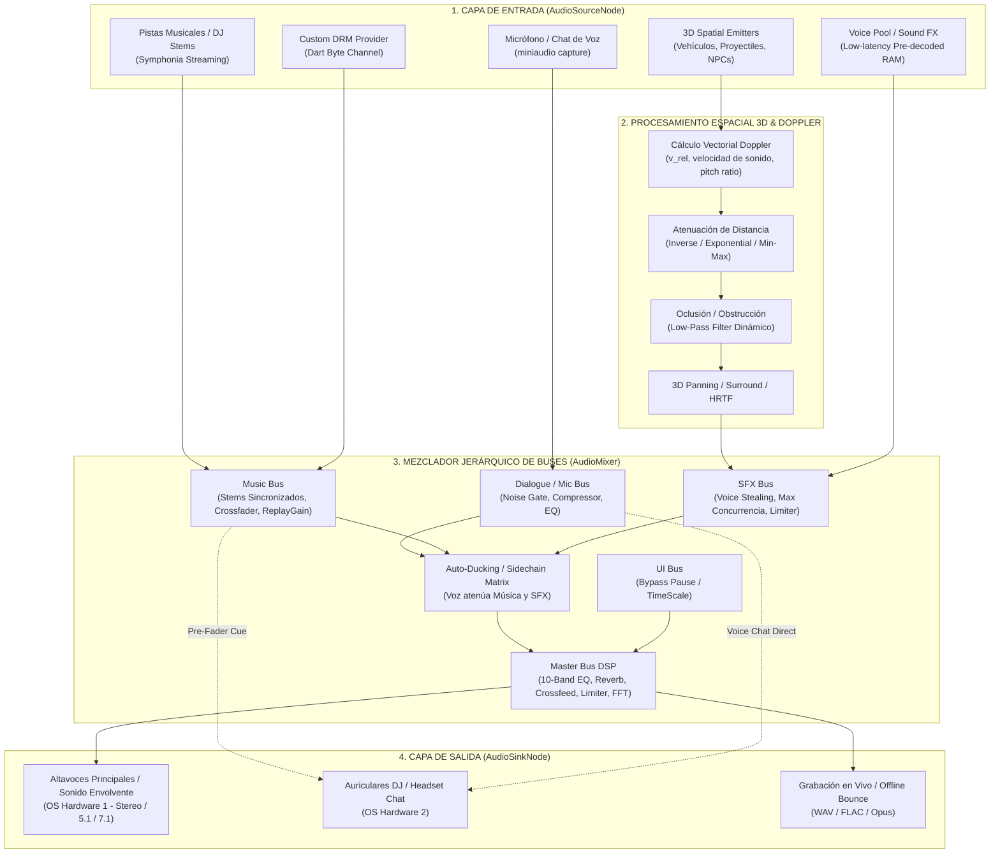
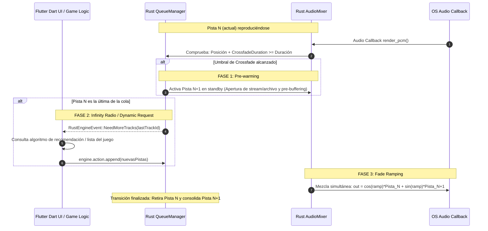
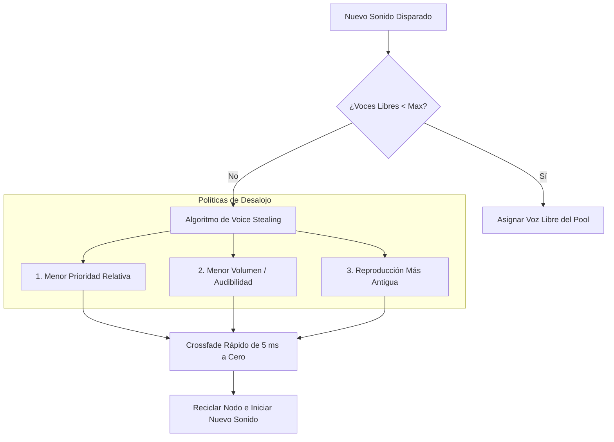
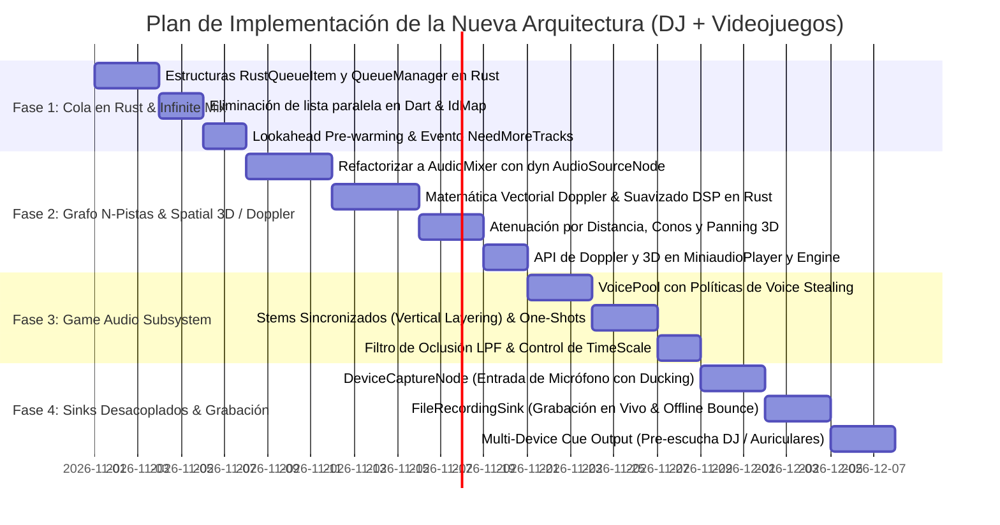

# Especificación Arquitectónica: Motor de Audio de Gráfico Modular (Audio Graph Engine) para DJ y Videojuegos

**Documento:** `NEW_FORMAT.md`  
**Estado:** Propuesta de Diseño Técnico y Especificación de Implementación Unificada  
**Alcance:** Cola Autoritativa en Rust, Infinite Mix, Mezclador Dinámico de $N$-Pistas, Audio Espacial 3D, Efecto Doppler, Gestión de Voces para Videojuegos (Voice Stealing), Música Adaptativa (Stems) y Desacoplamiento de Entradas (`AudioSourceNode`) y Salidas (`AudioSinkNode`).

---

## Tabla de Contenidos
1. [Visión y Objetivos: Doble Propósito (DJ & Videojuegos)](#1-visión-y-objetivos-doble-propósito-dj--videojuegos)
2. [Gestión de Cola Autoritativa en Rust y Shadow Mapping en Dart](#2-gestión-de-cola-autoritativa-en-rust-y-shadow-mapping-en-dart)
   - 2.1 Estructuras de Datos en Rust
   - 2.2 Sincronización y Mapeo Genérico `<T>` en Dart
   - 2.3 Operaciones de Cola Libres de Bloqueos (Lock-Free)
   - 2.4 Comportamiento en Segundo Plano (Mobile OS Background Playback)
3. [Especificación Técnica de "Infinite Mix"](#3-especificación-técnica-de-infinite-mix)
   - 3.1 Lookahead Pre-warming & Gapless Transition
   - 3.2 Autoplay Dinámico (Infinity Radio / Pipeline Request)
   - 3.3 Interacción con Políticas de Loop y Barajado
4. [Abstracción de Grafo de Audio: Entradas Desacopladas (`AudioSourceNode`)](#4-abstracción-de-grafo-de-audio-entradas-desacopladas-audiosourcenode)
   - 4.1 Trait Común `AudioSourceNode`
   - 4.2 Decodificadores de Pistas (`TrackSourceNode`)
   - 4.3 Captura de Hardware del SO (`DeviceCaptureNode`: Mic / Line-In)
   - 4.4 Clips Rápidos y Efectos de Sonido (`SoundFxNode`)
   - 4.5 Proveedores Personalizados (`CustomSourceNode`: DRM / Cifrado)
5. [Audio Espacial 3D y Efecto Doppler](#5-audio-espacial-3d-y-efecto-doppler)
   - 5.1 Fundamentos Físicos y Matemáticos del Efecto Doppler
   - 5.2 Parámetros del Oyente (`SpatialListener3D`) y Emisores (`SpatialEmitter3D`)
   - 5.3 Modelos de Atenuación de Distancia y Conos de Proyección
   - 5.4 Algoritmo DSP Libre de Clics para el Cambio de Frecuencia Doppler
   - 5.5 Soporte de Doppler en `MiniaudioPlayer` Individual y en el Grafo
6. [Subsistema de Audio para Videojuegos (Game Audio Engine)](#6-subsistema-de-audio-para-videojuegos-game-audio-engine)
   - 6.1 Pool de Voces Polifónicas y Algoritmos de Desalojo (Voice Stealing)
   - 6.2 Disparo de One-Shots de Ultrabaja Latencia con Variación Aleatoria
   - 6.3 Música Adaptativa Dinámica: Capas Verticales (Stems) y Transiciones por Compás
   - 6.4 Simulación Ambiental: Filtro de Oclusión / Obstrucción (Dynamic LPF)
   - 6.5 Escala Temporal del Juego (TimeScale / Bullet-Time & Tape-Stop)
7. [Núcleo de Mezcla y Jerarquía de Buses (`AudioMixer`)](#7-núcleo-de-mezcla-y-jerarquía-de-buses-audiomixer)
   - 7.1 Evolución de 2 Decks a $N$-Pistas Dinámicas
   - 7.2 Estructura Jerárquica de Buses (Master, Music, SFX, Dialogue, Ambience, UI)
   - 7.3 Módulo de Auto-Ducking / Sidechain Automático
   - 7.4 Separación Estricta de DSP (Por Nodo vs. Por Bus vs. Master)
8. [Abstracción de Salidas Desacopladas (`AudioSinkNode`)](#8-abstracción-de-salidas-desacopladas-audiosinknode)
   - 8.1 Trait Común `AudioSinkNode`
   - 8.2 Salidas Físicas Múltiples (Master + Cue DJ / Chat Auriculares)
   - 8.3 Compensación de Desfase de Reloj (Clock Drift)
   - 8.4 Grabador de Mezcla a Archivo (`FileRecordingSink`: Live & Offline Bounce)
   - 8.5 Broadcast / Network Stream Sink
9. [Diseño de la API Pública en Dart](#9-diseño-de-la-api-pública-en-dart)
10. [Plan de Migración e Implementación Faseada](#10-plan-de-migración-e-implementación-faseada)

---

## 1. Visión y Objetivos: Doble Propósito (DJ & Videojuegos)

Tanto un software para DJ profesional como el motor de audio de un videojuego contemporáneo comparten demandas técnicas idénticas:
* **Latencia ultrabaja determinista** (< 5 ms en el buffer de hardware).
* **Manejo concurrente de múltiples fuentes de audio** (decenas de SFX en juegos, múltiples pistas/stems/jingles en DJ).
* **Procesamiento de pitch y tiempo en tiempo real** (beatmatching y timestretching en DJ, efecto Doppler y pitch-shifting por eventos en juegos).
* **Enrutamiento multibus con ducking/sidechain** (micrófono sobre música en DJ, diálogos sobre explosiones/música en juegos).
* **Múltiples destinos de salida** (altavoces de sala y auriculares de preescucha en DJ; sonido envolvente 5.1/7.1 y canal separado para chat de voz en juegos).



### Principios Rectores:
1. **Un solo motor en Rust (Single Source of Truth)**: Todo el cálculo matemático (vectores 3D, Doppler, mezclas PCM, resampling, colas) ocurre en Rust en tiempo real.
2. **Garantía Libre de Bloqueos en el Hilo de Audio**: Cero asignaciones (`malloc`/`free`), cero mutexes bloqueantes del SO y cero interferencias de recolección de basura (GC) en la ruta crítica del hardware de audio.
3. **Dart como Fachada Reactiva**: Dart actúa exclusivamente como puente de comandos y receptor de telemetría de eventos.

---

## 2. Gestión de Cola Autoritativa en Rust y Shadow Mapping en Dart

### 2.1 Estructuras de Datos en Rust

La cola se almacena en `EngineCoordinator` protegida por un `RwLock` para lecturas ultrarrápidas, y sus índices y estados operan mediante atómicos:

```rust
// rust/src/core/queue.rs

#[derive(Debug, Clone)]
pub struct RustQueueItem {
    pub id: u64,
    pub source: AudioSourcePayload,
    pub replay_gain_db: Option<f32>,
    pub metadata_tag: Option<String>,
}

#[derive(Debug, Clone)]
pub enum AudioSourcePayload {
    Path(String),
    NetworkUrl { url: String, headers: Vec<(String, String)> },
    Memory(Vec<u8>),
    CustomProviderId(u32),
}

pub struct QueueManager {
    items: Vec<RustQueueItem>,
    current_index: AtomicIsize,
    loop_mode: AtomicU8, // 0: Off, 1: All, 2: One
    shuffle: AtomicBool,
    shuffle_order: Vec<usize>,
    next_item_id: AtomicU64,
}
```

### 2.2 Sincronización y Mapeo Genérico `<T>` en Dart

Dart mantiene únicamente un mapa de consulta asociativa indexado por el `u64 id` de Rust:

```dart
// lib/src/api/miniaudio_engine.dart

class MiniaudioEngine<T> {
  final Map<int, T> _shadowMetadata = {};

  Future<void> openQueue(List<EngineItem<T>> items) async {
    _shadowMetadata.clear();
    final rustItems = items.map((item) {
      final id = _generateNextId();
      _shadowMetadata[id] = item.data;
      return item.toRustPayload(id);
    }).toList();

    _rustEngine.openQueue(rustItems);
  }

  T? get currentItemMetadata {
    final currentId = _rustEngine.getCurrentTrackId();
    return _shadowMetadata[currentId];
  }
}
```

---

## 3. Especificación Técnica de "Infinite Mix"



### 3.1 Lookahead Pre-warming & Gapless Transition
- **Cálculo de Umbral**: En cada bloque de audio, el monitor de Rust evalúa:
  $$\Delta t = \text{duración} - \text{posición}$$
  Si $\Delta t \le t_{\text{crossfade}}$, se lanza de inmediato la preparación de la pista siguiente.
- **Cero Latencia**: Al iniciarse el crossfade, la pista entrante ya cuenta con muestras decodificadas listas en memoria RAM.

### 3.2 Autoplay Dinámico (Infinity Radio / Game Event Pipeline)
- Si `infiniteMixEnabled` está activo:
  - Cuando restan menos de 2 pistas en cola, Rust emite:
    ```rust
    RustEngineEvent::NeedMoreTracks {
        current_track_id: u64,
        remaining_tracks: usize,
    }
    ```
  - Dart responde invocando `append()` con nuevas pistas antes de que se agote la lista actual.

---

## 4. Abstracción de Grafo de Audio: Entradas Desacopladas (`AudioSourceNode`)

### 4.1 Trait Común `AudioSourceNode`

```rust
// rust/src/core/nodes/source.rs

pub trait AudioSourceNode: Send {
    /// Identificador único del nodo en el grafo
    fn id(&self) -> u32;

    /// Renderiza tramas PCM f32 en formato nativo del motor (interleaved)
    fn pull_frames(&mut self, output: &mut [f32], frame_count: usize) -> usize;

    /// Indica si el nodo sigue produciendo audio o ha llegado a EOF / finalizado
    fn is_active(&self) -> bool;

    /// Notifica comandos de seek al nodo
    fn seek(&mut self, position_ms: i64) -> Result<(), String>;

    /// Prioridad del nodo para el sistema de Voice Stealing (Juegos)
    fn priority(&self) -> u8 { 128 }

    /// Libera recursos internos (archivos, sockets, buffers)
    fn close(&mut self);
}
```

### 4.2 Tipos de Nodos de Entrada
* **`TrackSourceNode`**: Decodificación en streaming para canciones largas (MP3, FLAC, WAV, AAC, OGG, Opus, DSF, WV, MKA) usando Symphonia. Dispone de ajustes de velocidad/pitch (`SonicStream`) y resampleo (`RubatoResampler`).
* **`DeviceCaptureNode`**: Captura de hardware de micrófono o interfaz de línea vía `miniaudio.h` en modo captura (`ma_device_type_capture`). Alimenta el bus de voz/chat.
* **`SoundFxNode` / `OneShotNode`**: Tramas PCM 100% pre-decodificadas en RAM para disparo instantáneo (< 1 ms). Ideal para jingles de DJ y efectos sonoros de juegos (disparos, pasos, UI).
* **`CustomSourceNode`**: Streaming protegido y DRM mediante puente interactivo de bytes con Dart (`CustomByteProvider`).

---

## 5. Audio Espacial 3D y Efecto Doppler

Tanto para juegos 3D/2D como para simulaciones acústicas avanzadas de DJ (por ejemplo, posicionar virtualmente platos en un espacio binaural o simular un club nocturno), el motor implementa un subsistema de posicionamiento tridimensional.

### 5.1 Fundamentos Físicos y Matemáticos del Efecto Doppler

El efecto Doppler simula la compresión y dilatación de las ondas acústicas causada por el movimiento relativo entre una fuente emisora de sonido y el oyente (*Listener*).

```
          v_emitter (ve)                     v_listener (vl)
             ┌───►                                ┌───►
        [ Emitter ] ═════════════════════════> [ Listener ]
                                r_hat
                         (Vector Dirección)
```

#### Ecuación Física Unificada:
La frecuencia percibida por el oyente ($f_{\text{perc}}$) con respecto a la frecuencia emitida original ($f_0$) se calcula como:

$$f_{\text{perc}} = f_0 \cdot \left[ 1.0 + \lambda_{\text{doppler}} \cdot \left( \frac{c - (\vec{v}_{\text{listener}} \cdot \hat{r})}{c - (\vec{v}_{\text{emitter}} \cdot \hat{r})} - 1.0 \right) \right]$$

Donde:
* $c$: Velocidad del sonido en el medio (configurable; por defecto $343.3 \text{ m/s}$ o unidades de juego equivalentes).
* $\vec{p}_{\text{listener}}, \vec{v}_{\text{listener}}$: Vector de posición y vector de velocidad del oyente en $\mathbb{R}^3$.
* $\vec{p}_{\text{emitter}}, \vec{v}_{\text{emitter}}$: Vector de posición y vector de velocidad del emisor en $\mathbb{R}^3$.
* $\vec{r} = \vec{p}_{\text{listener}} - \vec{p}_{\text{emitter}}$: Vector relativo de desplazamiento desde el emisor al oyente.
* $\hat{r} = \frac{\vec{r}}{\|\vec{r}\|}$: Vector unitario que define la línea de visión del emisor al oyente.
* $\lambda_{\text{doppler}}$: Factor de escala Doppler (rango $[0.0, 5.0]$). Un valor de $0.0$ desactiva el efecto; $1.0$ representa la física real; $> 1.0$ exagera el efecto para diseño sonoro dramático en videojuegos.

#### Clamping de Seguridad y Prevención de Singularidades:
Para evitar divisiones entre cero y singularidades supersónicas (cuando $\vec{v}_{\text{emitter}} \to c$, es decir, la barrera del sonido Mach 1):
$$\vec{v}_{\text{proj}} = \text{clamp}(\vec{v} \cdot \hat{r}, -0.9 \cdot c, 0.9 \cdot c)$$
El ratio resultante de pitch $R = \frac{f_{\text{perc}}}{f_0}$ se restringe estrictamente dentro del intervalo seguro $[0.1, 4.0]$.

### 5.2 Parámetros del Oyente (`SpatialListener3D`) y Emisores (`SpatialEmitter3D`)

```rust
// rust/src/core/spatial.rs

#[derive(Debug, Clone, Copy)]
pub struct Vector3 {
    pub x: f32,
    pub y: f32,
    pub z: f32,
}

impl Vector3 {
    pub fn zero() -> Self { Self { x: 0.0, y: 0.0, z: 0.0 } }
    pub fn dot(&self, other: &Self) -> f32 { self.x * other.x + self.y * other.y + self.z * other.z }
    pub fn length(&self) -> f32 { (self.x.powi(2) + self.y.powi(2) + self.z.powi(2)).sqrt() }
    pub fn normalize(&self) -> Self {
        let len = self.length();
        if len > 1e-6 { Self { x: self.x / len, y: self.y / len, z: self.z / len } } else { Self::zero() }
    }
}

pub struct SpatialListener3D {
    pub position: Vector3,
    pub velocity: Vector3,
    pub forward: Vector3,
    pub up: Vector3,
}

pub struct SpatialEmitter3D {
    pub position: Vector3,
    pub velocity: Vector3,
    pub direction: Option<Vector3>,
    pub min_distance: f32,      // Distancia por debajo de la cual el volumen es 100%
    pub max_distance: f32,      // Distancia a la cual cesa la audibilidad
    pub rolloff_factor: f32,    // Coeficiente de atenuación
    pub doppler_factor: f32,    // Multiplicador del efecto Doppler (0.0 - 5.0)
    pub inner_angle: f32,       // Ángulo interno del cono de emisión (radianes)
    pub outer_angle: f32,       // Ángulo externo del cono de emisión
    pub outer_gain: f32,        // Atenuación fuera del cono
}
```

### 5.3 Modelos de Atenuación de Distancia y Conos de Proyección

El cálculo de ganancia por distancia soporta los tres modelos estándar de la industria (OpenAL / Wwise):
1. **Inverse Distance Model (Físicamente realista)**:
   $$\text{Gain}_{\text{dist}} = \frac{d_{\text{min}}}{d_{\text{min}} + \text{rolloff} \cdot (\text{clamp}(d, d_{\text{min}}, d_{\text{max}}) - d_{\text{min}})}$$
2. **Linear Attenuation (Común en juegos arcade)**:
   $$\text{Gain}_{\text{dist}} = 1.0 - \text{rolloff} \cdot \frac{\text{clamp}(d, d_{\text{min}}, d_{\text{max}}) - d_{\text{min}}}{d_{\text{max}} - d_{\text{min}}}$$
3. **Exponential Distance Model**:
   $$\text{Gain}_{\text{dist}} = \left(\frac{\text{clamp}(d, d_{\text{min}}, d_{\text{max}})}{d_{\text{min}}}\right)^{-\text{rolloff}}$$

### 5.4 Algoritmo DSP Libre de Clics para el Cambio de Frecuencia Doppler

En el hilo de audio en tiempo real, las actualizaciones de posición y velocidad procedentes de la lógica del juego ocurren típicamente a 60 Hz o 120 Hz, mientras que el buffer de audio opera a 48.000 Hz. Una aplicación abrupta del ratio Doppler produciría chasquidos ("clicks/zippering").

Para garantizar fluidez cristalina:
1. **Slew-Rate Limiter (Interpolación de Primer Orden)**:
   $$R_{\text{current}} \leftarrow R_{\text{current}} + \alpha \cdot (R_{\text{target}} - R_{\text{current}})$$
   donde el coeficiente de suavizado $\alpha = 1.0 - e^{-\frac{\Delta t}{\tau}}$ con $\tau \approx 20\text{ ms}$.
2. **Integración con `SonicStream` / Resampler**:
   El ratio $R_{\text{current}}$ modula continuamente la velocidad de reproducción de `Sonic` sin alterar la afinación base preconfigurada de la pista o efecto sonoro.

### 5.5 Soporte de Doppler en `MiniaudioPlayer` Individual y en el Grafo

El efecto Doppler se habilita tanto a nivel de reproductor aislado como en el grafo modular completo:
* **En `MiniaudioPlayer`**:
  ```dart
  final player = MiniaudioPlayer(AudioSource('/assets/audio/race_car.wav'));
  player.spatial.setSpeedOfSound(343.3);
  player.spatial.setDopplerFactor(1.2);
  player.spatial.setListenerPosition(Vector3(0, 0, 0));
  player.spatial.setListenerVelocity(Vector3(0, 0, 0));

  // Actualización periódica en el bucle del juego (ej. Flame / Flutter Ticker)
  player.spatial.setEmitterPosition(Vector3(carX, carY, carZ));
  player.spatial.setEmitterVelocity(Vector3(carVx, carVy, carVz));
  ```
* **En el Grafo `MiniaudioEngine`**:
  Los emisores 3D se asocian a nodos `SpatialEmitterNode` que reportan su matriz de posición y velocidad en cada render block.

---

## 6. Subsistema de Audio para Videojuegos (Game Audio Engine)

### 6.1 Pool de Voces Polifónicas y Algoritmos de Desalojo (Voice Stealing)

Un videojuego puede disparar cientos de sonidos por segundo (ráfagas de armas, pisadas de múltiples personajes, partículas de sonido). Abrir archivos o asignar memoria dinámica en cada impacto causaría caídas de fotogramas y fallos de audio.



#### Estructura del Voice Manager en Rust:
```rust
// rust/src/core/game/voice_pool.rs

pub struct VoicePool {
    max_voices: usize,
    active_voices: Vec<PooledVoiceNode>,
    free_indices: Vec<usize>,
}

pub struct PooledVoiceNode {
    pub source: Box<dyn AudioSourceNode>,
    pub priority: u8, // 0: Mínima (ej. pisadas lejanas), 255: Crítica (ej. diálogo principal)
    pub start_time_ms: u64,
    pub calculated_gain: f32,
    pub is_fading_out: bool,
}

impl VoicePool {
    pub fn play_sound(&mut self, source: Box<dyn AudioSourceNode>, priority: u8) -> Option<u32> {
        if self.active_voices.len() < self.max_voices {
            return Some(self.insert_voice(source, priority));
        }

        // Voice Stealing: Buscar la voz menos audible o de menor prioridad
        if let Some(steal_idx) = self.find_victim_voice(priority) {
            self.active_voices[steal_idx].quick_fadeout_and_replace(source, priority);
            Some(self.active_voices[steal_idx].source.id())
        } else {
            None // Sonido descartado porque las voces actuales tienen prioridad superior
        }
    }
}
```

### 6.2 Disparo de One-Shots de Ultrabaja Latencia con Variación Aleatoria

Para evitar la fatiga auditiva de repetición ("machine-gun effect") común cuando un arma o paso suena idéntico decenas de veces consecutivas:
* **Jitter Aleatorio de Pitch y Volumen**: Cada disparo puede alterar aleatoriamente su pitch ($\pm 5\%$) y su volumen ($\pm 2\text{ dB}$) en Rust de forma automática.
* **Cero Asignaciones**: El audio reside precargado como buffer crudo PCM en memoria RAM (`SharedMemorySource`).

### 6.3 Música Adaptativa Dinámica: Capas Verticales (Stems) y Transiciones por Compás

Los videojuegos modernos adaptan su música según el nivel de tensión o combate mediante dos técnicas que el motor soporta nativamente:

#### 1. Vertical Layering (Capas Sincronizadas en Fase por Muestra):
Se reproducen $N$ pistas de audio en paralelo (por ejemplo: Pista 1: Bajo y Batería, Pista 2: Sintetizadores, Pista 3: Orquesta de Combate) enganchadas estrictamente al **mismo reloj de muestras PCM**:
- En estado de exploración: Ganancia Pista 1 = $1.0$, Pistas 2 y 3 = $0.0$.
- Al entrar en combate: Ganancia Pista 2 sube a $1.0$ en 500 ms; Pista 3 sube a $1.0$ de manera instantánea.
- Cero desfasaje de fase entre stems.

#### 2. Horizontal Re-sequencing (Transición Musical por Compás / Beat Sync):
En lugar de saltar inmediatamente o en un crossfade temporal arbitrario, el motor calcula el tempo (BPM) y realiza el cambio de sección en el siguiente compás musical (*Downbeat / Next Bar*).

### 6.4 Simulación Ambiental: Filtro de Oclusión / Obstrucción (Dynamic LPF)

Cuando un emisor de sonido se encuentra detrás de una pared o puerta cerrada con respecto al jugador:
* El motor calcula un coeficiente de oclusión $[0.0, 1.0]$.
* Un filtro `BiquadFilter` pasa-bajas (LPF) de segundo orden ajusta suavemente su frecuencia de corte:
  $$f_{\text{corte}} = 20.000\text{ Hz} \cdot (1.0 - \text{oclusión}) + 400\text{ Hz} \cdot \text{oclusión}$$
* La señal directa se oscurece mientras que el envío a la reverberación ambiental puede mantenerse, recreando acústica espacial realista sin plugins externos.

### 6.5 Escala Temporal del Juego (TimeScale / Bullet-Time & Tape-Stop)

En videojuegos con mecánicas de cámara lenta (*bullet-time*), pausa activa o efectos de frenado (*tape-stop*):
* `engine.game.setTimeScale(factor, preservePitch: bool)`:
  - Si `preservePitch == true`: Modifica la velocidad conservando la afinación mediante `SonicStream`.
  - Si `preservePitch == false`: Emula la desaceleración física analógica de vinilo / cinta (varispeed), bajando tanto el tempo como el pitch armónicamente.

---

## 7. Núcleo de Mezcla y Jerarquía de Buses (`AudioMixer`)

### 7.1 Evolución de 2 Decks a $N$-Pistas Dinámicas

En lugar de crear 2 instancias fijas de reproductores completos, el motor opera un árbol de mezcla dinámico:

```rust
// rust/src/core/mixer.rs

pub struct AudioMixer {
    music_bus: AudioBusNode,
    sfx_bus: AudioBusNode,
    dialogue_bus: AudioBusNode,
    ui_bus: AudioBusNode,
    ambience_bus: AudioBusNode,
    master_bus: MasterBusNode,
    sidechain_matrix: SidechainMatrix,
    scratch_buffer: Vec<f32>,
    sample_rate: u32,
    channels: usize,
}
```

### 7.2 Estructura Jerárquica de Buses

```
[ Pista DJ A / Stem 1 ] ──┐
[ Pista DJ B / Stem 2 ] ──┼──> [ Music Bus ] ────┐
                                                │
[ Gunshot 3D SFX ] ───────┐                     │
[ Footstep SFX ] ─────────┼──> [ SFX Bus ] ─────┼──> [ Sidechain Matrix ] ──> [ Master Bus ] ──> Salidas
                                                │    (Voz atenúa Música
[ Mic / Dialogue NPC ] ──────> [ Dialogue Bus ] ┘     y Efectos de fondo)
                                                      
[ UI Click / Menú ] ─────────────────────────────────────────────────────────> (Directo al Master)
```

### 7.3 Módulo de Auto-Ducking / Sidechain Automático

Para DJs (micrófono sobre música) y Videojuegos (diálogos o chat de voz sobre música/efectos):
- **Detección RMS**: El `DialogueBus` monitoriza el nivel de señal.
- **Atenuación**: Si $\text{RMS} > -32\text{ dB}$, se aplica una curva de atenuación configurable (ej. $-14\text{ dB}$) sobre `MusicBus` y `SfxBus` en 30 ms (*Attack*).
- **Recuperación Suave**: Retorno a $0\text{ dB}$ en 400 ms (*Release*) tras 250 ms de silencio (*Hold*).

### 7.4 Separación Estricta de DSP

| Nivel de Procesamiento | Componentes | Dominio |
| :--- | :--- | :--- |
| **Por Nodo / Pista (`AudioSourceNode`)** | Efecto Doppler, Atenuación 3D, Panorámica, Filtro de Oclusión LPF, ReplayGain. | Parámetros específicos de cada sonido individual. |
| **Por Bus (`AudioBusNode`)** | Volúmenes de categoría (Música, SFX, Diálogo, UI), Voice Stealing, Ducking sidechain. | Control de volumen y mezcla de grupos coherentes. |
| **Maestro (`MasterBus`)** | Ecualizador paramétrico de 10 bandas, BS2B Crossfeed, Freeverb, Limitador suave, FFT Visualizer. | Protección de salida, acústica global y telemetría de espectro. |

---

## 8. Abstracción de Salidas Desacopladas (`AudioSinkNode`)

### 8.1 Trait Común `AudioSinkNode`

```rust
// rust/src/core/nodes/sink.rs

pub trait AudioSinkNode: Send {
    /// Envía tramas PCM mezcladas finales
    fn push_frames(&mut self, frames: &[f32], frame_count: usize);

    /// Señaliza fin de flujo o limpieza de buffers
    fn flush(&mut self);
}
```

### 8.2 Salidas Físicas Múltiples (Master + Cue DJ / Chat Auriculares)
- **Sink Principal (`MasterDeviceSink`)**: Conectado a los altavoces de sala / interfaz estéreo o 5.1/7.1.
- **Sink Secundario (`CueDeviceSink`)**: Conectado a la salida de auriculares para el DJ (preescucha) o al canal de auriculares del jugador (chat de voz de equipo independiente del sonido del juego).

### 8.3 Compensación de Desfase de Reloj (Clock Drift)
Cuando se conectan dos dispositivos de hardware físico independientes (ej. Tarjeta de sonido USB + Auriculares Bluetooth), los relojes de cristal divergen ligeramente. Un `RubatoResampler` dinámico compensa el desvío sin saltos audibles ni desbordamientos de buffer.

### 8.4 Grabador de Mezcla a Archivo (`FileRecordingSink`)
- **Grabación en Vivo**: Vía anillo SPSC sin bloqueo hacia un hilo de codificación a WAV (32-bit float / 24-bit PCM), FLAC o Opus.
- **Offline Bounce (Render Fuera de Línea)**: Renderizado ultrarrápido al 100% de la capacidad de la CPU. Permite generar la mezcla de un nivel o set de DJ de 1 hora en menos de 20 segundos.

---

## 9. Diseño de la API Pública en Dart

La API unificada satisface con elegancia los casos de uso tanto de DJ como de Videojuegos:

```dart
// ==========================================
// CASO 1: USO COMO REPRODUCTOR / DJ ENGINE
// ==========================================
final djEngine = MiniaudioEngine<TrackMeta>();

// 1. Configuración de salidas: Altavoces Master + Auriculares Cue para Pre-escucha
await djEngine.action.configureOutputs(
  masterDevice: AudioDevice.auto,
  cueDevice: AudioDevice.fromId('headphone_cue_id'),
  recordPath: '/storage/dj_set_session.flac',
);

// 2. Micrófono con Auto-Ducking para locución sobre la música
await djEngine.action.enableMicrophone(
  autoDucking: true,
  duckingDb: -14.0,
);

// 3. Cola autoritativa con Infinite Mix
await djEngine.action.setInfiniteMix(true);
await djEngine.action.openQueue([
  EngineItem.from('https://cdn.example.com/track1.mp3', data: meta1),
  EngineItem.from('/storage/music/track2.flac', data: meta2),
]);
await djEngine.action.play();


// ==========================================
// CASO 2: USO EN VIDEOJUEGOS (3D & DOPPLER)
// ==========================================
final gameAudio = MiniaudioEngine();

// 1. Configurar posición del Jugador / Cámara (Listener 3D)
gameAudio.spatial.setListener(
  position: Vector3(playerX, playerY, playerZ),
  velocity: Vector3(playerVx, playerVy, playerVz),
  forward: Vector3(camLookX, camLookY, camLookZ),
  up: Vector3(0.0, 1.0, 0.0),
);

// 2. Disparo de Efecto de Sonido One-Shot (con Voice Stealing y Jitter aleatorio)
gameAudio.game.playOneShot(
  AudioSource('/assets/audio/laser_shot.wav'),
  position: Vector3(enemyX, enemyY, enemyZ),
  velocity: Vector3(enemyVx, enemyVy, enemyVz),
  dopplerFactor: 1.0,
  pitchJitter: 0.05, // Variación aleatoria +/- 5%
  volumeJitter: 1.5, // Variación +/- 1.5 dB
  priority: 180,     // Prioridad de desalojo
);

// 3. Vehículo en Movimiento con Efecto Doppler Activo en un MiniaudioPlayer
final raceCarPlayer = MiniaudioPlayer(AudioSource('/assets/audio/engine_loop.wav'));
raceCarPlayer.spatial.enable3D(true);
raceCarPlayer.spatial.setDopplerFactor(1.5); // Doppler acentuado

// En el bucle de actualización (Game Loop):
void onGameTick(double dt) {
  raceCarPlayer.spatial.setEmitter(
    position: Vector3(car.x, car.y, car.z),
    velocity: Vector3(car.vx, car.vy, car.vz),
  );
}

// 4. Música Adaptativa por Stems Verticales
await gameAudio.game.loadAdaptiveMusic([
  MusicStem(id: 'base_drums', source: AudioSource('/music/stems/drums.ogg'), volume: 1.0),
  MusicStem(id: 'combat_strings', source: AudioSource('/music/stems/strings.ogg'), volume: 0.0),
  MusicStem(id: 'boss_lead', source: AudioSource('/music/stems/lead.ogg'), volume: 0.0),
]);

// Al entrar en combate: transición suave de stems en fase perfecta
gameAudio.game.fadeStem('combat_strings', targetVolume: 1.0, durationMs: 400);

// 5. Cámara Lenta (Bullet-Time)
gameAudio.game.setTimeScale(0.3, preservePitch: false); // Varispeed realista
```

---

## 10. Plan de Migración e Implementación Faseada



### Resumen de Beneficios Finales:
- **Solución Única para Dos Industrias**: Un solo núcleo en Rust de alto rendimiento que satisface tanto sets de DJ profesionales como videojuegos con audio 3D posicional inmersivo y polifonía masiva.
- **Efecto Doppler Físico**: Simulación exacta con vectores de velocidad relativa para emisor y oyente, interpolación anti-clics y factor configurable.
- **Rendimiento Máximo en Videojuegos**: Manejo de decenas de efectos concurrentes gracias al Voice Stealing, buffers precargados en RAM y música adaptativa sincronizada por compás.
- **Cero Mutexes en la Ruta Crítica**: La mezcla, el paneo 3D y el resampling transcurren de forma lock-free en el callback de audio del sistema operativo.
