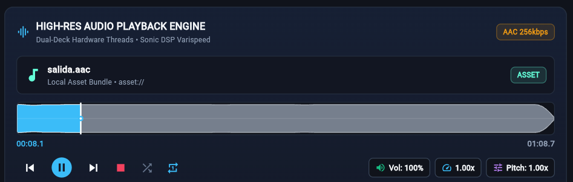
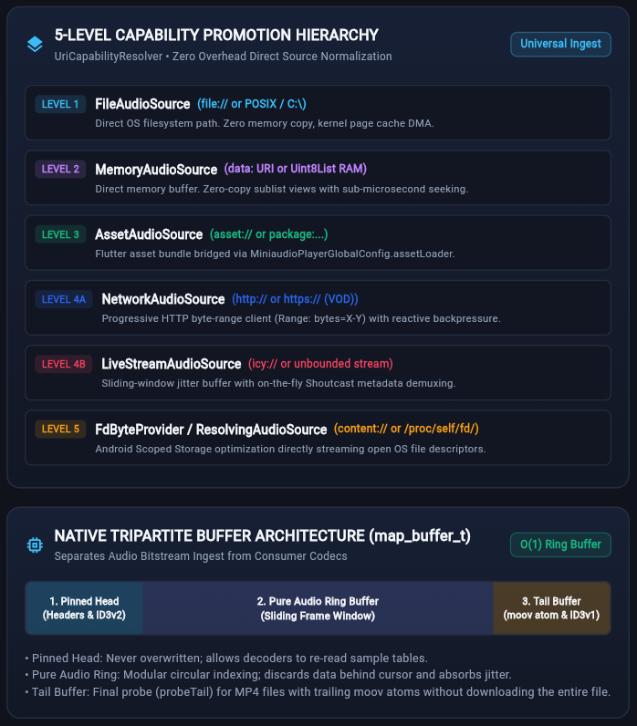

<div align="center">


[](https://pub.dev/packages/miniaudio_player)
[](LICENSE)
[](#architecture-highlights)
[](#supported-formats--codecs)
[](#platform-support)

**The high-performance native audio engine for Flutter & Dart — powered by a lock-free Rust DSP & decoding core (`miniaudio_player_rust` + Symphonia 0.6), a minimal C99 `miniaudio` hardware bridge, and `flutter_rust_bridge` v2.**

</div>

---

## Table of Contents

- [Table of Contents](#table-of-contents)
- [Why miniaudio\_player v4.0.0?](#why-miniaudio_player-v400)
- [Core Capabilities](#core-capabilities)
- [Supported Formats \& Codecs](#supported-formats--codecs)
- [Platform Support](#platform-support)
- [Installation \& Initialization](#installation--initialization)
  - [Web Setup (Required Cross-Origin Isolation Headers)](#web-setup-required-cross-origin-isolation-headers)
- [Quick Start](#quick-start)
- [API Highlights \& Recipes](#api-highlights--recipes)
  - [Dual-Deck Crossfade, Shuffle \& Infinite Mix](#dual-deck-crossfade-shuffle--infinite-mix)
  - [DSP Mastering, Equalizer, Reverb \& ReplayGain](#dsp-mastering-equalizer-reverb--replaygain)
  - [64-Voice Polyphonic RAM Effects \& 3D Spatial / Doppler](#64-voice-polyphonic-ram-effects--3d-spatial--doppler)
  - [Multi-Output Matrix, DJ CUE, Auto-Ducking \& WAV Recording](#multi-output-matrix-dj-cue-auto-ducking--wav-recording)
  - [Single-Pass Acoustic Analysis (`BS.1770-4`, Waveform, Lofty, Chromaprint)](#single-pass-acoustic-analysis-bs1770-4-waveform-lofty-chromaprint)
  - [Custom Pull Streaming (`CustomByteProvider`)](#custom-pull-streaming-custombyteprovider)
- [Studio Master Console Showcase \& Screenshot Guide](#studio-master-console-showcase--screenshot-guide)
  - [1. Studio Master Console Overview](#1-studio-master-console-overview)
  - [2. Row 1 (`2:2:1`) — Playback, Queue \& Effects](#2-row-1-221--playback-queue--effects)
  - [3. Row 2 (`1:2`) — Hardware Routing, Visualizer \& Unified DSP Suite](#3-row-2-12--hardware-routing-visualizer--unified-dsp-suite)
  - [4. Dedicated `Audio Analyzer` \& `Ingest & Buffer Matrix` Tabs](#4-dedicated-audio-analyzer--ingest--buffer-matrix-tabs)
  - [Manual Screenshot Update Checklist](#manual-screenshot-update-checklist)
- [Architecture Highlights](#architecture-highlights)
- [License \& Links](#license--links)

---

## Why miniaudio_player v4.0.0?

`miniaudio_player` 4.0.0 moves decoding, buffering, resampling, mixing, DSP, spatialization, recording, and analysis into a dedicated **pure-Rust engine core** driven by a single-owner real-time thread (`map-engine-clock`), leaving `miniaudio.h` focused strictly on low-level OS device I/O (`ma_context` / `ma_device`).

- **No Dart Isolate Audio Bottlenecks**: All decoding, ring buffering, DSP filtering, and polyphonic mixing run natively in compiled Rust (`opt-level = "s"`, `lto = true`, AVX2/FMA & NEON SIMD).
- **Wait-Free Real-Time Audio Path**: Hardware callbacks pull from lock-free `rtrb` SPSC ring buffers, UI visualizer metrics publish through `CachePaddedSeqlock`, and displaced native objects drop asynchronously on `map-reaper`.
- **Zero Duplicate RAM Ownership**: Passing `Uint8List` / `List<int>` or `AudioEffect` bytes hands ownership straight to Rust and releases Dart heap buffers immediately.
- **Canonical 3-Namespace API**: Control everything from music playlists and HLS streams to 64-voice 3D SFX, multi-room hardware routing, and WAV recording through one class: `MiniaudioPlayer<T>` (`.action`, `.state`, `.stream`).

---

## Core Capabilities

- **Unified `MiniaudioPlayer<T>` API**: Strict separation of imperative controls (`player.action`), $O(1)$ synchronous snapshots (`player.state`), and reactive broadcast telemetry (`player.stream`).
- **Universal `AudioSource<T>` + 3-Plane `StreamSession`**:
  - Accepts local files, `asset://` paths, `Uint8List` / `List<int>`, `data:` URIs, `http(s)://` VOD (HTTP `Range`), live `icy://` radio streams, `.m3u8` **HLS with AES-128-CBC decryption & MPEG-TS demuxing**, and `CustomByteProvider` pull streams.
  - Isolates pinned container headers (`Linear` `Head >= 64 KB`), a sliding circular audio ring (`Body`), and sparse tag storage (`Sparse` `BTreeMap`) with 3-phase progressive block coalescing (`UrgentBootstrap` -> `Stabilization` -> `CoalescedCruise` 15s super-blocks).
  - Multi-lane `IoWorkerPool` (`1` zero-wait local lane + `4` rapid-skip coalesced network workers with epoch cancellation and background standby pre-warming).
- **Dual-Deck Engine & Gapless/Crossfade Transitions**: Alternating Deck A / Deck B pipelines with `CrossfadeCurve.equalPower` or `linear`, manual/automatic overlap durations, native monotonic 64-bit queue IDs, `reorderByIds`, Fisher-Yates shuffle, and `InfiniteMixConfig` auto-fill (`stream.needMoreTracks`).
- **Full Rust DSP Suite (`f32` SIMD)**:
  - **10-Band ISO 266 Parametric Equalizer**: Direct Form II Transposed (`DF2T`) biquad cascade + Preamp (`dB`).
  - **Algorithmic Reverb**: Stereo Freeverb (`roomSize`, `damping`, `width`, `wet`, `dry`) + 6 presets.
  - **Bauer BS2B Headphone Crossfeed**, **Mid/Side Stereo Widener**, **Mono Downmix**, **Stereo Balance**.
  - **Sonic Time-Stretching & Pitch Shifting** + **Rubato** high-order resampler.
  - **Smart Silence Skipping FSM**: `trimEdges`, `continuous`, and `all` modes with 5 ms smooth crossfades and `silenceSavedDuration` telemetry.
  - **Per-Deck ReplayGain**: Isolated per-deck loudness normalization (`disabled`, `track`, `forced`) eliminating double-scaling or jumps during crossfades, plus **Soft-Knee Brickwall Peak Limiter**.
- **64-Voice Polyphonic RAM Effects Pool & 3D Spatial + Doppler**:
  - On-demand Symphonia decoding into pinned or LRU-managed Rust RAM (`maxRamBytes` default 50 MB), up to 64 simultaneous voices (`Voice` live handle), `DspRouting` (`inherit`, `isolate`, `bypass`), `VoiceStealingPolicy`, gain/pitch/balance randomization jitter, and 3D `SpatialListener` / `SpatialEmitter` kinematics with Doppler shift.
- **Multi-Destination Output Matrix, Capture & Recording**:
  - Stream concurrently to N physical devices across 5 independent audio buses (`all`, `musicMix`, `activeTrack`, `standbyTrack` for DJ CUE, and `voiceOnly`), with automatic OS `'AUTO'` physical endpoint deduplication and `pauseOnDeviceChange`.
  - Multi-microphone `AudioInput` matrix with live-edge latency capping, toggleable direct monitoring, and lock-free RMS sidechain `AutoDucker` (`DuckingConfig`).
  - Lock-free background **WAV Recording** (`startRecording` / `stopRecording`) capturing any selected `AudioOutputSource`.
- **Unified Single-Pass Acoustic Analyzer (`analyzeAudio` / `analyzeAudioSync`)**:
  - Reads container headers at zero decode cost, or runs a single native decode pass for **ITU-R BS.1770-4 / EBU R128 LUFS & ReplayGain**, bounded O(1)-RAM **adaptive 2:1 RMS decimated waveforms** (`100` buckets default), rich **Lofty + ID3v2 `CHAP` + artwork metadata**, and **Chromaprint (`Algorithm::Test2`)** acoustic fingerprints for AcoustID lookup.
- **10-Band Real-Time Visualizer**: On-demand DF2T bandpass energy extraction across selectable audio buses (`CachePaddedSeqlock`).

---

## Supported Formats & Codecs

| Category                      | Formats / Containers                                                                               | Native Engine / Crate                                                    |
| :---------------------------- | :------------------------------------------------------------------------------------------------- | :----------------------------------------------------------------------- |
| **Lossy Compressed**          | `.mp3`, `.mp2`, `.mp1`, `.ogg` (Vorbis), `.opus`, `.aac`, `.m4a` (AAC/ALAC), ADTS                  | `symphonia 0.6`, `symphonia-opus`, `rusty_aac`                           |
| **Lossless Compressed**       | `.flac`, `.ape` (Monkey's Audio), `.wv` (WavPack), `.m4a` (ALAC), `.oga`                           | `symphonia 0.6`, `ape-decoder`, `wavicle`                                |
| **Uncompressed & Hi-Res PCM** | `.wav`, `.aif`, `.aiff`, `.aifc`, `.caf`, `RF64`, `RIFX`, `W64`, `BWF`                             | `symphonia 0.6` + custom `ExtendedPcmReader`                             |
| **Direct Stream Digital**     | `.dsf` (DSD64+)                                                                                    | Custom `DsfReader`                                                       |
| **Multimedia & Streaming**    | `.webm`, `.mkv`, `.mka`, `.m3u8` (HLS + **AES-128-CBC** + **MPEG-TS**), `icy://` Shoutcast/Icecast | `symphonia 0.6`, `m3u8-rs`, `aes` + `cbc`, custom MPEG-TS & ICY demuxers |

---

## Platform Support

| Platform    | Output & Capture HAL                                                  | Build Integration                       |
| :---------- | :-------------------------------------------------------------------- | :-------------------------------------- |
| **Linux**   | PulseAudio / PipeWire / ALSA (`miniaudio.h`)                          | Dart Native Assets / Rust build hook    |
| **Windows** | WASAPI (`miniaudio.h`)                                                | Dart Native Assets / Rust build hook    |
| **macOS**   | CoreAudio (`miniaudio.h`)                                             | Dart Native Assets / Rust build hook    |
| **Android** | AAudio / OpenSL ES (`miniaudio.h` + AAudio safe wait hook)            | Dart Native Assets / Rust build hook    |
| **iOS**     | CoreAudio / AVAudioSession (`miniaudio.h`)                            | Dart Native Assets / Rust build hook    |
| **Web**     | Web Audio (`wasm32` multi-threaded `SharedArrayBuffer` + Web Workers) | `flutter_rust_bridge_codegen build-web` |

---

## Installation & Initialization

Add `miniaudio_player` to your `pubspec.yaml`:

```yaml
dependencies:
  miniaudio_player: ^4.0.0
```

Because v4.0.0 runs natively on a compiled Rust engine via `flutter_rust_bridge`, **explicit one-time initialization in `main()` is required** before constructing any `MiniaudioPlayer`:

```dart
import 'package:flutter/widgets.dart';
import 'package:miniaudio_player/miniaudio_player.dart';

Future<void> main() async {
  WidgetsFlutterBinding.ensureInitialized();

  // Required: initializes native Rust bindings & worker pools before creating players.
  await MiniaudioPlayer.ensureInitialized();

  // Optional: configure global buffer lookahead targets and native log verbosity.
  MiniaudioPlayer.config(
    logLevel: MiniaudioLogLevel.warning,
    bufferLocalDuration: const Duration(seconds: 30),
    bufferNetworkDuration: const Duration(seconds: 30),
  );

  runApp(const MyApp());
}
```

### Web Setup (Required Cross-Origin Isolation Headers)

On **Flutter Web**, `miniaudio_player` uses multi-threaded WebAssembly (`SharedArrayBuffer` + Web Workers + Atomics) generated by `flutter_rust_bridge_codegen build-web` so the real-time audio engine (`map-engine-clock`, `map-decoder`, `IoWorkerPool`) runs on dedicated background threads without blocking the UI thread.

Modern browsers require **Cross-Origin Isolation** HTTP response headers to enable `SharedArrayBuffer`:

```http
Cross-Origin-Opener-Policy: same-origin
Cross-Origin-Embedder-Policy: require-corp
```

_(Alternatively, `Cross-Origin-Embedder-Policy: credentialless` is supported by Chromium/Firefox when loading third-party cross-origin streams without CORP headers.)_

- **Local Development (`flutter run`)**:

  ```bash
  flutter run -d chrome \
    --web-header=Cross-Origin-Opener-Policy=same-origin \
    --web-header=Cross-Origin-Embedder-Policy=require-corp
  ```

- **Rebuilding the WebAssembly Bundle**:

  ```bash
  flutter_rust_bridge_codegen build-web --release
  ```

---

## Quick Start

```dart
import 'package:miniaudio_player/miniaudio_player.dart';

Future<void> playMusicExample() async {
  final player = MiniaudioPlayer<String>(
    queue: [
      AudioSource('/path/to/local_track.flac', data: 'Track 1'),
      AudioSource('https://example.com/audio/stream.mp3', data: 'Remote VOD'),
      AudioSource('https://radio.example.com/live.m3u8', data: 'HLS Radio'),
    ],
  );

  // Subscribe to reactive broadcasts
  final posSub = player.stream.position.listen((pos) {
    print('Position: $pos / ${player.state.duration}');
  });

  final metaSub = player.stream.metadata.listen((meta) {
    print('Now Playing: ${meta.title} - ${meta.artist}');
  });

  // Enable on-demand metadata & visualizer telemetry
  await player.action.setMetadataEnabled(true);
  await player.action.setVisualizerEnabled(true);

  // Start playback immediately
  await player.action.play();

  // Instant O(1) snapshot access without waiting for async futures
  print('Current state: ${player.state.playbackState}');

  // Clean shutdown when finished
  await posSub.cancel();
  await metaSub.cancel();
  await player.dispose();
}
```

---

## API Highlights & Recipes

### Dual-Deck Crossfade, Shuffle & Infinite Mix

```dart
// Smooth 5 s Equal-Power auto transitions and 500 ms manual skip crossfades
await player.action.setCrossfade(const CrossfadeConfig(
  autoDuration: Duration(seconds: 5),
  manualDuration: Duration(milliseconds: 500),
  curve: CrossfadeCurve.equalPower,
));

await player.action.setLoopMode(LoopMode.all);
await player.action.setShuffle(true);

// Deterministically reorder queued tracks natively in Rust using monotonic track IDs
final reversedIds = player.state.queue
    .map((item) => item.id!)
    .toList()
    .reversed
    .toList();
await player.action.reorderByIds(reversedIds);

// Auto-replenish queue before tracks run out
player.stream.needMoreTracks.listen((event) async {
  final nextBatch = await fetchRecommendations(event.remainingTracks);
  await player.action.append(nextBatch);
});
await player.action.setInfiniteMix(const InfiniteMixConfig(
  enabled: true,
  remainingTracksThreshold: 3,
));
```

### DSP Mastering, Equalizer, Reverb & ReplayGain

```dart
await player.action.setEqualizer(Equalizer.rock);
await player.action.setPreamp(-1.5);
await player.action.setReverb(Reverb.studio);
await player.action.setCrossfeed(Crossfeed.moffatBauer);
await player.action.setSpatializer(enabled: true, width: 1.35);
await player.action.setLimiter(true);

// Per-deck ReplayGain normalization prevents volume jumps during crossfades
await player.action.setReplayGainMode(ReplayGainMode.track);
await player.action.setDefaultReplayGain(-3.0, peak: 0.98);

// Silence skipping (ideal for podcasts & audiobooks)
await player.action.setSilenceConfig(const SilenceSkipConfig.continuous(
  thresholdDb: -45.0,
  minSilenceDuration: Duration(milliseconds: 300),
  padding: Duration(milliseconds: 50),
));
```

### 64-Voice Polyphonic RAM Effects & 3D Spatial / Doppler

```dart
final sfxPlayer = MiniaudioPlayer<void>(
  effects: [
    AudioEffect(
      id: 'laser',
      source: AudioSource(laserBytes), // Zero Dart heap duplication; pinned in Rust RAM
      pinned: true,
    ),
    AudioEffect(
      id: 'footstep',
      source: AudioSource('/assets/sfx/step.wav'),
      maxPolyphony: 8,
    ),
  ],
  config: const PlayerConfig(
    maxVoices: 64,
    maxRamBytes: 50 * 1024 * 1024, // 50 MB LRU budget
    voiceStealingPolicy: VoiceStealingPolicy.lowestPriority,
  ),
);

await sfxPlayer.action.setListener(const SpatialListener(
  position: Vector3(0, 0, 0),
  forward: Vector3(0, 0, -1),
));

// Trigger a 3D spatial moving voice and modulate it live
final Voice engineVoice = await sfxPlayer.action.playEffect(
  'laser',
  config: const EffectConfig(
    volume: 0.85,
    pitchJitter: 0.08,
    dspRouting: DspRouting.isolate,
    spatial: SpatialEmitter(
      position: Vector3(4.0, 0.0, -2.0),
      velocity: Vector3(-12.0, 0.0, 0.0), // Doppler pitch shift
    ),
  ),
);

await engineVoice.setEmitter(const SpatialEmitter(
  position: Vector3(1.5, 0.0, -1.0),
  velocity: Vector3(-12.0, 0.0, 0.0),
));
```

### Multi-Output Matrix, DJ CUE, Auto-Ducking & WAV Recording

```dart
final outputs = await MiniaudioPlayer.getOutputDevices();
final headphones = outputs.firstWhere((d) => !d.isAuto, orElse: () => outputs.first);

final studio = MiniaudioPlayer<String>(
  outputs: {
    const AudioOutput(deviceId: 'AUTO', source: AudioOutputSource.all),
    AudioOutput(deviceId: headphones.id, source: AudioOutputSource.standbyTrack), // DJ CUE
  },
  inputs: {
    const AudioInput(
      deviceId: 'AUTO',
      config: AudioInputConfig(
        gain: 1.2,
        monitorDirect: true,
        ducking: DuckingConfig(
          enabled: true,
          duckingDb: -14.0,
          thresholdDb: -30.0,
          attackMs: 30.0,
          holdMs: 250.0,
          releaseMs: 400.0,
        ),
      ),
    ),
  },
);

// Record clean un-ducked, SFX-free music mix directly to WAV on disk
await studio.action.startRecording(
  '/tmp/clean_set_recording.wav',
  format: AudioFileFormat.wav,
  source: AudioOutputSource.musicMix,
);
```

### Single-Pass Acoustic Analysis (`BS.1770-4`, Waveform, Lofty, Chromaprint)

```dart
final analysis = await MiniaudioPlayer.analyzeAudio(
  '/path/to/track.flac',
  replayGain: true,
  waveform: true,
  metadata: true,
  chromaprint: true,
  waveformPoints: 100,
  targetLufs: -18.0,
);

print('Loudness: ${analysis.replayGain?.lufs.toStringAsFixed(2)} LUFS');
print('Recommended RG: ${analysis.replayGain?.gainDb.toStringAsFixed(2)} dB');
print('100-block waveform samples: ${analysis.waveform?.points.length}');
print('Metadata: ${analysis.metadata?.title} / Chapters: ${analysis.metadata?.chapters.length}');
print('Chromaprint (${analysis.chromaprint?.algorithm}): ${analysis.chromaprint?.fingerprint}');
```

### Custom Pull Streaming (`CustomByteProvider`)

```dart
class EncryptedChunkProvider extends CustomByteProvider {
  @override
  int? get totalBytes => myRemoteEncryptedLength;

  @override
  Future<Uint8List> onRead(int offset, int size) async {
    return await fetchAndDecryptSlice(offset, size);
  }
}

final customSource = AudioSource<String>(EncryptedChunkProvider());
await player.action.setQueue([customSource]);
await player.action.play();
```

---

## Studio Master Console Showcase & Screenshot Guide

The [`example/`](example) application demonstrates all v4.0.0 features across **three responsive tabs** (`Studio Master Console`, `Audio Analyzer`, and `Ingest & Buffer Matrix`).

### 1. Studio Master Console Overview


> **File**: `pictures/studio_console_hero.png`  
> **Should show**: Full desktop view of the **Studio Master Console** tab displaying Row 1 (`2:2:1` Playing, Queue, Effects) and Row 2 (`1:2` Hardware Routing + Spectrum Visualizer alongside the unified Dynamic DSP & Spatial Mastering panel).

---

### 2. Row 1 (`2:2:1`) — Playback, Queue & Effects

|                                                                                                                     Playback Engine (`flex: 2`)                                                                                                                     |                                                                                                      Playlist Queue & Transitions (`flex: 2`)                                                                                                      |                                                                                             Native RAM Sound Effects (`flex: 1`)                                                                                             |
| :-----------------------------------------------------------------------------------------------------------------------------------------------------------------------------------------------------------------------------------------------------------------: | :------------------------------------------------------------------------------------------------------------------------------------------------------------------------------------------------------------------------------------------------: | :--------------------------------------------------------------------------------------------------------------------------------------------------------------------------------------------------------------------------: |
|                                                                                                                                                                                                         |                                                                                                                                                                                          |                                                                                                                                                              |
| **Transport, Inline Buffer Badge & Waveform Seekbar**<br>Displays the track title, codec badge, **Buffer `[start..end]` badge** beside **Inspect Metadata**, interactive **100-block waveform** overlay, Speed/Pitch sliders, and `Loop` / `Infinite Mix` switches. | **Queue & Compact Crossfade Controls**<br>Displays the inline wrap toolbar (`Curve` dropdown, `Auto` & `Manual` pills, `+` Add Track, track count, native `reorderByIds` Reverse action), Shuffle toggle, and monotonic ID rows (`#1`, `#2`, ...). | **Polyphonic SFX Memory Pool**<br>Displays live Rust RAM usage badge, active polyphony count badge, `Reload` + `Unload All` buttons in one row, and compact icon+name effect trigger chips (`Laser`, `Chime`, `Beep`, etc.). |

---

### 3. Row 2 (`1:2`) — Hardware Routing, Visualizer & Unified DSP Suite

|                                                                                                     Hardware Routing Matrix (`1/3` Col)                                                                                                      |                                                                               Real-Time Reactive Visualizer (`1/3` Col)                                                                               |
| :------------------------------------------------------------------------------------------------------------------------------------------------------------------------------------------------------------------------------------------: | :---------------------------------------------------------------------------------------------------------------------------------------------------------------------------------------------------: |
|                                                                                                                                                                         |                                                                                                                         |
| **Multi-Output Sinks, Mics & WAV Recording**<br>Multi-output device toggles + bus selectors (`All Mix`, `Music Only`, `Active Track`, `Standby CUE`, `Voice Only`), `AUTO` deduplication indicator, mic auto-ducking & WAV capture controls. | **10-Band DF2T Spectrum & Level Meters**<br>Bus selector (`All`, `Music`, `Active`, `Standby`, `Voice`), enable switch, stereo Peak/RMS bars, and 10 live reactive spectrum bands (`31 Hz – 16 kHz`). |


> **File**: `pictures/screenshots/dsp_mastering_grid.png` _(replaces the old separated EQ / Reverb / Spatial cards in the `1:2` right column)_  
> **Should show**: Full `DYNAMIC DSP & SPATIAL MASTERING` card featuring `ReplayGain Normalization` (first in row), `Preamp Gain`, `Stereo Balance`, `True-Peak Limiter`, `Mono Downmix`, wrapped horizontal preset pills on `Smart Silence Skipping`, `Bauer BS2B Crossfeed`, `Stereo Widener`, and `Algorithmic Reverb`, the responsive `ISO 266 10-Band Equalizer`, plus `Pause on Device Change` and `Dynamic Metadata Event Stream`.

---

### 4. Dedicated `Audio Analyzer` & `Ingest & Buffer Matrix` Tabs

|                                                                                                                                                             Audio Analyzer Tab (`Audio Analyzer`)                                                                                                                                                              |                                                                                                                                                Ingest & Buffer Matrix Tab (`Ingest & Buffer Matrix`)                                                                                                                                                 |
| :------------------------------------------------------------------------------------------------------------------------------------------------------------------------------------------------------------------------------------------------------------------------------------------------------------------------------------------------------------: | :--------------------------------------------------------------------------------------------------------------------------------------------------------------------------------------------------------------------------------------------------------------------------------------------------------------------------------------------------: |
|                                                                                                                                                                                                                                                                                                  |                                                                                                                                                                                                                                                                                 |
| **Single-Pass Analysis & Optimization Telemetry**<br>Tracks queue selector, collapsible **Unified Audio Analyzer** (vertical emphasized ReplayGain card at start of row, Audio Info, Metadata + Chapters/Art, Chromaprint with highlighted algorithm, 100-block waveform), plus **Single-Pass Native Pipeline** & **Memory/Worker/Cache Optimizations** cards. | **v4.0.0 ByteSource & StreamSession Architecture**<br>Row 1: **ByteSource Routing & IoWorkerPool** (`File`, `Memory`, `Net VOD`, `ICY/HLS AES-128`, `CustomDart`) + **3-Plane StreamSession** (`Head` Linear, `Body` Circular, `Metadata` Sparse). Row 2: **3-Phase Sliding-Window Coalescing** & **Downstream Decode -> DSP -> 5-Bus SPSC Matrix**. |

---

### Manual Screenshot Update Checklist

Use this mapping when capturing updated screenshots from `example/`:

| Image File Path                                | Target Tab / Card                                                                                                                                       | Key Elements to Capture                                                                                                         |
| :--------------------------------------------- | :------------------------------------------------------------------------------------------------------------------------------------------------------ | :------------------------------------------------------------------------------------------------------------------------------ |
| `pictures/studio_console_hero.png`             | **Studio Master Console** (Full Window)                                                                                                                 | Header tabs + `2:2:1` top row + `1:2` bottom row with active track playing & visualizer running.                                |
| `pictures/screenshots/playback_engine.png`     | **Studio Master Console** → `HIGH-RES AUDIO PLAYBACK ENGINE`                                                                                            | Buffer badge beside `Inspect Metadata`, 100-block waveform seekbar, rate/pitch sliders.                                         |
| `pictures/screenshots/playlist_queue.png`      | **Studio Master Console** → `DYNAMIC PLAYLIST QUEUE & TRANSITIONS`                                                                                      | Inline Curve dropdown + Auto/Manual + `+` + count + Reverse toolbar, `#N` ID queue items.                                       |
| `pictures/screenshots/ram_sound_effects.png`   | **Studio Master Console** → `NATIVE RAM SOUND EFFECTS & MEMORY` _(new)_                                                                                 | RAM KB badge, active voice badge, `Reload` / `Unload All` row, icon+name SFX triggers.                                          |
| `pictures/screenshots/hardware_routing.png`    | **Studio Master Console** → `AUDIO HARDWARE ROUTING MATRIX`                                                                                             | Output bus toggles (`Standby CUE`, `Music Only`), mic ducking sliders, live WAV recording toggle.                               |
| `pictures/screenshots/spectrum_visualizer.png` | **Studio Master Console** → `Real-Time Reactive Visualizer`                                                                                             | Bus selector, live 10-band spectrum bars, RMS & peak meters.                                                                    |
| `pictures/screenshots/dsp_mastering_grid.png`  | **Studio Master Console** → `DYNAMIC DSP & SPATIAL MASTERING` _(replaces old `equalizer.png`, `algorithmic_reverb.png`, `spatial_limiter_silence.png`)_ | All 5 top tiles (`ReplayGain` first), wrapped preset pills on Silence/BS2B/Widener/Reverb, 10-band EQ, device/metadata toggles. |
| `pictures/screenshots/audio_analyzer.png`      | **Audio Analyzer** Tab                                                                                                                                  | Telemetry strip + expanded 100-block waveform + vertical ReplayGain + Chromaprint algorithm + bottom optimization cards.        |
| `pictures/screenshots/ingest_matrix.png`       | **Ingest & Buffer Matrix** Tab                                                                                                                          | Updated 4-card v4.0.0 Rust grid (`ByteSource`, 3-plane `StreamSession` strip, `3-Phase Coalescing`, `5-Bus SPSC Matrix`).       |

---

## Architecture Highlights

```text
Flutter / Dart (MiniaudioPlayer<T>: .action • .state • .stream)
   └──► flutter_rust_bridge v2
         ├──► Control & I/O Plane
         │     ├── ControlCoordinator & HardwareDeviceSupervisor (AUTO deduplication + hot-plug)
         │     ├── IoWorkerPool (1x map-io-local + 4x map-io-net-* coalescing + PrewarmJob)
         │     └── StreamSession (Head Linear | Body Circular | Metadata Sparse -> Symphonia/Lofty)
         ├──► Single-Owner RT Audio Actor (map-engine-clock)
         │     ├── MusicManager (Deck A & Deck B: Sonic + Per-Deck ReplayGain + Crossfade)
         │     ├── DspProcessor (Preamp, 10-Band DF2T EQ, Reverb, Spatializer, Mono, Balance)
         │     ├── InputManager (Multi-mic live-edge capture + RMS AutoDucker + Direct Monitor)
         │     ├── EffectsManager (64-Voice VoicePoolRt + 3D Spatial/Doppler + DspRouting)
         │     ├── SimdMixer (AVX2/FMA / NEON) + Master SoftLimiter
         │     └── OutputManager (5 Buses -> rtrb SPSC -> WavRecorder & CachePaddedSeqlock Visualizer)
         └──► ReaperHandle (map-reaper off-thread teardown) + miniaudio_device_bridge.c (OS HAL)
```

For full signal-flow diagrams, thread synchronization guarantees, sliding-window formulas, and crate-level internals, read the complete [**Architecture Guide**](docs/ARCHITECTURE.md).

---

## License & Links

- **Repository**: [github.com/chomusuke-mk/miniaudio_player](https://github.com/chomusuke-mk/miniaudio_player)
- **Changelog**: [CHANGELOG.md](CHANGELOG.md)
- **Deep Architecture**: [docs/ARCHITECTURE.md](docs/ARCHITECTURE.md)
- **License**: [MIT](LICENSE)
