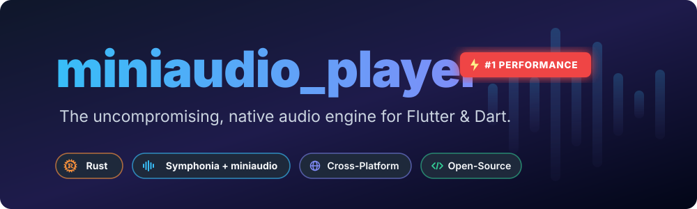
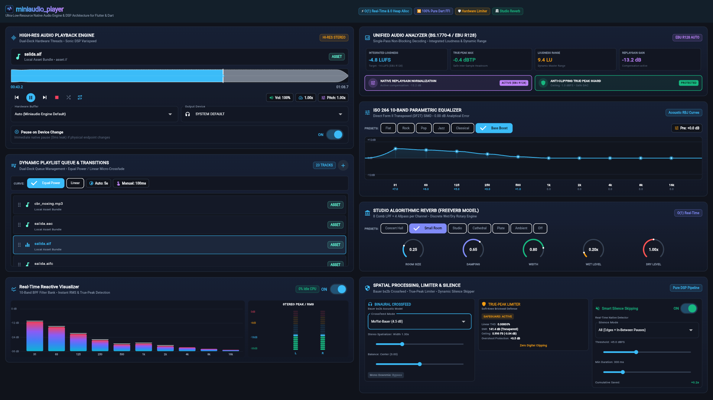
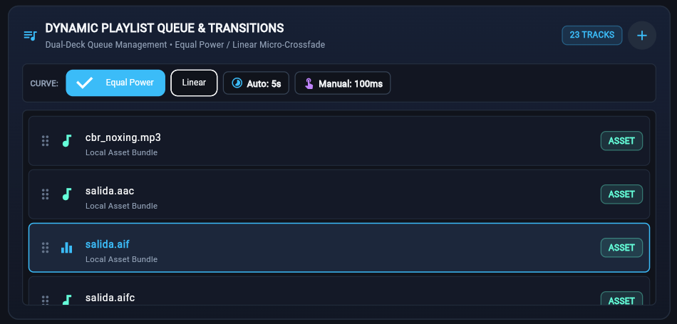
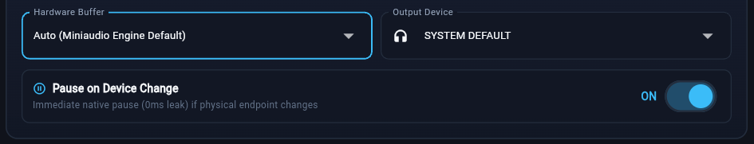
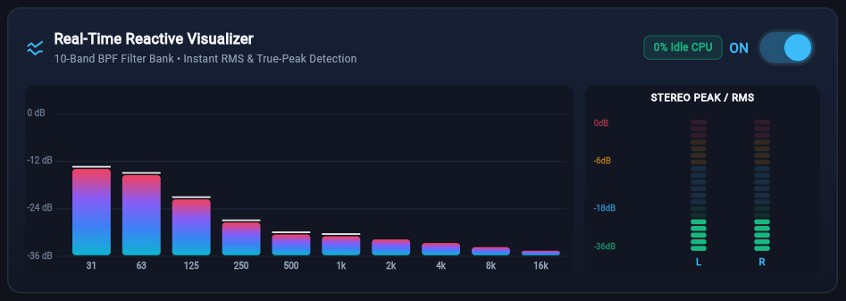
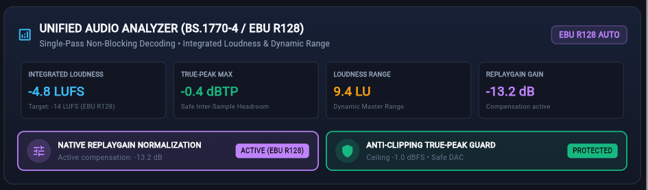

<p align="center">
  
</p>

#  miniaudio_player

[](https://pub.dev/packages/miniaudio_player)
[](https://miniaudio_player.chomusuke.dev/)
[](https://github.com/chomusuke-mk/miniaudio_player/blob/main/LICENSE)
[](https://pub.dev/packages/miniaudio_player)
[](https://github.com/chomusuke-mk/miniaudio_player/blob/main/docs/ARCHITECTURE.md)
[](https://www.buymeacoffee.com/chomusuke)
[](https://ko-fi.com/chomusuke_dev)

An **ultra-low-resource, high-performance cross-platform audio engine, queue orchestrator, DSP workstation, multi-bus recorder, and analyzer** for Flutter, Dart, and Web. Powered in **v4.0.0** by a pure-Rust real-time engine core (`miniaudio_player_rust` + Symphonia 0.6), a minimal C99 [`miniaudio`](https://miniaud.io/) hardware HAL, **`flutter_rust_bridge` v2**, and multi-threaded **WebAssembly (`SharedArrayBuffer` + Web Workers)**.

Engineered for smooth real-time playback, lock-free thread boundaries, zero duplicate RAM ownership, and zero UI jank by isolating decoding, DSP, mixing, and I/O off Flutter's UI thread.

---

## 📸 Studio Master Console (Hero Preview)

<p align="center">
  
</p>

<p align="center">
  🎮 <strong>Live Demo:</strong> <a href="https://miniaudio_player.chomusuke.dev/"><strong>https://miniaudio_player.chomusuke.dev/</strong></a>
</p>

_The bundled [**Studio Master Console**](https://github.com/chomusuke-mk/miniaudio_player/tree/main/example) showcases the v4.0.0 engine across three views: real-time transport & waveform seekbars, dual-deck queue & mathematical crossfades, 64-voice SFX pool, multi-device output/mic routing, multi-format live recording (with Web OPFS), 10-band DF2T spectrum visualizer, unified DSP suite, single-pass `BS.1770-4` / Chromaprint audio analyzer, and the 3-plane `StreamSession` ingest matrix._

---

## 📑 Table of Contents

- [miniaudio\_player](#-miniaudio_player)
  - [📸 Studio Master Console (Hero Preview)](#-studio-master-console-hero-preview)
  - [📑 Table of Contents](#-table-of-contents)
  - [1. Features at a Glance](#1-features-at-a-glance)
  - [2. Performance \& Architecture](#2-performance--architecture)
    - [2.1 Real-Time Audio Signal \& DSP Chain](#21-real-time-audio-signal--dsp-chain)
    - [2.2 Single-Owner Actor \& Lock-Free Thread Boundaries](#22-single-owner-actor--lock-free-thread-boundaries)
    - [2.3 Canonical Tripartite Facade (`.action`, `.state`, `.stream`)](#23-canonical-tripartite-facade-action-state-stream)
  - [3. Platform Support Matrix](#3-platform-support-matrix)
  - [4. Supported Audio Formats](#4-supported-audio-formats)
    - [Decoding \& Playback](#decoding--playback)
    - [Live Real-Time Recording (`AudioFileFormat`)](#live-real-time-recording-audiofileformat)
  - [5. Getting Started](#5-getting-started)
    - [Installation](#installation)
    - [Required One-Time Initialization](#required-one-time-initialization)
    - [Web Setup (Required Cross-Origin Isolation Headers)](#web-setup-required-cross-origin-isolation-headers)
  - [6. Feature Guide: Code \& Screenshots](#6-feature-guide-code--screenshots)
    - [6.1 Universal Playback, Ingest \& Transport (`MiniaudioPlayer<T>` \& `AudioSource`)](#61-universal-playback-ingest--transport-miniaudioplayert--audiosource)
    - [6.2 Dual-Deck Queue, Crossfade \& Infinite Mix](#62-dual-deck-queue-crossfade--infinite-mix)
    - [6.3 Custom Audio Sources \& On-The-Fly Decryption (`CustomByteProvider`)](#63-custom-audio-sources--on-the-fly-decryption-custombyteprovider)
    - [6.4 64-Voice Polyphonic RAM SFX \& 3D Spatial Audio + Doppler](#64-64-voice-polyphonic-ram-sfx--3d-spatial-audio--doppler)
    - [6.5 Multi-Output Matrix, DJ CUE, Mic Auto-Ducking \& Zero-Leak Device Switching](#65-multi-output-matrix-dj-cue-mic-auto-ducking--zero-leak-device-switching)
    - [6.6 Real-Time Audio Taps (VoIP Pull Ring \& Broadcast Push Stream)](#66-real-time-audio-taps-voip-pull-ring--broadcast-push-stream)
    - [6.7 Multi-Format Lock-Free Live Recording (11 Formats, `RecordingByteBuffer` \& Web OPFS)](#67-multi-format-lock-free-live-recording-11-formats-recordingbytebuffer--web-opfs)
    - [6.8 Real-Time Reactive Visualizer \& Stereo VU Meters](#68-real-time-reactive-visualizer--stereo-vu-meters)
    - [6.9 Dynamic DSP \& Spatial Mastering Suite (EQ, Reverb, Crossfeed, Limiter \& Silence Skip)](#69-dynamic-dsp--spatial-mastering-suite-eq-reverb-crossfeed-limiter--silence-skip)
    - [6.10 Single-Pass Acoustic Analyzer (`BS.1770-4`, Waveform, Lofty \& Chromaprint)](#610-single-pass-acoustic-analyzer-bs1770-4-waveform-lofty--chromaprint)
    - [6.11 Ingest Matrix \& 3-Plane `StreamSession`](#611-ingest-matrix--3-plane-streamsession)
    - [6.12 Flutter UI Integration (`StreamBuilder` \& Synchronous `O(1)` State)](#612-flutter-ui-integration-streambuilder--synchronous-o1-state)
  - [7. Contributing, License \& Powered-By Stack](#7-contributing-license--powered-by-stack)
    - [License \& Third-Party Libraries](#license--third-party-libraries)

---

## 1. Features at a Glance

- 🎛️ **Unified Dual-Deck `MiniaudioPlayer<T>` Engine**: Single canonical API handling music decks (_Deck A_ & _Deck B_), Equal-Power ($\cos / \sin$) & Linear crossfading (`CrossfadeConfig`), monotonic 64-bit track ID reordering (`reorderByIds`), non-destructive Fisher-Yates shuffle, loop modes (`LoopMode.off`, `.one`, `.all`), per-deck ReplayGain isolation, and Infinite Mix auto-replenishment (`InfiniteMixConfig` + `stream.needMoreTracks`).
- 🌐 **Multi-Threaded WebAssembly Runtime**: Runs the Rust audio engine, decoders, worker pools, and OPFS/memory recording in background Web Workers (`SharedArrayBuffer` + Atomics) driving Web Audio without blocking Flutter UI frames.
- 🔐 **Custom Sources & Zero-Disk Decryption (`CustomByteProvider`)**: Stream encrypted, DRM-protected, or custom storage sources asynchronously from Dart without writing decrypted bytes to temporary disk files.
- 🌊 **3-Plane `StreamSession` & Multi-Lane `IoWorkerPool`**: Splits every source into pinned container headers (`Head`), sliding circular audio ring (`Body`), and sparse tag/chapter/art storage (`Sparse`) with 3-phase progressive HTTP coalescing, HLS + **AES-128-CBC** decryption + **MPEG-TS** demuxing, and ICY live metadata.
- 🔊 **Rust SIMD DSP Workstation**: 10-band ISO 266 DF2T parametric equalizer, preamp, Freeverb algorithmic reverb (6 presets), Bauer BS2B headphone crossfeed, stereo widener, mono downmix, stereo balance, Rubato + Sonic speed/pitch shifting, smart silence skipping FSM, per-deck ReplayGain, and soft-knee brickwall true-peak limiter.
- 💥 **64-Voice Polyphonic RAM Effects & 3D Doppler**: Pinned or LRU-bounded SFX pool (`VoicePoolRt`) with `DspRouting` (`inherit`, `isolate`, `bypass`), `VoiceStealingPolicy`, randomization jitter, and 3D listener/emitter Doppler kinematics.
- 🎧 **5-Bus Matrix, DJ CUE, Real-Time PCM Taps & 11-Format Recording**: Stream to concurrent outputs across `all`, `musicMix`, `activeTrack`, `standbyTrack`, and `voiceOnly`; tap live audio into Dart via `watchAudioBus` or zero-allocation `openAudioTapBuffer` (VoIP/calls); record in real time to **WAV**, **RF64**, **Wave64**, **AIFF**, **CAF**, and lossless compressed **WavPack (`.wv`)**.
- 📊 **Single-Pass Acoustic Analyzer (`BS.1770-4`, Waveform, Lofty, Chromaprint)**: Extract codec telemetry (< 1 ms), EBU R128 loudness & ReplayGain, bounded O(1)-RAM RMS waveforms, ID3v2 chapters/artwork, and Chromaprint fingerprints in one decode pass.
- 🔄 **Orthogonal Tripartite API (`.action`, `.state`, `.stream`)**: Strict separation between non-blocking async commands (`action`), O(1) synchronous snapshots (`state`), and granular broadcast streams (`stream`).

---

## 2. Performance & Architecture

### 2.1 Real-Time Audio Signal & DSP Chain

```text
┌────────────────────────────────────────────────────────────────────────────────────────┐
│                           Decoded PCM Frames (Deck A / Deck B)                         │
└───────────────────────────────────────────┬────────────────────────────────────────────┘
                                            │
                                            ▼
                    ┌───────────────────────────────────────────────┐
                    │ 1. SilenceDetector FSM + ChannelMatrix +      │
                    │    Rubato Resampler + Sonic Time-Stretch      │
                    └───────────────────────┬───────────────────────┘
                                            │
                                            ▼
                    ┌───────────────────────────────────────────────┐
                    │ 2. Per-Deck DSP (ReplayGain, BS2B Crossfeed,  │
                    │    3D Spatial/Doppler, Limiter) + Crossfade   │
                    └───────────────────────┬───────────────────────┘
                                            │
                                            ▼
                    ┌───────────────────────────────────────────────┐
                    │ 3. Music DSP (Preamp, 10-Band ISO 266 DF2T EQ,│
                    │    Freeverb, Widener, Mono, Balance)          │
                    └───────┬───────────────────────────────┬───────┘
                            │                               │
                            ▼                               ▼
              [scratch_music Bus]             ┌─────────────────────────────┐
              (Pure Music Tap)                │ 4. Mic AutoDucker + 64-Voice│
                                              │    SFX SimdMixer (AVX2/NEON)│
                                              └──────────────┬──────────────┘
                                                             │
                                                             ▼
                                              ┌─────────────────────────────┐
                                              │ 5. Soft-Knee Master Limiter │
                                              └──────────────┬──────────────┘
                                                             │
                                                             ▼
┌────────────────────────────────────────────────────────────────────────────────────────┐
│  OutputManager::dispatch (5 Buses: All • MusicMix • ActiveTrack • StandbyTrack • Voice)│
│  ├─► Hardware Endpoints (rtrb SPSC -> C99 HAL)   ├─► AudioTaps (Push / Zero-Alloc Pull)│
│  ├─► LiveRecorder (WAV/RF64/W64/AIFF/CAF/WavPack)└─► 10-Band BPF Visualizer (Seqlock)  │
└────────────────────────────────────────────────────────────────────────────────────────┘
```

### 2.2 Single-Owner Actor & Lock-Free Thread Boundaries

```text
┌────────────────────────────────────────────────────────────────────────────────────────┐
│                              Flutter UI / Dart Main Isolate                            │
│  • flutter_rust_bridge v2 async commands (.action) & reactive telemetry (.stream)      │
│  • Zero-alloc direct C-ABI / WASM poll for VoIP AudioTapBuffer                         │
└──────────────────────────┬─────────────────────────────────────▲───────────────────────┘
                           │ Non-blocking channels               │ Atomics, Seqlock &
                           ▼                                     │ StreamSink Events
┌──────────────────────────────────────────────┐   ┌─────────────┴───────────────────────┐
│   Non-RT Control & I/O Plane                 │   │  Single-Owner RT Actor              │
│  • IoWorkerPool (1x local + 4x net coalesce) │──►│  • map-engine-clock thread          │
│  • ControlCoordinator & HwDeviceSupervisor   │   │  • MusicManager, EffectsManager,    │
│  • map-tap-dispatcher & map-reaper teardown  │   │    InputManager, DspProcessor       │
└──────────────────────────────────────────────┘   └─────────────┬───────────────────────┘
                                                                 │ rtrb SPSC Rings
                                                                 ▼
                                                   ┌─────────────────────────────────────┐
                                                   │ OS HAL (miniaudio_device_bridge.c)  │
                                                   │ WASAPI • CoreAudio • Pulse/ALSA •   │
                                                   │ AAudio/OpenSL • WebAudio Workers    │
                                                   └─────────────────────────────────────┘
```

### 2.3 Canonical Tripartite Facade (`.action`, `.state`, `.stream`)

| Facade Domain | Component Type    | Execution                  | Primary Responsibilities                                                                                                                                                                                                                     |
| :------------ | :---------------- | :------------------------- | :------------------------------------------------------------------------------------------------------------------------------------------------------------------------------------------------------------------------------------------- |
| **`.action`** | `PlayerAction<T>` | Asynchronous (`Future<T>`) | Serialized queue lane (`setQueue`, `append`, `reorderByIds`, `play`, `next`, `previous`) + non-blocking RT lane (`pause`, `stop`, `seek`, DSP controls, `playEffect`, hardware routing, recording, audio taps).                              |
| **`.state`**  | `PlayerState<T>`  | Synchronous ($O(1)$)       | Lock-free Dart snapshot updated strictly from native events: `playbackState`, `position`, `duration`, `buffer`, `queue`, `audioInfo`, `metadata`, `visualizer`, `outputs`, `inputs`, `isRecording`, `recordedDuration`, `allocatedRamBytes`. |
| **`.stream`** | `PlayerStream<T>` | Reactive (`Stream<T>`)     | Fine-grained broadcast streams (`playbackState`, `position`, `buffer`, `queue`, `metadata`, `visualizer`, `needMoreTracks`, `isRecording`, `isDuckingActive`, `errors`, etc.).                                                               |

📖 For the full system topology, thread roster, and sliding-window formulas, see the [**Architecture Guide**](https://github.com/chomusuke-mk/miniaudio_player/blob/main/docs/ARCHITECTURE.md).

---

## 3. Platform Support Matrix

| Audio Engine Capability                                    |      Android [^1]       | Windows [^2] |            Linux             |    iOS    |   macOS   |           Web [^3]            |
| :--------------------------------------------------------- | :---------------------: | :----------: | :--------------------------: | :-------: | :-------: | :---------------------------: |
| **OS Audio Backend**                                       |   AAudio / OpenSL ES    |    WASAPI    | PulseAudio / PipeWire / ALSA | CoreAudio | CoreAudio |    WASM + WebAudio Workers    |
| **Local Files, URIs & `asset://` Playback**                |           ✅            |      ✅      |              ✅              |    ✅     |    ✅     | ✅ (OPFS paths, `asset://`, `data:`, `blob:`, RAM) |
| **HTTP/HTTPS `Range`, ICY Radio & HLS (`AES-128`)**        |           ✅            |      ✅      |              ✅              |    ✅     |    ✅     |              ✅               |
| **Custom Pull Streams & DRM (`CustomByteProvider`)**       |           ✅            |      ✅      |              ✅              |    ✅     |    ✅     |              ✅               |
| **Dual-Deck Queue, Crossfade & Infinite Mix**              |           ✅            |      ✅      |              ✅              |    ✅     |    ✅     |              ✅               |
| **10-Band EQ, Freeverb, BS2B, Spatial & Limiter**          |           ✅            |      ✅      |              ✅              |    ✅     |    ✅     |              ✅               |
| **64-Voice Polyphonic SFX & 3D Doppler**                   |           ✅            |      ✅      |              ✅              |    ✅     |    ✅     |              ✅               |
| **5-Bus Output Matrix & Auto-Ducking Capture**             |           ✅            |      ✅      |              ✅              |    ✅     |    ✅     |              ✅               |
| **Real-Time Audio Taps (Push & Zero-Alloc Pull)**          |           ✅            |      ✅      |              ✅              |    ✅     |    ✅     |              ✅               |
| **11-Format Recording (Disk / `RecordingByteBuffer`)**     | ✅ (incl. `content://`) |      ✅      |              ✅              |    ✅     |    ✅     | ✅ (OPFS paths / Memory) |
| **Single-Pass Analyzer (`BS.1770-4`, Lofty, Chromaprint)** |           ✅            |      ✅      |              ✅              |    ✅     |    ✅     |              ✅               |

[^1]: **Android**: C11 hardware bridge builds with `ANDROID_STL=c++_shared`, 16 KB page alignment support, and AAudio state-change wait guard. Writable `content://` URIs are supported natively for recording.

[^2]: **Windows**: Uses WASAPI low-latency shared endpoints via `miniaudio.h`.

[^3]: **Web**: Multi-threaded `wasm32` WebAssembly using `SharedArrayBuffer` + Atomics and Rust-direct Origin Private File System (OPFS) access: relative and absolute paths without a URI scheme resolve automatically to OPFS for playback, analysis, SFX, local HLS, and 11-format live recording (or throw `MapResult.errorUnsupported` when OPFS is unavailable in the browser context).

---

## 4. Supported Audio Formats

### Decoding & Playback

| Category                      | Formats / Containers                                                                               | Native Engine / Crate                                                    |
| :---------------------------- | :------------------------------------------------------------------------------------------------- | :----------------------------------------------------------------------- |
| **Lossy Compressed**          | `.mp3`, `.mp2`, `.mp1`, `.ogg` (Vorbis), `.opus`, `.aac`, `.m4a` (AAC), ADTS                       | `symphonia 0.6`, `symphonia-opus`, `rusty_aac`                           |
| **Lossless Compressed**       | `.flac`, `.ape` (Monkey's Audio), `.wv` (WavPack), `.m4a` (ALAC), `.oga`                           | `symphonia 0.6`, `ape-decoder`, `wavicle`                                |
| **Uncompressed & Hi-Res PCM** | `.wav`, `.aif`, `.aiff`, `.aifc`, `.caf`, `RF64`, `RIFX`, `W64`, `BWF`                             | `symphonia 0.6`, `ExtendedPcmReader`                                     |
| **Direct Stream Digital**     | `.dsf` (DSD64+)                                                                                    | Custom `DsfReader`                                                       |
| **Multimedia & Streaming**    | `.webm`, `.mkv`, `.mka`, `.m3u8` (HLS + **AES-128-CBC** + **MPEG-TS**), `icy://` Shoutcast/Icecast | `symphonia 0.6`, `m3u8-rs`, `aes` + `cbc`, custom MPEG-TS & ICY demuxers |

### Live Real-Time Recording (`AudioFileFormat`)

| Container                | `AudioFileFormat` Presets                                | Notes                                              |
| :----------------------- | :------------------------------------------------------- | :------------------------------------------------- |
| **RIFF WAV (`.wav`)**    | `wav` (PCM 16), `wavFloat32` (Float 32)                  | Standard compatibility (up to 4 GiB RIFF limit)    |
| **RF64 WAV (`.rf64`)**   | `rf64` (PCM 16), `rf64Float32` (Float 32)                | 64-bit `RF64`/`ds64` chunk (>4 GiB recordings)     |
| **Sony Wave64 (`.w64`)** | `w64` (PCM 16), `w64Float32` (Float 32)                  | 64-bit GUID headers (>4 GiB recordings)            |
| **AIFF (`.aiff`)**       | `aiff` (Big-Endian PCM 16)                               | Studio IFF/AIFF container                          |
| **Apple CAF (`.caf`)**   | `caf` (BE PCM 16), `cafFloat32` (BE Float 32)            | 64-bit `caff`/`lpcm` container (>4 GiB recordings) |
| **WavPack (`.wv`)**      | `wavPack` (Lossless 16), `wavPackFloat32` (Lossless F32) | Streaming lossless block compression (`wavicle`)   |

---

## 5. Getting Started

### Installation

```bash
flutter pub add miniaudio_player
```

Or for pure Dart console/server targets:

```bash
dart pub add miniaudio_player
```

### Required One-Time Initialization

Because v4.0.0 executes on a compiled Rust core via `flutter_rust_bridge`, call `await MiniaudioPlayer.ensureInitialized();` **once** before instantiating any `MiniaudioPlayer`:

```dart
import 'package:flutter/widgets.dart';
import 'package:miniaudio_player/miniaudio_player.dart';

Future<void> main() async {
  WidgetsFlutterBinding.ensureInitialized();

  // Required once before creating any MiniaudioPlayer instance.
  await MiniaudioPlayer.ensureInitialized();

  // Optional: configure logging verbosity and buffer lookahead targets.
  MiniaudioPlayer.config(
    logLevel: MiniaudioLogLevel.warning,
    bufferLocalDuration: const Duration(seconds: 30),
    bufferNetworkDuration: const Duration(seconds: 30),
  );

  runApp(const MyApp());
}
```

### Web Setup (Required Cross-Origin Isolation Headers)

On **Flutter Web**, `miniaudio_player` uses multi-threaded WebAssembly (`SharedArrayBuffer` + Atomics + Web Workers). Serve your development and production pages with these HTTP headers:

```http
Cross-Origin-Opener-Policy: same-origin
Cross-Origin-Embedder-Policy: require-corp
```

_(You may also use `Cross-Origin-Embedder-Policy: credentialless` in Chromium/Firefox if loading third-party streams without CORP headers.)_

```bash
flutter run -d chrome \
  --web-header=Cross-Origin-Opener-Policy=same-origin \
  --web-header=Cross-Origin-Embedder-Policy=require-corp
```

---

## 6. Feature Guide: Code & Screenshots

### 6.1 Universal Playback, Ingest & Transport (`MiniaudioPlayer<T>` & `AudioSource`)

<p align="center">
  
</p>

Every media source resolves cleanly through `AudioSource<T>`—supporting native file paths, `file://` URIs, **automatic Web OPFS resolution for relative/absolute paths** (`O(1)` RAM streaming & seek; optional `opfs://` prefix is stripped with an `[INFO]` log), Flutter `asset://` / `package:` bundles, `Uint8List` / `data:` / `blob:` URIs, HTTP/HTTPS byte-range streaming, ICY live radio, and HLS `.m3u8` (including encrypted AES-128-CBC segments):

> **Web path rules:** On Web, relative and absolute paths without a URI scheme (e.g. `'/temporal/sistema/test/1.wav'`, `'temporal/sistema/test/1.wav'`, or `'1.wav'`) resolve automatically to OPFS (`'/temporal/sistema/test/1.wav'` and `'temporal/sistema/test/1.wav'` point to the same file, distinct from `'1.wav'`). Bundled Flutter assets must always use `asset://` or `package:`. Playback/analysis validates OPFS segment names strictly (`MapResult.errorInvalidArgs` on invalid names) and throws `MiniaudioPlayerException` (`MapResult.errorUnsupported`) if OPFS is unavailable in the browser context.

```dart
final player = MiniaudioPlayer<String>();

await player.action.setQueue([
  // 1. Local file path (Native) OR OPFS file path (Web, e.g. 'temporal/sistema/test/1.wav' / '/1.wav')
  AudioSource('/path/to/song.flac', data: 'Local Hi-Res'),

  // 2. Flutter asset bundle (zero temporary copies)
  AudioSource('asset://assets/music/theme.wav', data: 'Bundle Asset'),

  // 3. In-memory bytes (ownership transfers directly to Rust)
  AudioSource(decryptedBytes, data: 'In-Memory RAM'),

  // 4. Remote HTTP/HTTPS VOD with custom headers
  AudioSource(
    'https://example.com/audio/track.opus',
    headers: {'Authorization': 'Bearer YOUR_TOKEN'},
    data: 'Remote Opus',
  ),

  // 5. HLS (.m3u8 AES-128-CBC / MPEG-TS) or Shoutcast/Icecast live radio
  AudioSource('https://radio.example.com/live.m3u8', data: 'HLS Radio'),
]);

await player.action.play();

// Instant RT transport & Sonic speed/pitch controls
await player.action.setVolume(0.9);
await player.action.setRate(1.15);
await player.action.setPitch(1.0);
await player.action.seek(const Duration(seconds: 45));
await player.action.pause();
await player.action.stop();
```

---

### 6.2 Dual-Deck Queue, Crossfade & Infinite Mix

<p align="center">
  
</p>

`MiniaudioPlayer<T>` orchestrates _Deck A_ and _Deck B_ natively in Rust with gapless transitions, Equal-Power ($\cos / \sin$) or Linear crossfades, monotonic 64-bit track ID reordering, Fisher-Yates shuffle, and reactive queue auto-refill:

```dart
final engine = MiniaudioPlayer<TrackModel>(
  config: const PlayerConfig(
    crossfade: CrossfadeConfig(
      autoDuration: Duration(seconds: 5),      // End-of-track automatic overlap
      manualDuration: Duration(milliseconds: 300), // Smooth manual skip overlap
      curve: CrossfadeCurve.equalPower,
    ),
  ),
  queue: [
    AudioSource('/music/track1.flac', data: track1, replayGainDb: -1.4, replayPeak: 0.96),
    AudioSource('https://example.com/track2.mp3', data: track2),
  ],
);

await engine.action.play();
await engine.action.next();

// Deterministic queue reordering using monotonic IDs assigned by Rust
final reversedIds = engine.state.queue.map((e) => e.id!).toList().reversed.toList();
await engine.action.reorderByIds(reversedIds);

await engine.action.setShuffle(true);
await engine.action.setLoopMode(LoopMode.all);

// Infinite Mix auto-replenishment before the queue runs dry
engine.stream.needMoreTracks.listen((event) async {
  final nextBatch = await fetchRecommendations(remaining: event.remainingTracks);
  await engine.action.append(nextBatch);
});
await engine.action.setInfiniteMix(const InfiniteMixConfig(
  enabled: true,
  remainingTracksThreshold: 3,
));
```

---

### 6.3 Custom Audio Sources & On-The-Fly Decryption (`CustomByteProvider`)

Extend [`CustomByteProvider`](https://github.com/chomusuke-mk/miniaudio_player/blob/main/lib/src/loader/custom_byte_provider.dart) to pull encrypted, DRM-protected, or proprietary media streams cleanly into Rust without ever creating unencrypted temporary files on disk:

```dart
class EncryptedChunkProvider extends CustomByteProvider {
  EncryptedChunkProvider(this.encryptedFile, this.key);

  final File encryptedFile;
  final Uint8List key;
  RandomAccessFile? _raf;

  @override
  final int streamId = 1001;

  @override
  int? get totalBytes => encryptedFile.lengthSync();

  @override
  bool get isSeekable => true;

  @override
  Future<Uint8List> readBytes(int offset, int length) async {
    _raf ??= await encryptedFile.open(mode: FileMode.read);
    await _raf!.setPosition(offset);
    final cipher = await _raf!.read(length);
    return decryptAesCtrInMemory(cipher, offset, key);
  }

  @override
  Future<void> close() async {
    await _raf?.close();
    _raf = null;
  }
}

final provider = EncryptedChunkProvider(File('/storage/protected.enc'), secretKey);
await player.action.setQueue([AudioSource(provider)]);
await player.action.play();
```

---

### 6.4 64-Voice Polyphonic RAM SFX & 3D Spatial Audio + Doppler

<p align="center">
  
</p>

Manage up to 64 simultaneous voices with zero Dart heap duplication (`pinned` RAM vs LRU eviction budget `maxRamBytes`), per-voice `DspRouting`, pitch/volume randomization jitter, and live 3D emitter/listener Doppler shift:

```dart
final sfxPlayer = MiniaudioPlayer<void>(
  effects: [
    AudioEffect(
      id: 'laser',
      source: AudioSource(laserBytes), // Moved straight to Rust RAM
      pinned: true,
    ),
    AudioEffect(
      id: 'footstep',
      source: AudioSource('/assets/sfx/step.wav'),
      maxPolyphony: 8,
    ),
  ],
  config: const PlayerConfig(
    maxVoices: 64,
    maxRamBytes: 50 * 1024 * 1024, // 50 MB LRU budget for non-pinned SFX
    voiceStealingPolicy: VoiceStealingPolicy.lowestPriority,
  ),
);

await sfxPlayer.action.setListener(const SpatialListener(
  position: Vector3.zero,
  forward: Vector3.forward,
));

final Voice voice = await sfxPlayer.action.playEffect(
  'laser',
  config: const EffectConfig(
    volume: 0.85,
    pitchJitter: 0.08,
    dspRouting: DspRouting.isolate,
    spatial: SpatialEmitter(
      position: Vector3(4.0, 0.0, -2.0),
      velocity: Vector3(-12.0, 0.0, 0.0), // Doppler pitch shift
    ),
  ),
);

await voice.setEmitter(const SpatialEmitter(
  position: Vector3(1.5, 0.0, -1.0),
  velocity: Vector3(-12.0, 0.0, 0.0),
));
```

---

### 6.5 Multi-Output Matrix, DJ CUE, Mic Auto-Ducking & Zero-Leak Device Switching

<p align="center">
  
</p>

Route concurrent playback endpoints across any of 5 independent audio buses (`all`, `musicMix`, `activeTrack`, `standbyTrack` for DJ CUE pre-listening, and `voiceOnly`), mix multiple microphone inputs with live-edge latency capping & RMS sidechain auto-ducking, and enable zero-leak hardware switching:

```dart
final outputs = await MiniaudioPlayer.getOutputDevices();
final headphones = outputs.firstWhere((d) => !d.isAuto, orElse: () => outputs.first);

await player.action.setOutputs({
  const AudioOutput(deviceId: 'AUTO', source: AudioOutputSource.all),
  AudioOutput(deviceId: headphones.id, source: AudioOutputSource.standbyTrack), // DJ CUE
});

await player.action.setInputs({
  const AudioInput(
    deviceId: 'AUTO',
    config: AudioInputConfig(
      gain: 1.2,
      monitorDirect: true,
      ducking: DuckingConfig(
        enabled: true,
        duckingDb: -14.0,
        thresholdDb: -30.0,
        attackMs: 30.0,
        holdMs: 250.0,
        releaseMs: 400.0,
      ),
    ),
  ),
});

// Prevent acoustic leakage onto speakers when unplugging headphones
await player.action.setPauseOnDeviceChange(true);
```

---

### 6.6 Real-Time Audio Taps (VoIP Pull Ring & Broadcast Push Stream)

Extract live PCM frames directly from any audio bus (`voiceOnly`, `musicMix`, `all`, etc.) for **calls / VoIP**, external streaming, or custom DSP—either via reusable zero-allocation C-ABI/WASM ring memory (`AudioTapBuffer`) or coalesced broadcast streams (`watchAudioBus`):

```dart
// Mode A: Zero-allocation Pull ring buffer (ideal for low-latency VoIP / calls)
final AudioTapBuffer micTap = await player.action.openAudioTapBuffer(
  source: AudioOutputSource.voiceOnly,
  format: AudioTapFormat.pcm16,
  capacityFrames: 1024,
);

// Inside your call transmit loop (writes into pre-allocated pinned native/WASM memory):
final framesRead = micTap.poll(maxFrames: 480);
if (framesRead > 0) {
  final byteCount = framesRead * micTap.channels * AudioTapFormat.pcm16.bytesPerSample;
  sendVoipPacket(micTap.bytesView.sublist(0, byteCount));
}
await micTap.close();

// Mode B: Shared broadcast Push stream (coalesced per frameDuration window)
final sub = player.action
    .watchAudioBus(
      source: AudioOutputSource.musicMix,
      format: AudioTapFormat.float32,
      frameDuration: const Duration(milliseconds: 20),
    )
    .listen((AudioPcmChunk chunk) {
  consumeFloatSamples(chunk.samplesF32, sampleRate: chunk.sampleRate);
});
```

---

### 6.7 Multi-Format Lock-Free Live Recording (11 Formats, `RecordingByteBuffer` & Web OPFS)

Record selectively from any `AudioOutputSource` bus on dedicated Rust threads or async Dart sinks across **11 formats** (`wav`, `wavFloat32`, `rf64`, `rf64Float32`, `w64`, `w64Float32`, `aiff`, `caf`, `cafFloat32`, `wavPack`, `wavPackFloat32`), with automatic header back-patching on `stopRecording()` or `dispose()`:

> **Web OPFS recording & browser support:** On Web, passing any relative or absolute path without a URI scheme (or the unnecessary legacy `opfs://` prefix, which emits an `[INFO]` notice and is stripped from `RecordingResult.path`) writes directly to OPFS and auto-sanitizes invalid segment characters to prevent `InvalidName` errors (`'/temporal/sistema/test/1.wav'` and `'temporal/sistema/test/1.wav'` resolve to canonical OPFS path `'temporal/sistema/test/1.wav'`, whereas `'1.wav'` writes to OPFS root). If the current browser or non-secure context does not support OPFS, `startRecording` throws `MiniaudioPlayerException` (`MapResult.errorUnsupported`)—pass `MemoryRecordingBuffer()` for guaranteed cross-browser capture.

```dart
// 1. Native disk recording (paths, file:// URIs, Android content:// FDs)
//    OR automatic Web OPFS recording ('/temporal/sistema/test/1.wv' -> res.path == 'temporal/sistema/test/1.wv')
await player.action.startRecording(
  '/temporal/sistema/test/clean_set_recording.wv',
  format: AudioFileFormat.wavPack, // Lossless .wv (also wav, rf64, w64, aiff, caf)
  source: AudioOutputSource.musicMix,
);
final RecordingResult res = await player.action.stopRecording();

// RecordingResult helpers (O(1)-RAM browser download, direct playback, byte read, cleanup):
await res.download(); // Triggers browser download from OPFS / memory buffer on Web
await player.action.load(res.toAudioSource()); // Replay directly (valid in both Web OPFS & Native)
await res.delete();

// 2. Cross-platform async FIFO buffer (guaranteed fallback when browser lacks OPFS, encryption, or uploads)
final memBuffer = MemoryRecordingBuffer();
await player.action.startRecordingToBuffer(
  memBuffer,
  format: AudioFileFormat.cafFloat32,
  source: AudioOutputSource.all,
);
final RecordingResult memRes = await player.action.stopRecording();
final Uint8List finalizedAudio = await memRes.readBytes();
```

---

### 6.8 Real-Time Reactive Visualizer & Stereo VU Meters

<p align="center">
  
</p>

An on-demand 10-band DF2T filter bank matching ISO 266 octave center frequencies (`31 Hz`–`16 kHz`) publishes normalized spectrum bars plus stereo Peak/RMS telemetry via lock-free `CachePaddedSeqlock` from any selected bus:

```dart
await player.action.setVisualizerSource(AudioOutputSource.all);
await player.action.setVisualizerEnabled(true);

player.stream.visualizer.listen((VisualizerData data) {
  final List<double> bands = data.bands; // 10 normalized levels (0.0 .. 1.0)
  final double rms = data.rms;
  final double peak = data.peak;
  final double left = data.left;
  final double right = data.right;
});
```

---

### 6.9 Dynamic DSP & Spatial Mastering Suite (EQ, Reverb, Crossfeed, Limiter & Silence Skip)

<p align="center">
  
</p>

Shape every frequency band, acoustic space, headphone crossfeed stage, ReplayGain mode, brickwall limiter, and silence skipper in real time without glitches or allocations:

```dart
// 1. 10-Band ISO 266 Parametric Equalizer + Preamp
await player.action.setEqualizer(Equalizer.rock);
await player.action.setEqualizer(const Equalizer(hz31: 4.5, hz16k: 2.0));
await player.action.setPreamp(-1.5);

// 2. Algorithmic Freeverb Stereo Reverb
await player.action.setReverb(Reverb.studio);
await player.action.setReverb(const Reverb(
  roomSize: 0.85,
  damping: 0.25,
  width: 1.0,
  wet: 0.35,
  dry: 0.75,
));

// 3. Binaural Headphone Crossfeed (Bauer bs2b), Spatializer & Soft Limiter
await player.action.setCrossfeed(Crossfeed.moffatBauer);
await player.action.setSpatializer(enabled: true, width: 1.35);
await player.action.setLimiter(true);

// 4. Per-Deck ReplayGain & Continuous Silence Skipping
await player.action.setReplayGainMode(ReplayGainMode.track);
await player.action.setSilenceConfig(const SilenceSkipConfig.continuous(
  thresholdDb: -45.0,
  minSilenceDuration: Duration(milliseconds: 300),
  padding: Duration(milliseconds: 50),
));

player.stream.silenceSavedDuration.listen((saved) {
  print('Cumulative time saved skipping silence: ${saved.inSeconds}s');
});
```

---

### 6.10 Single-Pass Acoustic Analyzer (`BS.1770-4`, Waveform, Lofty & Chromaprint)

<p align="center">
  
</p>

Analyze local files or memory bytes on an isolated background deck—either via `< 1 ms` header fast-path (`AudioInfo`) or one constant-RAM decoding pass producing **ITU-R BS.1770-4 / EBU R128** loudness, adaptive 2:1 RMS waveforms, Lofty metadata + chapters/artwork, and Chromaprint fingerprints:

```dart
final AudioAnalysisResult result = await MiniaudioPlayer.analyzeAudio(
  '/path/to/song.flac',
  replayGain: true,
  waveform: true,
  metadata: true,
  chromaprint: true,
  waveformPoints: 100,
  targetLufs: -18.0,
);

print('Format: ${result.audioInfo.codec} (${result.audioInfo.sampleRate} Hz)');
print('Loudness: ${result.replayGain?.lufs.toStringAsFixed(2)} LUFS');
print('Recommended RG: ${result.replayGain?.gainDb.toStringAsFixed(2)} dB');
print('Waveform buckets: ${result.waveform?.points.length}');
print('Title / Chapters: ${result.metadata?.title} / ${result.metadata?.chapters.length}');
print('Chromaprint (${result.chromaprint?.algorithm}): ${result.chromaprint?.fingerprint}');

// Apply measured ReplayGain directly to the active track
await player.action.setReplayGain(ReplayGainConfig(
  gainDb: result.replayGain!.gainDb,
  peak: result.replayGain!.peak,
));
```

---

### 6.11 Ingest Matrix & 3-Plane `StreamSession`

<p align="center">
  
</p>

The **Ingest & Buffer Matrix** view inspects how `miniaudio_player` v4.0.0 isolates bytes across three planes inside Rust's `StreamSession`: **`Head`** (`Linear >= 64 KB` pinned container headers), **`Body`** (`8 MB` circular sliding window `[B_back | B_ahead]`), and **`Metadata`** (`Sparse` `BTreeMap` tags/chapters/art), driven by `IoWorkerPool` (`map-io-local` + 4 coalescing network workers) and 3-phase progressive fetching (`UrgentBootstrap` → `Stabilization` → `CoalescedCruise`).

---

### 6.12 Flutter UI Integration (`StreamBuilder` & Synchronous `O(1)` State)

```dart
class NowPlayingBar extends StatelessWidget {
  const NowPlayingBar({super.key, required this.player});

  final MiniaudioPlayer<AudioTrack> player;

  @override
  Widget build(BuildContext context) {
    return Column(
      mainAxisSize: MainAxisSize.min,
      children: [
        // Instant synchronous O(1) snapshot read
        Text('Outputs: ${player.state.outputs.length}'),

        // Granular reactive position updates without full-tree rebuilds
        StreamBuilder<Duration>(
          stream: player.stream.position,
          initialData: player.state.position,
          builder: (context, snapshot) {
            final pos = snapshot.data ?? Duration.zero;
            final sec = (pos.inSeconds % 60).toString().padLeft(2, '0');
            return Text('${pos.inMinutes}:$sec');
          },
        ),

        // Reactive Play / Pause control
        StreamBuilder<PlaybackState>(
          stream: player.stream.playbackState,
          initialData: player.state.playbackState,
          builder: (context, snapshot) {
            final isPlaying = snapshot.data == PlaybackState.playing;
            return IconButton(
              icon: Icon(isPlaying ? Icons.pause : Icons.play_arrow),
              onPressed: () => isPlaying ? player.action.pause() : player.action.play(),
            );
          },
        ),
      ],
    );
  }
}
```

---

## 7. Contributing, License & Powered-By Stack

Contributions are welcome! Check the [Architecture Guide](https://github.com/chomusuke-mk/miniaudio_player/blob/main/docs/ARCHITECTURE.md), explore the [Changelog](https://github.com/chomusuke-mk/miniaudio_player/blob/main/CHANGELOG.md), or open an issue / PR on [GitHub](https://github.com/chomusuke-mk/miniaudio_player/issues).

### License & Third-Party Libraries

`miniaudio_player` is licensed under the [**MIT License**](https://github.com/chomusuke-mk/miniaudio_player/blob/main/LICENSE) and integrates:

- **[miniaudio](https://miniaud.io/)** (Public Domain / MIT-0): Minimal C99 hardware backend (`ma_context` / `ma_device`).
- **[Symphonia](https://github.com/pdeljanov/Symphonia)**, **[symphonia-opus](https://crates.io/crates/symphonia-opus)** & **[rusty_aac](https://crates.io/crates/rusty_aac)**: Pure-Rust multi-codec audio demuxing & decoding.
- **[wavicle](https://crates.io/crates/wavicle)** & **[ape-decoder](https://crates.io/crates/ape-decoder)**: Pure-Rust WavPack encoding/decoding and Monkey's Audio decoding.
- **[rubato](https://crates.io/crates/rubato)**, **[lofty](https://crates.io/crates/lofty)**, **[m3u8-rs](https://crates.io/crates/m3u8-rs)**, **[chromaprint-next](https://crates.io/crates/chromaprint-next)** & **[rtrb](https://crates.io/crates/rtrb)**: High-order resampling, tag parsing, HLS playlists, acoustic fingerprinting, and lock-free SPSC ring buffers.
- **Sonic DSP**, **Freeverb** & **Bauer BS2B**: Time/pitch scaling, stereophonic algorithmic reverb, and binaural headphone crossfeed.
