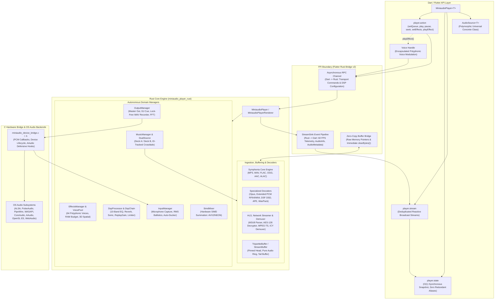
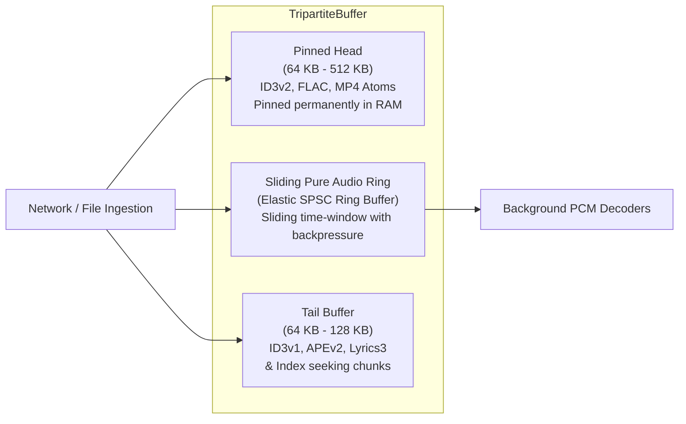
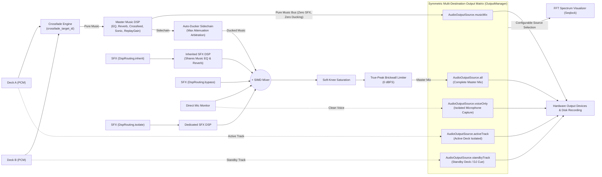

# `miniaudio_player` Comprehensive Architecture Specification

## 1. Executive Summary & Philosophy

`miniaudio_player` is an ultra-low-latency, memory-efficient, cross-platform audio playback and digital signal processing (DSP) engine engineered for Flutter and Dart. Its core is written in **Rust** (`miniaudio_player_rust`), backed by a lightweight **C11 hardware abstraction layer** (`miniaudio`), a native Rust implementation of the **Sonic DSP** time-stretching and pitch-shifting algorithm, and interfaced to Dart via **Flutter Rust Bridge (FRB v2)**.

The engine delivers production-grade capabilities within a unified architecture:

- **Dual-Deck Continuous Music Playback**: Seamless gapless playback and deterministic crossfading between Deck A and Deck B, indexed by monotonic track IDs rather than mutable queue indices.
- **Adaptive Progressive Streaming**: Native support for HTTP/HTTPS remote streams, HTTP Live Streaming (HLS v3/v7 with M3U8 parsing, AES-128 segment decryption, and MPEG-2 TS demuxing), and Internet radio (Shoutcast/Icecast) with dynamic ICY metadata parsing.
- **Tripartite Progressive Elastic Buffer (`TripartiteBuffer` / `StreamBuffer`)**: Memory-bounded stream caching featuring an immutable **Pinned Head** (for container headers and ID3v2/MP4 atoms), a lock-free **Sliding Pure Audio Ring** (with adaptive backpressure and block coalescing), and a **Tail Buffer** (for ID3v1/APEv2 metadata and seek indices).
- **Autonomous Memory-Budgeted SFX Voice Pool**: Up to 64 concurrent polyphonic voices with zero runtime heap allocations during playback, managed by an autonomous RAM budget (`effectMemoryLimitMb`), reactive multi-factor retention scoring (zero timers), and unconditional eviction immunity for memory-backed sources.
- **3D Spatial Acoustic Processor**: Real-time 3D audio modeling with distance attenuation curves (Linear, Inverse, Exponential), directional sound cones, and kinematic Doppler frequency shifts.
- **Studio-Grade DSP Processing Chain**: 10-band ISO 266 biquad equalizer, algorithmic Freeverb reverberation, native Sonic time-stretch/pitch-shift, Bauer BS2B stereo-to-binaural crossfeed, ITU-R BS.1770-4 / EBU R128 ReplayGain normalization, smart silence excision, and soft-knee saturation backed by a true-peak brickwall limiter at 0 dBFS.
- **Symmetric Multi-Destination Output Matrix**: Simultaneous routing across multiple physical audio endpoints, dedicated DJ CUE pre-listening headphone bus, lock-free WAV disk recording, and 60 FPS Fast Fourier Transform (FFT) spectrum analysis.
- **Microphone Capture & Auto-Ducking**: Hardware capture node with real-time RMS ballistics envelope, sidechain auto-ducking on the music bus, and direct monitoring with sub-15 ms latency.

---

## 2. System Architecture & Layered Topography

The system architecture is structured across four decoupled layers with well-defined boundaries:



---

## 3. Dart / Flutter Application Layer

### 3.1. `MiniaudioPlayer<T>` and Orthogonal Namespaces

The public API in Dart is organized into three strictly segregated namespaces, eliminating clutter and ambiguous state access:

- `player.action`: Houses all imperative, asynchronous command methods (`setQueue`, `play`, `pause`, `stop`, `seek`, `setVolume`, `setEffects`, `playEffect`, etc.). It directly holds the private FFI reference, keeping the internal bridge inaccessible from the outside.
- `player.state`: Exposes an $O(1)$ lock-free synchronous snapshot of the engine state at the current microtask. The state is updated reactively from Rust's telemetry events without requiring asynchronous polling or IPC waits.
- `player.stream`: Exposes fine-grained broadcast streams with built-in deduplication for reactive UI rendering (e.g., `stream.playbackState`, `stream.audioInfo`, `stream.metadata`, `stream.visualizer`).

### 3.2. Clean State Machine & Lifecycle Transitions

The player enforces a strict 3-state canonical machine that decouples transport authorization from temporary buffering conditions:

| Canonical State | Playback Authorization | Buffer & Network Activity | Entry Triggers |
| :--- | :---: | :--- | :--- |
| **`playing`** | **YES** | Active; continuously pulls network chunks and fills ring buffers up to capacity or EOF. Audio plays if buffered PCM frames are available (`!isBuffering`). | Explicit `play()` call. |
| **`paused`** | **NO** | Active; PCM rendering is halted, but network buffering and preloading continue in the background until the buffer is full. | Explicit `pause()` call. |

```mermaid
stateDiagram-v2
    [*] --> Stopped: Initial Creation
    Stopped --> Playing: play() [Authorizes audio; starts network prefetch]
    Playing --> Paused: pause() [Revokes audio; prefetch continues]
    Paused --> Playing: play() [Re-authorizes audio]
    Playing --> Stopped: stop() [Seek -> 0; aborts network & decoders]
    Paused --> Stopped: stop() [Seek -> 0; aborts network & decoders]
    Playing --> Stopped: Queue Finished [Seek stays at end; no loops/infinity]

    note right of Playing
        Buffering Condition (isBuffering = true)
        inhibits PCM rendering without altering
        the canonical 'Playing' authorization.
    end note
```

| **`stopped`** | **NO** | Completely halted; network requests are aborted, decoders are flushed, and audio device output is silent. | 1. Explicit `stop()` call (seek reset to 0).<br>2. Natural queue exhaustion when no repeat mode (`loopAll`/`loopOne`) or Infinity Mix items remain (seek remains at track end). |



#### Orthogonal Engine Flags

- **`isBuffering`**: A purely transient indicator that the decoded PCM queue or network ring buffer is temporarily depleted below its playback threshold. It never forces a transition to `paused`.
- **`isOpening`**: Set when the player is resolving a new URL, establishing HTTP handshakes, or sniffing stream headers. Treated as an internal buffering condition.
- **`isCrossfading`**: An internal flag of `MusicManager` indicating that Deck A and Deck B are simultaneously active and interpolating volumes; it does not alter the global transport authorization.

### 3.3. Polymorphic Universal `AudioSource<T>`

`AudioSource<T>` is a single concrete model class that replaces artificial subclass hierarchies (`UriAudioSource`, `MemoryAudioSource`, `CustomAudioSource` are eliminated):

- Supports file paths (`String` or `Uri` with `file://`).
- Supports remote HTTP/HTTPS URLs and HLS manifests (`.m3u8`).
- Supports Internet radio streams (`icy://`, `http://`).
- Supports in-memory byte buffers (`Uint8List` or `List<int>`).
- Supports pull-based custom streams (`CustomByteProvider`) for custom decryption, DRM, or streaming from proprietary storage.
- Attaches generic user metadata (`T? data`) preserved throughout the track lifecycle, alongside optional precomputed ReplayGain tags (`replayGainDb`, `replayPeak`).

#### Immediate Dart Heap Reclamation (`clearBytes`)

When an in-memory `AudioSource(Uint8List)` is transferred to Rust, Dart copies the buffer pointer to the native engine and immediately invokes `clearBytes()`. This drops the Dart heap reference, allowing the Dart garbage collector (GC) to reclaim RAM immediately rather than holding the compressed audio bytes in both Dart and Rust heaps.

### 3.4. Sound Effects Domain & Reactive `Voice` Handle

Sound effect registration is entirely declarative via `player.action.setEffects(List<AudioEffect>)`. Triggering an effect via `player.action.playEffect(id, ...)` allocates one of the 64 polyphonic voices and returns a `Future<Voice>`.

The returned `Voice` object encapsulates live modulation of that specific playing instance:

```dart
final voice = await player.action.playEffect(
  'explosion',
  volume: 0.8,
  pitch: 1.0,
  pitchJitter: 0.05, // Random ±5% pitch variation per trigger
  emitter: SpatialEmitter(position: Vector3(10.0, 0.0, 2.0)),
);

// Modulate the active voice slot in real time:
voice.setVolume(0.5);
voice.setPitch(1.2);
voice.setEmitter(SpatialEmitter(position: Vector3(5.0, 0.0, 1.0)));
await voice.stop(fadeDuration: const Duration(milliseconds: 50));
```

### 3.5. Deterministic Error Mapping (`MiniaudioPlayerException`)

Errors originating across the native FFI boundary are structured with standardized numeric codes (`MapResult::errorFileNotFound = -5`, `MapResult::errorDecodeFailed = -6`, etc.). Dart's `MiniaudioPlayerException.fromRustError` extracts the error code via regex and constructs strongly-typed exceptions, ensuring reliable programmatic error handling.

---

## 4. FFI Boundary & Flutter Rust Bridge (FRB v2)

The interface between the Dart runtime and the Rust native core is managed via FRB v2:

```mermaid
sequenceDiagram
    autonumber
    participant Dart as Dart App / UI
    participant FRB as FRB Task Pool (Background)
    participant RustCore as Rust Core Orchestrator
    participant AudioThread as Real-Time Audio Callback (OS)

    Dart->>FRB: player.action.play(id: 42) [Async RPC]
    FRB->>RustCore: Invokes MusicManager transport
    RustCore->>RustCore: Atomic state transition: Playing
    RustCore-->>Dart: Completes play() Future
    Note over AudioThread: Render callback wakes up;<br/>mixes PCM frames for track 42
    AudioThread->>RustCore: Updates atomic position & FFT visualizer
    RustCore->>Dart: StreamSink emits TelemetryEvent (60 FPS)
    Dart->>Dart: Updates player.state in O(1) & notifies UI streams
```

1. **Non-Blocking RPC Dispatch**: Imperative calls from Dart run on FRB background workers, ensuring that slow operations (such as opening network sockets or parsing large playlists) never stall Flutter's UI isolate.
2. **High-Frequency Telemetry Stream (`StreamSink`)**: Rust dispatches a consolidated telemetry stream at 60 FPS containing playback position, buffered ranges, device states, and FFT visualizer data. Event deduplication filters out redundant emissions when the player is idle or paused.
3. **Zero-Copy Byte Ingestion**: Large buffers pass directly from Dart to Rust via raw memory pointers, avoiding intermediate serialization or encoding overhead.

---

## 5. Rust Core Engine (`miniaudio_player_rust`)

### 5.1. Central Orchestrator (`MiniaudioPlayer` & `MiniaudioPlayerRenderer`)

`MiniaudioPlayer` coordinates all audio domains and manages the native playback lifecycle. The processing core (`MiniaudioPlayerRenderer`) is separated from the control API to ensure that the audio callback can operate independently of high-level management locks.

### 5.2. Music Domain (`MusicManager` & `DualSource`)

`MusicManager` manages continuous playlist sequencing and crossfading using a dual-deck architecture:

- **Deck A & Deck B Architecture**: Two independent streaming decks (`StreamingDeck`) run in parallel. While Deck A is playing the active track, Deck B can preload, decode, and cue the next track in advance.
- **Deterministic ID-Tracked Crossfading (`crossfade_target_id`)**: Traditional audio players associate crossfades with playlist indices (which fail when tracks are inserted, deleted, or reordered mid-transition). `miniaudio_player` pins crossfades to the monotonic `i64` track ID of the incoming song. Any queue alteration triggers `verify_or_abort_crossfade()`, immediately aborting the crossfade and restoring unity gain to the active deck if the target ID is no longer valid.
- **Asynchronous Decoder Threads (`DecoderWorker`)**: Each deck runs a dedicated worker thread that decodes compressed audio packets and writes raw `f32` PCM frames into lock-free ring buffers.
- **Universal Codec Suite**:
  - Symphonia engine: MP3, WAV, FLAC, OGG Vorbis, AAC ADTS, ALAC.
  - Specialized decoders: Opus (`symphonia_adapter_libopus`), Extended PCM (RF64, RIFX, W64 up to 32-bit float), DSD/DSF with FIR Blackman-Harris decimation to `f32`, Monkey's Audio (APE), and WavPack (.wv).

### 5.3. Progressive Buffering & Streaming Architecture

Network and local streaming rely on `TripartiteBuffer`:



- **Pinned Head**: Retains the initial stream segment containing container headers, metadata blocks, and seek tables. It remains permanently cached so decoders can seek back to stream headers without network round-trips.
- **Sliding Pure Audio Ring**: Stores pure audio packets in a bounded circular buffer. It maintains a configurable backward window (e.g., 10 seconds) to enable instant micro-seeks without cache misses, and a forward prefetch window (e.g., 30 seconds) grouped in coalesced blocks to prevent network socket thrashing.
- **Tail Buffer**: Dedicated storage for metadata appended at the end of the file (ID3v1, APEv2) to prevent decoder EOF chirps or failed header probes.
- **HLS Subsystem**: Built-in M3U8 manifest parser, AES-128-CBC segment decryptor (RFC 8216), and MPEG-2 TS demuxer for AAC/MP3 streams.
- **Shoutcast/Icecast ICY Demuxer**: Extracts interleaved metadata blocks dynamically without disrupting audio decoding.
- **Livestream Immunity & Infinite Loop Prevention**:
  - Live streams (`is_live == true` or `duration_ms <= 0`) cleanly expose `duration: null`.
  - When analyzing audio (`is_analysis == true`), live streams execute a fast-path that probes initial metadata and container format, stops the deck immediately, and skips full-track acoustic processing (ReplayGain, Waveform, Chromaprint), completely preventing infinite loading loops.

### 5.4. Polyphonic Sound Effects Domain (`EffectsManager`, `VoicePool`, `DspVoice`)

The SFX engine provides low-latency playback of up to 64 simultaneous voices:

- **Autonomous Memory Budget (`effectMemoryLimitMb`)**: Configurable RAM budget (default: 50 MB; nullable for unlimited memory).
- **Eviction Immunity for In-Memory Sources**: Sound effects created from memory bytes (`AudioSource(Uint8List)`) have an infinite retention weight (`SourceWeight = inf`), guaranteeing they will never be evicted.
- **Reactive Multi-Factor Retention Scoring**: Eviction runs reactively without background timers. When RAM is needed, inactive evictable sounds are ranked using:

$$\text{Score} = \text{SourceWeight} \times (1 + \text{TriggerFrequency}) \times \frac{1}{1 + \Delta t_{\text{seconds}}}$$

  where `SourceWeight` is `5.0` for network streams and `1.0` for local files. The lowest-scoring inactive sound is evicted first.

- **3D Spatial Acoustic Processor**: Calculates listener-relative distance attenuation, directional cone factors, and Doppler pitch modulation for each voice.

### 5.5. Digital Signal Processing Chain (`DspProcessor`, `DspChain`)

The DSP chain processes audio in contiguous floating-point (`f32`) blocks:

```mermaid
flowchart LR
    InPCM["Input PCM"] --> EQ["10-Band Biquad EQ (ISO 266)"]
    EQ --> Reverb["Freeverb (8 Comb + 4 Allpass)"]
    Reverb --> Crossfeed["Bauer BS2B Crossfeed"]
    Crossfeed --> Sonic["Sonic DSP (Pitch & Rate)"]
    Sonic --> RG["ReplayGain Normalization"]
    RG --> SoftKnee["Soft-Knee Saturation"]
    SoftKnee --> Limiter["Brickwall Limiter (0 dBFS)"]
    Limiter --> OutPCM["Processed Output PCM"]
```



- **10-Band ISO 266 Biquad Equalizer**: Direct Form II Transposed biquad filters tuned to standard ISO center frequencies (31 Hz to 16 kHz).
- **Algorithmic Freeverb Reverb**: 8 parallel feedback comb filters and 4 cascaded allpass filters per stereo channel.
- **Bauer BS2B Crossfeed**: Blends low frequencies across stereo channels with interaural time delay (ITD) filtering to alleviate headphone listening fatigue.
- **Sonic DSP**: Native Rust implementation of the PICOLA/WSOLA algorithm for time-stretching and pitch-shifting without vocal formant distortion.
- **ReplayGain & ITU-R BS.1770-4 / EBU R128**: Dynamic loudness normalization based on integrated LUFS measurements with relative and absolute gating.
- **Smart Silence Detector**: Finite-state machine that detects leading, intermediate, and trailing silence, excising pauses with smooth micro-crossfades.
- **Dynamic Headroom Protection**: Soft-knee saturator followed by a true-peak brickwall limiter at 0 dBFS, allowing unconstrained input volume levels (`volume >= 0.0`) without digital clipping.

### 5.6. Vectorized SIMD Mixer (`SimdMixer`)

Sums audio buses (music, sound effects, and microphone monitoring) using target-specific hardware acceleration:

- **x86_64**: AVX2 and FMA instructions processing 8 `f32` samples per instruction cycle.
- **aarch64**: ARM NEON instructions processing 4 `f32` samples per instruction cycle.
- **Scalar Fallback**: Loop-unrolled scalar implementation for platforms without SIMD extensions.

### 5.7. Input & Capture (`InputManager`, `DeviceCaptureNode`)

- **Hardware Microphone Capture**: Ingests PCM frames directly from the operating system's default or selected input node.
- **Dynamic RMS Auto-Ducker**: Evaluates speech envelope energy via sidechain; when vocal activity exceeds the user-defined threshold, it smoothly ducks the music bus using configurable attack, hold, and release curves.
- **Direct Monitoring**: Routes microphone input directly into the master output bus with sub-15 ms latency.

### 5.8. Multi-Destination Output Matrix & Live Recording (`OutputManager`)

- **Multi-Sink Routing**: Distributes decoupled audio streams across multiple physical soundcards and endpoints simultaneously. Each output endpoint independently selects its signal routing source:
  - **`AudioOutputSource.all` (All Mix)**: Complete master mix (playback tracks + all sound effects + microphone + auto-ducking + master limiter).
  - **`AudioOutputSource.musicMix` (Music Only)**: Pure music mix from decks with master music DSP (EQ, Reverb, Crossfeed, Sonic, ReplayGain), strictly isolated from sound effects (SFX) and microphone auto-ducking attenuation.
  - **`AudioOutputSource.activeTrack` (Active Deck)**: Isolated active deck track only, bypassing music DSP and mixing.
  - **`AudioOutputSource.standbyTrack` (Standby Deck / DJ Cue)**: Isolated standby deck track only for pre-listening and headphone cueing.
  - **`AudioOutputSource.voiceOnly` (Voice Only)**: Isolated microphone and line-in audio capture signal only, completely free from music and sound effects.
- **DJ CUE Pre-Listening**: Routes the standby track, active track, pure music mix, master mix, or microphone voice to a secondary output device (e.g., DJ headphones).
- **Lock-Free WAV Disk Recorder**: Streams rendered audio frames through a single-producer single-consumer (`rtrb`) ring buffer to a background file writer thread, capturing any of the five selective routing sources without disk I/O latency on the audio thread.
- **Configurable 60 FPS FFT Spectrum Analyzer**: Computes 10-band perceptual frequency magnitudes from any selected audio bus (`all`, `musicMix`, `activeTrack`, `standbyTrack`, or `voiceOnly`) and pushes updates via a `CachePaddedSeqlock` for lock-free UI consumption.

### 5.9. Continuous Engine Clock & Smart Acoustic Decay (`Freeverb` & `DspProcessor`)

- **Continuous Engine Clock (`map-engine-clock`)**: The master audio timing heartbeat runs continuously at the configured period (e.g., ~23.2 ms for 1024 frames at 44.1 kHz), decoupling audio routing from track playback states. When decks are paused or stopped, they write pure digital silence (`0.0`) without advancing playback position or decoding frames.
- **Natural Acoustic Reverb Tail Preservation**: When playback pauses or an SFX voice finishes, the `Freeverb` comb and allpass delay networks continue processing incoming zeros, allowing the physical reverberation impulse response to ring down smoothly and decay naturally to silence (RT60 decay) without artificial cutoffs or timer hacks.
- **Smart DSP Dormancy Bypass**: Both `Freeverb` and `DspProcessor` monitor energy levels. Once the reverberation tail decays below the digital silence threshold (< 1e-5 / -100 dBFS across 4 consecutive blocks), the DSP transitions to a dormant state (`is_dormant = true`). Subsequent periods of silence completely bypass biquad filters, delay lines, and gain loops, yielding virtually 0.0% CPU consumption during idle states while maintaining instantaneous 0 ms wake-up for new SFX, mic input, or playback.

---

## 6. Hard Real-Time Audio Signal Path

The high-priority audio callback renders PCM samples under hard real-time operating system deadlines. To guarantee zero audio dropouts or buffer underruns (*glitches* / *xruns*), the callback strictly follows the **Triple-Zero Guarantee**:

1. **Zero Heap Allocations**: All scratch buffers and working vectors are pre-allocated during initialization.
2. **Zero Mutex Contention**: Synchronization uses lock-free ring buffers, seqlocks, and atomic variables.
3. **Zero Syscalls / Blocking I/O**: Sockets, file descriptors, and disk operations run strictly on background threads.



### Signal Bus Isolation & DSP Routing Guarantee
To ensure accurate audio routing and prevent sound effects from bleeding into endpoints configured for background music or clean recording:
- **`DspRouting.inherit` (Default)**: SFX voices inherit the active master music DSP settings (Reverb, 10-band Equalizer, Preamp, Mono, Spatializer) through a synchronized `InheritDSP` processor, while retaining their per-voice parameters (volume, pitch, balance, spatial positioning). This ensures sound effects naturally share acoustic environment properties (e.g. room reverb) with the music while their output sums exclusively into `SIMDSum` (`AudioOutputSource.all` / "All Mix").
- **`AudioOutputSource.musicMix` ("Music Only")**: Taps directly from the Pure Music Bus downstream of `MusicDSP` before any auto-ducking or SFX summation. It contains strictly pure deck audio with music DSP, **completely unattenuated by microphone auto-ducking** and with **guaranteed zero sound effect samples**.
- **`AudioOutputSource.voiceOnly` ("Voice Only")**: Taps directly from the captured microphone voice bus (`scratch_voice`), completely free from deck music, crossfade transitions, and sound effects. Useful for clean vocal stem recording, dedicated PA routing, and vocal VU/spectrum meters.
- **`AudioOutputSource.all` ("All Mix")**: Receives the full vectorized SIMD sum of music (attenuated by microphone auto-ducking using Max-Attenuation Arbitration), polyphonic sound effects (all DSP routing modes: `inherit`, `isolate`, `bypass`), and direct microphone monitoring, finalized by soft-knee saturation and the true-peak brickwall limiter. Sound effects and ducking are routed exclusively to this master bus.
- **Configurable Visualizer Source**: The FFT spectrum visualizer can dynamically tap any of the five audio buses via `player.action.setVisualizerSource(source)`. When set to `voiceOnly`, the visualizer functions as a live vocal meter even when music decks are paused or stopped.
- **Multi-Microphone Auto-Ducking (Max Attenuation Arbitration)**: When multiple physical microphone inputs have ducking enabled, their sidechain envelopes are arbitrated via minimum gain ($\min_i g_i$), ensuring that simultaneous speech across N microphones attenuates background music by the maximum configured ducking depth rather than cascading or multiplying into silence.

---

## 7. Concurrency, Threading & Synchronization Model

Execution is partitioned into four isolated thread domains:

| Thread Domain | Core Responsibility | Concurrency & Real-Time Guarantees |
| :--- | :--- | :--- |
| **Dart UI / Event Loop** | Widget rendering, UI event handling, reactive stream subscriptions. | Non-blocking. Communicates with native code via asynchronous FRB RPC dispatch. |
| **FRB Task Pool** | Command parsing, local file probing, offline acoustic analysis. | Background threads. Does not block the Dart UI or the real-time audio callback. |
| **I/O & Network Workers** | HTTP/HLS chunk prefetching, sliding buffer management, disk WAV writing. | Decoupled via lock-free queues (`rtrb`, `crossbeam_channel`). Never acquires audio callback locks. |
| **Real-Time Audio Callback** | PCM frame generation, SIMD summing, DSP processing, hardware submission. | **Hard real-time priority. Strictly zero allocations, zero mutexes, zero syscalls.** |

### Lock-Free Synchronization Primitives

1. **`CachePaddedSeqlock<T>`**: Sequence lock padded to 64-byte cache line boundaries to eliminate false sharing. Grants the audio thread uninterrupted write access to high-frequency telemetry (visualizer FFT, position) while enabling tear-free atomic reads from UI dispatchers.
2. **Lock-Free SPSC Ring Buffers (`rtrb`)**: Single-Producer Single-Consumer circular buffers used for audio frame transfers, disk recording streams, and voice completion events.
3. **Atomic State Indicators**: Volume, pitch, playback rate, crossfade progress, and `crossfade_target_id` rely on standard atomic types (`AtomicBool`, `AtomicI64`, `AtomicU64`, `AtomicU32`) with explicit `Acquire`/`Release` memory ordering.

---

## 8. Compilation, Linker Optimization & Binary Footprint

The native build pipeline is aggressively optimized to deliver a minimal binary footprint while preserving SIMD vectorization and real-time DSP performance.

### 8.1. Release Profile Configuration (`rust/Cargo.toml`)

```toml
[profile.release]
opt-level = "s"      # Aggressively optimizes size while preserving SIMD vectorization
lto = true           # Fat LTO: Cross-crate and C-boundary Link-Time Optimization
codegen-units = 1    # Single compilation unit maximizes interprocedural dead-code elimination
strip = true         # Strips debug symbols and non-dynamic symbol tables
panic = "abort"      # Drops exception landing pads and dramatically shrinks .eh_frame
```

#### Comparative Analysis of Optimization Levels (`opt-level`)

- **`opt-level = 3`** (9.34 MB): Aggressive loop unrolling and function inlining bloat the `.text` section without measurable latency benefits for the audio callback.
- **`opt-level = "z"`** (8.16 MB): Minimizes binary size blindly, but emits indirect jump tables in the `.data` section and disables profitable SIMD vectorizations in DSP routines.
- **`opt-level = "s"`** (**8.14 MB**): Strikes the optimal balance; significantly reduces `.text` size while maintaining SIMD vectorization in `SimdMixer` and the FFT visualizer.

#### Impact of `panic = "abort"`

Uncaught panics cannot safely cross the FFI boundary into C or Dart. Switching to `panic = "abort"`:

- Shrinks `.gcc_except_table` from 272 KB to **13 KB** (a **95.1%** reduction).
- Reduces the executable `.text` section by **2.42 MB** by stripping exception landing pads and unwinding metadata.

### 8.2. Linker Optimization Flags (`rustflags`)

Configured in `rust/.cargo/config.toml` and mirrored in the project root `.cargo/config.toml`:

```toml
[target.'cfg(target_os = "linux")']
rustflags = [
    "-C", "link-arg=-Wl,--gc-sections",      # Garbage-collect unused ELF sections
    "-C", "link-arg=-Wl,--as-needed",        # Drop links to unreferenced shared libraries
    "-C", "link-arg=-Wl,-O1",                # Optimize linker symbol hash tables
    "-C", "force-unwind-tables=no",          # Suppress redundant DWARF asynchronous unwind tables
]
```

### 8.3. Crate Feature Pruning

- **`ureq`**: Configured with `default-features = false, features = ["tls"]`. Stripping the default `gzip` feature eliminates redundant transport decompression code for streams that are already natively compressed (MP3, AAC, FLAC).
- **`symphonia`**: Combining Fat LTO (`lto = true`) with single compilation units (`codegen-units = 1`) allows the linker to perform machine-level tree shaking, automatically removing unused codec routines.
- **`lofty`**: Retained necessary zlib decompression support to preserve compatibility with compressed ID3v2 tags found in real-world MP3 files.

### 8.4. Flutter Build Hook Integration (`hook/build.dart`)

To ensure Cargo reads `rust/.cargo/config.toml` reliably regardless of where Flutter CLI invocations originate, `hook/build.dart` sets the working directory explicitly to the `rust` subfolder:

```dart
// hook/build.dart
final rustDir = input.packageRoot.resolve('rust');
final buildProcess = await Process.start(
  'cargo',
  ['build', '--release', ...],
  workingDirectory: rustDir.path, // Ensures rust/.cargo/config.toml is automatically parsed
);
```

### 8.5. Empirical Optimization Benchmarks

| Metric | Initial State (Baseline) | Optimized Production State | Net Reduction | Percentage Improvement |
| :--- | :---: | :---: | :---: | :---: |
| **Binary Size (`libminiaudio_player.so`)** | **9.90 MB (9,899,256 B)** | **6.93 MB (6,930,376 B)** | **-2.97 MB** | **-30.0%** |
| **Code Section (`.text`)** | 6.96 MB (7,295,152 B) | 4.64 MB (4,868,688 B) | -2.31 MB | -33.3% |
| **Exception Tables (`.gcc_except_table`)** | 265.8 KB (272,152 B) | 12.9 KB (13,276 B) | -252.8 KB | **-95.1%** |
| **Unwind Frames (`.eh_frame`)** | 634.5 KB (649,692 B) | 323.7 KB (331,472 B) | -310.8 KB | -49.0% |
| **Unwind Header (`.eh_frame_hdr`)** | 93.2 KB (95,436 B) | 48.0 KB (49,140 B) | -45.2 KB | -48.5% |
| **Read-Only Data (`.rodata`)** | 998.4 KB (1,022,372 B) | 919.1 KB (941,156 B) | -79.3 KB | -7.9% |
| **Test Suite Verification** | 100% Pass Rate (Rust: 51/51, Flutter: 37/37) | 100% Pass Rate | 0 regressions | **100% OK** |

---

## 9. Clean Code Standards, Strong Typing & Architectural Discipline

The codebase adheres strictly to clean code practices and static typing guarantees:

### 9.1. Quality Criteria

- **Dead Code Elimination (*RemoveDeadCode*)**: Systematically purged unused structs, orphan enums (such as `RustEngineEvent`), redundant getter methods, and legacy wrapper shims.
- **Comprehensive Documentation (*Documented*)**: All public structs, enums, methods, functions, and internal invariants are thoroughly documented (`///` in Rust and Doxygen `/** */` in C).
- **Standardized Technical English (*Write in English*)**: All internal comments, variable identifiers, documentation, and diagnostics are strictly written in professional English.

### 9.2. Eliminating Primitive Obsession

Strong domain types replace raw primitives to enforce invariant validation at compile time:

- `SampleRate`: Enforces permissible sample rates (e.g., 8,000 Hz to 192,000 Hz).
- `Volume`: Encapsulates non-negative linear gains ($[0.0, \infty)$) and provides explicit conversion methods (`to_decibels()`).
- `Decibels`: Represents logarithmic scale values with deterministic conversion to linear gain (`to_linear()`).

### 9.3. Compile-Time Typestate Lifecycle Pattern

To prevent illegal state transitions and guarantee safe resource access, the player models its lifecycle using Rust's Typestate pattern:

```rust
pub struct Uninitialized;
pub struct Open<S> { stream: S }
pub struct Active<S> { stream: S }
pub struct Paused<S> { stream: S }
pub struct Stopped<S> { stream: S }

pub struct Player<State> {
    config: PlayerConfig,
    state: State,
}

impl Player<Uninitialized> {
    pub fn open<S>(self, stream: S) -> Player<Open<S>> { ... }
}

impl<S> Player<Open<S>> {
    pub fn play(self) -> Player<Active<S>> { ... }
}

impl<S> Player<Active<S>> {
    pub fn pause(self) -> Player<Paused<S>> { ... }
    pub fn stop(self) -> Player<Stopped<S>> { ... }
}
```

### 9.4. Generator AST Cleanliness (FRB v2 Compatibility)

To ensure reliable, conflict-free code generation with `flutter_rust_bridge_codegen`:

- Structural types were systematically disambiguated (e.g., `DspVoice` and `DspVoicePool` in the DSP module vs. `VoicePool` in the Core module).
- Unit structs were standardized with explicit empty bodies (`pub struct SimdMixer {}`) to conform to AST parser requirements.
