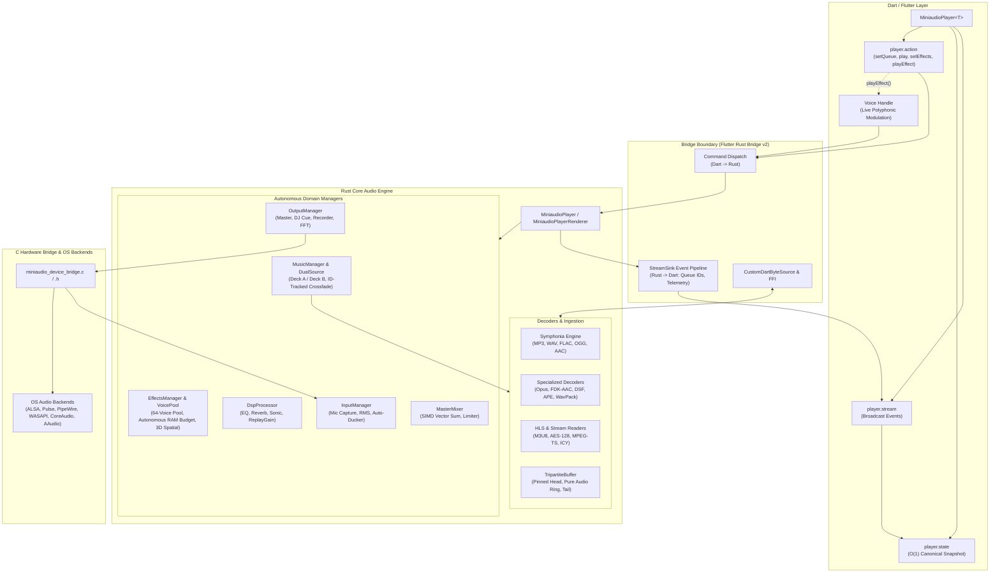
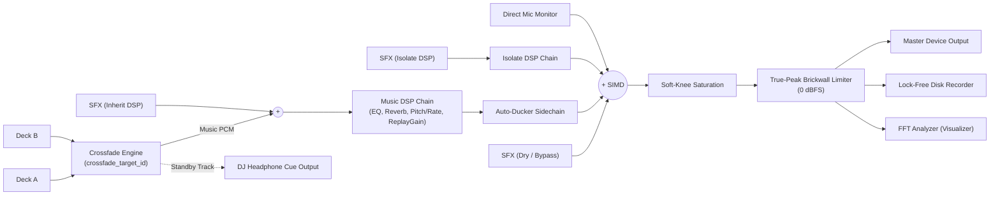

# `miniaudio_player` Architecture Specification

## 1. Executive Summary

`miniaudio_player` is an ultra-low-resource, cross-platform audio player and digital signal processing (DSP) engine built for Flutter and Dart. It combines a high-performance **Rust core** with **miniaudio** hardware abstraction and **Sonic DSP**, bridged seamlessly to Dart via **Flutter Rust Bridge (FRB v2)**.

The engine provides unified support for streaming music queues, autonomous memory-budgeted polyphonic RAM sound effects with 3D spatialization and Doppler kinematics, a multi-destination output matrix (speakers, DJ CUE pre-listening, and lock-free live recording), real-time microphone capture with auto-ducking, and studio-grade DSP processing.

---

## 2. System Architecture Overview

The system is organized into four clearly separated layers:

1. **Dart API Layer**: Developer-facing unified API featuring `MiniaudioPlayer<T>` and three orthogonal namespaces:
   - `player.action`: Asynchronous imperative commands (`setQueue`, universal `play`, `setEffects`, `playEffect`, DSP & routing controls).
   - `player.state`: $O(1)$ lock-free synchronous state snapshots with zero redundant aliases.
   - `player.stream`: Reactive broadcast streams for fine-grained UI bindings.
2. **Flutter Rust Bridge (FRB) & FFI Boundary**: Asynchronous RPC command dispatch, zero-copy byte transfers with immediate Dart heap reclamation (`clearBytes`), and lightweight native Rust-to-Dart broadcast event streaming.
3. **Rust Core Audio Engine (`miniaudio_player_rust`)**: Domain managers orchestrating dual-deck gapless playback, ID-tracked crossfading, autonomous RAM-budgeted polyphonic effects, DSP filters, SIMD audio mixing, and format decoders.
4. **C Hardware Bridge (`miniaudio`) & OS Audio Subsystem**: Native C11 bridge interfacing directly with platform audio backends (ALSA, PulseAudio, PipeWire, WASAPI, CoreAudio, AAudio, OpenSL ES, and WebAudio).

---

## 3. High-Priority Real-Time Audio Signal Path

The high-priority audio callback renders PCM samples under hard real-time deadlines. To guarantee zero audio dropouts (glitches / xruns), the render callback is strictly **lock-free, allocation-free, and syscall-free**.

### Signal Processing Steps:
1. **Music Decoding & ID-Tracked Crossfading**: `MusicManager` (`DualSource`) renders PCM frames from Deck A and Deck B, executing equal-power or linear crossfade interpolation governed by `crossfade_target_id`.
2. **Dynamic DSP Batching**:
   - `DspRouting.inherit`: Voices are summed into `scratch_music` before the main DSP pass, sharing EQ and Reverb at zero additional CPU cost.
   - `DspRouting.isolate`: Voices undergo dedicated DSP processing using pre-allocated work buffers.
   - `DspRouting.bypass`: Clean sound effects bypass all filters and feed directly into the master bus.
3. **Master Music DSP**: Equalizer, Reverb, Sonic (time-stretch & pitch-shift), and ReplayGain normalization applied in a single contiguous vectorized pass.
4. **Auto-Ducking & Mic Monitoring**: `InputManager` samples microphone input, tracks ballistic RMS envelopes, applies exponential sidechain ducking to the music bus, and mixes direct low-latency monitoring.
5. **Vectorized SIMD Summation**: `MasterMixer` sums all streams using hardware-accelerated SIMD instructions (AVX2/NEON).
6. **Master Dynamics & Limiting**: Soft-knee headroom protection followed by a true-peak brickwall limiter prevents digital clipping past 0 dBFS, allowing unconstrained positive gain (`volume >= 0.0`) on individual inputs and tracks.
7. **Multi-Destination Dispatch**: Processed audio is routed concurrently to the primary output device, DJ CUE pre-listening headphone bus, lock-free WAV disk recording ring buffer, and FFT spectrum visualizer.

---

## 4. Subsystem Details

### 4.1. Music Domain (`MusicManager` & `DualSource`)
- **Strict Separation of Queue Configuration and Playback**:
  - `player.action.setQueue(List<AudioSource<T>>)`: Replaces the playlist queue in Rust without starting playback or probing audio decoders. Sets `state.currentIndex` to `null` (`-1` in Rust) until `play(...)` is invoked.
  - `player.action.play({int? id, int? position, bool? shuffled, Duration? seek})`: Universal transport command handling initial start, resumption, track switching by monotonic `id` or zero-based `position` (`id` takes precedence over `position`), atomic shuffle activation (pinning the selected starting track to index `0` on first play), and initial seek offsets.
- **Deterministic Crossfade by Track ID (`crossfade_target_id`)**:
  - Crossfade transitions track the monotonic `id` (`Arc<AtomicI64>`) of the incoming track rather than its mutable queue index.
  - Any queue mutation (`append`, `insertNext`, `removeAt`, `reorder`, `reorderByIds`, `clearQueue`, `setShuffle`, `setLoopMode`) invokes `verify_or_abort_crossfade()`, immediately aborting any in-flight crossfade and restoring unity gain to the active deck if the expected target track ID has changed.
- **Lightweight Queue Telemetry & Memory Reclamation**:
  - Rust emits `RustPlayerEvent::Queue(Vec<i64>)` containing only ordered track IDs, eliminating redundant FFI serialization of strings and byte buffers on queue mutations.
  - When an `AudioSource<T>` backed by in-memory `Uint8List` bytes is transferred to Rust, Dart immediately clears its local byte reference via `clearBytes()` so the Dart GC reclaims the heap buffer while preserving generic `T? data` in `sourceRegistry`.
- **Unified Decoders, HLS & TripartiteBuffer**:
  - Powered by Symphonia with specialized decoders for Opus, FDK-AAC, Extended PCM, DSF (Direct Stream Digital), APE (Monkey's Audio), and WavPack.
  - Built-in M3U8 parser, AES-128 segment decryption, and MPEG-TS demuxer for HLS streams, alongside ICY metadata demuxing.
  - `TripartiteBuffer` separates the **Pinned Head** (ID3v2/FLAC/MP4 header metadata), **Pure Audio Ring** (bounded circular audio frame cache), and **Tail Buffer** (ID3v1/APEv2/trailing chunks) to prevent EOF decoder chirps and synthesize `.metaBytes` containers.

### 4.2. Sound Effects Domain (`EffectsManager`, `VoicePool`, & `Voice`)
- **Declarative Catalog (`setEffects`)**:
  - `player.action.setEffects(List<AudioEffect>)` registers the sound effects catalog in Rust. Manual `loadEffect`, `preloadEffects`, and `unloadEffect` methods are eliminated.
- **Autonomous Memory-Budgeted Eviction (`effectMemoryLimitMb`)**:
  - Configured via `effectMemoryLimitMb` on `MiniaudioPlayer` or `PlayerConfig` (defaults to `50` MB; nullable for unlimited memory with a `[!CAUTION]` safety warning).
  - **Memory-Backed Effect Immunity**: Effects created from in-memory bytes (`AudioSource(Uint8List)`) are decoded immediately in Rust (freeing compressed bytes) and are strictly **immune to eviction** (`SourceWeight = inf`), while counting toward `allocatedRamBytes`.
  - **Reactive Triggers (Zero Timers)**: Eviction runs deterministically on `playEffect(id)` (Trigger 1, prior to decoding an uncached effect) and on `VoiceCompleted` (Trigger 2, when an active voice finishes playing).
  - **Multi-Factor Retention Score**: Inactive evictable effects are ranked by:
    $$\text{Score} = \text{SourceWeight} \times (1 + \text{TriggerFrequency}) \times \frac{1}{1 + \Delta t_{\text{seconds}}}$$
    where `SourceWeight` is `5.0` for network URLs and `1.0` for local files. The lowest-scoring inactive effect is evicted first.
- **Encapsulated Live `Voice` Handle**:
  - `player.action.playEffect(id, ...)` configures all initial playback parameters (`volume`, `pitch`, `balance`, `pitchJitter`, `volumeJitter`, `emitter`, `looping`, `routing`) and returns a `Future<Voice>`.
  - The returned `Voice` object encapsulates live modulation of that active polyphonic voice slot (`voice.id`, `voice.setVolume`, `voice.setPitch`, `voice.setBalance`, `voice.setEmitter`, `voice.stop`), while global scene physics remain on `player.action.setListener` and `player.action.setDopplerParameters`.

### 4.3. Digital Signal Processing (`DspProcessor`)
- **Unconstrained Gain & Modulation**: `volume` (`>= 0.0`), `rate` (`> 0.0`), `pitch` (`> 0.0`), `micVolume` (`>= 0.0`), and `cueVolume` (`>= 0.0`) enforce no artificial upper ceiling (such as `2.0` or `4.0`), empowering full software amplification protected at the output stage by the master soft-knee saturator and 0 dBFS brickwall limiter.
- **10-Band ISO 266 Equalizer**: Peaking and shelving biquad filters tuned to standard center frequencies (31 Hz to 16 kHz).
- **Studio Algorithmic Reverb**: Freeverb-based network with 8 parallel comb filters and 4 cascaded allpass filters per channel.
- **Sonic DSP**: High-quality pitch shifting and time stretching without formant corruption.
- **ReplayGain & ITU-R BS.1770-4 / EBU R128**: Loudness normalization with peak clipping protection and single-pass offline acoustic analysis (`analyzeAudio`, `analyzeAudioSync`, `analyzeAudioMemory`).
- **Skip Silence**: Dynamic threshold detection with edge trimming and continuous pause excision.

### 4.4. Input & Capture (`InputManager`)
- **Microphone Capture**: Interfaces with hardware capture nodes via miniaudio.
- **Sidechain Auto-Ducker**: Automatically lowers music volume when speech is detected, configured by threshold, attack, hold, and release parameters.
- **Direct Monitoring**: Sub-15 ms hardware-to-master direct pass-through for karaoke and vocal applications.

### 4.5. Output Matrix & Recording (`OutputManager`)
- **Multi-Sink Matrix**: Dispatches the master mix to multiple active output targets configured via `player.action.configureOutputs`, `addOutput`, and `removeOutput`, reflected in `player.state.outputs`.
- **DJ Cue Pre-Listening**: Routes standby deck, active deck, or master mix to a secondary audio endpoint (e.g., USB headphones).
- **Lock-Free Live Recording**: Streams rendered audio frames into a single-producer single-consumer (`rtrb`) ring buffer, written to disk in a dedicated worker thread so the audio thread never blocks on disk I/O.
- **FFT Spectrum Visualizer**: Real-time 10-band Fast Fourier Transform and RMS/peak analyzer controlled via `player.action.setVisualizerEnabled`.

---

## 5. Concurrency and Threading Architecture

`miniaudio_player` separates execution across four distinct thread domains:

| Thread Domain | Responsibilities | Concurrency Guarantees |
| :--- | :--- | :--- |
| **Dart Main / UI Thread** | Widget rendering, user interaction, reactive stream subscriptions. | Non-blocking. Communicates with Rust via FRB and serialized transport queue. |
| **FRB Task Pool** | Command deserialization, initial stream probing, offline acoustic analysis. | Background worker threads. Long-running tasks do not block Dart or audio. |
| **I/O & Network Workers** | HTTP/HLS stream prefetching, file reading, disk recording writer. | Lock-free queues (`rtrb`, `crossbeam_channel`). Never holds mutexes shared with audio thread. |
| **Real-Time Audio Callback** | PCM frame generation, DSP execution, SIMD summing, hardware output. | Hard real-time priority. **Strictly lock-free, zero allocations, no syscalls, no blocking I/O.** |

### Synchronization Mechanisms
- **Seqlock (`CachePaddedSeqlock<T>`)**: Allows lock-free, tear-free atomic reads of high-frequency visualizer telemetry from the audio thread without blocking writer threads.
- **Lock-Free Ring Buffers (`rtrb`)**: Single-Producer Single-Consumer buffers decouple network/file data ingestion, voice completion notifications, and disk recording from the audio callback.
- **Atomic State Indicators**: Volume, rate, pitch, crossfade progress, and `crossfade_target_id` are updated atomically (`AtomicBool`, `AtomicI64`, `AtomicU64`, `AtomicU32`).

---

## 6. Dart API Design Principles

1. **Unified Concrete `AudioSource<T>`**:
   - A single concrete class with a single unified constructor `AudioSource(Object source, {Map<String, String>? headers, T? data, double? replayGainDb, double? replayPeak, int? id})` accepting:
     - `String` (local file path, HTTP/HTTPS URL, HLS `.m3u8` stream, or `data:` URI),
     - `Uri` (file, network, or `data:` URI),
     - `Uint8List` / `List<int>` (in-memory audio bytes, automatically cleared on the Dart side once transferred to Rust), or
     - `CustomByteProvider` (custom pull-based byte stream for DRM, encrypted decryption, or tokenized storage).
   - No subclass hierarchy (`UriAudioSource`, `MemoryAudioSource`, `CustomAudioSource`, and `AudioSource.custom` are eliminated).
2. **Orthogonal Namespaces & Encapsulation**:
   - `player.action`: Async imperative commands (`setQueue()`, `play()`, `pause()`, `seek()`, `setEffects()`, `playEffect()`). Holds a private reference to `_rustPlayer` directly, keeping `MiniaudioPlayer`'s FFI handle strictly private.
   - `player.state`: Canonical synchronous snapshot (`isPlaying`, `isBuffering`, `isCompleted`, `isOpening`, `isPaused`, `currentIndex`, `infiniteMixEnabled`, `mono`, `bufferSize`, `audioBitrate`, `preamp`, `limiterEnabled`, `isShuffled`) with zero duplicate convenience aliases.
   - `player.stream`: Fine-grained broadcast streams providing deduplicated reactive updates for UI components.
3. **Clean Break Architecture**: Zero deprecated facades or legacy shims; deterministic method signatures throughout.
4. **Effective Dart Documentation**: 100% English API documentation following official Dart guidelines.
