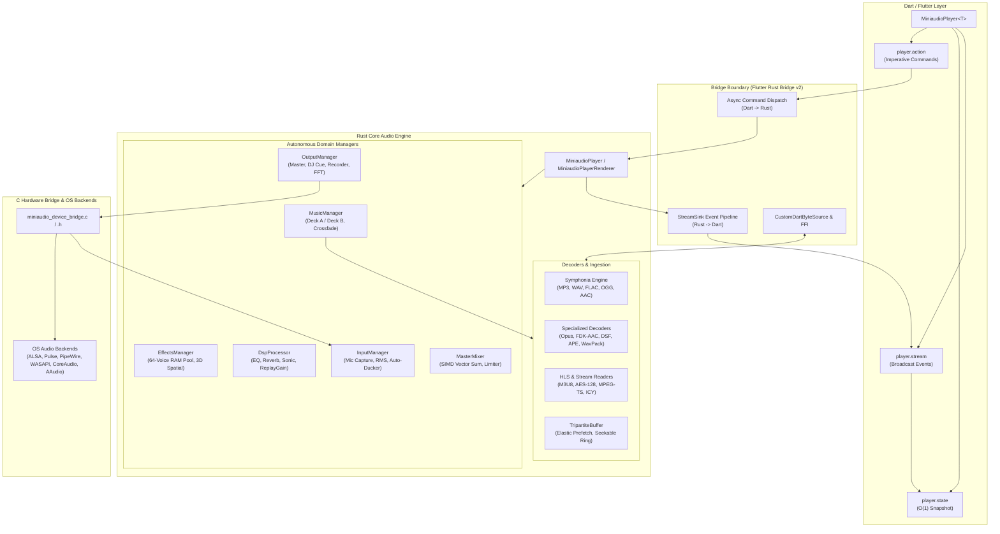
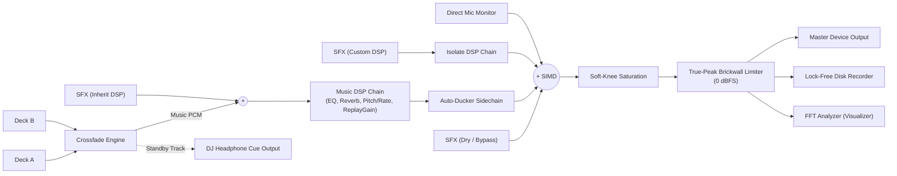

# `miniaudio_player` Architecture Specification

## 1. Executive Summary

`miniaudio_player` is an ultra-low-resource, cross-platform audio player and digital signal processing (DSP) engine built for Flutter and Dart. It combines a high-performance **Rust core** with **miniaudio** hardware abstraction and **Sonic DSP**, bridged seamlessly to Dart via **Flutter Rust Bridge (FRB v2)**.

The engine provides unified support for streaming music queues, polyphonic RAM sound effects with 3D spatialization and Doppler kinematics, a multi-destination output matrix (speakers, DJ CUE pre-listening, and lock-free live recording), real-time microphone capture with auto-ducking, and studio-grade DSP processing.

---

## 2. System Architecture Overview

The system is organized into four clearly separated layers:

1. **Dart API Layer**: Developer-facing unified API featuring `MiniaudioPlayer<T>` and three orthogonal namespaces:
   - `player.action`: Asynchronous imperative commands.
   - `player.state`: $O(1)$ lock-free synchronous state snapshots.
   - `player.stream`: Reactive broadcast streams for UI bindings.
2. **Flutter Rust Bridge (FRB) & FFI Boundary**: Asynchronous RPC command dispatch, zero-copy byte transfers, and native Rust-to-Dart broadcast event streaming.
3. **Rust Core Audio Engine (`miniaudio_player_rust`)**: Domain managers orchestrating playback, polyphonic effects, DSP filters, SIMD audio mixing, and format decoders.
4. **C Hardware Bridge (`miniaudio`) & OS Audio Subsystem**: Native C11 bridge interfacing directly with platform audio backends (ALSA, PulseAudio, PipeWire, WASAPI, CoreAudio, AAudio, OpenSL ES, and WebAudio).

---

## 3. High-Priority Real-Time Audio Signal Path

The high-priority audio callback renders PCM samples under hard real-time deadlines. To guarantee zero audio dropouts (glitches / xruns), the render callback is strictly **lock-free, allocation-free, and syscall-free**.

### Signal Processing Steps:
1. **Music Decoding & Crossfading**: `MusicManager` renders PCM frames from Deck A and Deck B, executing equal-power or linear crossfade interpolation.
2. **Dynamic DSP Batching**:
   - `DspRouting.inherit`: Voices are summed into `scratch_music` before the main DSP pass, sharing EQ and Reverb at zero additional CPU cost.
   - `DspRouting.isolate`: Voices undergo dedicated DSP processing using pre-allocated work buffers.
   - `DspRouting.bypass`: Clean sound effects bypass all filters and feed directly into the master bus.
3. **Master Music DSP**: Equalizer, Reverb, Sonic (time-stretch & pitch-shift), and ReplayGain normalization applied in a single contiguous vectorized pass.
4. **Auto-Ducking & Mic Monitoring**: `InputManager` samples microphone input, tracks ballistic RMS envelopes, applies exponential sidechain ducking to the music bus, and mixes direct low-latency monitoring.
5. **Vectorized SIMD Summation**: `MasterMixer` sums all streams using hardware-accelerated SIMD instructions (AVX2/NEON).
6. **Master Dynamics & Limiting**: Soft-knee headroom protection followed by a true-peak brickwall limiter prevents digital clipping past 0 dBFS.
7. **Multi-Destination Dispatch**: Processed audio is routed concurrently to the primary output device, DJ CUE pre-listening headphone bus, lock-free WAV/MP3 disk recording ring buffer, and FFT spectrum visualizer.

---

## 4. Subsystem Details

### 4.1. Music Domain (`MusicManager` & `DualDeck`)
- **Dual Decks**: Two independent playback decks (Deck A and Deck B) allow seamless gapless track transitions and automatic or manual crossfading.
- **Unified Decoders**: Powered by Symphonia with extensions for Opus, FDK-AAC, Extended PCM, DSF (Direct Stream Digital), APE (Monkey's Audio), and WavPack.
- **HLS & Live Streaming**: Built-in M3U8 parser, AES-128 segment decryption, and MPEG-TS demuxer for HLS streams, alongside ICY metadata extraction for internet radio.
- **TripartiteBuffer**: Three-segment elastic cache providing prefetch read-ahead, seekable history, and lock-free chunk ingestion from network and custom Dart sources.

### 4.2. Sound Effects Domain (`EffectsManager` & `VoicePool`)
- **Polyphonic Pool**: Manages up to 64 simultaneous voices held in RAM as shared `Arc<[f32]>` audio buffers.
- **Zero-Allocation Dynamic Batching**: Groups voices dynamically to process multiple sound effects through shared DSP scratch buffers without allocating memory.
- **3D Spatial Audio & Kinematics**:
  - Distance attenuation models: Inverse, Linear, and Exponential.
  - 3D Cartesian coordinates for listener and sound emitters.
  - Realistic Doppler effect simulation based on relative velocities and speed of sound.
- **Anti-Machinegun Jitter**: Random variations in pitch and volume prevent repetitive fatigue when rapid sound effects trigger consecutively.
- **LRU Eviction**: Intelligently evicts oldest or quietest voices when pool capacity is reached, while safeguarding pinned sound effects (`pinned: true`).

### 4.3. Digital Signal Processing (`DspProcessor`)
- **10-Band ISO 266 Equalizer**: Peaking and shelving biquad filters tuned to standard center frequencies (31 Hz to 16 kHz).
- **Studio Algorithmic Reverb**: Freeverb-based network with 8 parallel comb filters and 4 cascaded allpass filters per channel.
- **Sonic DSP**: High-quality pitch shifting and time stretching without formant corruption.
- **ReplayGain & ITU-R BS.1770-4 / EBU R128**: Loudness normalization with peak clipping protection.
- **Skip Silence**: Dynamic threshold detection with edge trimming and continuous pause excision for speech and podcasts.

### 4.4. Input & Capture (`InputManager`)
- **Microphone Capture**: Interfaces with hardware capture nodes via miniaudio.
- **Sidechain Auto-Ducker**: Automatically lowers music volume when speech is detected, configured by threshold, attack, hold, and release parameters.
- **Direct Monitoring**: Sub-15 ms hardware-to-master direct pass-through for karaoke and vocal applications.

### 4.5. Output Matrix & Recording (`OutputManager`)
- **Multi-Sink Matrix**: Dispatches the master mix to multiple active output targets.
- **DJ Cue Pre-Listening**: Routes standby deck, active deck, or master mix to a secondary audio endpoint (e.g., USB headphones).
- **Lock-Free Live Recording**: Streams rendered audio frames into a single-producer single-consumer (`rtrb`) ring buffer, decoded and written to disk in a worker thread to ensure the audio thread never blocks on disk I/O.
- **FFT Spectrum Visualizer**: 256/512-point Fast Fourier Transform computing normalized band energies for real-time UI spectrum visualizers.

---

## 5. Concurrency and Threading Architecture

`miniaudio_player` separates execution across four distinct thread domains:

| Thread Domain | Responsibilities | Concurrency Guarantees |
| :--- | :--- | :--- |
| **Dart Main / UI Thread** | Widget rendering, user interaction, reactive stream subscriptions. | Non-blocking. Communicates with Rust asynchronously via FRB. |
| **FRB Task Pool** | Command deserialization, initial stream probing, file acoustic analysis. | Background worker threads. Long-running tasks do not block Dart or audio. |
| **I/O & Network Workers** | HTTP/HLS stream prefetching, file reading, disk recording writer. | Lock-free queues (`rtrb`, `crossbeam_channel`). Never holds mutexes shared with audio thread. |
| **Real-Time Audio Callback** | PCM frame generation, DSP execution, SIMD summing, hardware output. | Hard real-time priority. **Strictly lock-free, zero allocations, no syscalls, no blocking I/O.** |

### Synchronization Mechanisms
- **Seqlock (`SeqLock<T>`)**: Allows lock-free, atomic reads of high-frequency playback telemetry (position, buffer range, RMS levels) from the audio thread without locking or blocking writer threads.
- **Lock-Free Ring Buffers (`rtrb`)**: Single-Producer Single-Consumer buffers decouple network data ingestion and disk recording from the audio callback.
- **Atomic State Indicators**: Volume, crossfade curves, and operational flags are updated atomically via standard Rust atomics (`AtomicBool`, `AtomicU64`, `AtomicF32`).

---

## 6. Dart API Design Principles

1. **Orthogonal Namespaces**:
   - `player.action`: Async commands returning futures (`play()`, `pause()`, `seek()`, `loadEffect()`).
   - `player.state`: Instant synchronous inspection of current values without inter-thread waiting.
   - `player.stream`: Fine-grained broadcast streams providing reactive updates for UI components.
2. **Clean Break Architecture**: No deprecated facades or shims; deterministic method signatures throughout.
3. **Type-Safe Domain Modeling**: Rich immutable value types and sealed hierarchies (`AudioSource`, `AudioOutput`, `AudioInput`, `DspRouting`, `Vector3`).
4. **Effective Dart Documentation**: 100% English API documentation following official Dart guidelines.
