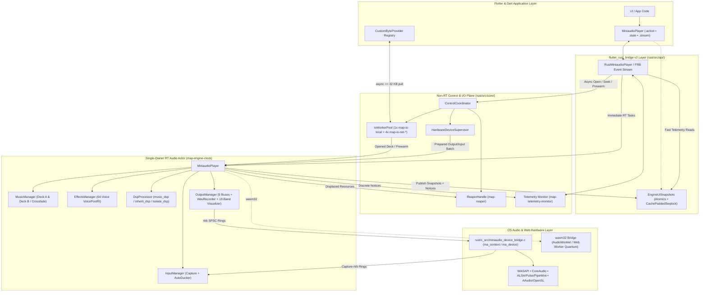

# miniaudio_player Architecture (v4.0.0)

`miniaudio_player` is a cross-platform audio playback, streaming, DSP, polyphonic sound effects, capture, recording, and acoustic analysis engine built on a **pure-Rust engine core** (`miniaudio_player_rust`) paired with a **minimal C99 hardware abstraction bridge** (`miniaudio_device_bridge.c` + `miniaudio.h`) and bound to Flutter/Dart via **`flutter_rust_bridge` v2 (`FRB`)**.

---

## 1. Architectural Principles

1. **Single-Owner Real-Time Actor (`map-engine-clock`)**: All real-time mixing, dual-deck crossfading, DSP, voice pooling, microphone ducking, and output bus routing execute on one dedicated OS thread that exclusively owns `MiniaudioPlayer`. No outer mutex wraps the audio engine during PCM rendering.
2. **Wait-Free / Lock-Free Boundaries**: OS audio hardware callbacks communicate with the engine via lock-free `rtrb` SPSC ring buffers (`OutputDeviceRenderer`, `DeviceCaptureNode`, `LiveRecorder`). UI/telemetry snapshots are exposed via atomics, `RwLock` snapshots (`EngineUiSnapshots`), and cache-padded sequence locks (`CachePaddedSeqlock<VisualizerData>`).
3. **Zero Head-of-Line Blocking in Control Paths**: Slow storage/network opening (`IoWorkerPool`), hardware enumeration/reopening (`HardwareDeviceSupervisor`), and heavy object dropping (`ReaperHandle` on `map-reaper`) run off the audio clock thread.
4. **Canonical 3-Namespace Dart Surface**: Everything on the Dart side flows through `MiniaudioPlayer<T>` via three orthogonal namespaces: `player.action`, `player.state`, and `player.stream`.
5. **Minimal C HAL Footprint**: `rust/c_src/miniaudio_device_bridge.c` disables miniaudio's node graph, decoders, encoders, resource manager, and high-level engine (`MA_NO_DECODING`, `MA_NO_ENCODING`, `MA_NO_RESOURCE_MANAGER`, `MA_NO_NODE_GRAPH`, `MA_NO_ENGINE`), retaining only `ma_context` and `ma_device`.

---

## 2. High-Level System Topology



---

## 3. Codebase Organization

```text
miniaudio_player/
├── lib/
│   ├── miniaudio_player.dart          # Package barrel exports
│   └── src/
│       ├── api/                       # Canonical MiniaudioPlayer<T>, action, state, stream, sources,
│       │                              # analysis models, devices, DSP config, spatial, recording
│       ├── loader/                    # CustomByteProvider async pull-stream abstraction
│       ├── rust/                      # Auto-generated FRB v2 Dart bindings
│       └── *.dart                     # Crossfeed, Equalizer, InfiniteMix, Reverb models
├── rust/
│   ├── Cargo.toml                     # Crate dependencies & size/LTO release profile
│   ├── c_src/
│   │   ├── miniaudio.h                # Unmodified miniaudio single-header HAL
│   │   ├── miniaudio_device_bridge.c  # Thin C99 ma_context/ma_device wrapper + Android AAudio hook
│   │   └── miniaudio_device_bridge.h
│   └── src/
│       ├── api/                       # FRB v2 exposed entrypoints, types, analyzer API, WASM quantum
│       ├── bridge/                    # Rust FFI declarations wrapping miniaudio_device_bridge.h
│       ├── buffer/                    # ByteSource hierarchy, 3-plane StreamSession, Demux/Meta readers
│       ├── core/                      # EngineActor, ControlCoordinator, IoWorkerPool, DualSource,
│       │                              # MusicManager, EffectsManager, InputManager, OutputManager,
│       │                              # AudioRenderer, DspProcessor, SimdMixer, LiveRecorder, Typestate
│       ├── decoder/                   # Symphonia 0.6 registry + APE, WavPack, DSF, Opus, Extended PCM,
│       │                              # StreamClassifier
│       ├── dsp/                       # BS.1770-4 / Waveform / Chromaprint analyzer, DF2T Biquads,
│       │                              # EQ, BS2B Crossfeed, Freeverb, SoftLimiter, AutoDucker, SilenceFSM,
│       │                              # Sonic wrapper, Rubato resampler, 3D Spatial, 10-Band Visualizer
│       ├── hls/                       # M3U8 playlist parser, AES-128-CBC decryptor, MPEG-TS demuxer
│       ├── metadata/                  # Lofty + Symphonia + ID3v2 CHAP + ICY unified metadata extractor
│       └── sync/                      # CancelToken, ReaperHandle, ring buffer helpers, CachePaddedSeqlock
├── example/
│   └── lib/                           # Studio Master Console (3 views: Console, Analyzer, Ingest Matrix)
└── docs/
    └── ARCHITECTURE.md
```

---

## 4. Dart Client Architecture (`lib/src/`)

### Unified Player & Startup Contract
* Callers must initialize native bindings once via `await MiniaudioPlayer.ensureInitialized();` (`RustLib.init(...)` with local shared-library fallback search for desktop dev runs). Instantiating `MiniaudioPlayer()` beforehand throws an explicit `StateError`.
* `MiniaudioPlayer<T>` has zero public `MiniaudioEngine` split: music decks, playlist queues, effects, multi-outputs, microphone inputs, recording, and analyzer static helpers (`analyzeAudio`, `analyzeAudioSync`) all live cleanly under `MiniaudioPlayer`.

### Orthogonality of `action`, `state`, and `stream`
* **`player.action` (`PlayerAction<T>`)** dispatches commands along two contention-free lanes:
  * **Lane 1 (`_serializeQueue` FIFO + `_activePlayEpoch`)**: Serializes queue mutations and track switches (`setQueue`, `append`, `insertNext`, `removeAt`, `reorder`, `reorderByIds`, `clearQueue`, `play`, `next`, `previous`) so overlapping slow opens never interleave out of order; newer `play(...)` epochs supersede superseded queued opens immediately.
  * **Lane 2 (Immediate RT Lane)**: Transport controls (`pause`, `stop`, `seek`), DSP updates (`setVolume`, `setRate`, `setPitch`, `setEqualizer`, `setReverb`, `setPreamp`, `setCrossfeed`, `setSpatializer`, `setSilenceConfig`, `setReplayGainMode`, `setLimiter`), SFX triggers (`playEffect`, `stopAllEffects`, listener/Doppler), and hardware/recording calls bypass the queue chain completely so slow HTTP opens never stall pause/seek/SFX latency.
* **`player.state` (`PlayerState<T>`)** provides $O(1)$ synchronous Dart snapshots updated strictly from native Rust events (`_onRustEvent`), keeping Flutter's UI tree decoupled from polling.
* **`player.stream` (`PlayerStream<T>`)** exposes reactive broadcast streams (`playbackState`, `position`, `buffer`, `queue`, `audioInfo`, `metadata`, `visualizer`, `isRecording`, `isDuckingActive`, `micRmsLevel`, `allocatedRamBytes`, `needMoreTracks`, `errors`, etc.). Heavy telemetry emitters (`visualizerEnabled`, `metadataEnabled`) default to zero-cost dormant mode until activated.

### Source Ownership & Custom Byte Providers
* `AudioSource<T>` accepts a file/URI `String`, `Uri`, `data:` URI, `Uint8List` / `List<int>`, or `CustomByteProvider`.
* For memory sources (`Uint8List` / `List<int>` / `data:` URI), `_prepareSource` hands byte ownership directly to Rust and clears Dart's internal reference via `_clearBytes()`, eliminating duplicate heap retention in the Dart isolate.
* Queue additions assign strictly monotonic 64-bit integer IDs (`_nextSourceId++`), powering deterministic native reordering (`reorderByIds`).

---

## 5. Concurrency, Actor Model & Lock-Free Primitives

### Dedicated Thread Roster
1. **`map-engine-clock` (`EngineActor`)**: Fixed-cadence actor thread stepping `MiniaudioPlayer::render_pcm(period_frames)` every audio period and draining non-blocking `RtActorMsg` commands from an unbounded `crossbeam_channel` before/between ticks. Publishes atomic snapshots (`EngineUiSnapshots`) and emits non-blocking `RtEngineNotice` and `RtControlHint` messages.
2. **`map-telemetry-monitor`**: Receives discrete notifications from `map-engine-clock` and pushes UI telemetry deltas (position, buffer bounds, metadata, errors, infinite-mix `NeedMoreTracks`, RAM effect stats) over FRB `StreamSink<RustPlayerEvent>`.
3. **`ControlCoordinator`**: Offloads blocking open, seek, standby prewarm, and hardware device reconfiguration tasks so `map-engine-clock` never waits on sockets, disk I/O, or OS audio endpoint negotiation.
4. **`IoWorkerPool`**:
   * `map-io-local` (`1` worker): Immediate `0 ms` dispatch for local file, memory, `asset://`, and custom sources.
   * `map-io-net-*` (`4` workers): Handles HTTP/HTTPS VOD, ICY live streams, and HLS `.m3u8` sources with epoch-guarded **rapid-skip coalescing** (`COALESCE_QUIET_MS = 18 ms`, `COALESCE_BURST_CAP_MS = 140 ms`) and `CancelToken` pre-emption when users mash Next/Previous. Also runs background `PrewarmJob` requests for the standby deck prior to crossfades or track boundaries.
5. **`HardwareDeviceSupervisor`**: Listens for OS default audio device switches (hot-plug notifications) to transparently rebuild/re-route `AUTO` endpoints and optionally trigger `pauseOnDeviceChange`.
6. **`map-reaper` (`ReaperHandle`)**: Receives displaced old decoders, byte sources, closed output devices, and finished recorder threads across a bounded lock-free channel, dropping them asynchronously so RT threads never invoke destructors or `free()`.

### Compile-Time Guarantees & Sync Modules (`rust/src/core/` & `rust/src/sync/`)
* **Typestate Lifecycle (`typestate.rs`)**: Encodes valid state transitions (`Uninitialized -> Open<S> -> Active<S> <-> Paused<S> / Stopped<S>`) and domain newtypes (`TrackId`, `DeckId`, `OpenGeneration`) to eliminate invalid transition states.
* **Lock-Free Primitives (`sync/`)**: `CachePaddedSeqlock` prevents false sharing across CPU cache lines while giving UI consumers wait-free visualizer snapshots (`VisualizerData`); `CancelToken` provides atomic cancellation propagation into synchronous network/file readers.

---

## 6. Universal Ingest & Three-Plane `StreamSession`

Rather than duplicating buffers in Dart or blocking decoders on raw HTTP sockets, ingest runs natively in Rust across two layers (`rust/src/buffer/` & `rust/src/hls/`):

### `ByteSource` Hierarchy (`source.rs`)
| Input Kind | Rust Implementation | Mechanism |
|---|---|---|
| Local Files / `asset://` | `FileByteSource` | OS file descriptor wrapped in a `64 KB` `BufReader`, loading initial header window + tail tags directly on `map-io-local`. |
| Memory / `data:` URI | `MemoryByteSource` | Moves Dart byte vector ownership directly into Rust (`_clearBytes()`), offering sub-microsecond in-RAM random access. |
| HTTP / HTTPS VOD | `StreamByteSource` (`HttpVod`) | `ureq` TLS client issuing HTTP `Range` byte requests with `CancelToken` abort and epoch invalidation. |
| Live Radio / ICY | `StreamByteSource` (`HttpLive`) | Sliding-window live jitter buffer with inline Shoutcast/Icecast ICY metadata frame extraction (`icy-metaint`). |
| HLS Streams (`.m3u8`) | `hls/` (`m3u8_parser`, `crypto`, `mpegts`) | Parses master/media playlists (`m3u8-rs`), decrypts **AES-128-CBC** segments, and demuxes **MPEG-TS** audio packets natively. |
| Custom Dart Streams | `CustomDartByteSource` | `CustomSourceRegistry` pulls chunks from Dart `CustomByteProvider` (`>= 32 KB` minimum prefetch, `10 s` response timeout) with zero temporary disk files. |

### Three-Plane `StreamSession` (`stream_buffer.rs` & `demux_reader.rs`)
Incoming bytes are routed by `StreamClassifier` (`classifier.rs`) into three isolated storage planes inside `StreamSession`:

1. **Plane 1 — `Head` (`BufferBackend::Linear`)**: Permanently pins container headers (`>= 64 KB` initial capacity, `32 KB` min growth step — `fLaC`, `moov`, `RIFF`, `OpusHead`, initial ID3 tags) so format re-probing and zero-offset replays never trigger extra I/O.
2. **Plane 2 — `Body` (`BufferBackend::Circular`)**: Byte-indexed sliding window ring (`8 MB` default capacity) delimited by `audio_start..audio_end`. Retains `[B_back | B_ahead]` around the read cursor (`10 s` local / `15 s` net backward seek retention and `30 s` default ahead target, dynamically scaled `1.0x..3.0x` by playback rate).
3. **Plane 3 — `Metadata` (`BufferBackend::Sparse`)**: `BTreeMap<u64, Vec<u8>>` sparse offset map keeping large tag blocks, embedded album art, chapters, and live ICY payloads strictly separated from the sequential PCM stream budget.

### Progressive 3-Phase Sliding-Window Coalescing
Background streamer threads (`miniaudio-net-streamer`) query `next_block_request()` driven by `SlidingWindowConfig` (`5 s` base window `B_win`, `32 KB/s` initial bitrate floor before live header estimate):
* **`BlockFetchPhase::UrgentBootstrap` (`buffer < 1 * B_win`)**: Fetches one `5 s` block immediately for minimal time-to-first-byte after open or hard seek.
* **`BlockFetchPhase::Stabilization` (`1..3 * B_win`)**: Streams incremental `5 s` windows while measured bitrate stabilizes.
* **`BlockFetchPhase::CoalescedCruise` (`>= 3 * B_win`)**: Suppresses frequent small network requests until a full `3 * B_win` (`15 s`) deficit builds up, requesting one coalesced super-block via HTTP `Range`.
* **In-Window Seek**: Seeks landing inside `[B_back, B_ahead]` resolve in $O(1)$ RAM; out-of-window seeks call `reset_for_seek()` and anchor a new `Range` fetch.

`DemuxedStreamReader` merges `Head` + `Body` into a single `Read + Seek + MediaSource` adapter (`5 s` blocking timeout) for decoders, while `MetadataStreamReader` feeds `Sparse` tags cleanly into `lofty`.

---

## 7. Multi-Codec Decoding & Single-Pass Acoustic Analyzer

### Decoder Registry (`rust/src/decoder/`)
`create_codec_registry()` wires:
* **Symphonia 0.6** core codecs/containers (`MP3`, `MP2`, `MP1`, `FLAC`, `Vorbis`, `AAC`, `ALAC`, `WAV`, `AIFF`, `MKV/WebM/MKA`, `CAF`).
* **`symphonia-adapter-libopus`** (`Opus`) and **`symphonia-adapter-fdk-aac`** (`FDK-AAC` on non-wasm targets).
* **Custom Native FormatReaders**: `ApeReader` (`ape-decoder`, `.ape`), `WavpackReader` (`wavicle`, `.wv`), `DsfReader` (`.dsf` / DSD64+), and `ExtendedPcmReader` (`RF64`, `RIFX`, `W64`, `BWF`, high-depth linear/float PCM).

### Metadata Engine (`rust/src/metadata/`)
Combines `lofty` (`ID3v1/v2`, `Vorbis Comments`, `MP4 ilst`, `APEv2`, `RIFF INFO`, `AIFF Text`), binary ID3v2 `CHAP` frame extraction, DSF/RIFF broadcast extension chunks, Symphonia `MetadataRevision`/`Visual`/`Cue`, and live ICY updates into one normalized `AudioMetadata` structure.

### Unified Single-Pass Analyzer (`rust/src/dsp/analysis.rs`)
`MiniaudioPlayer.analyzeAudio(...)` / `analyzeAudioSync(...)` evaluates a source on an isolated offline `StreamingDeck` (`new_analysis_deck`) without touching playback DSP or OS callbacks:
1. **Header Fast-Path**: When `replayGain`, `waveform`, and `chromaprint` are all `false`, only container headers and tags are probed (`< 1 ms`, zero PCM decode).
2. **Livestream Short-Circuit**: Unbounded streams skip whole-track loudness/waveform/fingerprint scans immediately.
3. **Single Decode Pass**: Each decoded stereo frame simultaneously feeds:
   * **`Bs1770LoudnessAnalyzer`**: ITU-R BS.1770-4 / EBU R128 K-weighting biquad cascade (`1681.97 Hz` acoustic high-shelf + `38.14 Hz` RLB high-pass) + `400 ms` dual-gated integrated loudness integration against `targetLufs` (`-18.0` LUFS default) + true sample peak.
   * **`AdaptiveWaveformAccumulator`**: Fixed bounded RAM (`MAX_BUCKETS = 2048`), starting at `256 frames/bucket` and triggering pairwise quadratic RMS folding ($\sqrt{(a^2 + b^2)/2}$) while doubling bucket stride whenever capacity fills, then resampling to `waveformPoints` (`100` default).
   * **`Chromaprint` Fingerprinting**: Converts chunks using a single reused `Vec<i16>` scratch buffer into `chromaprint-next` (`Algorithm::Test2`) for AcoustID matching.

---

## 8. Real-Time Audio Signal Path & Multi-Layer DSP

```mermaid
flowchart LR
    subgraph DecodeThread["DecoderWorker Thread (Per Active Deck)"]
        Demux["Symphonia / Custom Decoder"]
        Sil["SilenceDetector FSM (5 ms Crossfade)"]
        Mat["ChannelMatrix (Up/Downmix)"]
        Res["Rubato FFT/Sinc Resampler"]
        Ring["rtrb SPSC AudioRingBuffer"]
        Demux --> Sil --> Mat --> Res --> Ring
    end

    subgraph DeckRender["Per-Deck AudioRenderer (Inside map-engine-clock)"]
        Sonic["SonicStream / TimeStretch (Rate & Pitch)"]
        DeckChain["DspChain: Per-Deck ReplayGain + BS2B Crossfeed + 3D Spatial/Doppler + Limiter"]
        Sonic --> DeckChain
    end

    Ring --> Sonic

    subgraph MasterMix["MiniaudioPlayer::render_pcm (map-engine-clock)"]
        XFade["MusicManager::render (Deck A + Deck B EqualPower / Linear)"]
        MusicDSP["music_dsp (DspProcessor: Preamp + 10-Band DF2T EQ + Spatializer + Mono + Balance + Freeverb)"]
        TapMusic["scratch_music (Pure Music Bus)"]
        SuperFlow["super_flow (All Mix Bus)"]
        MicMgr["InputManager::process (Live-Edge Capture + Max-Attenuation AutoDucker + Direct Monitor)"]
        VoiceMgr["EffectsManager (64-Voice VoicePoolRt)"]
        IsoDSP["isolate_dsp / inherit_dsp (DspProcessor)"]
        Simd["SimdMixer (AVX2/FMA / NEON / Scalar)"]
        Lim["master_limiter (SoftLimiter Brickwall)"]
    end

    DeckChain --> XFade --> MusicDSP --> TapMusic
    TapMusic --> SuperFlow
    SuperFlow --> MicMgr
    MicMgr -->|"Voice Only"| BusVoice["scratch_voice"]
    VoiceMgr -->|"DspRouting::Bypass"| SuperFlow
    VoiceMgr -->|"DspRouting::Isolate"| IsoDSP --> Simd
    VoiceMgr -->|"DspRouting::Inherit"| IsoDSP
    MicMgr --> Simd --> Lim

    subgraph Dispatch["OutputManager::dispatch"]
        OutSinks["Physical Devices Matrix (rtrb -> miniaudio_device_bridge.c)"]
        Rec["LiveRecorder Thread (rtrb -> WAV Pcm16/Float32)"]
        Vis["10-Band DF2T Visualizer -> CachePaddedSeqlock"]
    end

    TapMusic --> Dispatch
    Lim --> Dispatch
    BusVoice --> Dispatch
```



### Key Signal-Processing Details
* **Per-Deck ReplayGain Isolation**: `ReplayGain` (`disabled`, `track`, `forced`) is applied per deck inside `AudioRenderer.dsp` (`DspChain`), while post-mix `music_dsp` keeps ReplayGain disabled. During a dual-deck crossfade, outgoing Deck A and incoming Deck B preserve their individual loudness normalization without double-scaling or mutating each other's gain.
* **True `MusicMix` Bus Separation**: `scratch_music` is tapped immediately after `music_dsp` and *before* `InputManager` auto-ducking and `EffectsManager` accumulation. Recording or monitoring `AudioOutputSource.musicMix` guarantees zero microphone ducking dip and zero SFX leakage, while `AudioOutputSource.all` captures the full ducked + SFX + monitored master mix.
* **Dual-Routing 64-Voice SFX Pool (`EffectsManager` & `VoicePoolRt`)**:
  * Voices tagged `DspRouting::Inherit` pass through `inherit_dsp` (mirroring music EQ/Preamp/Reverb/Spatializer/Mono), `DspRouting::Isolate` passes through `isolate_dsp`, and `DspRouting::Bypass` sums dry into `super_flow`.
  * Enforces `maxVoices` (up to 64) using configurable `VoiceStealingPolicy` (`oldest`, `quietest`, `lowestPriority`, `none`) and manages `maxRamBytes` memory budgets by LRU-evicting idle `LocalFile`/`Network` buffers while protecting pinned `Memory` byte-slice sounds.
  * Supports 3D emitter/listener coordinates (`SpatialListener`, `SpatialEmitter`, `DistanceModel`, `Vector3`) and Doppler pitch shifts via `compute_spatial_and_doppler`.
* **Sidechain `AutoDucker`**: Each active microphone input drains frames using live-edge jitter capping (`~3` periods max latency) and computes real-time RMS levels feeding configurable `Attack / Hold / Release` gain envelopes. Multi-mic setups arbitrate via **minimum gain (maximum attenuation)** across active microphones.

---

## 9. Multi-Destination Output Matrix, Hardware Supervisor & Platform HAL

### Five-Bus Routing & DJ CUE Pre-Listening
`AudioOutput` endpoints and `startRecording` (`LiveRecorder`) can independently tap any of 5 discrete buses:
1. `AudioOutputSource.all`: Master ducked music + SFX + direct-monitored mic + soft limiter.
2. `AudioOutputSource.musicMix`: Pure music + music DSP (zero SFX, zero ducking).
3. `AudioOutputSource.activeTrack`: Active foreground deck output (great for deck isolation).
4. `AudioOutputSource.standbyTrack`: Pre-loaded / outgoing standby deck (dedicated **DJ CUE headphone pre-listening**).
5. `AudioOutputSource.voiceOnly`: Isolated microphone capture bus (zero music, zero SFX).

### Physical Endpoint Deduplication (`AUTO` Collision Resolution)
On OSes where `'AUTO'` resolves to a concrete default device ID (e.g., `"Built-in Analog Stereo"`), `HardwareDeviceSupervisor` resolves `AUTO`'s physical OS identifier ahead of diffing so specifying both `AudioOutput()` (`'AUTO'`) and that physical ID in `outputs` (or `inputs`) opens **only one hardware stream**, prioritizing `'AUTO'` while preserving every user item in `state.outputs` / `state.inputs`.

### Platform Backend Matrix
* **Desktop & Mobile (Linux, Windows, macOS, Android, iOS)**: `rust/c_src/miniaudio_device_bridge.c` initializes `ma_context` / `ma_device` (WASAPI, CoreAudio, PulseAudio/PipeWire/ALSA, AAudio/OpenSL ES). On Android, an AAudio `waitForStateChange` wrapper clamps timeouts to `1.0 s` (`1_000_000_000 ns`) and recovers valid `STARTING`/`STARTED` states cleanly.
* **Web (`wasm32`)**: `rust/src/api/player.rs` exposes `wasm_worker_pump_quantum` to advance the player actor per Web Audio render quantum.

---

## 10. Binary Footprint & Build Optimization

* **`rust/Cargo.toml` (`[profile.release]`)**:
  * `opt-level = "s"` (size optimization alongside fast SIMD vector loops)
  * `lto = true` + `codegen-units = 1` (whole-program dead-code elimination and cross-crate inlining)
  * `strip = true` + `panic = "abort"` (strips symbols and unwind tables)
* **`rust/c_src/miniaudio_device_bridge.c`**:
  * Excludes all higher-level miniaudio engines/codecs (`MA_NO_DECODING`, `MA_NO_ENCODING`, `MA_NO_RESOURCE_MANAGER`, `MA_NO_NODE_GRAPH`, `MA_NO_ENGINE`), shrinking the C shim exclusively to hardware device I/O.
