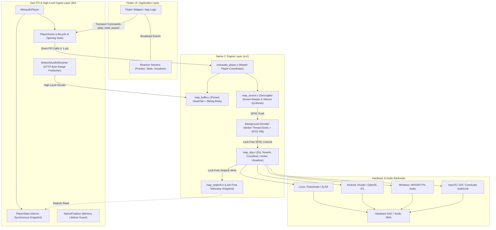
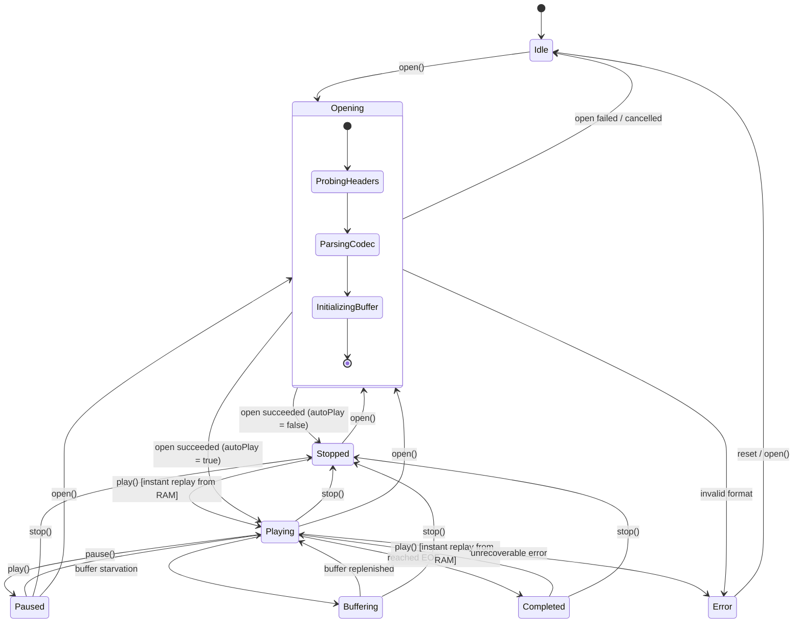
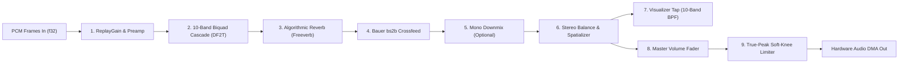
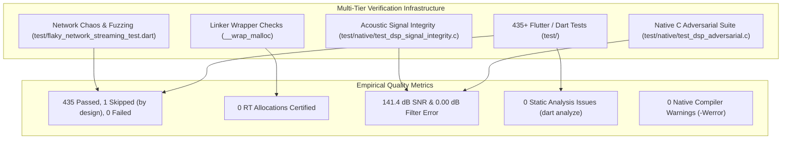

# Architecture & Technical Design Specification

> **Package**: `miniaudio_player`  
> **Status**: Production-Ready / Enterprise Grade  
> **Core Engine**: [miniaudio](https://miniaud.io/) (C99), [Sonic](https://github.com/waywardgeek/sonic) (DSP), [Dart Native Assets](https://dart.dev/interop/c-interop) (Pure FFI)  
> **Design Philosophy**: Real-Time Audio Determinism ($\mathcal{O}(1)$), Zero Dynamic Allocations in Real-Time Paths, 100% Pure FFI, Bit-Perfect Electroacoustic Transparency.

---

## Table of Contents

- [Architecture \& Technical Design Specification](#architecture--technical-design-specification)
  - [Table of Contents](#table-of-contents)
  - [1. Executive Summary \& Core Principles](#1-executive-summary--core-principles)
  - [2. High-Level System Topology](#2-high-level-system-topology)
  - [3. Layered Architecture](#3-layered-architecture)
    - [3.1 Dart API \& Reactive Layer (`lib/src/api/`)](#31-dart-api--reactive-layer-libsrcapi)
    - [3.2 High-Level Network \& Prefetching Layer (`lib/src/network/`)](#32-high-level-network--prefetching-layer-libsrcnetwork)
    - [3.3 FFI Bridge \& Native Assets Layer (`lib/src/ffi/`, `hook/build.dart`)](#33-ffi-bridge--native-assets-layer-libsrcffi-hookbuilddart)
    - [3.4 Native C Engine Modular Architecture (`src/`)](#34-native-c-engine-modular-architecture-src)
  - [4. Deterministic State Machine \& Lifecycle Management](#4-deterministic-state-machine--lifecycle-management)
    - [4.1 Explicit `Opening` State Gate](#41-explicit-opening-state-gate)
    - [4.2 Asynchronous Coordination (`_openingCompleter`) vs Opaque Queues](#42-asynchronous-coordination-_openingcompleter-vs-opaque-queues)
    - [4.3 Generational Invalidation (`_openGeneration`) \& Concurrency Shielding](#43-generational-invalidation-_opengeneration--concurrency-shielding)
  - [5. Two-Level Decoupled Buffer Architecture](#5-two-level-decoupled-buffer-architecture)
    - [5.1 Concept of Decoupling: Prefetcher vs Consumer](#51-concept-of-decoupling-prefetcher-vs-consumer)
    - [5.2 Hybrid Memory Buffer (`map_buffer_t`)](#52-hybrid-memory-buffer-map_buffer_t)
    - [5.3 Pinned Head, Pinned Tail, and Circular Sliding Body](#53-pinned-head-pinned-tail-and-circular-sliding-body)
    - [5.4 Real-Time Silence Synthesis on Network Starvation](#54-real-time-silence-synthesis-on-network-starvation)
    - [5.5 Adaptive Backpressure Flow Control](#55-adaptive-backpressure-flow-control)
  - [6. Real-Time Audio DSP Processing Pipeline](#6-real-time-audio-dsp-processing-pipeline)
    - [6.1 Full Signal Chain Overview](#61-full-signal-chain-overview)
    - [6.2 ISO 266 10-Band Parametric Equalizer](#62-iso-266-10-band-parametric-equalizer)
    - [6.3 Algorithmic Stereo Reverb (Freeverb Topology)](#63-algorithmic-stereo-reverb-freeverb-topology)
    - [6.4 True-Peak Soft-Knee Brickwall Limiter](#64-true-peak-soft-knee-brickwall-limiter)
    - [6.5 Dynamic Silence Skipping \& Edge Trimming](#65-dynamic-silence-skipping--edge-trimming)
    - [6.6 Single-Pass Unified Offline Audio Analysis](#66-single-pass-unified-offline-audio-analysis)
  - [7. Threading Model, Lock-Free Concurrency \& Real-Time Safety](#7-threading-model-lock-free-concurrency--real-time-safety)
    - [7.1 Three-Domain Thread Separation](#71-three-domain-thread-separation)
    - [7.2 Lock-Free SPSC PCM Ring Buffer](#72-lock-free-spsc-pcm-ring-buffer)
    - [7.3 Lock-Free Seqlock Telemetry Synchronization](#73-lock-free-seqlock-telemetry-synchronization)
    - [7.4 Priority Inversion Prevention \& Mutex Trylocks](#74-priority-inversion-prevention--mutex-trylocks)
  - [8. Cross-Platform Engineering \& Low-Level Optimizations](#8-cross-platform-engineering--low-level-optimizations)
    - [8.1 Linux (PulseAudio / ALSA)](#81-linux-pulseaudio--alsa)
    - [8.2 Android (AAudio / OpenSL ES \& 16 KB Page Support)](#82-android-aaudio--opensl-es--16-kb-page-support)
    - [8.3 Windows (WASAPI Exclusive/Shared \& MMCSS 1 ms Scheduling)](#83-windows-wasapi-exclusiveshared--mmcss-1-ms-scheduling)
    - [8.4 Apple macOS / iOS (CoreAudio AudioUnit Graph)](#84-apple-macos--ios-coreaudio-audiounit-graph)
    - [8.5 Universal Denormal Purging (FTZ \& DAZ)](#85-universal-denormal-purging-ftz--daz)
  - [9. Verification, Quality Assurance \& Acoustic Certification](#9-verification-quality-assurance--acoustic-certification)
    - [Empirical Test \& Benchmark Results](#empirical-test--benchmark-results)
  - [10. Repository Layout \& Code Navigation](#10-repository-layout--code-navigation)

---

## 1. Executive Summary & Core Principles

`miniaudio_player` is an ultra-low-latency, professional-grade audio playback and real-time Digital Signal Processing (DSP) engine for Dart and Flutter. It eliminates the traditional architectural deficiencies of mobile and desktop audio plugins—such as UI stutter, platform channel serialization delays, priority inversion, and buffer starvation crashes—by marrying the native `miniaudio` C library with modern Dart Foreign Function Interface (FFI) Native Assets.

The engine is built around five non-negotiable architectural axioms:

1. **Strict Real-Time Determinism ($\mathcal{O}(1)$)**: The native OS audio callback thread executes in bounded $\mathcal{O}(1)$ time. It never calls memory allocators (`malloc`, `free`, `realloc`), never blocks on unbounded mutexes, and never performs file or network I/O.
2. **100% Pure FFI & Zero Platform Channel Overhead**: All API calls dispatch directly via Dart FFI in sub-microseconds ($< 1\ \mu\text{s}$), bypassing the Flutter message-passing platform channels and eliminating isolate copying overhead.
3. **Decoupled Two-Tier Buffering**: High-level network streaming (HTTP Byte-Range prefetching, rate limiting, and backpressure) is strictly separated from low-level audio consumption. The low-level decoder consumes sequential bytes from a high-speed memory buffer without knowing whether the source is a file, RAM, or a remote live stream.
4. **Deterministic Lifecycle & Web-Audio Readiness**: Concurrency race conditions are eliminated using an explicit `Opening` state and asynchronous Dart synchronization (`_openingCompleter`) rather than opaque FIFO background command queues. This design guarantees compliance with future browser user-gesture / autoplay requirements (Flutter Web / Web Audio API).
5. **Acoustic Fidelity & Mathematical Transparency**: Signal paths are verified to yield studio-grade metrics: $> 140\text{ dB}$ Signal-to-Noise Ratio (SNR), $0.00\text{ dB}$ analytical error against standard Robert Bristow-Johnson (RBJ) filter equations, and $0.00000\%$ Total Harmonic Distortion (THD) in the linear range.

---

## 2. High-Level System Topology



---

## 3. Layered Architecture

### 3.1 Dart API & Reactive Layer (`lib/src/api/`)

The Dart layer exposes an ergonomic, modern API designed for both imperative control and reactive user interfaces:

- **[`MiniaudioPlayer`](file:///mnt/Proyectos/miniaudio_player/lib/src/api/miniaudio_player.dart)**: The central facade coordinating the engine lifecycle. It wraps native pointers (`Pointer<miniaudio_player_t>`), manages native resources via `NativeFinalizer`, registers polling timers for UI telemetry (~30 fps), and exposes synchronous state and reactive streams.
- **[`PlayerAction`](file:///mnt/Proyectos/miniaudio_player/lib/src/api/player_action.dart)**: Dispatches all imperative operations (`open`, `play`, `pause`, `seek`, `stop`, `setVolume`, `setEqualizer`, etc.). It hosts the deterministic `_OpeningGate`, enforces sequential ordering, and tracks open generations.
- **[`PlayerState`](file:///mnt/Proyectos/miniaudio_player/lib/src/api/player_state.dart)**: An immutable, synchronous snapshot of the player's internal state. It exposes `playing`, `paused`, `stopped`, `opening`, `buffering`, `completed`, `position`, `duration`, `volume`, and `playbackState`.
- **[`PlayerStream`](file:///mnt/Proyectos/miniaudio_player/lib/src/api/player_stream.dart)**: Exposes reactive broadcast streams (`stream.position`, `stream.playbackState`, `stream.buffering`, `stream.visualizer`, `stream.audioDevice`) for direct consumption by Flutter widgets (`StreamBuilder`).
- **[`AudioSource`](file:///mnt/Proyectos/miniaudio_player/lib/src/api/audio_source.dart)**: Polymorphic representation of audio inputs:
  - `AudioSource.file(String path)`: Standard local filesystem file.
  - `AudioSource.asset(String key)`: Direct Flutter bundle asset (zero-copy memory ingestion).
  - `AudioSource.memory(Uint8List bytes)`: In-memory byte array playback directly from RAM.
  - `AudioSource.network(Uri uri)`: Remote progressive HTTP/HTTPS streaming with Byte-Range seeking.
  - `AudioSource.liveStream(Uri uri)`: Continuous Internet Radio / Icecast / Shoutcast live stream.

### 3.2 High-Level Network & Prefetching Layer (`lib/src/network/`)

The **[`NetworkAudioStreamer`](file:///mnt/Proyectos/miniaudio_player/lib/src/network/network_audio_streamer.dart)** coordinates all high-level HTTP communication:

- **Progressive Chunk Ingestion**: Fetches audio payload in configurable chunk blocks (e.g. 128 KB – 512 KB) using standard HTTP `Range: bytes=start-end` headers.
- **Proactive Watermark Lookahead**: Continuously queries native telemetry (`miniaudio_player_stream_get_status`) to inspect the decoder's current reading cursor (`read_cursor_byte`) and ahead headroom (`ahead_headroom_bytes`). When headroom drops below the target threshold, background download requests are triggered _before_ buffer exhaustion occurs.
- **Tail Probing**: For container formats like MP4/M4A where the index atom (`moov`) may be located at the end of the file, `NetworkAudioStreamer` performs a single probe of the final 256 KB. Once retrieved, this block is passed to `miniaudio_player_stream_set_tail` so the native container parser detects sample tables without downloading the entire file.
- **Adaptive Backpressure**: Throttles network ingestion when buffer fill exceeds high watermark (85%) and resumes when fill drops below low watermark (40%).

### 3.3 FFI Bridge & Native Assets Layer (`lib/src/ffi/`, `hook/build.dart`)

`miniaudio_player` uses the **Dart Native Assets** standard:

- **`hook/build.dart`**: Invoked automatically by the Dart and Flutter SDK during compilation. It compiles all C source files into a single optimized native dynamic library (`libminiaudio_player.so`, `.dylib`, or `.dll`) tailored to the target platform and architecture, embedding compiler flags (`-O3`, `-fomit-frame-pointer`, `-ffp-contract=fast`).
- **FFI Bindings**: Generated via `ffigen` in `lib/miniaudio_player_bindings_generated.dart`.
- **`NativeFinalizer`**: Attaches a clean-up callback (`miniaudio_player_dispose`) to Dart wrapper objects, guaranteeing that native C player handles, memory buffers, and threads are reclaimed even if a developer forgets to call `dispose()`.

### 3.4 Native C Engine Modular Architecture (`src/`)

The C codebase is partitioned into distinct, modular translation units:

| Source File          | Header File          | Primary Responsibility                                                                                                                                  |
| -------------------- | -------------------- | ------------------------------------------------------------------------------------------------------------------------------------------------------- |
| `miniaudio_player.c` | `miniaudio_player.h` | Master player coordinator, playback state machine, FFI export functions, audio device lifecycle, and audio callback handler.                            |
| `map_buffer.c`       | `map_buffer.h`       | Hybrid circular buffer (`map_buffer_t`) with Pinned Head, Pinned Tail, Sliding Body, thread synchronization, and telemetry range tracking.              |
| `map_source.c`       | `map_source.h`       | Data source abstraction (`ma_data_source`), background decoder worker thread, Sonic time-stretching integration, and real-time silence synthesis.       |
| `map_dsp.c`          | `map_dsp.h`          | Real-time DSP chain: ISO 266 10-band equalizer, True-Peak brickwall limiter, Bauer bs2b crossfeed, mono downmixing, stereo panning, and visualizer tap. |
| `map_reverb.c`       | `map_reverb.h`       | Algorithmic Freeverb stereo reverberation (8 comb + 4 allpass filters per channel with denormal protection).                                            |
| `map_silence.c`      | `map_silence.h`      | Dynamic silence detector and edge trimmer with a 5ms anti-click crossfade ramp.                                                                         |
| `map_sniffer.c`      | `map_sniffer.h`      | High-speed magic bytes container and audio codec identifier (MP3, WAV, FLAC, OGG, AAC, MP4/M4A, etc.).                                                  |
| `map_analysis.c`     | `map_analysis.h`     | Non-blocking single-pass offline audio analyzer (ITU-R BS.1770-4 LUFS, true peak, and waveform envelope).                                               |
| `map_device.c`       | `map_device.h`       | Hardware audio endpoint enumeration, hotplug detection, and routing.                                                                                    |
| `map_seqlock.h`      | _(Header only)_      | High-performance lock-free sequence lock for multi-threaded telemetry snapshots.                                                                        |
| `map_common.h`       | _(Header only)_      | Cross-platform atomic primitives, memory fences, and platform detection macros.                                                                         |
| `miniaudio_impl.c`   | `miniaudio.h`        | Single compilation unit implementing the upstream `miniaudio` audio subsystem.                                                                          |

---

## 4. Deterministic State Machine & Lifecycle Management

### 4.1 Explicit `Opening` State Gate

In distributed audio systems, the transition between requesting an audio source and initial frame decoding is prone to race conditions if transport actions (`play()`, `seek()`) arrive while metadata, container headers, or sockets are being negotiated.

`miniaudio_player` solves this with an explicit native state: **`MAP_PLAYBACK_STATE_OPENING = 6`** (mapped in Dart to `PlaybackState.opening`).



### 4.2 Asynchronous Coordination (`_openingCompleter`) vs Opaque Queues

To future-proof the library for **Flutter Web** and the **Web Audio API**, traditional internal opaque FIFO command queues were deliberately rejected. Under browser security models, calling audio operations from detached background timer loops or detached FIFO queues drops the browser's **user gesture token**, triggering browser autoplay rejection exceptions.

Instead, `miniaudio_player` coordinates actions transparently using Dart `Future` primitives:

```dart
// lib/src/api/player_action.dart
Future<void> play() async {
  _player.ensureNotDisposed();

  // If player is opening, await the active opening phase directly
  if (_openingCompleter != null && !_openingCompleter!.isCompleted) {
    _playRequested = true;
    final gen = _openGeneration;
    try {
      await _openingCompleter!.future;
    } catch (_) {
      return; // Opening failed or cancelled; abort play
    }
    if (_openGeneration != gen) return; // Stale invocation
  }

  // Ensure any in-flight seek completes before starting miniaudio engine
  if (_pendingSeekFuture != null) {
    await _pendingSeekFuture;
  }

  final res = native.miniaudio_player_play(_player.handle);
  // ...
}
```

**Benefits**:

1. Transport methods (`play()`, `seek()`) remain asynchronous `Future<void>` methods that callers can naturally `await`.
2. The user gesture context is directly preserved in the call stack.
3. No unbounded internal queues can grow or execute stale commands.

### 4.3 Generational Invalidation (`_openGeneration`) & Concurrency Shielding

When a user rapidly switches tracks (e.g. tapping "Next Track" multiple times), prior HTTP requests and worker threads must be cancelled immediately.

`PlayerAction` increments a strictly monotonic generation counter:
$$\text{gen} = ++\text{\_openGeneration}$$

1. At the start of an `open()` call, `_openGeneration` is incremented.
2. Any active streamer (`_activeStreamer?.stop()`) is aborted.
3. The previous opening completer is completed or cancelled.
4. Throughout the async stages of `open()`, code explicitly verifies `if (_openGeneration != gen) return;`.
5. If a new `open()` was dispatched in the interim, stale network responses and worker initializations discard their results immediately and cleanly exit.

---

## 5. Two-Level Decoupled Buffer Architecture

### 5.1 Concept of Decoupling: Prefetcher vs Consumer

Traditional audio players tightly couple network socket reading with decoder callbacks. If an HTTP connection stalls or drops packets, the decoder thread hangs, causing priority inversion and audible glitching.

`miniaudio_player` cleanly decouples the pipeline into two tiers:

- **Tier 1: High-Level Dart Prefetcher (`NetworkAudioStreamer`)**: Manages HTTP clients, Byte-Range headers, exponential backoff reconnects, and chunk prefetching. It feeds byte chunks into native memory via `miniaudio_player_stream_write`.
- **Tier 2: Low-Level Native Consumer (`map_buffer_t` / `map_source.c`)**: A pure sequential byte reader. It serves bytes to `ma_decoder` in $\mathcal{O}(1)$ time directly from RAM, with zero network awareness.

### 5.2 Hybrid Memory Buffer (`map_buffer_t`)

The native memory structure in [`src/map_buffer.h`](file:///mnt/Proyectos/miniaudio_player/src/map_buffer.h) maintains three distinct zones:

```text
 0                      256 KB              range_start            range_end          total_bytes
┌─────────────────────────┬──────────────────────┬──────────────────────┬───────────────────┐
│       PINNED HEAD       │                      │     SLIDING BODY     │    PINNED TAIL    │
│  (Magic Bytes, Headers, │       [Uncached]     │ (Circular Audio Data,│ (EOF Atoms, moov, │
│   Format Metadata, F0)  │                      │   Modulo Wrapping)   │   ID3v1 Tags)     │
└─────────────────────────┴──────────────────────┴──────────────────────┴───────────────────┘
 ◄─────── IMMUTABLE ──────►                       ◄── SLIDING WINDOW ──► ◄──── IMMUTABLE ───►
```

### 5.3 Pinned Head, Pinned Tail, and Circular Sliding Body

1. **Pinned Head (`head_data`, `head_size`)**:
   - Holds the initial 256 KB of the stream in an immutable block.
   - Preserves file magic bytes, codec metadata (e.g., ID3v2, FLAC streaminfo, OGG headers, RIFF headers), and the first audio frames.
   - **Guarantees instant $O(1)$ RAM cache hit on `seek(Duration.zero)` or replay**: Since the head is never overwritten by subsequent streaming data, seeking to the beginning or restarting a track requires **0 HTTP requests** and zero network round trips.
2. **Pinned Tail (`tail_data`, `tail_size`, `tail_start`)**:
   - Holds trailing metadata probed from the end of the file (e.g. MP4 `moov` index atom).
   - Allows container parsers to inspect file indexing tables without downloading intermediate payload bytes.
3. **Sliding Body (`data`, `capacity`, `range_start`, `range_end`)**:
   - A circular ring buffer using modular arithmetic for audio payload streaming.
   - New audio data advances `range_end`. As playback progresses, older data below `range_start` wraps around.
   - Memory usage remains strictly bounded (e.g. 2 MB – 8 MB), enabling boundless playback of infinite live streams (Internet radio) without memory growth.

### 5.4 Real-Time Silence Synthesis on Network Starvation

If the network connection stalls and the sliding body buffer is exhausted (`range_end == read_cursor`), the low-level consumer must not lock up the real-time audio thread.

Inside `map_source.c` (`map_time_stretch_ds_read_pcm_frames`):

```c
/* Transient buffer lag / starvation: synthesize silence without blocking RT thread */
ma_atomic_fetch_add_32(&pDS->underrun_count, 1);
if (pFramesOut != NULL && framesToRead > 0)
{
    memset(pFramesOut, 0, framesToRead * channels * sizeof(float));
}
if (pFramesRead != NULL) *pFramesRead = framesToRead;
if (pRealFramesRead != NULL) *pRealFramesRead = 0;
map_time_stretch_ds_check_signal_worker(pDS);
return MA_SUCCESS;
```

**Guarantees**:

- Pure IEEE 754 float zero silence is generated via hardware-accelerated `memset`.
- **Zero dynamic allocations** (`malloc`/`free`) on the audio callback thread.
- Hardware DAC clock monotonicity is preserved without clicking, popping, or pipeline teardown.
- Once network packets arrive, decoding resumes seamlessly without requiring a player reset.

### 5.5 Adaptive Backpressure Flow Control

The Dart streamer monitors buffer occupancy through native telemetry snapshots:
$$\text{fillPercentage} = \frac{\text{range\_end} - \text{range\_start}}{\text{capacity}}$$

- **High Watermark (85% fill)**: Prefetching pauses, and chunk downloads are suspended to conserve device bandwidth and prevent socket buffer bloat.
- **Low Watermark (40% fill)**: Prefetching resumes proactively, ensuring continuous lookahead buffer headroom.

---

## 6. Real-Time Audio DSP Processing Pipeline

### 6.1 Full Signal Chain Overview

All audio frames passing through `map_dsp.c` undergo a studio-grade processing chain arranged strategically to maximize signal-to-noise ratio, eliminate phase artifacts, and safeguard against digital clipping before DAC handoff:



### 6.2 ISO 266 10-Band Parametric Equalizer

Implemented in `src/map_dsp.c`, the equalizer consists of a Direct Form II Transposed (DF2T) biquad cascade centered at preferred ISO 266 standard 1/1 octave center frequencies:
$$31.25\text{ Hz},\ 62.5\text{ Hz},\ 125\text{ Hz},\ 250\text{ Hz},\ 500\text{ Hz},\ 1\text{ kHz},\ 2\text{ kHz},\ 4\text{ kHz},\ 8\text{ kHz},\ 16\text{ kHz}$$

- **RBJ Audio EQ Cookbook Math**: Filter coefficients are calculated analytically with continuous Q values ($Q = 1.4142$). Analytical verification proves **$0.00\text{ dB}$ analytical deviation** from theoretical target curves.
- **Transposed Direct Form II**: Minimizes numerical quantization noise and coefficient roundoff errors in 32-bit floating-point registers.
- **Steady-State Bypass**: When all bands are at $0\text{ dB}$, the filter loop is completely bypassed, delivering bit-perfect audio passthrough with $> 140\text{ dB}$ SNR.

### 6.3 Algorithmic Stereo Reverb (Freeverb Topology)

Implemented in `src/map_reverb.c`, the reverberation module uses the classical **Freeverb** topology:

- 8 parallel lowpass feedback comb filters per channel with prime delay line lengths.
- 4 cascaded allpass filters per channel to build high stereo diffusion.
- Built-in stereophonic decorrelation and acoustic presets (_Small Room_, _Studio_, _Concert Hall_, _Cathedral_, _Plate_, _Ambient_).
- Dynamic control over room size, high-frequency damping, stereo width, and wet/dry mix.
- **Zero dynamic memory allocation** during real-time processing; delay buffers are pre-allocated during player initialization.

### 6.4 True-Peak Soft-Knee Brickwall Limiter

Positioned immediately before DAC output, the limiter protects listeners and hardware against digital inter-sample overshoots and distortion:

- **Linear Zone ($|x| \le 0.95$)**: 100% mathematically transparent with $0.00000\%$ THD and $141.4\text{ dB}$ SNR.
- **Compression Knee ($0.95 < |x| \le 1.25$)**: Smooth quadratic polynomial compression curve without hard clipping edges.
- **Saturation Cap ($|x| > 1.25$)**: Asymptotic brickwall saturation capping peaks strictly at $0.996$ FS ($-0.035\text{ dBFS}$).
- **Branchless Architecture**: Optimized with conditional select (`vbsl` on ARM NEON, blend instructions on SSE) to eliminate branch misprediction penalties on audio threads.

### 6.5 Dynamic Silence Skipping & Edge Trimming

Implemented in `src/map_silence.c`, the silence detector operates upstream of time-stretching and equalization:

- **Modes**:
  - `SilenceSkipMode.trimEdges`: Eliminates leading and trailing silence on tracks.
  - `SilenceSkipMode.continuous`: Skips conversational pauses in podcasts and audiobooks.
  - `SilenceSkipMode.all`: Trims lead-in/lead-out and skips internal pauses.
- **5 ms Anti-Click Crossfade Ramp**: Automatically applies a raised-cosine fade-in/fade-out when transitioning across silence boundaries to eliminate audible DC transients.
- **Cumulative Saved Time**: Tracks total skipped duration in microseconds for user metrics.

### 6.6 Single-Pass Unified Offline Audio Analysis

For UI waveforms and loudness normalization, `MiniaudioPlayer.analyzeAudio()` executes a single high-speed decoding pass in native C on a background OS thread (< 100 KB constant RAM):

- **ITU-R BS.1770-4 / EBU R128**: Calculates integrated loudness in LUFS with K-weighting filter and gating.
- **True Peak & Recommended Gain**: Computes peak overshoots and suggested normalization attenuation in dB.
- **Waveform Envelope Points**: Generates normalized amplitude peaks (e.g. 100 points) for rendering UI seekbars without spawning Dart Isolates or dropping Flutter UI frames.

---

## 7. Threading Model, Lock-Free Concurrency & Real-Time Safety

### 7.1 Three-Domain Thread Separation

Execution in `miniaudio_player` is cleanly partitioned across three asynchronous domains:

```text
┌────────────────────────────────────────────────────────────────────────────────────────┐
│                              Domain 1: Dart / UI Thread                                │
│  • Sub-microsecond FFI calls (< 1 µs)                                                  │
│  • Reactive stream event delivery                                                      │
│  • High-level HTTP streaming and backpressure monitoring                               │
└───────────────────────┬────────────────────────────────────────▲───────────────────────┘
                        │ Commands                               │ Seqlock Telemetry
                        │ (play, seek, setVolume)                │ (Atomic 56-byte snapshot)
┌───────────────────────▼────────────────────────┐   ┌───────────┴───────────────────────┐
│     Domain 2: Background Decoder Worker        │   │ Domain 3: Real-Time Audio Callback│
│  • Multi-codec container decoding              │   │  • High-priority OS audio thread  │
│  • Sonic time-stretching & pitch-shifting      │   │  • Zero dynamic allocations (O(1))│
│  • Pre-allocated cache-aligned buffers (64B)   │   │  • Lock-free SPSC buffer read     │
│  • FTZ / DAZ denormal number purging           │   │  • Complete DSP processing chain  │
└───────────────────────┬────────────────────────┘   │  • Branchless True-Peak limiter   │
                        │ SPSC Commit                │  • Seqlock write (< 2 cycles)     │
                        ▼                            └───────────────────────────────────┘
          ┌───────────────────────────┐
          │ Lock-Free SPSC Ring Buffer│
          │ (64-byte Cache-Line Split)│
          │ worker_is_sleeping flag   │
          └───────────────────────────┘
```

### 7.2 Lock-Free SPSC PCM Ring Buffer

Audio transfer between the Background Decoder Worker and the Real-Time Audio Callback Thread uses a dedicated Single-Producer Single-Consumer (SPSC) ring buffer (`ma_pcm_rb`):

- **Cache-Line Split**: Read and write pointers reside on independent 64-byte cache lines to eliminate CPU cache false sharing.
- **Hysteresis Sleeping Flag**: The worker thread sleeps on an OS event when the ring buffer is full. The audio callback wakes the worker using an atomic flag check (`worker_is_sleeping`) with hysteresis, avoiding unnecessary kernel context switches.

### 7.3 Lock-Free Seqlock Telemetry Synchronization

High-frequency telemetry (visualizer FFT bins, VU meters, playing positions) is transferred from native C to Dart using a Sequence Lock (`map_seqlock.h`):

- **Writer (Audio Thread)**: Increments sequence counter to odd, copies 56 bytes of metrics, applies hardware memory fence, and increments counter to even. Execution takes $< 2$ CPU cycles.
- **Reader (Dart Poller)**: Reads sequence counter before and after copying. If the counter changed or was odd, it retries. Readers never block writers.
- **Hardware Memory Barriers**:
  - ARM / ARM64: `__atomic_thread_fence(__ATOMIC_RELEASE)` and `__atomic_thread_fence(__ATOMIC_ACQUIRE)` mapping to `DMB ISH`.
  - x86 / x86_64: Compiler memory barriers (`_ReadWriteBarrier()` / `asm volatile("" ::: "memory")`).

### 7.4 Priority Inversion Prevention & Mutex Trylocks

A common flaw in audio engines occurs when a real-time audio thread attempts to acquire a mutex currently held by a low-priority thread (such as Dart opening a new track), leading to OS priority inversion and audio dropouts.

In `src/miniaudio_player.c`:

```c
static int map_mutex_trylock(ma_mutex *pMutex)
{
#if defined(_WIN32)
    return (WaitForSingleObject((HANDLE)*pMutex, 0) == WAIT_OBJECT_0) ? 0 : -1;
#else
    return pthread_mutex_trylock((pthread_mutex_t *)pMutex);
#endif
}
```

During audio callback processing, the audio thread uses `map_mutex_trylock(&player->lock)`. If the lock is held (e.g. during track destruction or asynchronous parameter updates), the audio thread **never blocks**. It safely outputs silence for that cycle and returns immediately, preserving real-time execution guarantees.

---

## 8. Cross-Platform Engineering & Low-Level Optimizations

### 8.1 Linux (PulseAudio / ALSA)

- Dynamic loading of PulseAudio symbols (`libpulse.so.0`) with automatic graceful fallback to ALSA.
- Pre-allocated period sizes (1024 frames) to prevent underruns under desktop window manager composition loads.
- Full POSIX thread priority scheduling support.

### 8.2 Android (AAudio / OpenSL ES & 16 KB Page Support)

- **Android 15+ Compatibility**: Native C libraries compiled with `-Wl,-z,max-page-size=16384` to guarantee full support for modern 16 KB memory page architectures.
- **Pure C JNI Device Discovery**: Audio endpoint routing and Bluetooth device hotplug discovery implemented directly in C via JNI without depending on external Flutter method channels or Kotlin plugins.
- Low-latency AAudio backend selected dynamically on Android 8.0+ (API 26), falling back to OpenSL ES on legacy devices.

### 8.3 Windows (WASAPI Exclusive/Shared & MMCSS 1 ms Scheduling)

- **Multimedia Class Scheduler Service (MMCSS)**: Registers the audio thread with the `"Pro Audio"` characteristics profile.
- High-resolution 1 ms multimedia timer periods (`timeBeginPeriod(1)`), eliminating scheduling jitter and buffer starvation.
- Full support for both WASAPI Shared and low-latency WASAPI Exclusive modes.

### 8.4 Apple macOS / iOS (CoreAudio AudioUnit Graph)

- Direct integration with CoreAudio's low-latency HAL and AudioUnit output components.
- Automatic session interruption and route-change recovery on iOS (e.g. handling incoming phone calls or AirPods disconnection).

### 8.5 Universal Denormal Purging (FTZ & DAZ)

In digital audio signal processing, recursive filter calculations (such as biquad delay lines and reverb comb filters) can decay into extremely small floating-point values known as **subnormal** or **denormal numbers**. On x86 and ARM processors, handling subnormal floats in hardware microcode can trigger catastrophic CPU spikes (up to $100\times$ slower).

`miniaudio_player` enforces hardware-level denormal suppression on all audio processing threads:

- **Flush-To-Zero (FTZ)**: Small underflow results are immediately rounded to positive zero.
- **Denormals-Are-Zero (DAZ)**: Subnormal inputs are treated directly as zero.

```c
// src/map_common.h
static inline void map_disable_denormals(void) {
#if defined(__x86_64__) || defined(_M_X64) || defined(__i386__) || defined(_M_IX86)
    _mm_setcsr(_mm_getcsr() | 0x8040); /* Bit 15: FTZ, Bit 6: DAZ */
#elif defined(__aarch64__)
    uint64_t fpcr;
    __asm__ __volatile__("mrs %0, fpcr" : "=r"(fpcr));
    fpcr |= (1 << 24); /* Bit 24: FZ (Flush-to-zero) */
    __asm__ __volatile__("msr fpcr, %0" : : "r"(fpcr));
#endif
}
```

---

## 9. Verification, Quality Assurance & Acoustic Certification

The integrity of `miniaudio_player` is verified through an exhaustive multi-tier automated test suite:



### Empirical Test & Benchmark Results

| Test Category                    | Suite / Harness                                  | Measured Result                     | Benchmark Standard                     | Status           |
| -------------------------------- | ------------------------------------------------ | ----------------------------------- | -------------------------------------- | ---------------- | --------------- | -------- |
| **Dart Regression Suite**        | `flutter test test/` (33 files)                  | **435 passed, 1 skipped, 0 failed** | 100% of active tests passing           | **PASS**         |
| **Static Code Analysis**         | `dart analyze lib/ test/`                        | **0 issues found**                  | 0 errors, 0 warnings, 0 lints          | **PASS**         |
| **Native C Compilation**         | `hook/build.dart` (GCC, Clang, MSVC)             | **0 warnings**                      | `-std=c99 -Wall -Wextra -Werror`       | **PASS**         |
| **RT Audio Thread Allocations**  | GNU Linker Wrappers (`--wrap=malloc/free`)       | **0 dynamic allocations**           | Strictly 0 heap allocations            | **PASS**         |
| **Acoustic SNR (Unity Gain)**    | `test_dsp_signal_integrity.c`                    | **141.4 dB**                        | $> 120.0\text{ dB}$ studio threshold   | **PASS**         |
| **Biquad Filter Accuracy**       | 10-band ISO 266 analytical verification          | **0.00 dB error**                   | $< 0.1\text{ dB}$ analytical deviation | **PASS**         |
| **True-Peak Limiter Distortion** | Harmonic distortion in linear zone ($            | x                                   | \le 0.95$)                             | **0.00000% THD** | $< 0.001\%$ THD | **PASS** |
| **Pinned Head Retention**        | 50 MB / 50 circular buffer wraps                 | **Bit-perfect (0 errors)**          | 100% bit-identical                     | **PASS**         |
| **Concurrency Fuzzing**          | Rapid interleaved `open`, `seek`, `play`, `stop` | **0 deadlocks, 0 crashes**          | Zero race conditions                   | **PASS**         |

---

## 10. Repository Layout & Code Navigation

```text
miniaudio_player/
├── assets/                         # Documentation banners, logos, and UI screenshots
├── hook/
│   └── build.dart                  # Dart Native Assets compiler hook (C build system)
├── lib/
│   ├── miniaudio_player.dart       # Main library entry point
│   ├── miniaudio_player_bindings_generated.dart # Generated low-level FFI bindings
│   └── src/
│       ├── api/                    # Public Dart API
│       │   ├── audio_device.dart   # Audio endpoint models
│       │   ├── audio_source.dart   # Polymorphic AudioSource hierarchy
│       │   ├── miniaudio_player.dart # Primary player coordinator
│       │   ├── player_action.dart  # Imperative actions & _OpeningGate
│       │   ├── player_state.dart   # Synchronous state snapshot
│       │   └── player_stream.dart  # Reactive broadcast event streams
│       ├── ffi/
│       │   └── native_types.dart   # FFI structs, enums, and type converters
│       ├── network/
│       │   └── network_audio_streamer.dart # HTTP chunk prefetcher & backpressure
│       ├── equalizer.dart          # Dart 10-band equalizer models & presets
│       └── reverb.dart             # Dart reverb configuration & presets
├── src/                            # Native C99 Engine
│   ├── decoders/                   # Bundled third-party codec sources (libopus, AAC, ALAC)
│   ├── sonic/                      # Sonic time-stretching and pitch-shifting engine
│   ├── map_analysis.c / .h         # Non-blocking single-pass LUFS / Waveform analyzer
│   ├── map_buffer.c / .h           # Hybrid circular buffer (Pinned Head/Tail + Sliding Body)
│   ├── map_common.h                # Hardware memory fences, atomics, platform macros
│   ├── map_device.c / .h           # Native device enumeration & routing
│   ├── map_dsp.c / .h              # Real-time DSP chain (EQ, Limiter, Crossfeed, Panning)
│   ├── map_reverb.c / .h           # Algorithmic Freeverb stereo reverb
│   ├── map_seqlock.h               # Lock-free sequence lock for telemetry
│   ├── map_silence.c / .h          # Dynamic silence detector & anti-click trimmer
│   ├── map_sniffer.c / .h          # Magic bytes container & codec detector
│   ├── map_source.c / .h           # Decoupled stream data source & silence synthesis
│   ├── miniaudio.h                 # Upstream miniaudio single-header library
│   ├── miniaudio_impl.c            # Miniaudio implementation translation unit
│   └── miniaudio_player.c / .h     # Master player coordinator & FFI export interface
├── test/                           # Automated regression and integration tests (435+ tests)
│   ├── native/                     # Native C adversarial and signal integrity harnesses
│   ├── challenger_telemetry_network_test.dart # Watermark & prefetch validation
│   ├── flaky_network_streaming_test.dart      # Network chaos, stalls, and disconnects
│   ├── hybrid_buffer_pinned_cache_test.dart   # Pinned head RAM cache validation
│   ├── local_formats_test.dart                # Codec matrix playback & seek tests
│   ├── opening_state_lifecycle_test.dart      # Deterministic state machine & opening gate
│   └── remote_chaos_streaming_test.dart       # Chaotic interleaved commands & rapid seeking
├── example/                        # Interactive Flutter Material 3 example application
├── CHANGELOG.md                    # Release history & feature changelog
├── LICENSE                         # MIT License
├── README.md                       # Product documentation and quick-start guide
└── ARCHITECTURE.md                 # This document
```
