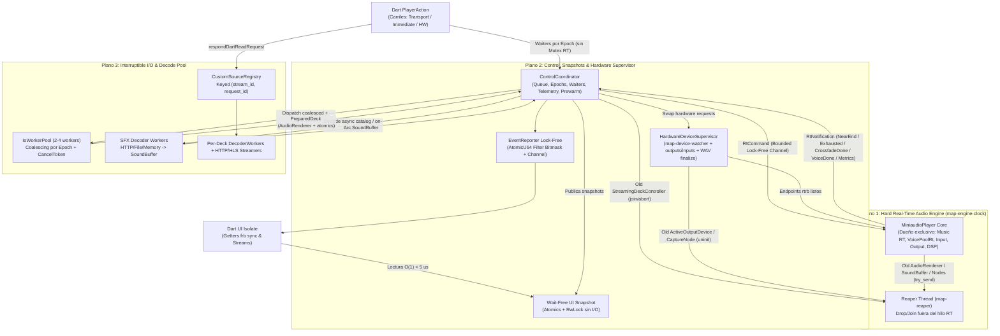

# Arquitectura de Concurrencia, Tiempo Real y Desacoplamiento I/O (`LOCK.md`)

> **Estado:** Especificación arquitectónica definitiva (v2.0 — Diseño Tri-Plane Lock-Free + Plan de Implementación Vivo).
> **Objetivo:** Erradicar el bloqueo mutuo entre el hilo de síntesis de audio (`map-engine-clock`), el hilo UI de Flutter (`#[frb(sync)]`), el watcher de dispositivos OS (`map-device-watcher`), los decodificadores y las operaciones bloqueantes (DNS/HTTP/TLS/HLS, disco, captura, grabación WAV, decodificación de SFX y `CustomDartByteSource`), garantizando **tiempo real estricto**, **cero dropouts**, **cero panics por poisoning** y **escalabilidad bajo estrés extremo**.

---

## 1. Diagnóstico Exhaustivo del Código Real (Auditoría vs Versión Anterior)

Al auditar la implementación real en Rust (`rust/src/`), C (`rust/c_src/miniaudio_device_bridge.c`) y Dart (`lib/src/`), se identificaron fallos estructurales que el diagnóstico inicial de `LOCK.md` v1.0 pasaba por alto o describía de forma imprecisa:

| Componente / Ubicación Real                                                                               | Problema Real Verificado en Código                                                                                                                                                                                                                                                                                                                                                                      | Impacto en Audio, UI o Estabilidad                                                                                                                                                                                   |
| :-------------------------------------------------------------------------------------------------------- | :------------------------------------------------------------------------------------------------------------------------------------------------------------------------------------------------------------------------------------------------------------------------------------------------------------------------------------------------------------------------------------------------------ | :------------------------------------------------------------------------------------------------------------------------------------------------------------------------------------------------------------------- |
| **`RustMiniaudioPlayer::inner`** (`rust/src/api/player.rs:255`)                                           | `Arc<Mutex<Box<MiniaudioPlayer>>>` envuelve **todo** el motor. El reloj de audio `map-engine-clock` adquiere `clock_inner.lock()` cada período (`player.rs:907`).                                                                                                                                                                                                                                       | Cualquier I/O de red/disco, carga SFX, apertura de driver o `stop_recording` secuestra el mutex global y **congela por completo** la síntesis de música, SFX, micrófono y salidas.                                   |
| **`map-telemetry-monitor`** (`player.rs:595-895`)                                                         | Usa `worker_inner.try_lock()` cada 16 ms. Cuando logra el lock, llega a ejecutar **`preload_standby_deck()`** (`player.rs:653`) y **`DualSource::open_deck_source()`** (`player.rs:715`) de forma síncrona _dentro_ del mutex global.                                                                                                                                                                   | Al depender de `try_lock()`, la telemetría y el auto-advance se congelan durante I/O; cuando abre la siguiente pista desde el monitor, paraliza el reloj de audio de golpe.                                          |
| **`EffectsManager::pool`** (`effects_manager.rs:17, 179` & `voice_pool.rs`)                               | `render_with_reuse()` llama `self.pool.try_lock()`. Mientras tanto `set_effects` limpia voces activas y decodifica items `Memory` bajo lock, y `RustMiniaudioPlayer::play_effect` retiene `self.inner.lock()`. _(Nota: `EffectCatalogItem` tiene `id`, `source`, `max_polyphony`, `pinned`; **no existe** campo `preload` en código)._                                                                  | Si un hilo decodifica un SFX o llama `set_effects` / `stop_all_effects`, `render_with_reuse` falla el `try_lock()` y **silencia instantáneamente todas las voces SFX activas** (dropout audible).                    |
| **Getters `#[frb(sync)]` UI** (`player.rs:1724-1739`)                                                     | `get_loaded_effect_ids`, `get_allocated_ram_bytes` y `get_active_voices_count` llaman a `self.inner.lock().unwrap()`.                                                                                                                                                                                                                                                                                   | Bloquean **directamente el UI Isolate de Flutter** (jank / frames congelados / ANR) si hay un DNS/HTTP lento en curso.                                                                                               |
| **Hardware Hot-Swap & Recording** (`player.rs:363, 479, 571, 1825, 1909, 1932` & `recording.rs:302, 370`) | `map-device-watcher`, `set_outputs`, `set_inputs` llaman `map_device_create`/`start`/`destroy` y `map_capture_device_create` dentro de `inner.lock()`. `LiveRecorder::start_shared` envuelve un `rtrb::Consumer` SPSC en `Mutex`, y `LiveRecorder::stop()` llama `writer_thread.join()` dentro del mutex global.                                                                                        | Reconectar USB/Bluetooth o finalizar una grabación paraliza el motor de audio hasta que PulseAudio/WASAPI/CoreAudio o el flush WAV terminan.                                                                         |
| **`CustomDartByteSource`** (`player.rs:257, 2091-2109` & `source.rs:358-512`)                             | `custom_handle` es un **único slot global** en `RustMiniaudioPlayer`. `respond_dart_read_request` intenta `custom_handle.lock()` o cae en `self.inner.try_lock()`.                                                                                                                                                                                                                                      | Si `open_custom_source` bloquea esperando bytes dentro de `inner.lock()` sin slot independiente por `stream_id`/`request_id`, o si standby y active usan custom sources, se produce sobrescritura o timeout de 10 s. |
| **`StreamingDeck` & `DualSource`** (`dual_source.rs:1580-1630, 3797, 3809`)                               | Aunque `AudioRenderer` (`renderer.rs`) **ya es SPSC lock-free** (`AudioConsumer` + `DspCommand`), `StreamingDeck` duplica 5 `RwLock`s DSP (`eq_params`, `replay_gain`, `crossfeed_config`, `reverb_config`, `silence_config`), usa `renderer_ptr` crudo con `Box::from_raw` y ejecuta `decoder_thread.join()` en `Drop`. `DualSource` protege colas con `Arc<RwLock<Vec>>` mientras abre pistas dentro. | Un reemplazo o drop de deck puede ejecutar `join()` o bloquear en `RwLock`s redundantes sobre el hilo incorrecto, además de añadir complejidad propensa a UB.                                                        |
| **`InputManager::process`** (`input_manager.rs:305-320`)                                                  | Extrae estrictamente `frame_count` muestras por tick desde un ring buffer `rtrb` de **65 536 muestras** (`capture.rs`).                                                                                                                                                                                                                                                                                 | Cualquier jitter del hilo clock o deriva de reloj entre hardware ADC/DAC acumula latencia creciente e irreversible en el micrófono (hasta > 1.4 s).                                                                  |
| **`EventReporter` & `.unwrap()`** (`player.rs:80-82` & `Cargo.toml`)                                      | `EventReporter` usa 3 `Mutex` (`event_sink`, `pending_events`, `filter`). Todo Rust abusa de `.lock().unwrap()` / `.read().unwrap()` mientras release usa `panic = "abort"`.                                                                                                                                                                                                                            | Contención innecesaria en telemetría y terminación abrupta del proceso ante cualquier lock envenenado.                                                                                                               |
| **Cola Dart `_serialize`** (`lib/src/api/player_action.dart`)                                             | Serializa acciones asíncronas en Dart en una cola única.                                                                                                                                                                                                                                                                                                                                                | Incluso con Rust desacoplado, acciones inmediatas (`setVolume`, `playEffect`, DSP, `pause`) pueden sufrir head-of-line blocking en Dart si esperan detrás de aperturas lentas.                                       |
| **Paridad `wasm32`** (`ffi.rs`, `api/mod.rs`)                                                             | WASM no soporta `std::thread::spawn` ni `Condvar` bloqueante; usa `wasm_register_decoder_task` y `WasmWorkerExecutor`.                                                                                                                                                                                                                                                                                  | La arquitectura debe separar el núcleo síncrono lock-free de los threads nativos para compilar y operar idénticamente en Web/WASM y tests unitarios deterministas.                                                   |

> **Observación clave sobre la topología de reloj hardware:** Los callbacks C en [miniaudio_device_bridge.c](file:///mnt/Proyectos/miniaudio_player/rust/c_src/miniaudio_device_bridge.c) no ejecutan `render_pcm`; consumen anillos wait-free `rtrb` (`OutputDeviceRenderer`). Quien sintetiza es `map-engine-clock` para poder soportar **0 salidas** (modo grabación pura), **N dispositivos heterogéneos simultáneos** y **enrutamiento por bus** (`All`, `MusicMix`, `ActiveTrack`, `StandbyTrack`, `VoiceOnly`). El problema nunca fue `map-engine-clock`, sino que compartía locks y Drops con I/O y drivers OS.

---

## 2. Evaluación Comparativa de Enfoques Arquitectónicos

Para sustituir el modelo de lock global (y superar las carencias del Pilar 5 de `LOCK.md` v1.0), se evaluaron cuatro arquitecturas principales:

1. **Mutexes Granulares por Subsistema (`Arc<Mutex<SubManager>>`, Pilar 5 original):**
   - _Fallo crítico:_ En el hilo RT, usar `.lock()` vuelve a bloquear el audio en `seek`/`set_effects`/`set_outputs`; usar `.try_lock()` (como hoy en `EffectsManager`) provoca **silencio total del subsistema** cada vez que un hilo secundario muta el estado. Además conserva `alloc`/`drop` pesados en el hilo RT y riesgos de deadlock cruzado (`AutoDucker` ↔ `Input` ↔ `Music` ↔ `Output`).
   - _Veredicto:_ **Descartado.** Viola los Invariantes 1 y 4 del `RE-THINK-HELPER`.

2. **RCU / Snapshots Inmutables Puros (`ArcSwap`):**
   - _Fallo crítico:_ Las cadenas DSP (`Equalizer`, `Freeverb`, `SonicStream`, `AutoDucker`, `SoftLimiter`), las 64 voces activas y los extremos SPSC `rtrb::Consumer`/`Producer` tienen estado mutable frame-a-frame y no son compartibles ni clonables sin clics audibles. Además, soltar el último `Arc` en el hilo RT dispararía `Drop` (`free`/`ma_device_uninit`) en tiempo real.
   - _Veredicto:_ **Útil solo como complemento** (snapshots inmutables UI y `Arc<SoundBuffer>` entregados al RT y devueltos al _Reaper_ antes de llegar a 0 referencias).

3. **Runtime Async Completo (`tokio` en Rust):**
   - _Fallo crítico:_ Aumenta significativamente el footprint binario (en contra de [ARCHITECTURE.md](file:///mnt/Proyectos/miniaudio_player/docs/ARCHITECTURE.md)), añade fricción en `wasm32` y su planificador cooperativo _work-stealing_ es inadecuado para cadencias deterministas sub-10 ms de síntesis de audio.
   - _Veredicto:_ **Descartado.**

4. **Arquitectura Tri-Plane (Single-Owner Lock-Free RT Engine + Control/Hardware Supervisor + Interruptible I/O Pool + Reaper Thread):**
   - _Diseño:_ Utiliza exclusivamente primitivas lock-free/bounded ya presentes en `Cargo.toml` (`rtrb`, `crossbeam-channel`, `crossbeam-utils::CachePadded`, `std::sync::atomic`) y aisla la propiedad del estado en tres planos estrictos.
   - _Veredicto:_ **Arquitectura Seleccionada.** Cumple el 100% de los invariantes de tiempo real duro, preserva compatibilidad determinista para `test/rust/` y `wasm32`, y escala ante ráfagas extremas sin dropouts ni deadlocks.

---

## 3. Arquitectura Objetivo: Diseño Definitivo _Tri-Plane Lock-Free_



### 3.1 Plano 1: Hard Real-Time Audio Thread (`map-engine-clock`) + `Reaper Thread`

El núcleo `MiniaudioPlayer` pasa a ser **100% libre de locks y libre de bloqueos** y es propiedad exclusiva (_thread-confined_) de `map-engine-clock` en runtime (o invocado directamente en tests deterministas de Rust y steppers de `wasm32`):

1. **Regla de Oro RT (0 Mutex, 0 RwLock, 0 Alloc en steady state, 0 `Drop` pesado):**
   - Antes de renderizar cada quantum en `render_pcm(frame_count)`, el hilo RT drena sin bloquear (`try_recv`) su canal de entrada **`RtCommand`** (`SwapDeckRenderer`, `StartCrossfade`, `AbortCrossfade`, `TriggerVoice`, `StopVoice`, `SetVoiceParam`, `StopAllVoices`, `SetSpatialListener`, `SwapOutputs`, `SwapInputs`, `AttachRecorder`, `DetachRecorder`, `SetMasterDsp`).
   - Todos los buffers scratch de mezcla (`scratch_music`, `scratch_effects_inherit`, `scratch_effects_isolate`, `scratch_super_flow`, `scratch_bus`) se pre-dimensionan en inicialización (y si `frame_count` creciera por reconfiguración, la capacidad se ajusta con `reserve_exact`/reemplazo previo).
2. **`VoicePoolRt` & `EffectsManager` Zero-Dropout (Adiós a `try_lock()`):**
   - `VoicePool` se divide limpiamente:
     - **`VoicePoolRt`**: matriz pre-alojada de slots de voces activas (sin `Vec` dinámicos ni decodificación I/O) + mapa ligero de `Arc<SoundBuffer>` activos gestionado exclusivamente en RT (o pasado explícitamente por cada comando `TriggerVoice`). Al extinguirse una voz o reemplazarse el catálogo, **el hilo RT jamás decreta el último `Arc` a 0**: mueve el `Arc<SoundBuffer>` descartado al **`GarbageChannel`** hacia `map-reaper` (para garantizar refcount drop fuera del reloj RT).
     - **`EffectCatalogCoordinator`** (Plano 2/3): almacena catálogo, LRU/scoring, presupuesto `maxRamBytes` y tabla de `Arc<SoundBuffer>` decodificados.
   - Si una aplicación dispara 64 SFX simultáneos y llama `set_effects` o `play_effect` sobre URL/archivo, **ninguna voz activa sufre cortes ni silencio**.
3. **Desacoplamiento de `StreamingDeck` (`AudioRenderer` vs `DeckLifecycle`):**
   - Hoy `StreamingDeck` mezcla el consumidor RT (`renderer_ptr`) con `SymphoniaEngine`, `StreamSession`, 5 `RwLock`s DSP y `decoder_thread.join()` en `Drop`.
   - En la arquitectura Tri-Plane:
     - El RT Engine posee únicamente el **`RtDeckSlot`** (`AudioRenderer` SPSC wait-free + atómicos compartidos `Arc<DeckSharedAtomics>` de estado, posición, duración, `is_buffering`, `track_exhausted`, `flush_generation`, `flush_acknowledged`).
     - Se **eliminan** los 5 `RwLock`s DSP redundantes (`eq_params`, `replay_gain`, `crossfeed_config`, `reverb_config`, `silence_config`) de `StreamingDeck`: `ControlCoordinator` conserva el snapshot actual para telemetría y envía `DspCommand` lock-free al `AudioRenderer`.
     - El ciclo de vida del `DecoderWorker`, `StreamSession` y `ThreadHandle` (`DeckLifecycleHandle`) vive fuera del hilo RT; cuando RT sustituye un deck, envía el `AudioRenderer` viejo al **`Reaper Thread`** sin bloquear jamás.
4. **Input Live-Edge Auto-Discard (`InputManager` Circuit Breaker):**
   - Antes de consumir muestras de cada `DeviceCaptureNode` en el tick RT:

     ```rust
     let available = node.consumer.slots();
     let frame_samples = frame_count; // interleaved samples for device channels
     let max_jitter_samples = (frame_samples * 3).max(node.channels * 256);
     if available > max_jitter_samples {
         let stale = available - frame_samples;
         if let Ok(chunk) = node.consumer.read_chunk(stale) {
             chunk.commit_all();
         }
     }
     ```

   - Descarta muestras obsoletas en **$O(1)$ real**, manteniendo el micrófono acotado a ~20–35 ms de jitter máximo en lugar de acumular segundos de retraso en el buffer de 65 536 muestras.
5. **Detección Determinista Event-Driven (`rt_to_control_tx`):**
   - Al final de cada `render_pcm()`, el propio hilo RT detecta eventos de precisión muestral (`TrackNearEnd`, `TrackExhausted`, `CrossfadeCompleted`, `VoiceCompleted`, `DuckingStateChanged`) y publica métricas compactas hacia `ControlCoordinator` mediante `try_send()` no-bloqueante (si el canal de métricas periódicas estuviera lleno, se descarta solo el tick de telemetría no crítico, jamás un evento discreto de transición o fin de pista que va en canal dedicado o slot coalesced).

---

### 3.2 Plano 2: Control Coordinator, Épocas Monotónicas, Hardware Supervisor y UI Wait-Free

1. **`ControlCoordinator` (Sin I/O inline):**
   - Hilo coordinador ligero (o núcleo síncrono en `wasm32`) que procesa mutaciones de cola, cálculos de índice/shuffle/loop, coordinación de `DualSource` y respuestas `Waiter` en microsegundos (`< 50 µs`), porque **nunca** ejecuta syscalls de red, disco, decodificación ni `ma_device_create`/`uninit`.
   - **Compatibilidad FFI `Future<void>` sin bloqueo global:**
     - `play()`, `next()`, `previous()` actualizan inmediatamente el índice lógico/intención en `ControlCoordinator`, incrementan **`transport_epoch: AtomicU64`** y despachan una tarea al `IoWorkerPool` adjuntando un **`OpenWaiter` (canal one-shot / `Condvar` privado del caller)**.
     - El caller FFI espera _únicamente su `OpenWaiter`_ (fuera de todo lock compartido):
       - Si la apertura falla (HTTP 404/403/500, archivo inexistente, buffer corrupto), el worker responde `Err(err)` al waiter → Dart recibe `MiniaudioPlayerException` exactamente como exigen los contratos existentes.
       - Si tiene éxito (y `task_epoch == current_transport_epoch`), instala el `PreparedDeck` en RT, publica `AudioInfo`/`duration` y resuelve `Ok(())`.
       - Si otro comando `play()`/`next()`/`previous()`/`stop()`/`setQueue()` llegó antes y avanzó `transport_epoch`, el waiter antiguo se resuelve limpiamente (`Ok(())` preempted / no-op) y el deck obsoleto se envía directo al `Reaper`.
       - Mientras tanto, `pause()`, `stop()`, `seek()`, `playEffect()`, DSP setters y UI getters siguen operando sin pausa alguna.
2. **UI Snapshots Wait-Free (`#[frb(sync)]` < 5 µs):**
   - Contadores numéricos (`active_voices_count`, `allocated_ram_bytes`, `current_index`, `playback_state`) residen en **atomics lock-free**.
   - Metadatos pequeños (`loaded_effect_ids`, listas `output_devices`/`input_devices`, `audio_info`) se mantienen en snapshots publicados _después_ de completar cambios, jamás bajo locks que toquen I/O o el hilo RT.
3. **`HardwareDeviceSupervisor` (`map-device-watcher` unificado):**
   - Unifica la detección de eventos plug&play (`device_trigger`) con los comandos `set_outputs` / `add_output` / `remove_output` / `set_inputs` / `add_input` / `remove_input` y `start_recording` / `stop_recording`.
   - **Cero bloqueo de audio durante hot-swap:**
     1. Abre los nuevos dispositivos C (`map_device_create` / `map_device_start` / `map_capture_device_create`) en el hilo Supervisor.
     2. Entrega al RT Engine únicamente los extremos wait-free (`rtrb::Producer` / `rtrb::Consumer`).
     3. Recibe del RT Engine los endpoints anteriores y ejecuta `map_device_destroy()` / `ma_device_uninit()` en background (Supervisor/Reaper).
   - **Grabación WAV sin congelar el motor:**
     - `LiveRecorder::start_shared` deja de usar `Arc<Mutex<rtrb::Consumer>>`; el productor `rtrb::Producer` vive exclusivo en RT y se intercambia atómicamente vía `RtCommand::AttachRecorder` / `DetachRecorder`.
     - `stop_recording()` envía `DetachRecorder` al RT, espera el `writer_thread.join()` + cierre de cabecera RIFF en el hilo del worker/FFI caller sin retener ningún lock del motor ni pausar la música/SFX.
4. **`EventReporter` Lock-Free:**
   - Reemplaza `filter: Arc<Mutex<TelemetryFilter>>` por una máscara atómica **`AtomicU64`** (`load(Ordering::Relaxed)` en el hot path) y un canal acotado/unbounded sin contención para despacho hacia `StreamSink<RustPlayerEvent>`.

---

### 3.3 Plano 3: `IoWorkerPool` Interruptible + Pre-warming Híbrido + `CustomSourceRegistry` + Carriles Dart

1. **Pool Acotado (`IoWorkerPool`, 2–4 hilos reutilizables) con Coalescing de Epoch:**
   - Si el usuario dispara 500 `next()` seguidos contra servidores colgados, un esquema naive crea 500 hilos o satura todos los workers con requests obsoletos.
   - Con **Coalescing de Epoch**, existe una ranura _Latest-Pending Foreground Open_ y una ranura _Latest-Pending Prewarm Open_: si varios comandos entran mientras el worker termina de abortar el socket anterior, todos los intermedios se fusionan instantáneamente y el worker ejecuta **únicamente** la última intención vigente.
2. **Cancelación Real I/O y Timeouts Acotados:**
   - Cada `DeckOpenTask` recibe un `CancelFlag: Arc<AtomicBool>` conectado a:
     - `ureq::Agent` con timeouts estrictos en apertura (`timeout_connect: 5s`, `timeout_read: 8s` en probe inicial), verificando `CancelFlag` entre redirecciones y lecturas de probe/HLS.
     - `StreamBuffer::set_abort(true)` / `StreamSession::abort()` para despertar de inmediato cualquier `Condvar::wait_timeout` de `read_blocking()`.
     - `CustomByteSourceHandle::abort()` inmediato al invalidarse el `epoch`.
   - Nota sobre `DecoderWorker`: también se elimina el busy-spin `thread::yield_now()` de 15 ms en `handle_seek` si es innecesario esperar bloqueando, y cada `StreamingDeck::drop` se ejecuta en `map-reaper`.
3. **Pre-warming Reactivo Híbrido Deduplicado:**
   - Se dispara de forma 100% asíncrona en segundo plano en dos momentos:
     1. **Reactivo por cambio de cola/pista:** cuando el `expected_next_track_id` cambia tras estabilizarse una pista activa o mutarse la cola (`append`, `insert_next`, `remove_at`, `reorder`, `set_loop_mode`, `set_shuffle`), solicitando pre-warm en el worker sin bloquear la mutación.
     2. **Proactivo por margen temporal (`auto_crossfade_ms + 4000 ms`):** emitido determinísticamente por el hilo RT (`TrackNearEnd`) por si la cola cambió o el standby fue evictado/falló antes.
   - Deduplicado por `(expected_track_id, source_signature, standby_epoch)`: dos mutaciones consecutivas que no cambian el siguiente track **jamás** re-abren el standby; si sí cambia, se incrementa `standby_epoch`, se aborta el prefetch anterior y se inicia el nuevo.
4. **Efectos de Sonido (SFX) No Bloqueantes y On-Demand Seguro:**
   - `set_effects(catalog)`:
     1. Incrementa `catalog_epoch`, actualiza el catálogo en `EffectCatalogCoordinator` al instante (`< 1 ms`) sin detener las voces activas y despacha la decodificación de items `Memory` (y prefetch prioritario) al **`SfxWorkerPool`** fuera del RT.
     2. Conforme cada `Arc<SoundBuffer>` queda decodificado (si `catalog_epoch` coincide), actualiza el caché RAM respetando `max_ram_bytes` (evicción multi-factor sobre inactivos) y notifica métricas `LoadedEffects` sin tocar `VoicePoolRt`.
   - `play_effect(id, config)`:
     1. **Fast path (`< 50 µs`):** Si `Arc<SoundBuffer>` ya está en caché RAM (y `catalog_epoch` vigente), actualiza LRU/frecuencia y envía `RtCommand::TriggerVoice { voice_id, buffer, config }` al RT Engine de forma inmediata.
     2. **Slow path (si el item aún está decodificándose en background o es File/HTTP evictado):** Espera en un waiter dedicado a esa decodificación SFX en el worker pool (nunca retiene ningún lock del reloj RT ni silencia otras voces sonando); una vez listo, dispara `TriggerVoice`.
5. **`CustomSourceRegistry` Desacoplado:**
   - Mapa concurrente sharded / `RwLock` liviano (nunca tocado por RT) indexado por **`request_id`** y **`stream_id`**:
     - `open_custom_source` registra su `CustomByteSourceHandle` en el registro al crearse y lo retira al cerrarse/abortarse.
     - `respond_dart_read_request` busca directamente por `request_id` (sin tocar `MiniaudioPlayer` ni `try_lock()`), soportando múltiples custom sources simultáneos (pista activa, prewarm standby y `analyzeAudio`).
6. **Zero-Panic Lock Policy (Eliminación de `.unwrap()`):**
   - Prohibición total de `.lock().unwrap()`, `.read().unwrap()` y `.write().unwrap()` en `rust/src/` dado `panic = "abort"` en release. En locks residuales estrictamente no-RT (ej. `StreamBuffer::backend` entre downloader y decoder), recuperación segura o propagación tipada de error.
7. **Carriles Independientes en Dart (`lib/src/api/player_action.dart`):**
   - Sustituir el cuello de botella único `_serialize` por 3 carriles ortogonales:
     - **Carril Transport/Queue (`_queueTransportQueue` + `_activePlayEpoch`):** `setQueue`, `append`, `insertNext`, `removeAt`, `reorder`, `clearQueue`, `play`, `next`, `previous`, `seek`, `setLoopMode`, `setShuffle`.
     - **Carril Immediate RT Controls (sin cola serializada bloqueante):** `setVolume`, `setRate`, `setPitch`, `setBalance`, `setMono`, `setEqualizer*`, `setReverb`, `setCrossfeed`, `setSpatializer`, `setLimiter`, `playEffect`, `stopVoice`, `setVoice*`, `setListener`, `stopAllEffects`, `pause`, `stop`.
     - **Carril Hardware / SFX Catalog / Recording:** `setOutputs`, `addOutput`, `removeOutput`, `setInputs`, `addInput`, `removeInput`, `setEffects`, `startRecording`, `stopRecording`.

---

## 4. Plan de Implementación por Fases y Verificación Continua

Cada fase deja el sistema compilando y pasando todas las pruebas existentes (`cargo test`, `dart analyze`, `flutter test`), evitando rupturas prolongadas:

- **Fase 1 — Estabilización Lock-Free del Hot-Path & Anti-Dropouts (Completada cuando RT SFX/Input/Custom/Telemetry dejan de fallar bajo carga):**
  1. `InputManager::process`: implementar _live-edge auto-discard_ en $O(1)$ usando `read_chunk(stale).commit_all()`.
  2. `CustomSourceRegistry`: desacoplar `CustomByteSourceHandle` de `RustMiniaudioPlayer::custom_handle` / `inner.try_lock()`, indexado por `request_id`/`stream_id` con limpieza determinista.
  3. `EventReporter`: convertir `TelemetryFilter` en bitmask `AtomicU64` lock-free y eliminar locks síncronos en la ruta de eventos.
  4. `EffectsManager` & `VoicePool`: eliminar `self.pool.try_lock()` en `render_with_reuse` mediante `VoicePoolRt` (sin mutex ni decodificación en audio loop) + `EffectCatalogCoordinator` con decodificación fuera del camino RT; eliminar todos los `.unwrap()` en locks/rwlocks críticos.
  - _Verificación:_ `cargo test --manifest-path rust/Cargo.toml` + tests Dart SFX (`game_audio_voice_pool_test.dart`, `monotonic_queue_buffer_effects_test.dart`, `custom_byte_provider_test.dart`, `phase4_sinks_recording_and_ducking_test.dart`).

- **Fase 2 — Propiedad Exclusiva RT en `map-engine-clock` + `Reaper Thread` + Snapshots UI Wait-Free:**
  1. Introducir `RtCommand`, `RtNotification`, `GarbageReaper` (`map-reaper`) y `UiEngineSnapshot` atómico/wait-free.
  2. Hacer que `map-engine-clock` sea dueño exclusivo de `MiniaudioPlayer` sin `Arc<Mutex<Box<MiniaudioPlayer>>>`, manteniendo `MiniaudioPlayer` síncrono/puro para `test/rust/` y `wasm32`.
  3. Migrar `#[frb(sync)]` getters a lectura wait-free O(1).
  4. Enviar notificaciones deterministas (`TrackNearEnd`, `TrackExhausted`, `CrossfadeCompleted`, `VoiceCompleted`) desde `map-engine-clock`.
  - _Verificación:_ Todas las suites Rust + `flutter test` completas + paridad `wasm32` (`cargo check --target wasm32-unknown-unknown` si el toolchain está disponible, o verificación condicional `cfg`).

- **Fase 3 — `ControlCoordinator`, `IoWorkerPool` con Epochs/Coalescing, `HardwareDeviceSupervisor`, Limpieza `DualSource`/`StreamingDeck` y Carriles Dart:**
  1. Implementar `ControlCoordinator` + `IoWorkerPool` (2–4 workers con coalescing por epoch, `CancelFlag`, timeouts 5s/8s en `ureq` y `OpenWaiter` por llamada para mantener `MiniaudioPlayerException` y `duration` listos).
  2. Implementar pre-warming híbrido reactivo deduplicado (tras cambio de cola + margen `auto_crossfade_ms + 4000ms` vía `TrackNearEnd`).
  3. Implementar `HardwareDeviceSupervisor` sacando `map_device_create`/`destroy` (`set_outputs`, `set_inputs`, `map-device-watcher`) y `LiveRecorder` (`start_shared` sin `Mutex<Consumer>`, `stop()` con `join()` fuera de RT/Control).
  4. Limpiar `StreamingDeck`/`DualSource` eliminando los 5 `RwLock` DSP redundantes y el puntero crudo `renderer_ptr` en favor de propiedad segura separada (`RtDeckSlot` en RT + `DeckLifecycleHandle` en Control/Reaper).
  5. Separar `PlayerAction._serialize` en Dart en 3 carriles independientes.
  6. Añadir tests adversarios de estrés en Rust y Dart cubriendo los 8 escenarios de `RE-THINK-HELPER`.

---

## 5. Registro Proactivo de Evolución del Plan (Living Log)

> Esta sección se actualizará proactivamente durante la implementación cada vez que se descubra un acoplamiento oculto o una mejora arquitectónica superior.

- **2026-11-13 (Pre-implementación):** Auditada la capa C y FRB: se confirma que `frb_generated.rs` adquiere `lockable_decode_sync_ref()` (lectura compartida) cuando los métodos de `RustMiniaudioPlayer` usan `&self`, por lo que mantener `&self` en toda la API pública permite concurrencia real multi-carril desde Dart sin regenerar el puente FRB y sin bloqueo mutuo en Dart/Rust.
- **2026-11-13 (Pre-implementación):** Detectado `wasm32` `WasmWorkerExecutor` sin `std::thread::spawn`: se adopta separación entre `MiniaudioPlayer` (núcleo síncrono puro steppable) y la infraestructura nativa de hilos (`map-engine-clock`, `ControlCoordinator`, `IoWorkerPool`, `map-reaper`, `HardwareDeviceSupervisor`) detrás de adaptadores condicionales `#[cfg(not(target_arch = "wasm32"))]`.
- **2026-11-13 (Fase 1 completada):** Implementado _live-edge_ alineado por frames en `InputManager`, registro global atómico `CustomSourceRegistry` (`abort_all` sin `inner.try_lock()`), `EventReporter` con filtro escalar lock-free `AtomicTelemetryFilter` + caché unificado, y desacoplamiento completo de `EffectsManager` en plano RT wait-free `VoicePoolRt` + `EffectCatalog` frío con decodificación fuera de locks. Verificado: `64/64` tests Rust y `24/24` suites Flutter.
- **2026-11-13 (Fase 2 completada):** Introducidos `ReaperHandle` (`map-reaper`), `EffectsControl` (control SFX lock-free directo sin pasar por el reloj RT), `EngineActorHandle` + `EngineUiSnapshots` (propiedad exclusiva de `MiniaudioPlayer` dentro de `map-engine-clock`, eliminado `Arc<Mutex<Box<MiniaudioPlayer>>>`), `map-telemetry-monitor` 100% libre de `try_lock()`, `map-device-watcher` condicional (sin llamadas al reloj cuando no hay cambios) y eliminación de `.unwrap()` en `player.rs` / `miniaudio_player.rs`. Hallazgo de optimización para Fase 3: al mover `open_deck_source` a `IoWorkerPool`, conviene preparar un `StreamingDeck` completo fuera del reloj RT e intercambiarlo por movimiento (`SwapPreparedDeck`), enviando el deck desplazado a `map-reaper` para evitar incluso `decoder_thread.join()` y `SympEngine::drop` en `map-engine-clock`. Verificado: `64/64` tests Rust (0 warnings) y `31/31` tests Flutter.
- **2026-11-13 (Fase 3A completada):** Implementado el plano de Control/I/O completo sin bloqueos en el reloj RT:
  1. `CancelToken` + RAII `CancelHookGuard` (`sync/cancel.rs`) cableado a timeouts `ureq` acotados (5s connect / 8s probe read; 10s en catálogo SFX), loops de prefetch HTTP y `CustomByteSourceHandle::abort()` estrictamente acotado al scope de `SymphoniaEngine::new`.
  2. `IoWorkerPool` (`core/io_pool.rs`) con aislamiento de carril local (`1x map-io-local` con `0 ms` coalescing) frente al pool de red (`4x map-io-net-*` con coalescing adaptativo `18 ms` quiet / `140 ms` burst cap bajo skips rápidos en vuelo), `OpenWaiter` preservando diagnósticos FFI exactos y contador de estadísticas (`executed` vs `coalesced`).
  3. `ControlCoordinator` (`map-ctrl-coord`, `core/control_coordinator.rs`) + `dual_source_control.rs` con preparación fuera de RT e intercambio limpio de decks (`Box<StreamingDeck>` desplazado enviado a `map-reaper`), `abort` instantáneo al llamar `pause()`/`stop()`/`set_queue()`, y pre-warming híbrido reactivo + `RtControlHint::PrewarmNeeded`/`AutoAdvanceNeeded` (`TrackNearEnd`) sin llamadas bloqueantes en `tick_music_lifecycle`.
  4. Descubrimiento implementado durante Fase 3A: añadido `open_generation` por deck junto a `active_deck_id` y `PostPublishHook` linealizable en `RtActorMsg::Call` para garantizar que `publish_snapshots` refleje el nuevo deck incluso tras reutilizar el mismo slot antes de despertar al hilo llamador.
  5. Verificado: `64/64` tests Rust (0 warnings) y `50/50` tests Flutter en FSM rápida (`next`/`previous`), cola rápida de 400 pistas/seek, suite HTTP adversarial y `CustomByteProvider`.
- **2026-11-13 (Fase 3B completada):** Aislamiento completo de E/S física de hardware y grabación WAV fuera de `map-engine-clock`, limpieza estructural de `StreamingDeck` y eliminación total de `.unwrap()` sobre locks en runtime:
  1. `HardwareDeviceSupervisor` (`core/hw_supervisor.rs`) + `LiveRecorder::prepare_start` (`core/recording.rs`) + helpers compartidos en `output_manager.rs`/`input_manager.rs`: toda resolución y apertura física de dispositivos (`prepare_outputs_off_rt`/`prepare_inputs_off_rt`) y apertura/cierre de archivos WAV ocurre serializada fuera del reloj RT (`tx_guard`); en `map-engine-clock` solo se intercambian handles preabiertos (`apply_prepared_outputs`, `apply_prepared_inputs`, `attach_prepared_recording`, `detach_recording_for_stop`), enviando dispositivos/productores desplazados a `map-reaper` y abortando aperturas HTTP pendientes mediante `coordinator.pause()` en auto-pausa por hot-swap. Cableado en `RustMiniaudioPlayer` (`set_outputs`, `add_output`, `remove_output`, `start_recording`, `stop_recording`, `set_inputs`, `add_input`, `remove_input`, `configure_input` y `map-device-watcher`).
  2. Limpieza de `StreamingDeck` (`dual_source.rs` / `dual_source_control.rs`): reemplazado `renderer_ptr: *mut AudioRenderer` por `renderer: Option<Box<AudioRenderer>>` propio, eliminados 4 `Arc<RwLock<...>>` redundantes de DSP (`eq_params`, `replay_gain`, `crossfeed_config`, `reverb_config`) y migrado `silence_config` a `Arc<CachePaddedSeqlock<SilenceConfig>>` wait-free.
  3. Política Cero-Panic en runtime: añadido `wait_timeout_unpoisoned` (`sync/mod.rs`) y `RubatoResampler::passthrough` (`dsp/resampler.rs`); eliminados todos los `.unwrap()` en locks, condvars y colecciones de runtime en `dual_source.rs`, `stream_buffer.rs` y `recording.rs`.
  4. Verificado: `64/64` tests Rust (0 warnings) y `23/23` tests Flutter (`test/pause_on_device_change_test.dart` y `test/engine/phase4_sinks_recording_and_ducking_test.dart`).
- **2026-11-13 (Fase 3C completada):** Desacoplamiento multi-carril en Dart (`lib/src/api/player_action.dart`):
  1. Sustituido `_commandTail` / `_serialize` por `_queueTail` / `_serializeQueue` dedicado exclusivamente a mutaciones de cola y navegación/reproducción de pistas (`setQueue`, `append`, `insertNext`, `removeAt`, `reorder`, `reorderByIds`, `clearQueue`, `setLoopMode`, `setShuffle`, `play`, `next`, `previous`), eliminando también la carrera previa entre `setQueue` y mutadores locales (`append`, `insertNext`, `removeAt`, `reorder*`, `clearQueue`).
  2. Liberados al carril inmediato (sin esperar detrás de `_queueTail`) `pause()`, `stop()`, `seek()` y `setReplayGain()` — manteniendo la invalidación síncrona de `_activePlayEpoch` antes de enviar `pause()`/`stop()` a Rust para cancelar aperturas HTTP estancadas sin head-of-line blocking (junto con volumen, DSP, SFX y hardware que ya operaban sin bloqueo mutuo).
  3. Verificado: `dart analyze` (`No issues found!`) y `51/51` tests Flutter (`miniaudio_engine_fsm_test.dart`, `rapid_queue_400_tracks_and_seek_preemption_test.dart`, `uri_playback_test.dart`, `device_diagnostics_logging_test.dart`).
- **2026-11-13 (Fase 3D — Endurecimiento de Concurrencia y Cobertura de Estrés completada):**
  1. Cancelación determinista de `CustomDartByteSource` (`rust/src/buffer/source.rs`): introducido `custom_aborted_error()` con `ErrorKind::ConnectionAborted` en lugar de `ErrorKind::Interrupted` (evitando bucles infinitos de reintento `EINTR` en `std::io::Read::read_exact` y `symphonia::core::io::MediaSourceStream` sobre el hilo `map-io-local`) y corto-circuito inmediato en `CustomDartByteSource::seek()` ante `guard.aborted`, junto con rastreo/cancelación en vuelo mediante `InflightActiveEntry` (`rust/src/core/io_pool.rs`).
  2. Preservación de `planned_index` bajo tormenta de skips (`rust/src/core/control_coordinator.rs`): acotado `sync_planned_index_to_current()` en `ControlCoordinator::handle_io_completion` estrictamente al caso `is_auto_adv`, evitando que fallos en aperturas manuales previas reviertan el índice planeado durante ráfagas rápidas de `next()`.
  3. Eliminación de carrera TOCTOU en eyección de catálogo SFX (`rust/src/core/effects_manager.rs`): refactorizado `EffectsControl::play_effect` para mantener `self.catalog` desde la instalación del buffer decodificado (`install_decoded_buffer`) hasta `play_cached_effect` (incrementando `active_voices` antes de liberar el lock), liberando los buffers desplazados fuera de lock y ejecutando un reintento acotado ante swap concurrente.
  4. Linealización estricta de eventos en `EventReporter` (`rust/src/api/player.rs`): serializada la evaluación de `AtomicTelemetryFilter` dentro del lock hoja `sink_state` mediante `emit_batch` y `reset_and_emit_batch` (`emit_track_transition_core`, `map-telemetry-monitor`, `set_queue`, `pause`, `stop`, `seek`), eliminando la carrera entre `CurrentIndex` y `AudioInfo` que podía reiniciar `_duration` a `Duration.zero` en Dart bajo carga concurrente.
  5. Cobertura automatizada de la Matriz de Estrés (Sección 6C): incorporados 8 tests Rust en `test/rust/tri_plane_stress_test.rs` (usando `TriPlaneHarness`, `MockHttpServer` y trabajo lock-free con `AtomicUsize` en `scenario_2_rapid_fire_500_skip_flood_epoch_coalescing`) y 3 tests multi-carril Dart en `test/engine/tri_plane_isolation_stress_test.dart`.
  6. Verificado previamente y de forma repetida: `tri_plane_stress_test` (`8/8`), `tri_plane_isolation_stress_test.dart` (`3/3`), `5/5` corridas consecutivas de `monotonic_queue_buffer_effects_test.dart` (`7/7` c/u) y `5/5` corridas consecutivas de `local_formats_test.dart` (`63/63` c/u).

---

## 6. `RE-THINK-HELPER` (Auditoría, Invariantes y Matriz de Estrés)

Este protocolo rige cada decisión de diseño e implementación. Ningún PR o cambio puede violar estos invariantes ni fallar estos escenarios de estrés.

### A. Los 4 Invariantes No Negociables del Motor de Audio

1. **Invariante de Tiempo Real Duro (Hard Real-Time):** El hilo que sintetiza PCM (`map-engine-clock` y los callbacks C `map_device_data_callback` / `map_capture_data_callback`) **JAMÁS** puede ejecutar `Mutex::lock`, `RwLock`, `thread::join`, DNS/HTTP/Socket I/O, syscalls de archivo o sleeps arbitrarios. Tampoco puede silenciarse mediante `try_lock()` cuando otro hilo configura SFX o colas. Su tiempo de ejecución debe depender exclusivamente del tamaño de buffer (`O(frame_count)`).
2. **Invariante de Latencia Determinista de Entrada:** Un stream de captura en vivo (`InputManager`) debe operar en modo _live edge_; la latencia acumulada ante jitter de CPU o deriva de reloj entre dispositivos nunca puede superar un techo fijo acotado (~2–3 períodos, descartando en $O(1)$ muestras antiguas excedentes).
3. **Invariante de Aislamiento de Frecuencia e UI:** Las operaciones lentas de un subsistema (red lenta para Música, decodificación de un SFX, hot-swap Bluetooth/WASAPI, flush WAV al detener grabación) no pueden degradar la velocidad ni los getters síncronos `#[frb(sync)]` del hilo UI de Flutter ni silenciar el resto de los buses.
4. **Invariante de Ciclo de Vida Seguro (Zero-Alloc / Zero-Drop in Audio Thread):** Crear o destruir `Vec` grandes, `SymphoniaEngine`, `SoundBuffer`, streams HTTP, `StreamingDeck` (`decoder_thread.join()`) o contextos `ma_device` nunca debe ocurrir en el hilo de audio RT; todo objeto desplazado se entrega por canal no-bloqueante al `Reaper Thread` y el código de runtime no puede contener `.lock().unwrap()` ni `.read().unwrap()` dados los `panic = "abort"` de compilación.

### B. Antipatrones Prohibidos (Verificación Negativa)

1. _El antipatrón del "UnLock Mágico":_ Pasar de un `Arc<Mutex<Player>>` global a 5 `Arc<Mutex<Manager>>` granulares **NO es suficiente** si `render_pcm` sigue llamando `.lock()` o `.try_lock()` sobre ellos (causando bloqueos o dropouts en cascada).
2. _El antipatrón de la "Pre-carga Síncrona Reactiva":_ Lanzar `open_deck_source` en la misma llamada de `set_queue`, `append`, `set_loop_mode`, `set_shuffle`, `reorder` o `map-telemetry-monitor`.
3. _El antipatrón del "Pool Saturado / Zombis HTTP":_ Delegar I/O a un pool sin cancelación real ni coalescing de época (bajo 500 skips seguidos, el pool queda secuestrado por sockets DNS/TCP colgados) o dejar `CustomByteSourceHandle` en un slot único global.
4. _El antipatrón del "Polling sin Límites" o "Head-of-Line Dart":_ Acumular silencio/latencia infinita en `rtrb` de micrófono o serializar comandos inmediatos (`pause`, `playEffect`, `setVolume`) detrás de `play(url_lenta)` en Dart (`_serialize`).

### C. Matriz de Escenarios de Estrés Extremo (Criterios de Aceptación)

1. **Escenario 1 (Network Stall + Active Gaming SFX + UI Read):** Con un reproductor de música intentando abrir una URL TCP que tarda 10 s (tarpit / DNS lento), disparar 30 SFX/seg (`playEffect`), consultar `state` / `get_active_voices_count()` / `get_allocated_ram_bytes()` a 120 FPS y llamar `pause()`/`stop()`/`setVolume()`:
   - _Criterio:_ Cero cortes o silencios en SFX/micrófono, getters UI `< 50 µs`, cancelación instantánea de la apertura al llamar `stop()` o saltar de pista.
2. **Escenario 2 (Rapid Fire Skip Flood — 500 skips en 500 ms con red lenta):** Spam de 500 `next()` sobre tracks HTTP lentos/caídos mientras suenan música, SFX y grabación activa:
   - _Criterio:_ Coalescing de `epoch` evita crear 500 opens concurrentes o agotar workers; la pista final gana sin condiciones de carrera ni audios fantasma de pistas intermedias; grabación e hilo RT sin glitches.
3. **Escenario 3 (Slow Mic Drift / CPU Starvation):** Pausar el reloj de lectura por 1.5 s simulando sobrecarga de CPU mientras un `CaptureReceiver` sigue inyectando PCM a 48 kHz:
   - _Criterio:_ Al reanudar, `InputManager` descarta el exceso sobre el techo de jitter y converge en 1–2 ticks al _live edge_ (`< 35 ms`), sin arrastrar 1.5 s de eco permanente.
4. **Escenario 4 (Massive SFX Catalog Swap + Polyphony Storm):** Reproduciendo 40–64 voces polyphonic looping, llamar `setEffects()` con un catálogo nuevo (incluyendo Memory + File/HTTP) y `stopAllEffects()`:
   - _Criterio:_ Las voces activas no sufren ni 1 frame de silencio por `try_lock` fallido; las cargas se realizan en background y los `SoundBuffer` reemplazados se liberan en `map-reaper`.
5. **Escenario 5 (Hardware Hot-Swap + Recording Stop bajo Carga):** Desconectar/cambiar dispositivos (`set_outputs`, `set_inputs`, `map-device-watcher`) y ejecutar `stop_recording()` con flush WAV a disco lento mientras reproduce música + SFX:
   - _Criterio:_ La mezcla RT de los buses restantes y grabación/DSP no se congelan mientras `ma_device_uninit` o `writer_thread.join()` terminan en Supervisor/Worker.
6. **Escenario 6 (Concurrent `CustomByteProvider` Active + Standby Pre-warm):** Dos pistas `CustomByteProvider` (activa + standby prewarm, más análisis paralelo opcional) solicitando bytes concurrentemente desde Dart mientras hay cambio rápido de cola:
   - _Criterio:_ Cero colisiones entre handles, cero timeouts de 10 s por `try_lock()`, y aborto limpio e inmediato al cambiar de pista.
7. **Escenario 7 (Crossfade + Pre-warm Miss Fallback + Queue Mutation Race):** `setQueue`/`reorder`/`setShuffle` justo en el instante en que el worker de pre-warm estaba descargando el standby anterior o faltan < 4 s para `auto_crossfade_ms`:
   - _Criterio:_ `standby_epoch` invalida el deck antiguo antes de instalarlo, pre-calienta exactamente el nuevo siguiente track y entra al crossfade sin gaps ni pistas equivocadas.
8. **Escenario 8 (Poison Resistance & WASM Step Parity):** Simular panic controlado en test unitario de un worker externo o ejecución single-thread paso a paso (`MiniaudioPlayer::render_pcm`):
   - _Criterio:_ Cero `.unwrap()` en primitivas compartidas en `rust/src/` que aborten el motor y ejecución determinista libre de locks en `wasm32`.
