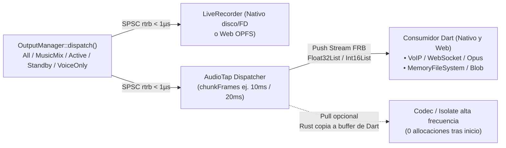
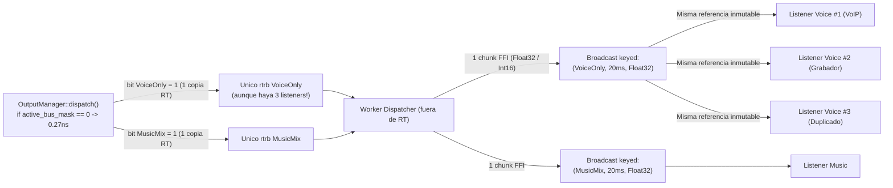

# Análisis Técnico y Plan de Evolución para Grabación (`docs/RECORDING.md`)

Este documento analiza el estado actual de `startRecording` / `stopRecording` en `miniaudio_player`, evalúa si es mejor soportar `content://` internamente en Android frente a exponer un `fd` público al usuario, detalla los enfoques viables para soportar grabación en Web (`wasm32`) incluyendo sistemas de archivos virtuales y memoria, **analiza la factibilidad de compartir punteros de memoria (Rust RW / Dart Read-Only) para crear un flujo universal tipo "Audio Tap" aplicable tanto a llamadas VoIP como a grabación en Dart/Web**, y propone mejoras concretas y plan por fases para reforzar el subsistema en todas las plataformas.

> **Alcance:** Informe técnico y propuesta de diseño/implementación (sin cambios de código todavía). Basado en la arquitectura actual de `miniaudio_player` (`PlayerAction`, `HardwareDeviceSupervisor`, `OutputManager`, `LiveRecorder`, `MiniaudioPlayerPlugin.java` y `docs/RESOLVER.md`).

---

## 1. Diagnóstico del Estado Actual

Hoy la tubería de grabación funciona de extremo a extremo de la siguiente forma:

1. **Capa Dart ([player_action.dart](../lib/src/api/player_action.dart)):**
   * Expone `Future<void> startRecording(String path, {AudioFileFormat format = AudioFileFormat.wav, AudioOutputSource source = AudioOutputSource.all})` y `Future<RecordingResult> stopRecording()`.
   * Reenvía directamente `path`, `format.index` y `source.value` a Rust sin validar ni normalizar el destino (`file://...` o `content://...` pasan literales).
2. **Coordinación y Motor RT ([player.rs](../rust/src/api/player.rs), [hw_supervisor.rs](../rust/src/core/hw_supervisor.rs), [output_manager.rs](../rust/src/core/output_manager.rs)):**
   * `HardwareDeviceSupervisor::start_recording` abre el archivo y arranca `LiveRecorder` fuera del hilo de audio en tiempo real (`map-engine-clock`), creando un ring buffer lock-free SPSC (`rtrb`) de `sample_rate * channels * 4` muestras (~4 segundos de margen).
   * En cada ciclo de renderizado, `OutputManager::dispatch` copia en $O(1)$ las muestras del bus seleccionado (`All`, `MusicMix`, `ActiveTrack`, `StandbyTrack`, `VoiceOnly`) al productor `rtrb`.
   * La duración transcurrida (`recorded_duration_ms`) se actualiza en cada tick hacia Dart mediante `RustPlayerEvent::RecordedDuration`.
3. **Escritor en Disco ([recording.rs](../rust/src/core/recording.rs)):**
   * `LiveRecorder::open_recording_file` ejecuta `std::fs::OpenOptions::new().write(true).create(true).truncate(true).open(path)`.
   * Lanza el hilo `miniaudio-wav-writer` (en Web, un Web Worker vía `crate::sync::thread`), escribe una cabecera RIFF/WAVE de 44 bytes con tamaños en `0`, drena el `rtrb` con `BufWriter(65536)`, y al detener ejecuta `finalize_wav_header(&mut file, total_bytes)` haciendo `seek` a los offsets `4` y `40`.

### Brechas y problemas detectados en la implementación actual

| Área | Problema actual observado | Impacto real |
|---|---|---|
| **Web (`wasm32`)** | `wasm32-unknown-unknown` (sin WASI) no soporta `std::fs::OpenOptions::open`. | `startRecording` **siempre falla en Web**. Incluso el ejemplo ([audio_engine_controller.dart](../example/lib/controllers/audio_engine_controller.dart)) crea un `MemoryFileSystem` de `package:file` y pasa `archivo.path` (`/.tmp/...`), pero Rust no puede abrirlo. |
| **Android SAF (`content://`)** | `std::fs::OpenOptions::open("content://...")` trata la URI como ruta POSIX literal. | Imposible grabar directamente en archivos elegidos por el usuario vía SAF (`ACTION_CREATE_DOCUMENT`) o `MediaStore`. |
| **`file://` URI** | `startRecording` no normaliza URIs `file:///...` (a diferencia de `AudioSource` con `resolveFileUriToPath`). | Pasar `file:///tmp/rec.wav` falla al abrir archivo. |
| **Desajuste `AudioFileFormat` vs `WavFormat`** | [player_models.dart](../lib/src/api/player_models.dart) define `AudioFileFormat { wav(0), mp3(1), flac(2) }` y [recording.dart](../lib/src/api/recording.dart) define `WavFormat { pcm16, float32 }` sin usar. En [player.rs](../rust/src/api/player.rs) `match format { 1 => WavFormat::Float32, _ => WavFormat::Pcm16 }`. | Elegir `AudioFileFormat.mp3` (`index = 1`) **graba un WAV Float32 con extensión `.mp3`**, y elegir `flac` (`index = 2`) **graba un WAV PCM16 con extensión `.flac`**. |
| **Silenciamiento de errores de escritura/seek** | `WavSampleWriter::drain_consumer` hace `break` si falla escribir; `finalize_wav_header` ignora errores con `let _ = ...`; `hw_supervisor.rs` hace `.unwrap_or(0)` al parar. | Un disco lleno (`ENOSPC`), desconexión USB o `fd` revocado falla en silencio o devuelve un WAV truncado sin excepción en `stopRecording()`. |
| **Doble `startRecording` sin parar antes** | `attach_prepared_recording` sobrescribe la sesión previa y `hw_supervisor.rs` detiene `old.stop()` descartando su resultado. | Se pierde silenciosamente la referencia/métrica de la grabación anterior en curso. |

---

## 2. Android `content://` resuelto internamente vs. `fd` público en la API

Se evaluó si conviene:
* **Opción A (Propuesta):** Mantener `startRecording(String pathOrUri, ...)` sin exponer `fd` al usuario, detectando `content://` en Android para obtener el `fd` internamente y entregarlo a Rust de forma transparente.
* **Opción B:** Añadir un parámetro público `int? fd` en `PlayerAction.startRecording`.

### 2.1 Comparativa técnica

| Criterio | Opción A: `content://` interno → `fd` oculto (**Recomendada**) | Opción B: `fd` público en `startRecording` |
|---|---|---|
| **Ergonomía Flutter/Dart** | ✅ Plugins estándar (`file_picker`, `saf`, `media_store`, `ACTION_CREATE_DOCUMENT`) devuelven `String` (`content://...`). El usuario usa la misma forma que en `AudioSource`. | ❌ Dart/Flutter (`dart:io`, `package:file`) **no exponen `fd`**. Obliga al desarrollador de la app a escribir código Kotlin/Swift/C propio para abrir y pasar un `int`. |
| **Consistencia con `docs/RESOLVER.md`** | ✅ Mismo patrón arquitectónico que reproducción/análisis: URIs `content://` se traducen a `fd` dentro de la librería ([MiniaudioPlayerPlugin.java](../android/src/main/java/dev/chomusuke/miniaudio_player/MiniaudioPlayerPlugin.java)). | ❌ Rompe la abstracción introducida en `AudioSource`. |
| **Seguridad de Ownership (`RawFd`)** | ✅ `ParcelFileDescriptor.detachFd()` crea un descriptor exclusivo que entra directo a `File::from_raw_fd(fd)` en Rust y se cierra limpiamente al terminar `LiveRecorder`. Cero *double-close* o `EBADF`. | ⚠️ Riesgo alto de bugs del caller: si Java/Dart cierra el `fd` antes de `stopRecording()` o lo vuelve a usar tras cederlo, causa `EBADF` o corrupción silenciosa sobre FDs reciclados por el kernel. |
| **Portabilidad multiplataforma** | ✅ Un `String` funciona en Linux/macOS/Windows/iOS/Android (rutas/`file://`/`content://`) y sirve como clave lógica o modo virtual en Web. | ❌ `i32 RawFd` solo existe en POSIX (`#[cfg(unix)]`). En Windows los archivos usan `HANDLE` (`usize`), no `fd` POSIX; en Web no existen descriptores de kernel. |
| **Soporte Background Isolates** | ✅ Ya resuelto mediante `MiniaudioPlayer.ensureInitialized(rootIsolateToken: token)` y `BackgroundIsolateBinaryMessenger` ([source_resolver_io.dart](../lib/src/resolver/source_resolver_io.dart)). | ✅ No requiere Messenger, pero exige código nativo externo previo igualmente. |
| **Flexibilidad para casos no-Android** | ⚠️ Solo cubre destinos `String` salvo API complementaria (ver Sec. 3 para sinks virtuales/memoria). | ✅ Permite grabar a pipes/sockets/memfd creados desde código C externo en Linux/macOS/iOS (aunque WAV requiere `seek`, ver abajo). |

**Conclusión:** Resolver `content://` internamente es **claramente mejor** como diseño principal de `startRecording`. Es más seguro, idiomático en Flutter, coherente con `AudioSource` y portable. Como mucho, si alguna vez existiera un requerimiento muy avanzado de integraciones POSIX nativas externas, podría existir aparte un método específico experimental Unix-only, pero **no debe contaminar la firma principal de `startRecording`**.

### 2.2 Diferencia clave entre reproducir `content://` y grabar `content://`

A diferencia de la cola de reproducción (`setQueue` + `DartResolveRequest` bajo demanda porque hay cientos de pistas futuras):

1. **`startRecording` ya es asíncrono (`Future<void>`) y abre un único destino inmediato.**
   * No hace falta el protocolo de eventos ida-y-vuelta `DartResolveRequest` ↔ `respondDartResolveRequest`.
   * Dart puede resolver la URI `content://` **antes de cruzar FFI** llamando directamente al `MethodChannel` (`openWritableContentFd`) y pasar a Rust un destino ya resuelto (por ejemplo un enum interno FFI `RustRecordingTarget::Path(String)` | `RustRecordingTarget::Fd { fd: i32, display_uri: String }` | target Web).
2. **Reglas críticas en Android (`MiniaudioPlayerPlugin.java`):**
   * **Modos de apertura SAF / MediaStore:** Intentar `contentResolver.openFileDescriptor(uri, "rwt")` (lectura + escritura + truncado), con fallback ordenado a `"wt"` y `"w"` si un proveedor específico rechaza `"rw"` o truncado al abrir. (En Android algunos proveedores de nube/SAF permiten `"w"`/`"wt"` aunque no `"rw"`, y en Linux `lseek()` + `write()` siguen funcionando sobre `O_WRONLY` si el descriptor respalda un archivo regular).
   * **Validación temprana de `seek` para WAV:** Como `finalize_wav_header` necesita escribir 8 bytes en los offsets `4` y `40`, en `LiveRecorder::prepare_start_with_file` conviene validar `file.seek(SeekFrom::Start(0))` **antes** de empezar a grabar. Si un `ContentProvider` devuelve un pipe no-seekable (`ESPIPE`), falla de inmediato en `startRecording` con `MapResult.errorUnsupported` en lugar de dejar grabar varios minutos y corromper la cabecera al parar.
   * **Permisos persistentes / errores claros:** Capturar `SecurityException` → `errorAccessDenied` (`-11`), `FileNotFoundException` → `errorFileNotFound` (`-5`), proveedor sin escritura o `NullPointerException`/`IllegalArgumentException` → `errorInvalidArgs` (`-2`) o `errorUnsupported` (`-10`).
   * **Anti-fuga de `fd`:** Si ocurre cualquier error en Rust tras recibir el `fd` (ej. error al verificar seek o al lanzar el hilo escritor, o fallo al enviar por FFI si se usa handle en memoria), envolver inmediatamente `fd` en `std::fs::File::from_raw_fd(fd)` al entrar a la función Rust garantiza que Rust lo cierre por RAII sin fugas.
   * **`RecordingResult.path`:** Conservar el `String` original (`content://...`) en `OutputManager::recording_path` para que `RecordingResult.path` devuelva la URI utilizable por la app en Android (incluso reproducible luego con `AudioSource.uri(result.path)`).

---

## 3. Enfoques para Grabación en Web (`wasm32`) y Archivos Virtuales

En `wasm32-unknown-unknown`, Rust no cuenta con sistema de archivos (`std::fs`) ni descriptores POSIX. Sin embargo, el proyecto ya dispone de:
* **Web Workers con memoria lineal compartida (`SharedArrayBuffer`)** donde `crate::sync::thread::Builder::spawn` ejecuta hilos Rust reales (incluido el futuro escritor de `LiveRecorder`).
* **Soporte de `AudioSource` para `blob:` URLs y `Uint8List` / `MemoryAudioSource`** en Web.
* **`example/` usando `package:file`** (`MemoryFileSystem` en Web vs `LocalFileSystem` en Nativo).

A continuación se evalúan los enfoques posibles para Web y destinos virtuales:

### Enfoque 1: Abstracción `RecordingSink` / Streaming de bloques Rust → Dart (Compatible con `package:file` virtual y memoria)

En lugar de acoplar `LiveRecorder` a `std::fs::File`, se separa la codificación de muestras del backend de escritura (`trait Write + Seek` o un trait propio `RecordingStorage` con `write_chunk(&[u8])` y `finalize_riff_sizes(u32)`):

* **Cómo funciona:**
  1. Un destino virtual/memoria envía los bloques codificados (p. ej. cada 64 KiB) hacia Dart mediante un `StreamSink<Uint8List>` de FRB o buffer compartido, manteniendo los primeros 44 bytes pendientes o enviando el parche final de 8 bytes `(riff_size, data_bytes)` al ejecutar `stopRecording()`.
  2. Si el caller usa un `File` virtual de `package:file` (`MemoryFileSystem`), un adaptador en Dart recibe los chunks y los escribe en el archivo virtual (`RandomAccessFile` o ensamblado en memoria), parcheando los offsets `4` y `40` al cerrar.
* **Pros:**
  * Funciona tanto en **Web** como en **Nativo** (memoria, `package:file`, cifrado en vuelo, subida streaming por HTTP/WebSocket, etc.).
  * **No satura la memoria lineal de 1 GiB de WASM** (`--max-memory=1073741824` en [build_web_wasm.dart](../tool/build_web_wasm.dart)) porque los bytes salen progresivamente del heap WASM hacia JS/Dart conforme se graban.
* **Contras:**
  * Cruzar el puente FRB cada pocos KB tiene mayor sobrecarga que escribir directo en un handle Web nativo (mitigable enviando bloques grandes de 64-256 KiB cada ~200-500 ms).
  * Si el usuario solo usa `MemoryFileSystem`, toda la grabación sigue acumulándose finalmente en RAM de JS/Dart.

### Enfoque 2: OPFS (*Origin Private File System*) en Web Worker (**Ideal para grabación larga $O(1)$ RAM en Web**)

Los navegadores modernos exponen **OPFS** (`navigator.storage.getDirectory()`), un sistema de archivos privado por origen con acceso síncrono de alto rendimiento exclusivo dentro de Web Workers mediante **`FileSystemFileHandle.createSyncAccessHandle()`**:

* **Cómo funciona:**
  1. Como `miniaudio-wav-writer` en `wasm32` **ya corre dentro de un Web Worker** ([rust/src/sync/mod.rs](../rust/src/sync/mod.rs)), ese mismo worker (o un puente JS síncrono invocado por ese worker tras inicializar el handle de forma asíncrona) escribe bloques directamente al archivo privado OPFS.
  2. **`FileSystemSyncAccessHandle.write(buffer, { at: offset })` soporta `seek` aleatorio nativo** (soporte nativo para parchear los offsets `4` y `40` del header WAV al terminar!).
  3. Al llamar `stopRecording()`:
     * Se flushea y cierra el `SyncAccessHandle` (`flush()` + `close()`).
     * Se obtiene el objeto `File` (`fileHandle.getFile()`), pudiendo crear al instante una **`blob:` URL** (`URL.createObjectURL(file)`) para reproducción inmediata sin cargar todo el archivo a RAM ni copiar bytes por FFI, y/o leer los bytes bajo demanda o disparar descarga en el navegador.
* **Pros:**
  * **$O(1)$ RAM** real incluso grabando horas de audio en Web sin riesgo de OOM en WASM ni en JS.
  * Mantiene la semántica de **`startRecording(String path)`**: `path` actúa como ruta lógica/relativa dentro del sandbox OPFS del origen.
  * El `File` sobrevivirá incluso a recargas si la app decide conservarlo en OPFS (o puede limpiarse con un `removeEntry` temporal al limpiar/dispose).
* **Contras:**
  * OPFS es privado al origen: **no es visible directamente en la carpeta "Descargas"** del usuario hasta exportarlo vía `Blob` / `<a download>` o `showSaveFilePicker`.
  * Está sujeto a cuota de almacenamiento del navegador y requiere contexto seguro (`https://` o `http://localhost`, igual que `SharedArrayBuffer` / `getUserMedia` ya requeridos por WebAudio en este paquete).
  * `createSyncAccessHandle()` puede tener diferencias menores entre navegadores antiguos; conviene tener fallback al Enfoque 3.

### Enfoque 3: Acumulador en JS `Blob` / `Uint8List` + `blob:` URL (Fallback universal / Modo Memoria explícito)

* **Cómo funciona:**
  1. El worker escritor acumula bloques PCM/WAV (p. ej. chunks de 256 KiB para evitar reasignaciones cuadráticas de memoria) y **los transfiere fuera del heap WASM hacia un array de `Uint8Array` en JS** (asociado a un ID de sesión), parcheando los 8 bytes de cabecera en el chunk `0` al finalizar.
  2. En `stopRecording()`, JS construye un `new Blob(chunks, { type: 'audio/wav' })` y opcionalmente genera una `blob:` URL (`URL.createObjectURL(blob)`), o entrega un `Uint8List` a Dart si el usuario solicitó grabación en memoria.
* **Consumo de RAM estimado (audio estéreo 48 kHz):**
  * **PCM 16-bit:** `48000 * 2 ch * 2 bytes` ≈ `192 KB/s` ≈ **11.5 MB/min** (~345 MB en 30 min).
  * **Float 32-bit:** `48000 * 2 ch * 4 bytes` ≈ `384 KB/s` ≈ **23.0 MB/min**.
* **Pros:**
  * 100% compatible en todos los navegadores modernos sin depender de APIs OPFS.
  * Integración inmediata en Web: una `blob:` URL devuelta en `RecordingResult` se reproduce al instante con el propio `MiniaudioPlayer` (`AudioSource.uri('blob:...')`, ya soportado en `wasm_ureq`) y se descarga en 2 líneas JS (`<a download>`).
* **Contras:**
  * Consumo lineal de RAM según duración; inviable para sesiones muy largas de varias horas.
  * Si el caller acumulase los chunks dentro de WASM en vez de moverlos a JS/Dart, agotaría el tope de 1 GiB del módulo WASM.

### Enfoque 4: `WASI` / Emscripten `MEMFS` (No recomendado)

* **Por qué descartarlo:** Compilar con WASI o emular POSIX en memoria implicaría rehacer el pipeline de [tool/build_web_wasm.dart](../tool/build_web_wasm.dart) (`wasm-pack` + `wasm32-unknown-unknown` + SharedArrayBuffer workers) para escribir contra un filesystem aislado en memoria WASM que ni es persistente ni accesible directamente desde `MemoryFileSystem` de Dart sin extraer bytes igualmente. Añade complejidad y peores límites de memoria que los enfoques 1-3.

### Enfoque 5: `MediaRecorder` / `MediaStreamAudioDestinationNode` en JS (No recomendado como reemplazo de `LiveRecorder`)

* **Por qué descartarlo como mecanismo único:** Aunque el navegador tiene `MediaRecorder` (que codifica WebM/Opus nativo), capturar desde el nodo final de WebAudio **rompería la grabación selectiva de buses** (`AudioOutputSource.musicMix`, `activeTrack`, `standbyTrack`, `voiceOnly` frente a `all` en [OutputManager::dispatch](../rust/src/core/output_manager.rs)) porque WebAudio en este proyecto solo recibe la mezcla maestra ya combinada por Rust en `WasmWebAudioRing`. Además impediría grabar PCM16/Float32 bit-exacto desde Rust y usar el mismo motor de grabación entre plataformas.

---

### Comparativa y Recomendación de Arquitectura para Web + `RecordingByteBuffer`

| Criterio | Enfoque 1 (Sink/Stream → Dart) | Enfoque 2 (OPFS en Worker) | Enfoque 3 (JS `Blob` / RAM) | **Diseño Final (`String` OPFS + `RecordingByteBuffer`)** |
|---|---|---|---|---|
| **RAM para grabaciones largas** | Depende del destino Dart | ✅ **$O(1)$ RAM** (disco sandbox) | ❌ $O(T)$ RAM (~11.5 MB/min PCM16) | ✅ $O(1)$ en OPFS (`String`) / chunks fijos sin realocar en `MemoryRecordingBuffer` |
| **Compatibilidad navegadores** | ✅ Universal | ⚠️ Alta en modernos, falla en WebKit privado / cuota 0 / iframes | ✅ Universal | ⚠️ `String` usa OPFS (con warning; fallo claro si no soporta) / `RecordingByteBuffer` 100% universal |
| **Compatible con `startRecording(path)` existente** | ⚠️ Solo si Dart mapea `path` a `FileSystem` | ✅ `path` es ruta virtual en OPFS | ✅ `path` como nombre lógico del `Blob` | ✅ Mantiene `String`, y añade `{RecordingByteBuffer? buffer}` |
| **Tipado estático y sin `dynamic`** | Depende de interfaz | ✅ | ✅ | ✅ **Cero `dynamic`:** `abstract interface class RecordingByteBuffer` |
| **Extensible a `package:file`, HTTP, IndexedDB, etc.** | ✅ | ❌ | ❌ | ✅ Cualquier usuario hace `implements RecordingByteBuffer` |
| **Reproducir / descargar luego en Web** | ✅ Si guarda en `Uint8List`/`Blob` | ✅ `blob:` URL desde `FileHandle` | ✅ `blob:` URL directo | ✅ `RecordingResult` entrega `uri` (`blob:`) en OPFS y chunks/`toBytes()`/`toBlobUrl()` en memoria |

**Arquitectura definitiva recomendada:**
1. **En Nativo con `String path`:** `LiveRecorder` Rust OS-thread directo a disco (`path`, `file://`, o `content://` `fd` en Android) con $O(1)$ RAM y sin pasar bloques por Dart.
2. **En Web con `String path` (cuando NO se pasa `RecordingByteBuffer`):** el motor usa **Enfoque 2 (OPFS `SyncAccessHandle`)** en el Web Worker **respetando exactamente el `path` enviado** dentro del árbol OPFS del origen (creando subdirectorios intermedios vía `getDirectoryHandle(..., { create: true })` + `getFileHandle(name, { create: true })`), emitiendo un **warning único (`MapLogger.warn`)** sobre soporte parcial OPFS y recomendando `RecordingByteBuffer` (`RecordingByteBuffer.memory()` o `implements RecordingByteBuffer`) para portabilidad total; devuelve `blob:` URL en `RecordingResult.uri` o `errorUnsupported` si OPFS no está disponible en ese navegador.
3. **Con `RecordingByteBuffer` (en Web y Nativo):**
   * `RecordingByteBuffer` es la interfaz mínima fuertemente tipada (sin `dynamic`, espejo en escritura de [CustomByteProvider](../lib/src/loader/custom_byte_provider.dart)) y trae su implementación growable lista para usar: **`MemoryRecordingBuffer`** (accesible como `RecordingByteBuffer.memory()` / `MemoryRecordingBuffer()`), basada en chunks de 64 KiB con `writeAt(4/40)` sin realocar megabytes previos.
   * Quien desee grabar hacia **`package:file` (`MemoryFile` / `LocalFile`)**, IndexedDB, subida HTTP o cifrado propio solo escribe `class MiDestino implements RecordingByteBuffer` e implementa los 4 métodos del contrato.

### 3.1 Diseño del Contrato `RecordingByteBuffer` y Reglas de OPFS por `path` en Web

#### A. Por qué `RecordingByteBuffer` supera tanto a las clases nativas de Dart como a *duck typing* (`Object? file`)
1. **Limitaciones de las clases nativas del SDK de Dart (verificadas en SDK `dart:typed_data` / `dart:io`):**
   * `Uint8List`: longitud fija (`UnsupportedError` al hacer `add`).
   * `List<int>`: crece usando 8 bytes por byte de audio en VM 64-bit / float64 en JS.
   * `BytesBuilder` (`dart:typed_data`): es *append-only* (`add`/`takeBytes`/`toBytes`); carece de `writeAt(offset, bytes)` para actualizar offsets `4` y `40` del WAV (salvo re-copiar toda la grabación en `stopRecording()` cuando `copy: true`) y obliga a fusionar un único `Uint8List` contiguo en `toBytes()` en vez de armar un `Blob` Web directo por chunks.
   * `IOSink`: sin acceso aleatorio (`setPosition` / `writeAt`).
2. **Limitaciones verificadas de aceptar `Object? file` por *duck typing* (`package:file` / `dart:io`):**
   * En Dart no existe *structural typing* estático: pedir métodos arbitrarios sin interfaz exige `dynamic`, perdiendo chequeo en compilación y tree-shaking en `dart2js`/`dart2wasm`, y además tanto `dart:io.File` como `package:file.MemoryFile` requieren `io.FileMode.write` en `open(...)`.
   * Como en `package:file` `7.0.1` `MemoryFile implements io.File`, en Nativo no se puede distinguir por tipo `is io.File` si un archivo es disco real o memoria virtual, y su `MemoryRandomAccessFile` lanza `FileSystemException('An async operation is currently pending')` ante escrituras async concurrentes.
   * **Con `implements RecordingByteBuffer`:** se eliminan `dynamic`, `dart:io` en la firma pública y `package:file` en [pubspec.yaml](../pubspec.yaml); quien use `package:file` solo envuelve `open` / `writeFrom` / `setPosition` / `flush` / `close` en ~15 líneas tipadas (y `example/` puede incluir ese adaptador directamente).

#### B. Contrato mínimo `RecordingByteBuffer` + `MemoryRecordingBuffer`
Los helpers de RAM (`toBytes()`, `takeBytes()`, `chunks`, `clear()`) viven **únicamente** en la clase concreta `MemoryRecordingBuffer`, manteniendo mínimo el contrato para quienes implementen destinos custom:

```dart
abstract interface class RecordingByteBuffer {
  /// Implementación growable por chunks (64 KiB) lista para usar en memoria.
  static MemoryRecordingBuffer memory({int chunkSize = 65536}) =>
      MemoryRecordingBuffer(chunkSize: chunkSize);

  FutureOr<void> write(Uint8List bytes);
  FutureOr<void> writeAt(int offset, Uint8List bytes); // Ej. parcheo RIFF en 4 y 40
  FutureOr<void> flush();
  FutureOr<void> close();
  String? get path;       // Etiqueta o path informativo para RecordingResult.path
  int get lengthInBytes;  // Total escrito en bytes
}
```

* **Validación temprana (*fail-fast* en 0 ms) en `startRecording()`:** antes de activar el Audio Tap, `startRecording` prueba `buffer.write(header44Bytes)` + `buffer.writeAt(0, ...)` para verificar permisos/contrato al instante, y serializa todas las llamadas `FutureOr<void>` en cola FIFO estricta (evitando errores de concurrencia en wrappers async como `MemoryRandomAccessFile`).

#### C. Comportamiento exacto en Web cuando NO se pasa `RecordingByteBuffer` (`String path` → OPFS)
1. **Emite warning único (`MapLogger.warn`):** advierte que grabar usando solo `String path` en Web emplea **OPFS**, el cual puede no estar disponible en todos los navegadores o contextos privados/iframes, sugiriendo pasar un `RecordingByteBuffer` (`RecordingByteBuffer.memory()` o `implements RecordingByteBuffer` sobre `package:file` u otro backend) si se necesita portabilidad total.
2. **Resolución del `path` enviado dentro de OPFS:** como `FileSystemDirectoryHandle.getFileHandle(name)` en Web **no acepta `/` ni rutas anidadas** (lanza `TypeError` si recibe `'a/b.wav'`), el puente JS/OPFS normaliza `path` (`\` → `/`, recorta `/` inicial/final, rechaza vacío o `..` con `errorInvalidArgs`), crea cada carpeta intermedia mediante `dir = await dir.getDirectoryHandle(seg, { create: true })` y abre el archivo final con `dir.getFileHandle(fileName, { create: true })` y `createSyncAccessHandle()`.
   * Así rutas tipo `'studio_recording_123.wav'` o `'/.tmp/miniaudio_player_example_abc/rec.wav'` funcionan respetando la jerarquía enviada en `path`.
   * Al finalizar en `stopRecording()`, cierra el `SyncAccessHandle`, obtiene `await fileHandle.getFile()` y expone **`RecordingResult.path`** (ruta OPFS normalizada) + **`RecordingResult.uri`** (`blob:` URL lista para reproducir/descargar), además de un helper opcional en Web para leer/borrar archivos guardados en OPFS por ese mismo `path`.
3. **Si el navegador no soporta OPFS / `createSyncAccessHandle()` (ej. WebKit privado o cuota 0):** falla de inmediato en `startRecording()` con `MiniaudioPlayerException(MapResult.errorUnsupported)` indicando en inglés cómo usar `RecordingByteBuffer`.
4. **Desventaja conocida (acotada explícitamente):** cualquier `MemoryRecordingBuffer` (o `MemoryFile` envuelto) acumula el WAV en RAM (~11.5 MB/min a 48 kHz estéreo PCM16); para grabaciones largas en Web conviene OPFS (`String`), dejando `RecordingByteBuffer` para clips en memoria, descarga/stream directo o almacenamiento propio.

---

## 4. Enfoque Universal: Escuchar un Bus de Salida desde Dart ("Audio Tap") para Llamadas y Grabación Web/Virtual

Además de grabar archivos, existe una necesidad hermana muy cercana: que una app en Dart (por ejemplo una **aplicación de llamadas / VoIP**, transmisión en vivo o procesamiento externo) pueda **recibir en tiempo real el flujo PCM de cualquiera de los buses** de [OutputManager](../rust/src/core/output_manager.rs) —por ejemplo `AudioOutputSource.voiceOnly` (micrófono capturado limpio, que como vimos funciona incluso con `directMonitoring == false`) o `AudioOutputSource.all`— y, a la vez, que ese mismo mecanismo resuelva la grabación en Dart/Web hacia memoria o archivos virtuales (`package:file`).

A continuación se analiza primero si conviene implementarlo **compartiendo un puntero de memoria crudo (Rust read-write / Dart read-only)** y luego se propone la arquitectura universal viable.

### 4.1 Análisis de factibilidad: ¿Puede Rust tener un arreglo RW y Dart leerlo por puntero en modo Read-Only?

La idea resulta muy atractiva por latencia cero, pero choca con **3 restricciones técnicas reales** al aplicarla entre **Rust + Dart Nativo (`dart:ffi`) + Web (`wasm32`)**:

#### A. Problema algorítmico del Ring Buffer (un consumidor no puede ser 100% read-only sin cursor)
* En el visualizador actual (`visualizer_seqlock` en [output_manager.rs](../rust/src/core/output_manager.rs)) funciona un *Seqlock* de solo lectura porque si la UI se salta 2 frames o lee el último espectro instantáneo no pasa nada grave.
* En **llamadas VoIP o grabación**, en cambio, **no se pueden perder ni repetir 20 ms de audio**:
  * Las muestras (`data: [f32]`) **sí** son conceptualmente de solo lectura para Dart, pero el productor Rust **necesita saber hasta dónde leyó Dart (`read_pos`)** para no pisar audio sin enviar ni saber qué frontera exacta es nueva si el buffer circular da la vuelta.
  * Si Dart es 100% incapaz de escribir siquiera un contador atómico (`read_pos`) o invocar a Rust para confirmarlo, cualquier jitter del Event Loop o pausa de GC provocará sobreescrituras silenciosas (*tearing*) o pérdida/duplicación de muestras.

#### B. Factibilidad en Nativo (`dart:ffi` en Android / iOS / Linux / Windows / macOS)
* **¿Es técnicamente posible?** **Sí.** Rust puede exponer una dirección de memoria y Dart IO ([platform_loader_io.dart](../lib/src/loader/platform_loader_io.dart)) puede hacer `Pointer<Float>.fromAddress(addr).asTypedList(len)` sin copiar bytes; incluso a nivel de sistema operativo se podría crear un doble mapeo (`memfd_create`/`shm_open` en Unix con `PROT_WRITE` en Rust + `PROT_READ` en Dart, o `MapViewOfFile(FILE_MAP_READ)` en Windows).
* **¿Por qué NO conviene exponerlo al usuario ni basar la API pública en punteros crudos?**
  1. **Sin barreras atómicas `Acquire`/`Release` portables en `dart:ffi`:** Rust escribe desde otro hilo OS (`map-engine-clock`) usando `std::sync::atomic`. Leer memoria compartida y punteros de anillo desde Dart sin instrucciones atómicas `Acquire/Release` genera ***data races* (Undefined Behavior)**: en CPUs ARM64 (Android/iOS) las lecturas pueden observar `write_pos` actualizado antes que los samples de audio recién escritos.
  2. **Tipo mutable en Dart / peligro de `SIGSEGV`:** `Pointer.asTypedList` devuelve un `Float32List` mutable para el compilador Dart. Si no proteges páginas con `mprotect`, Dart puede corromper datos de Rust; si sí pones `PROT_READ` por hardware, cualquier escritura accidental desde Dart dispara un **`SIGSEGV` fatal** (mata toda la app sin lanzar excepción Dart).
  3. **Peligro de *Use-After-Free* (UAF):** si el usuario llama `player.dispose()` o destruye el tap mientras un listener/Isolate de Dart conserva una referencia `Float32List` sobre el puntero crudo, la siguiente lectura provoca un crash nativo inmediato.
  4. **Incompatibilidad directa con Web:** `dart:ffi` no compila en `dart2js` / `dart2wasm`.

#### C. Factibilidad en Web (`wasm32` + JS + `SharedArrayBuffer`)
* **¿Es técnicamente posible?** **Sí — de hecho este proyecto ya comparte memoria lineal así internamente** entre Rust y el `AudioWorklet` en [ffi.rs](../rust/src/bridge/ffi.rs) (`wasm_get_web_audio_ring_descriptor`) y [platform_loader_web.dart](../lib/src/loader/platform_loader_web.dart) (`_ensureViews()`). Como Rust WASM compila con `--shared-memory`, toda su RAM vive en un único `SharedArrayBuffer` y cualquier `*const f32` equivale a un offset `u32` legible con `new Float32Array(memory.buffer, ptr, len)` y `Atomics`.
* **¿Por qué TAMPOCO conviene exponer ese puntero directo al usuario en Web?**
  1. **Cero protección read-only ni aislamiento por rango:** JS/Dart no puede crear una vista verdaderamente `read-only` sobre un `SharedArrayBuffer`. Quien reciba `wasmMemory.buffer` tendría acceso de lectura **y escritura** a todo el heap de Rust WASM (un índice fuera de rango o bug del caller corrompería el motor de audio entero).
  2. **Invalidación por `memory.grow`:** cada vez que WASM expande memoria dinámica, `wasmMemory.buffer` cambia de instancia y los `TypedArray` previos quedan obsoletos si no se reconstruyen en cada lectura.
  3. **Sin bloqueo en UI:** el hilo principal del navegador prohíbe `Atomics.wait()` (lanza `TypeError`), por lo que el consumo desde el hilo Dart Web debe ser no bloqueante por polling o mediante mensajes desde un Web Worker.

#### D. ¿Se pueden reemplazar los 5 buffers scratch de Rust (`all`, `music`, `active`, `cue/standby`, `voice_only`) por buffers reutilizables de Dart para escribir una sola vez?
En [miniaudio_player.rs](../rust/src/core/miniaudio_player.rs) y [music_manager.rs](../rust/src/core/music_manager.rs), el motor usa arreglos internos por período (`super_flow`, `scratch_music`, `scratch_deck_a`, `scratch_deck_b`, `scratch_standby`, `scratch_voice`) antes de llamar a `OutputManager::dispatch`. Se analizó si Rust podría renderizar directamente dentro de buffers reutilizables creados por Dart para eliminar copias por completo.

**Por qué NO pueden reemplazarse esos scratch buffers RT por arreglos gestionados en Dart:**
1. **GC compacto en Dart Nativo (`Float32List` se mueve en RAM):** un `Float32List` ordinario vive en el heap del Garbage Collector de Dart (el cual es *moving/compacting*). Rust no puede retener un puntero crudo hacia un `Float32List` de Dart mientras `map-engine-clock` corre en otro hilo OS, porque el GC puede relocalizarlo o recolectarlo en medio de `render_pcm` (corrupción / *segfault*). Usar memoria fija fuera del GC (p. ej. `package:ffi` `calloc` o un buffer C/Rust con `NativeFinalizer`) equivale ya a memoria nativa no administrada por el GC de Dart, y además `dart:ffi` no existe en Web.
2. **Ventana de 1 solo período vs. Ring Buffer (tearing y pérdida):** los scratch buffers miden apenas `frame_count` (~10–23 ms) y Rust los reinicia con `fill(0.0)` al comenzar cada tick. Si Dart lee desde un único buffer compartido sin un ring buffer multi-período (`rtrb`) en medio, cualquier latencia >1 período del Event Loop de Dart hace que Rust sobrescriba el bloque mientras Dart aún lo lee (*tearing* o audio perdido).
3. **Escrituras múltiples in-place y caché L1/SIMD de DSP:** durante `render_pcm`, `super_flow` y `scratch_music` se leen y modifican múltiples veces por muestra (decodificación → `music_dsp` EQ/Reverb → copia a `super_flow` → Auto-Ducking `*=` → mezcla SFX `simd_mixer` → `master_limiter` → `visualizer`). Necesitan memoria privada y contigua del hilo RT para mantener caché L1 caliente sin contención de otros hilos.
4. **Alternancia dinámica en `active` y `cue` ([music_manager.rs](../rust/src/core/music_manager.rs)):** `active_deck_buffer()` y `standby_buffer()` no son ni siquiera dos direcciones fijas únicas; alternan dinámicamente entre `scratch_deck_a`, `scratch_deck_b` y `scratch_standby` según el estado del crossfade.

**Qué SÍ funciona y sí rescatamos de esta idea ("1 sola copia útil hacia buffer reutilizable de Dart"):**
* Los scratch buffers internos siguen siendo privados en Rust RT (limpio, rápido y seguro para DSP).
* Pero cuando el usuario abre un **Pull sin allocaciones**, **eliminamos copias y colas intermedias extra**: Rust copia **1 única vez directamente desde el `rtrb` de salida hacia el buffer reutilizable fijo de Dart** (buffer alineado fuera del GC con `NativeFinalizer` en Nativo / `Float32Array` reutilizable en Web dentro de una sola llamada síncrona), sin crear objetos nuevos por tick ni serializar por FRB SSE!

**Veredicto sobre compartir el puntero crudo al usuario:** Aunque es viable como mecanismo interno de muy bajo nivel (como ya se hace entre Rust y el `AudioWorklet` Web), **no es seguro ni portable exponer un puntero crudo `Rust RW / Dart Read-Only` como solución pública** ni reemplazar los scratch buffers de `render_pcm` por memoria del GC de Dart. En cambio, un diseño basado en `rtrb` privado + copia directa única al buffer reutilizable (Pull) o vista inmutable compartida (Push) ofrece prácticamente el mismo rendimiento sin riesgos de memoria.

---

### 4.2 Solución Universal Segura: "Audio Tap" Simétrico en `OutputManager` (Nativo + Web)

La solución universal consiste en añadir un **4.º consumidor simétrico en [OutputManager](../rust/src/core/output_manager.rs)** (junto a altavoces físicos, `LiveRecorder` y `Visualizer`), usando exactamente el mismo anillo lock-free `rtrb::Producer<f32>` en `OutputManager::dispatch` (< 1 µs en el hilo RT), y entregar los bloques a Dart de forma segura por **dos vías complementarias (sin exponer punteros internos de Rust)**:



#### Modo Principal (Universal y Seguro): *Push Stream* por bloques acotados (`Stream<AudioPcmChunk>`)
1. El usuario registra un tap en cualquier bus (`All`, `VoiceOnly`, `MusicMix`, etc.) indicando tamaño de bloque en milisegundos/frames (por ejemplo **10 ms o 20 ms**, que coincide exactamente con los tamaños de frame estándar de **Opus / WebRTC**) y formato de muestra (`Float32` o `PCM16`):
   * `player.action.watchAudioBus(source: AudioOutputSource.voiceOnly, frameDurationMs: 20, ...)` *(o `openAudioTap`)*.
2. Un trabajador ligero fuera del hilo RT (en Rust nativo o Web Worker) drena el `rtrb::Consumer<f32>` **dentro de Rust** (donde `Acquire`/`Release`, contadores `read_pos` y lifetimes son 100% seguros) y cuando acumula `chunkFrames` emite un chunk al `StreamSink` de FRB (o buffer tipado).
3. **¿Cuál es el overhead real frente a puntero crudo?**
   * Para VoIP mono a 48 kHz en paquetes de 20 ms (`960 frames`): solo **`1.9 KB` en `Int16` (`PCM16`)** o **`3.8 KB` en `Float32`** cada 20 ms (**50 chunks/s**, ~96–192 KB/s).
   * Para estéreo completo a 48 kHz cada 20 ms: **`3.8 KB` (`PCM16`)** o **`7.6 KB` (`Float32`)**.
   * En cualquier móvil o navegador moderno copiar 2–8 KB 50 veces por segundo toma microsegundos, elimina *data races* ARM64, elimina UAF al cerrar, funciona idéntico en **Android, iOS, Desktop, Background Isolates y Web**, y permite detectar `droppedFrames` si Dart se atrasa.

#### Modo Avanzado Opcional: *Pull* directo a buffer reutilizable propiedad de Dart (*Zero-Allocation* / 1 copia SPSC → Dart)
Si una app de audio/DSP en Isolate nativo o JS quiere cero asignaciones por frame y cero serialización SSE:
* En lugar de que Dart reciba un puntero **interno de Rust** o que `render_pcm` escriba sobre memoria del GC:
  * **En Nativo (`dart:ffi`):** el handle `AudioTapBuffer` en Dart asigna **una sola vez** un buffer nativo fijo fuera del GC (p. ej. vía helper FFI `alloc_tap_buffer` / `free_tap_buffer` con `NativeFinalizer` sin añadir `package:ffi`, expuesto como `Float32List` / `Int16List` reutilizable) y llama de forma síncrona directa por FFI a `pollAudioTap(tapId, dstPtr, maxFrames)`: Rust hace pop atómico del `rtrb` de ese bus y escribe **directamente sobre `dstPtr`** (1 sola copia útil `rtrb → buffer Dart`, 0 colas intermedias, 0 allocaciones GC).
  * **En Web (`wasm32`):** Dart/JS mantiene su propio `Float32Array` / `Int16Array` reutilizable y dentro de una sola llamada síncrona WASM (`wasm_poll_audio_tap`) copia desde el `rtrb` hacia ese `TypedArray` antes de retornar (0 riesgos por `memory.grow`, 0 exposición del `SharedArrayBuffer` completo).
  * *(Múltiples Pull sobre el mismo bus)*: si solo hay 1 lector Pull, lee directo del `rtrb` principal (1 copia); si hubiera varios Pull independientes sobre el mismo bus a distinto ritmo, un distribuidor fuera de RT alimenta anillos por lector sin duplicar copias en el hilo de audio RT.
* **Seguridad total:** Dart nunca ve punteros de Rust ni el `SharedArrayBuffer` completo de WASM, Rust nunca depende de punteros del GC de Dart, y la escritura RT permanece privada y libre de *tearing*.

### 4.3 Optimización Multi-Suscriptor y Medición Real de Costo CPU (`0 escuchas`, `Voice + Music`, `Voice × 3`)

El diseño del **Audio Tap** debe resolver óptimamente arquitecturas reales y también errores comunes del llamador:

1. **Escuchar `VoiceOnly` y `MusicMix` simultáneamente** (ej. transmisión VoIP + monitoreo/grabación de música).
2. **Escuchar `VoiceOnly` 3 veces al mismo tiempo** (ej. 3 widgets/servicios distintos suscritos por arquitectura modular o por registro duplicado accidental).
3. **Ningún listener activo (`0 escuchas`)**: ¿conviene escribir continuamente en los anillos o activar solo bajo demanda?

#### Medición empírica de costo del *Pull* sin allocaciones (`rustc -O`)
Se midió directamente en Rust optimizado (`1,000,000` ticks de `10 ms` a `48 kHz` estéreo = `960` muestras `f32` por tick, equivalente a `10,000.0 s` / `2.77 horas` de audio continuo):

| Escenario medido (`48 kHz` estéreo, ticks de `10 ms`) | Tiempo total (`10,000 s`) | Costo por tick (`10 ms`) | % de 1 núcleo CPU |
|---|---:|---:|---:|
| **1) Reposo con bitmask (`active_bus_mask.load(Relaxed) == 0`)** | `0.273 ms` | **`0.27 ns`** | **`0.000003%`** |
| **2) 1 bus activo (`push` SPSC + `pull` sin allocaciones `f32`)** | `105.890 ms` | **`105.89 ns`** | **`0.001059%`** |
| **3) 5 buses escribiendo incondicionalmente (`0` escuchas leyendo)** | `530.833 ms` | **`530.83 ns`** | **`0.005308%`** |
| **4) 1 bus activo (`push` + `pull` sin allocaciones + `f32 -> i16`)** | `1059.959 ms` | **`1.06 µs`** | **`0.010600%`** |

**Conclusión de la medición:**
* El costo CPU del `pull` sin allocaciones es **extremadamente bajo (~0.001% CPU por bus activo)** e incluso los 5 buses juntos representan solo ~`0.005%` CPU en este host (`1.92 MB/s` de tráfico de memoria).
* **Por eso sí conviene dejar la capacidad de `Pull` y `Push` siempre activa y pre-lista en el motor sin requerir configuración previa del usuario.**
* Al mismo tiempo, guardar las escrituras en `OutputManager::dispatch` con un **bitmask de 1 byte `active_bus_mask: AtomicU8`** (exactamente igual que `visualizer_enabled` e `is_recording` en [output_manager.rs](../rust/src/core/output_manager.rs)) cuesta apenas **`0.27 ns/tick` (`0.000003%`) cuando nadie escucha**, ahorra tráfico constante de caché/batería en móviles y **evita que quede audio viejo (*stale*) acumulado en el ring** antes de que el usuario empiece a escuchar! (Opcionalmente, si en un caso Pull concreto alguien quisiera búfer pre-rodado continuo, activar el bit mantiene el anillo actualizado con un costo despreciable.)

#### Arquitectura Óptima en 2 Capas para `Voice + Music` y `Voice × 3`



1. **En el hilo RT (`OutputManager` — máximo 1 escritura por bus, nunca por listener):**
   * `OutputManager` tiene como máximo **1 anillo SPSC `rtrb` por bus** (`All`, `MusicMix`, `ActiveTrack`, `StandbyTrack`, `VoiceOnly`) — nunca crea 3 anillos RT si 3 listeners piden `VoiceOnly`.
   * **Caso `VoiceOnly × 3` + `MusicMix × 1`:** en el hilo RT solo existen **2 bits activos** en `active_bus_mask`, así que `OutputManager::dispatch` realiza **exactamente 2 copias SPSC** (1 para `VoiceOnly`, 1 para `MusicMix`), **nunca 4**.
2. **Coalescencia y Fan-Out fuera de RT + en Dart (`refCount` + vistas inmutables):**
   * **Misma clave `(source, format, chunkDurationMs)`** (ej. 3 suscripciones iguales a `VoiceOnly @ 20 ms Float32`):
     * Se comparten mediante **un único `StreamController<AudioPcmChunk>.broadcast()`** en Dart con contador **`refCount`**.
     * Rust cruza FFI **1 sola vez** cada 20 ms; Dart envuelve los datos en una vista de solo lectura (`UnmodifiableFloat32ListView` / `UnmodifiableUint8ListView` de `dart:typed_data`) y entrega **la misma referencia** a los 3 listeners (0 copias extra y protección total frente a mutación accidental entre suscriptores!).
     * Cuando se cancelan 2 de los 3 listeners, `refCount` baja de `3 -> 2 -> 1` sin interrumpir al tercero; solo al pasar de `1 -> 0` se apaga el bit de `VoiceOnly` en `active_bus_mask`.
   * **Distinto formato/tamaño sobre el mismo bus** (ej. `VoiceOnly` en `Int16 @ 20 ms` + `VoiceOnly` en `Float32 @ 10 ms` + un consumidor `Pull` independiente):
     * El hilo RT sigue escribiendo **1 solo `rtrb` para `VoiceOnly`** (`f32` nativo del motor).
     * El trabajador dispatcher (fuera de RT) drena ese único ring y alimenta cada configuración/pull hija en paralelo, evitando cargar jamás al reloj RT de audio.

---

### 4.4 Cómo unifica esto Llamadas VoIP + Grabación Web / `package:file` (y sus límites prácticos)

| Caso de uso | Cómo lo resuelve el **Audio Tap** (`watchAudioBus` / `AudioTap`) | Detalle práctico clave |
|---|---|---|
| **App de Llamadas / VoIP (`VoiceOnly`)** | Se suscribe a `AudioOutputSource.voiceOnly` en paquetes de 20 ms (`Int16`/`Float32`). | Funciona incluso con `directMonitoring = false` (no se escucha eco propio en bocinas), respeta `micVolume` y mezcla múltiples micrófonos activos. Dart envía los paquetes directo a Opus / WebRTC DataChannel / WebSocket / UDP. |
| **Llamada con música de fondo ("Radio / Karaoke")** | Se suscribe a `AudioOutputSource.all` (o abre 2 taps: `voiceOnly` + `musicMix`). | Incluye Auto-Ducking, Reverb, Limiter y SFX mezclados automáticamente por el motor Rust. |
| **Llamada WebRTC pura en Navegador (`RTCPeerConnection`)** | Dos caminos según arquitectura del caller: **(1)** Tap PCM hacia DataChannel / WebSocket / WebCodecs; **(2)** en JS WebAudio conectar un nodo destino `MediaStreamAudioDestinationNode` para entregar un `MediaStreamTrack` nativo directo a `RTCPeerConnection.addTrack(...)` sin convertir a Dart. | En el caso (2) JS mantiene toda la negociación WebRTC nativa del navegador usando el audio ya procesado por Rust/WASM. |
| **Grabación hacia `RecordingByteBuffer` (`MemoryRecordingBuffer` o `package:file` vía `implements`)** | Dart escribe cabecera RIFF de 44 bytes al abrir y añade cada chunk WAV/PCM desde el Audio Tap; al terminar parcha offsets `4` y `40` con `writeAt`. | Resuelve al instante [AudioEngineController.startRecording](../example/lib/controllers/audio_engine_controller.dart) en Web sobre `MemoryFileSystem`, memoria pura o streaming propio sin `std::fs` en WASM. |

#### ⚠️ Por qué NO conviene eliminar `LiveRecorder` / OPFS y dejar TODA grabación solo en Dart
Aunque el **Audio Tap** unifica maravillosamente llamadas y destinos virtuales en Dart, para grabación formal conviene mantener **dos carriles complementarios**:
1. **Grabación directa a almacenamiento (`startRecording(pathOrContentUri)`):**
   * En **Nativo (archivo local y Android `content://`)**: `LiveRecorder` en Rust escribe en un hilo OS dedicado sin cruzar FFI cada 20 ms y sin depender de pausas de GC o bloqueos de UI en Dart.
   * En **Web (grabaciones largas usando `String path`)**: OPFS (`SyncAccessHandle` en Web Worker) sigue siendo muy superior a acumular en RAM Dart (`MemoryRecordingBuffer` / `MemoryFileSystem`) porque mantiene **$O(1)$ de memoria** incluso durante horas.
2. **Audio Tap / `RecordingByteBuffer` (`watchAudioBus` / `startRecording(..., buffer: ...)`):**
   * Se encarga de **VoIP/llamadas**, transmisión por red, visualización/análisis custom en Dart, y grabación hacia **memoria (`RecordingByteBuffer.memory()`) / `package:file` (`implements RecordingByteBuffer`) / Web universal**.

---

## 5. Mejoras Recomendadas para Reforzar y Blindar la Grabación

Además de Android `content://` y Web, el análisis del código actual revela mejoras de alto impacto para hacer el subsistema sólido a nivel producción:

### 5.1 Corregir el bug crítico `AudioFileFormat` vs `WavFormat`
Hoy existe una incoherencia grave entre:
* `enum AudioFileFormat { wav, mp3, flac }` en [player_models.dart](../lib/src/api/player_models.dart),
* `enum WavFormat { pcm16, float32 }` en [recording.dart](../lib/src/api/recording.dart),
* y `match format { 1 => WavFormat::Float32, _ => WavFormat::Pcm16 }` en [player.rs](../rust/src/api/player.rs).

**Qué debe corregirse:**
* **A corto plazo (corrección inmediata sin romper compatibilidad):**
  * Exponer claramente la codificación real en Dart: aceptar `WavFormat` (o variantes explícitas `wavPcm16` / `wavFloat32` además de mantener deprecado o validado `AudioFileFormat`), **rechazando `AudioFileFormat.mp3` y `AudioFileFormat.flac` con `MapResult.errorUnsupported` ("MP3/FLAC encoders not implemented yet; use WAV")** en vez de generar archivos `.mp3` o `.flac` con contenido WAV corrupto de extensión falsa.
* **A mediano plazo (evolución real de formatos):**
  * **FLAC pure-Rust:** `flacenc` (MIT/Apache-2.0) permite codificar FLAC lossless 100% en Rust incluso en `wasm32` sin dependencias C (además ya está en el espíritu pure-Rust de [Cargo.toml](../rust/Cargo.toml)).
  * **MP3:** requiere encoder (p. ej. `mp3lame-encoder` en nativo o `shine` pure-Rust/C simple si se busca `wasm32`), o documentar WAV/FLAC como formatos nativos soportados.

### 5.2 Propagación real de errores de I/O, Seek y Parcheo RIFF
Actualmente:
* `WavSampleWriter::drain_consumer` ([recording.rs](../rust/src/core/recording.rs)) ignora errores de escritura (`if self.write_sample(sample).is_err() { break; }`).
* `finalize_wav_header` ignora fallos (`let _ = finalize_wav_header(...)`).
* `HardwareDeviceSupervisor::stop_recording` ([hw_supervisor.rs](../rust/src/core/hw_supervisor.rs)) descarta el `Result` del hilo escritor (`detached.recorder.stop().unwrap_or(0)`).

**Mejoras concretas:**
1. Guardar el primer `std::io::Error` en el hilo escritor, marcar un estado de fallo, abortar la escritura en vez de seguir consumiendo CPU, y **emitir `RustPlayerEvent::Error`** en tiempo real hacia Dart mientras la grabación está activa (y detener `is_recording` limpiamente).
2. Propagar el `Err(msg)` en `HardwareDeviceSupervisor::stop_recording` en vez de `.unwrap_or(0)` para que `await player.action.stopRecording()` lance una `MiniaudioPlayerException` real si falló el cierre/flush/finalize del header.
3. Contar **muestras totales exactas escritas** e incluir en `bytes_written` el tamaño completo real en disco (`data_bytes + 44` para WAV PCM, o `seek(End(0))` verificado) documentándolo con claridad.
4. **Control del límite de 4 GiB del estándar RIFF WAV (`u32::MAX - 36`):** en grabaciones muy extensas (ej. ~6 horas estéreo 48 kHz PCM16), detectar cuando `data_bytes` se acerque a `u32::MAX - 36` para finalizar limpiamente antes de corromper el header RIFF (o actualizar automáticamente los primeros bytes a **RF64**, formato de >4 GiB que el decoder Symphonia/engine del propio reproductor ya reproduce como vimos en `salida.rf64`).

### 5.3 Normalización, validaciones tempranas y máquina de estados estricta
1. **Reutilizar `resolveFileUriToPath` en Dart ([source_resolver_common.dart](../lib/src/resolver/source_resolver_common.dart)):**
   * Aceptar tanto rutas locales (`/tmp/rec.wav`, `C:\rec.wav`) como `file:///...` en Nativo (convirtiéndolo a ruta OS antes de enviarlo a Rust).
   * Rechazar esquemas inválidos para grabación (`http://`, `https://`, `asset://`, `data:`, `ws://`) antes de cruzar FFI con `ArgumentError` / `MiniaudioPlayerException(errorUnsupported)`.
   * Validar cadena vacía o solo espacios en Dart.
2. **Prohibir (o parametrizar explícitamente) doble `startRecording()` concurrente:**
   * Si `isRecording == true`, rechazar un segundo `startRecording` con `MiniaudioPlayerException(errorInvalidState)` ("A recording session is already active; call stopRecording() first") en vez de destruir silenciosamente la grabación anterior.
3. **Creación segura / mensajes claros de directorio padre:**
   * Documentar si `startRecording` exige que la carpeta padre exista o ofrecer parámetro opcional `bool createParentDirectories = false` (en Nativo, `std::fs::create_dir_all(parent)` antes de `OpenOptions::open`) con errores descriptivos ante permisos denegados (`ErrorKind::PermissionDenied` → `errorAccessDenied`) o ruta padre inexistente (`ErrorKind::NotFound` → `errorFileNotFound`).
4. **Cierre ordenado en `dispose()`:**
   * Garantizar que si `player.dispose()` se invoca mientras hay una grabación en curso, `OutputManager::dispose()` drene los últimos frames pendientes del `rtrb`, cierre el escritor (`finalize_wav_header` o cierre OPFS) y libere recursos sin dejar headers WAV en `0` bytes ni handles abiertos.

### 5.4 Evolución de la API pública (`RecordingByteBuffer` / `RecordingResult` / Controles extra)

Para mantener **100% retrocompatibilidad** con código existente (`await player.action.startRecording(path, format: ..., source: ...)`):

1. **Mantener `startRecording([String? path], {RecordingByteBuffer? buffer, ...})` retrocompatible:**
   * **`path` (`String`):**
     * En Nativo: normaliza `file://...`, resuelve `content://...` en Android (`MiniaudioPlayerPlugin.java` → `fd`), y usa `LiveRecorder` Rust OS-thread.
     * En Web (sin `buffer`): usa **OPFS** emitiendo warning único (`MapLogger.warn`) sobre compatibilidad de navegadores y recomendando `RecordingByteBuffer`; devuelve `blob:` URL en `RecordingResult.uri` o `errorUnsupported` si OPFS no está disponible en ese navegador.
   * **`buffer` (`RecordingByteBuffer`, ej. `RecordingByteBuffer.memory()` o clase del usuario con `implements RecordingByteBuffer`):**
     * Se valida al instante en `startRecording` (prueba `write` de cabecera 44 B + `writeAt(0)`), escribe chunks por cola FIFO secuencial desde **Audio Tap** (`PCM16` / `Float32`) y finaliza offsets `4` y `40` en `stopRecording()`. Si llegan ambos (`path` y `buffer`), prioriza `buffer` emitiendo warning; si faltan ambos, lanza `ArgumentError`.
2. **Helper opcional para `package:file` en el ejemplo / apps usuarias:**
   * Cualquier app que use `package:file` puede escribir una clase `implements RecordingByteBuffer` (~15 líneas delegando `write`/`writeAt`/`flush`/`close` al `RandomAccessFile`) sin que `miniaudio_player` importe `package:file` ni `dart:io`.
3. **Enriquecer `RecordingResult` sin romper campos actuales:**
   * Mantener `path`, `duration`, `bytesWritten`, `sampleCount`.
   * Añadir campos opcionales:
     * `Uint8List? bytes` (poblado en modo memoria o bajo demanda).
     * `String? uri` (ej. `blob:https://...` en Web para reproducir/descargar al instante, o la URI `content://...` en Android).
     * `int droppedFrames` (telemetría de overflows si el disco/worker no pudo seguir el ritmo).
4. **Controles adicionales de estudio:**
   * **`pauseRecording()` / `resumeRecording()`:** implementables con un único `AtomicBool` (`is_recording_paused`) en `OutputManager::dispatch` sin cerrar ni reabrir archivos ni cortar el header WAV (útil para pausar anuncios o cortes sin dividir pistas).
   * **Muestreo de salida opcional (`int? outputSampleRate`):** hoy graba siempre a `PlayerConfig.sampleRate`; un `LinearPcmResampler` opcional permitiría grabar p. ej. a 44.1 kHz o 16 kHz (voz) aunque el motor reproduzca a 48 kHz o viceversa.
   * **Aumentar margen de backpressure o hacerlo configurable:** el `rtrb` actual de `LiveRecorder::prepare_start` dura 4 segundos (`sr * ch * 4`); en almacenamientos lentos (tarjetas SD Android o SAF) añadir métrica de `droppedFrames` y opcionalmente buffer de 8 s reduce pérdidas durante picos de I/O.

---

## 6. Plan de Implementación Priorizado por Fases

El plan reordena la ejecución priorizando el **Audio Tap universal** (ex-Fase 3 ahora **Fase 1**), ya que habilita simultáneamente **apps de llamadas VoIP / streaming en vivo** y sirve de base inmediata para **grabación en memoria / archivos virtuales (`package:file`) en Web y Nativo**:

### Fase 1 (Prioridad Máxima) — Audio Tap Universal Multi-Bus (`OutputManager` → Dart Push / Pull)
1. **Matriz RT en `OutputManager` ([output_manager.rs](../rust/src/core/output_manager.rs)):**
   * Añadir estructura fija de 5 slots de bus (`All`, `MusicMix`, `ActiveTrack`, `StandbyTrack`, `VoiceOnly`) gobernada por `active_bus_mask: AtomicU8` (costo `0.27 ns/tick` en reposo cuando `mask == 0`, y máximo 1 copia RT por bus sin importar cuántos suscriptores existan).
   * Soportar activación simultánea de múltiples buses (ej. `VoiceOnly` + `MusicMix`) y coalescencia automática cuando hay múltiples suscriptores en el mismo bus (ej. `VoiceOnly × 3`).
2. **Dispatcher fuera de RT (`Push Stream` + `Pull` sin allocaciones):**
   * **Push Stream seguro (`watchAudioBus` / `openAudioTap`):** worker/dispatcher drena los anillos SPSC activos dentro de Rust, realiza conversión opcional `Float32` ↔ `Int16` (`PCM16`) y agrupa lotes exactos por `frameDurationMs` (10 / 20 ms para Opus/WebRTC) o bytes RAW.
   * **Broadcast por clave `(source, format, frameDurationMs)` + `refCount` en Dart:** compartir un único cruce FFI entregando vistas inmutables (`UnmodifiableFloat32ListView` / `UnmodifiableUint8ListView`) y apagando el bit del bus en Rust únicamente cuando `refCount == 0`.
   * **Pull sin allocaciones y 1 sola copia (`rtrb → buffer reutilizable Dart`):** mantener siempre lista la API `AudioTapBuffer.poll()` usando buffer nativo fijo fuera del GC + vista `Float32List`/`Int16List` reutilizable con `NativeFinalizer` en Nativo FFI directo (sin serialización FRB SSE ni dependencias extra) y `TypedArray` reutilizable síncrono en Web, donde Rust copia directamente desde el `rtrb` del bus (y solo fan-out fuera de RT si existen múltiples lectores Pull desfasados sobre el mismo bus).
3. **Tests Rust & Dart multiplataforma:**
   * Verificar `VoiceOnly` + `MusicMix` simultáneos, `VoiceOnly` suscrito 3 veces con cancelación parcial (`3 -> 2 -> 1 -> 0` sin cortes), `droppedFrames`, cero *data races*, cero allocaciones en el hilo RT y paridad Web + Nativo.

### Fase 2 — Grabación en Web (`wasm32`: OPFS usando `path` + `RecordingByteBuffer` / `MemoryRecordingBuffer`)
1. **Soporte Web vía `String path` usando únicamente Enfoque 2 (OPFS) + Warning explícito:**
   * En Web Worker (`crate::sync::thread`), resolver la jerarquía de `path` en OPFS (normalizando separadores, rechazando vacío/`..`, creando carpetas intermedias con `getDirectoryHandle(..., { create: true })` y el archivo con `getFileHandle(..., { create: true })`), escribir WAV con `FileSystemSyncAccessHandle` ($O(1)$ RAM y `write(buf, { at: 4/40 })` al cerrar) y devolver esa ruta normalizada en `RecordingResult.path` más su `blob:` URL en `RecordingResult.uri` (+ helper opcional para leer/borrar archivos OPFS por `path`).
   * Cuando no se pase `RecordingByteBuffer` en Web (solo `String`), emitir warning único (`MapLogger.warn`) advirtiendo que OPFS depende del navegador/contexto privado y sugiriendo usar `RecordingByteBuffer`; si el navegador carece de OPFS, fallar claramente con `MiniaudioPlayerException(errorUnsupported)` con esa recomendación en inglés.
2. **Interfaz `RecordingByteBuffer` + `MemoryRecordingBuffer` (`RecordingByteBuffer.memory()`) en Nativo y Web:**
   * Definir `abstract interface class RecordingByteBuffer` (`write`, `writeAt`, `flush`, `close`, `path`, `lengthInBytes`) + implementación chunked de 64 KiB `MemoryRecordingBuffer` (`toBytes()`, `takeBytes()`, `chunks`, `clear()`, y helper `Blob`/descarga en Web sin concatenar toda la RAM), completamente tipada (cero `dynamic`, cero dependencias en [`pubspec.yaml`](../pubspec.yaml)).
   * Integrar en `startRecording([String? path], {RecordingByteBuffer? buffer, ...})` con validación de entrada (`path == null && buffer == null` → `ArgumentError`; ambos → warning y prioridad a `buffer`), **validación *fail-fast* en 0 ms** (`write` + `writeAt(0)` al iniciar), cola secuencial FIFO sobre **Audio Tap**, y patching RIFF (`4` y `40`) al cerrar.
   * Actualizar `example/` ([audio_engine_controller.dart](../example/lib/controllers/audio_engine_controller.dart)) implementando un adaptador `implements RecordingByteBuffer` sobre el `MemoryFile` de `package:file` (o usando `RecordingByteBuffer.memory()`) para validar la grabación real en Web!

### Fase 3 — Robustez del Núcleo (`LiveRecorder` + `PlayerAction` + `AudioFileFormat`)
1. **Corregir bug `AudioFileFormat` vs `WavFormat`:**
   * Conectar explícitamente `WavFormat` (`pcm16`, `float32`) y validar `AudioFileFormat`: rechazar `mp3` y `flac` con `MapResult.errorUnsupported` hasta contar con encoders reales, evitando archivos WAV corruptamente renombrados `.mp3` / `.flac`.
2. **Normalización y máquina de estados estricta:**
   * Normalizar `file://...` usando `resolveFileUriToPath` ([source_resolver_common.dart](../lib/src/resolver/source_resolver_common.dart)), rechazar rutas vacías o esquemas de red/solo lectura (`http://`, `asset://`, `data:`, `ws://`), impedir doble `startRecording()` concurrente (`errorInvalidState`) y garantizar cierre completo de cabecera WAV en `OutputManager::dispose()`.
3. **Propagación real de errores e invariantes WAV:**
   * Propagar errores de `write`, `seek`, `flush` y `finalize_wav_header` hacia `stopRecording()` y `RustPlayerEvent::Error`, contabilizar `droppedFrames` y proteger el límite RIFF de 4 GiB (`u32::MAX - 36`).

### Fase 4 — Soporte Android `content://` (SAF / MediaStore) vía `fd` Interno
1. **Micro-plugin Android ([MiniaudioPlayerPlugin.java](../android/src/main/java/dev/chomusuke/miniaudio_player/MiniaudioPlayerPlugin.java)):**
   * Añadir `openWritableContentFd` en el canal `'dev.chomusuke.miniaudio_player/source_resolver'` intentando `"rwt"` → `"wt"` → `"w"` con `detachFd()`, respetando `RootIsolateToken` en Background Isolates y mapeando `SecurityException` / `FileNotFoundException`.
2. **Backend `Fd` en Rust (`#[cfg(unix)]` `LiveRecorder::prepare_start_fd`):**
   * Envolver inmediatamente `fd` en `std::fs::File::from_raw_fd(fd)` (RAII anti-fugas), validar capacidad `seek(SeekFrom::Start(0))` **antes** de grabar para detectar pipes no-seekables tempranamente y devolver la URI `content://...` original en `RecordingResult.path`.

### Fase 5 — Capacidades Pro de Estudio y Encoders (Opcional)
* `pauseRecording()` / `resumeRecording()` mediante `AtomicBool` en `OutputManager::dispatch` sin cortar el archivo WAV.
* Transición automática a **RF64** o rotación de archivo al superar 4 GiB.
* Helper opcional en Web hacia `MediaStreamAudioDestinationNode` para conectar directo a `RTCPeerConnection` (`WebRTC` nativo del navegador).
* Encoders pure-Rust reales (`flacenc` para FLAC lossless y encoder MP3) para completar `AudioFileFormat`.
