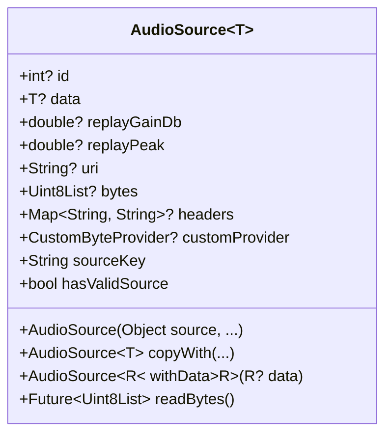
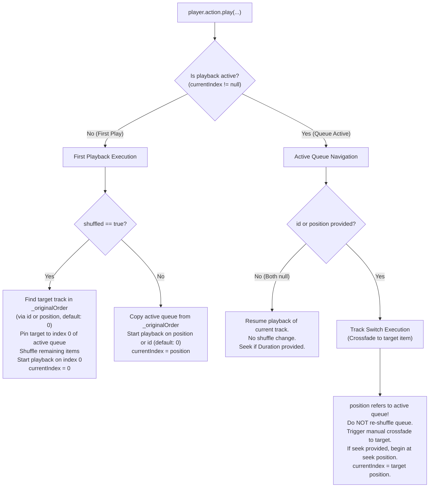
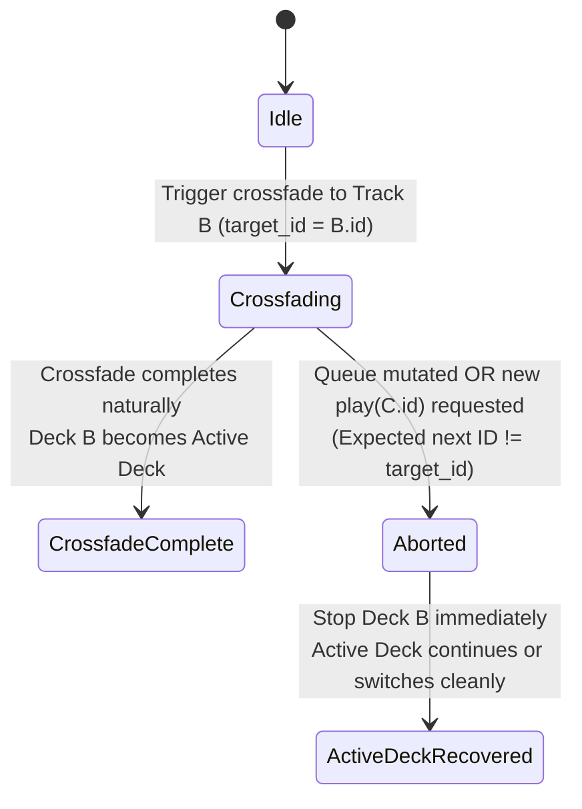
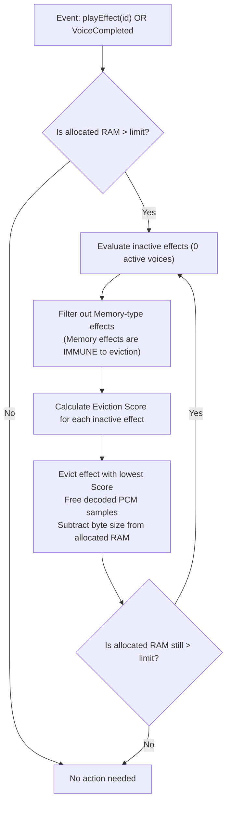
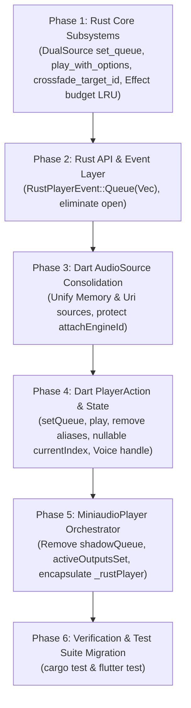

# Comprehensive Architectural Refactoring Plan: Queue, Sources, Effects, State & Crossfade Modernization

## 1. Executive Summary & Design Scope

This document establishes the comprehensive specification for the end-to-end modernization of `miniaudio_player`, bridging the high-level reactive Dart/Flutter API with the high-performance native Rust core.

Following user requirements, this refactor permanently removes legacy naming conventions, convenience aliases, and backward-compatibility shims. Every component has a single, unambiguous canonical name and a clear domain boundary.

### Key Architectural Pillars
1. **Complete Elimination of `open`**: The historic `open` terminology is removed across both Dart and Rust. Music uses `setQueue(...)` and `play(...)`; effects use `setEffects(...)` and `playEffect(...)`.
2. **Universal `play` Method & Removal of `skipToIndex`**: Playback is unified under `play({int? id, int? position, bool? shuffled, Duration? seek})`. Calling `play` with an `id` or `position` when already playing acts as a track skip utilizing a manual crossfade.
3. **Crossfading Governed by `id` (Not Index)**: Crossfade state transitions track target items by their unique monotonic `target_id: i64`. Any queue mutation (removal, insertion, reordering) or track switch targeting a different ID immediately aborts the active crossfade safely.
4. **Autonomous Memory-Budgeted Effect Subsystem**: Eager manual methods (`loadEffect`, `preloadEffects`, `unloadEffect`) are eliminated. Rust manages an effect RAM budget (default: **50 MB**, configurable, nullable for unlimited with danger alert). Memory-type effects are immune to eviction. Eviction occurs reactively without timers, balancing recency (LRU), source type penalties, and repetition frequency.
5. **In-Depth Effect Setter & Spatial Analysis**: Disentangling static asset configuration from live running voice modulation, proposing the encapsulation of live voice controls into a `Voice` handle object returned by `playEffect`.
6. **Unified `AudioSource`**: Merging `MemoryAudioSource` and `UriAudioSource` into a single `AudioSource<T>` class, freeing Dart byte arrays once transferred to Rust.
7. **State Sanitization & Removal of Limiters**: Stripping all convenience aliases from `PlayerState`, allowing open-ended volume ($\ge 0.0$), validating rate and pitch strictly as $> 0.0$ in Rust, and making `currentIndex` nullable.

---

## 2. Audio Analysis & ReplayGain Integration (`audio_analysis_result.dart`)

### 2.1 Current State & Limitations
Currently, `ReplayGainResult.getRecommendedVolume({bool preventClipping = true})` computes a linear volume multiplier via:
$$\text{factor} = 10^{\text{gainDb} / 20}$$
and advises the caller to invoke `player.action.setVolume(factor)`.

This approach conflates two fundamentally distinct concerns:
* **User Master Volume**: The application's volume slider (e.g., 75% volume).
* **Acoustic Loudness Normalization**: Per-track gain metadata according to ITU-R BS.1770-4 / EBU R128.

Applying ReplayGain through `setVolume` forces the user to recalculate and overwrite the master volume on every track transition, breaking crossfades and manual volume adjustments.

### 2.2 Modernized Solution
* **Documentation Enhancement**:
  Update `ReplayGainResult.getRecommendedVolume` to clearly document that instead of setting player volume, the **canonical and recommended approach** is to assign ReplayGain directly to the `AudioSource`:
  ```dart
  AudioSource(
    filePath,
    replayGainDb: result.replayGain?.gainDb,
    replayPeak: result.replayGain?.peak,
  )
  ```
* **Lossless Native DSP Normalization**:
  The native Rust DSP pipeline (`ReplayGainStage` in `rust/src/dsp/equalizer.rs`) automatically applies loudness normalization in 32-bit floating point PCM before master limiting. This guarantees:
  * Gapless transitions between tracks of wildly different recording levels.
  * Complete independence for `player.action.setVolume(...)`, which remains dedicated solely to user interface controls.
  * Full clipping protection via peak scaling (`1.0 / peak`) without audio ducking or manual math in Dart.

---

## 3. Audio Source Unification (`audio_source.dart`)

### 3.1 Problem Analysis
`AudioSource<T>` is currently defined as a `sealed` class with three subclasses: `UriAudioSource<T>`, `MemoryAudioSource<T>`, and `CustomAudioSource<T>`.

**Why unifying is superior**:
1. **Immediate Transfer to Native Memory**: When a user creates an `AudioSource` and passes it to the player, Dart immediately extracts the file path, network URL, or raw `Uint8List` bytes and sends them across the FFI bridge into Rust. Rust instantiates the underlying decoder or byte source.
2. **Reclaiming Dart Heap Memory**: Retaining a `MemoryAudioSource` with large `Uint8List` byte arrays in Dart results in duplicated memory (once in Dart GC heap, once in native memory). Unifying the class allows Dart to clear its local `bytes` reference to `null` (or empty) once transferred, retaining only the lightweight descriptor (`id`, `data`, `replayGainDb`, `replayPeak`).
3. **Elimination of Boilerplate**: Having separate classes forces exhaustive pattern matching across the player codebase. A single concrete class eliminates subclass branching while remaining 100% polymorphic at the input level.

### 3.2 Proposed Structure


#### Specifications:
* **Single Concrete Class `AudioSource<T>`**:
  * Unified Constructor (`AudioSource.custom` and all subclasses removed):
    ```dart
    AudioSource(
      Object source, {
      Map<String, String>? headers,
      T? data,
      double? replayGainDb,
      double? replayPeak,
      int? id,
    })
    ```
    Accepts:
    * `String` (file path, HTTP/HTTPS URL, HLS `.m3u8` stream, `data:` URI).
    * `Uri` (file, network, or `data:` URI).
    * `Uint8List` / `List<int>` (raw audio bytes in RAM).
    * `CustomByteProvider` (custom pull-based byte stream for DRM, encrypted decryption, or tokenized storage).
* **Protection of `attachEngineId` and `clearBytes`**:
  * Annotated with `@internal`:
    ```dart
    /// > [!WARNING]
    /// > Internal engine method. Application developers must NEVER invoke this directly.
    /// > Track identifiers are assigned monotonically by the engine coordinator.
    @internal
    void attachEngineId(int newId) {
      _id ??= newId;
    }
    ```

---

## 4. Elimination of `open` & Canonical Naming Standards

### 4.1 Rationale
In audio frameworks, the verb `open` historically denoted "open a file handle". In modern high-level players, calling `open` on a playlist does not open a file; it replaces or configures the queue of tracks. Furthermore, mixing music and sound effects under the same generic terminology causes confusion over which subsystem is being manipulated.

All `open` methods are permanently eliminated across both Dart and Rust.

### 4.2 Canonical Naming Matrix

| Old / Ambiguous Method | Domain | New Canonical Method | Purpose |
| :--- | :--- | :--- | :--- |
| `player.action.open(sources)` | Music | `player.action.setQueue(List<AudioSource<T>> sources)` | Sets or replaces the music playlist queue without starting playback. |
| `DualSource::open_queue` | Music (Rust) | `DualSource::set_queue(sources)` | Replaces `sources` map and `original_order` vector. |
| `player.action.play()` | Music | `player.action.play({int? id, int? position, bool? shuffled, Duration? seek})` | Starts, resumes, skips, or seeks music tracks. |
| `player.action.skipToIndex(...)` | Music | *Removed* (unified into `play(position: ...)`) | Eliminates duplicate navigation paths. |
| `player.action.loadEffect(...)` | Effects | `player.action.setEffects(List<AudioEffect> effects)` | Registers the sound effects catalog in the player. |
| `player.action.preloadEffects(...)` | Effects | *Removed* (handled autonomously by Rust RAM budget) | Zero manual preloading required. |
| `player.action.unloadEffect(...)` | Effects | *Removed* (handled autonomously by Rust LRU eviction) | Zero manual unloading required. |
| `player.action.playEffect(...)` | Effects | `player.action.playEffect(String id, ...)` | Triggers a polyphonic sound effect voice. |

---

## 5. Universal Music `play` Method Specifications

### 5.1 Method Signature
```dart
Future<void> play({
  int? id,
  int? position,
  bool? shuffled,
  Duration? seek,
});
```

### 5.2 Resolution Hierarchy
* If `id` is non-null: `id` takes precedence over `position`.
* If `id` is null and `position` is non-null: `position` is used.
* If both are null: targets the current item or resumes playback.

### 5.3 Detailed Behavior Specification



#### First Playback Execution (`currentIndex == null`):
1. **With target (`id` or `position`) and `shuffled: true`**:
   * Example: `position: 3, shuffled: true`.
   * Rust locates the target track in `_originalOrder` (at index 3).
   * That track is placed as index 0 of `active_queue`.
   * The remaining tracks from `_originalOrder` are shuffled randomly and placed after index 0.
   * Playback begins immediately on index 0 (the requested track).
   * If `seek` is provided, playback begins at that `seek` offset.
   * `currentIndex` is set to `0`.
   * Rust emits the new queue order `[id]` and `currentIndex = 0`.
2. **Without target (`id: null, position: null`) and `shuffled: true`**:
   * All tracks from `_originalOrder` are shuffled into `active_queue`.
   * Playback starts on the first item (index 0).
   * `currentIndex` is set to `0`.
   * Rust emits the new queue order `[id]` and `currentIndex = 0`.
3. **With `shuffled: false` (or omitted)**:
   * `active_queue` is copied directly from `_originalOrder`.
   * Playback starts on `position ?? 0` (or the track matching `id`).
   * `currentIndex` is set to that index.
   * Rust emits `active_queue` and `currentIndex`.

#### Subsequent Calls When Queue Is Already Active (`currentIndex != null`):
1. **Resuming playback (`id: null, position: null`)**:
   * If paused or stopped, playback simply resumes.
   * If `seek` is provided, seeks to that position within the current track.
   * No re-shuffling or queue modification occurs.
2. **Switching tracks (`id` or `position` provided)**:
   * `position` explicitly refers to the **current active `queue`**, NOT `_originalOrder`.
   * **Replaces the old `skipToIndex`**: Switching tracks when already playing initiates a **manual crossfade** from the active deck to the target deck.
   * If `seek` is provided, the incoming track starts rendering from that `seek` offset.
   * The active queue order is NOT re-shuffled.

#### Toggling Shuffle Mode:
* **Activating Shuffle (`setShuffle(true)` or `play(shuffled: true)` on active queue)**:
  * The currently active item (`active_queue[currentIndex]`) becomes index 0 of the new `active_queue`.
  * The remaining items in `active_queue` are shuffled randomly.
  * `currentIndex` becomes 0.
  * `_originalOrder` remains untouched.
  * Rust emits the new queue `[id]` and `currentIndex = 0`.
* **Deactivating Shuffle (`setShuffle(false)`)**:
  * `active_queue` is restored to match `_originalOrder` exactly.
  * The ID of the currently playing track is located in `_originalOrder`, and `currentIndex` is updated to that position.
  * Rust emits the restored queue `[id]` and updated `currentIndex`.
  * Playback continues uninterrupted on the current track.

---

## 6. Crossfade by ID Architecture

### 6.1 Vulnerability of Index-Based Crossfades
Currently, `DualSource` tracks crossfades using an integer index: `auto_crossfade_target_index: Arc<AtomicI64>`.

If the queue is mutated while an automatic or manual crossfade is transitioning (e.g. `removeAt`, `insert`, `setQueue`, or an unexpected track shift), the target index can suddenly point to a completely different audio file. Deck B would begin fading into the wrong song, causing jarring audio glitches and corrupted state.

### 6.2 Target ID Tracking & Safety Invariant


1. **Replace Index with `crossfade_target_id: Arc<AtomicI64>`**:
   * When Deck B is armed for an automatic or manual crossfade, `crossfade_target_id` stores the unique monotonic `id` of the target track (e.g. `42`).
2. **Strict Cancellation Invariant**:
   * If any queue mutation occurs (`remove`, `insert`, `setQueue`, `reorder`), Rust recalculates the ID of the expected next track.
   * If the expected next track ID does **not match** `crossfade_target_id`:
     * The crossfade is **instantly aborted** (`crossfade.abort()`).
     * Deck B is immediately stopped and unloaded.
     * The active deck is restored to unity gain without audio glitches.
     * If the mutation was caused by an explicit `play(new_id)`, a new crossfade or clean jump to `new_id` is initiated immediately.

---

## 7. Autonomous Memory-Budgeted Effect Subsystem

### 7.1 Elimination of Eager Loading Methods
The methods `loadEffect`, `preloadEffects`, and `unloadEffect` are permanently removed from `PlayerAction` and `MiniaudioPlayer`. 

Dart no longer attempts to micromanage sound effect memory or decode audio bytes in background isolates.

### 7.2 Configuration & Defaults
* **`effectMemoryLimitMb`**:
  * Configurable on `MiniaudioPlayer` or `PlayerConfig`.
  * **Default value**: `50` (50 Megabytes).
  * **Nullable**: If `null`, memory is completely unconstrained:
    > [!CAUTION]
    > **[DANGEROUS: UNLIMITED MEMORY]**: Setting `effectMemoryLimitMb: null` disables all RAM eviction. Sound effects will accumulate in memory indefinitely without safety boundaries. Use only in strictly controlled environments with finite, small audio assets.

### 7.3 Autonomous Eviction & Lifecycle Mechanics
Rust manages the effect RAM budget deterministically without background timers, polling intervals, or helper threads:



1. **Memory-Type Effects Immunity**:
   * Effects backed by in-memory bytes (`MemoryAudioSource` / raw bytes in RAM) are **never evicted**. Evicting them would destroy the only copy of the audio data.
   * However, their decoded PCM footprint **does count** towards `allocated_ram_bytes`.
2. **Reactive Eviction Triggers (Zero Timers)**:
   * **Trigger 1: On `playEffect(id)`**:
     If effect `id` is not currently decoded in RAM, Rust decodes it. If this would exceed the memory limit, Rust evicts inactive effects *before* loading. If all loaded effects are currently playing, Rust temporarily permits the allocation without dropping audio, and evicts as soon as a voice finishes.
   * **Trigger 2: On `VoiceCompleted`**:
     Whenever an active voice finishes playing and frees its voice slot, Rust checks if `allocated_ram_bytes > max_ram_bytes`. If so, it immediately purges the lowest-scoring inactive effects.
3. **Multi-Factor Eviction Scoring**:
   The eviction score is calculated as:
   $$\text{Score} = \text{SourceWeight} \times (1 + \text{TriggerFrequency}) \times \frac{1}{1 + \Delta t_{\text{seconds}}}$$
   * **Source Weight**:
     * `Memory`: $\infty$ (Pinned, immune).
     * `Network` (Remote URL): `5.0` (Expensive to refetch over HTTP).
     * `Local File`: `1.0` (Cheap to re-read from local disk).
   * **Trigger Frequency**:
     A monotonic counter incremented every time `playEffect` is called for this ID. A rapid-fire effect (e.g. gunshots or footsteps played 500 times in 10 seconds) accumulates a massive frequency multiplier, preventing it from being evicted.
   * **Recency ($\Delta t$)**:
     Seconds elapsed since `last_used`.
   * The inactive effect with the **lowest score** is evicted first.

---

## 8. In-Depth Analysis: Effect Parameter Setters & 3D Spatial Controls

The user specifically requested an analysis of:
`setEffectVolume`, `setEffectPitch`, `setEffectBalance`, `setEffectEmitter`, `setListener`, `setDopplerParameters`
*Why do they exist, and shouldn't `playEffect` be the sole method responsible for all of them?*

### 8.1 The Dual Nature of Sound Effects: Asset vs. Live Voice
The fundamental confusion in the existing API stems from naming:
* `AudioEffect`: A **static asset** (e.g., an MP3 file named `"engine_loop"` or `"laser"`).
* `VoiceId`: A **live, running instance** rendered on the 64-channel polyphonic voice pool.

When calling `setEffectVolume(voiceId, volume)` or `setEffectPitch(voiceId, pitch)`, the method is **not** modifying the static effect template. It is modulating a **currently active, playing voice**!

### 8.2 Why They Exist in Audio Engines
1. **One-Shot vs. Continuous / Looping Sounds**:
   * For **95% of use cases** (one-shots: UI clicks, explosions, gunshots, alerts), all parameters are known at the moment of playback. `playEffect` can and should handle all of them in a single call.
   * For **continuous or looping sounds** (e.g. a car engine running for 30 seconds, a moving vehicle in a game, ambient wind, a siren passing by):
     * As a vehicle drives across the scene (e.g. at 60 FPS), its 3D position changes every 16ms. The game must update its position (`emitter`).
     * As the vehicle accelerates, its pitch increases.
     * If real-time voice modulation methods did not exist, the developer would be forced to stop and restart the sound every frame, causing audible clicks and audio stuttering.
2. **The Spatial Listener**:
   * The **Listener** represents the ears of the player or camera in 3D space.
   * In any audio scene, there are many sound sources (emitters), but **only one listener**.
   * Passing `SpatialListener` into `playEffect` would make no conceptual sense, because you do not attach the player's ears to a sound effect! The listener updates continuously as the player character walks through the virtual world.
3. **Doppler Parameters**:
   * `setDopplerParameters(factor, speedOfSound)` calibrates global physics (e.g., speed of sound = 343.3 m/s in air). This is a global engine constant, not an effect property.

### 8.3 Recommended API Modernization
To eliminate confusion while preserving high-performance 3D game audio capabilities:

1. **`playEffect` as the Complete All-in-One Trigger**:
   `playEffect` handles 100% of the initial parameters for all one-shot and starting playback needs:
   ```dart
   Future<VoiceId> playEffect(
     String id, {
     double? volume,
     double? pitch,
     double? balance,
     double? pitchJitter,
     double? volumeJitter,
     SpatialEmitter? emitter,
     bool? looping,
     int? priority,
     DspRouting? dspRouting,
   });
   ```
2. **Encapsulate Real-Time Voice Modulation into a `Voice` Handle**:
   Instead of scattering disconnected `setEffectVolume(voiceId, ...)` methods across `PlayerAction`, `playEffect` can return a `Voice` handle object:
   ```dart
   // Clean, object-oriented, self-explanatory:
   final voice = await player.action.playEffect('engine_loop', looping: true);
   voice.setVolume(0.8);
   voice.setPitch(1.4);
   voice.setEmitter(currentVehiclePosition);
   voice.stop();
   ```
   Or if maintained on `PlayerAction`, rename them clearly to `action.setVoiceVolume(VoiceId, ...)`, removing the misleading word `Effect`.
3. **Spatial Listener & Doppler Relocation**:
   Relocate `setListener` and `setDopplerParameters` into a dedicated spatial namespace: `player.action.spatial.setListener(...)` and `player.action.spatial.setDopplerParameters(...)` (or keep clearly separated on `player.action.setListener(...)`), clarifying that they govern world listener physics, completely independent of individual sound effects.

---

## 9. Player State & Modernization (`player_state.dart`)

### 9.1 Elimination of Convenience Aliases
All duplicate getters in `PlayerState` are removed permanently:

| Deprecated / Removed Alias | Single Canonical Property |
| :--- | :--- |
| `bool get playing` | `bool isPlaying` |
| `bool get buffering` | `bool isBuffering` |
| `bool get completed` | `bool isCompleted` |
| `bool get opening` | `bool isOpening` |
| `bool get isStopped` | `playbackState == PlaybackState.stopped` |
| `bool get isError` | `playbackState == PlaybackState.error` |
| `bool get isMono` | `bool mono` |
| `int get bufferSizeFrames` | `int bufferSize` |
| `int get bitrate` | `int audioBitrate` |
| `double get preampDb` | `double preamp` |
| `bool get isLimiterEnabled` | `bool limiterEnabled` |
| `bool get shuffle` | `bool isShuffled` |
| `int get pinnedHeadSize` | `metaBytes?.length ?? 0` |

### 9.2 Removal of Arbitrary Limiters
* **Volume**:
  * Removed the `2.0` upper clamp. Volume can now be any value $\ge 0.0$ (supporting high-gain amplification beyond 200%).
* **Rate & Pitch**:
  * Removed arbitrary range clamps (`[0.5, 2.0]` or `[0.05, 4.0]`).
  * In both Dart and Rust, validate strictly that $\text{rate} > 0.0$ and $\text{pitch} > 0.0$.
* **Mic & Cue Volume**:
  * Removed artificial `2.0` clamp.

### 9.3 Nullable `currentIndex`
* `int? currentIndex`: Nullable by design. When no queue is loaded or before `play(...)` is invoked for the first time, `currentIndex == null`.
* Derived getters:
  ```dart
  AudioSource<T>? get currentItem =>
      (currentIndex != null && currentIndex! >= 0 && currentIndex! < queue.length)
          ? queue[currentIndex!]
          : null;

  bool get hasNext => currentIndex != null && currentIndex! < queue.length - 1;
  bool get hasPrevious => currentIndex != null && currentIndex! > 0;
  ```

---

## 10. End-to-End Migration & Implementation Blueprint



### Phase 1: Rust Core Subsystems
1. **`DualSource` (`rust/src/core/dual_source.rs`)**:
   * Replace `open_queue` with `set_queue(sources: Vec<AudioSourceCore>)`.
   * Replace `auto_crossfade_target_index: Arc<AtomicI64>` with `crossfade_target_id: Arc<AtomicI64>`.
   * Implement target ID verification in `render_mix`: if the upcoming track ID != `crossfade_target_id`, abort the crossfade.
   * Implement `play_track(id: Option<i64>, position: Option<usize>, shuffled: Option<bool>, seek_ms: Option<i64>)`.
   * Remove upper clamp limits on rate and pitch (only check $> 0.0$).
2. **`VoicePool` (`rust/src/core/voice_pool.rs`)**:
   * Implement dynamic memory budget `max_ram_bytes: Option<usize>`.
   * Implement multi-factor scoring (Source weight, frequency counter, recency).
   * Implement reactive eviction in `play_effect` and on `VoiceCompleted`.

### Phase 2: Rust API & Bridge
1. **`rust/src/api/types.rs`**:
   * Update `RustPlayerEvent::Queue(Vec<i64>)` to send only track IDs.
   * Update `CurrentIndex(Option<i32>)` or `-1` for null.
2. **`rust/src/api/player.rs`**:
   * Remove `open`; expose `set_queue` and `set_effects`.
   * Expose `play` with `id`, `position`, `shuffled`, `seek_ms`.

### Phase 3: Dart `AudioSource`
1. Merge `MemoryAudioSource`, `UriAudioSource`, and `CustomAudioSource` into a single concrete `AudioSource<T>` class.
2. Remove `AudioSource.custom` and accept `CustomByteProvider` directly in the unified `AudioSource(Object source, ...)` constructor.
3. Protect `attachEngineId` and `clearBytes` with `@internal` and warning docstrings.

### Phase 4: Dart `PlayerState` & `PlayerAction`
1. Remove all convenience aliases from `PlayerState`.
2. Make `currentIndex` nullable (`int?`).
3. Inject `_rustPlayer` directly into `PlayerAction(this, _rustPlayer)`.
4. Replace `action.open` with `action.setQueue` and universal `action.play`.
5. Remove `action.skipToIndex`.
6. Implement `Voice` handle for real-time live voice modulation.

### Phase 5: Dart `MiniaudioPlayer`
1. Remove `shadowQueue`.
2. Remove `_activeOutputs` and `activeOutputsSet`.
3. Relocate `infiniteMixEnabled` to `state`, `stream`, and `action`.
4. Document all parameters of `analyzeAudio`, `analyzeAudioMemory`, `analyzeAudioSync`.
5. Remove public getter `rustPlayer`.

### Phase 6: Test Suite Validation
1. Run `cargo check --manifest-path rust/Cargo.toml` and `cargo test`.
2. Update unit tests in `test/` for `setQueue`, `play`, and unified `AudioSource`.
3. Run `dart analyze lib test --fatal-infos`.
4. Run `flutter test`.
