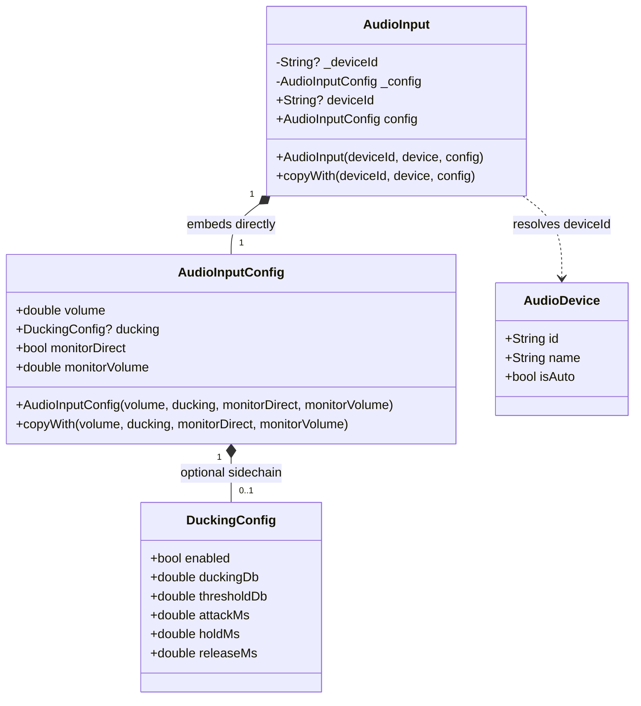
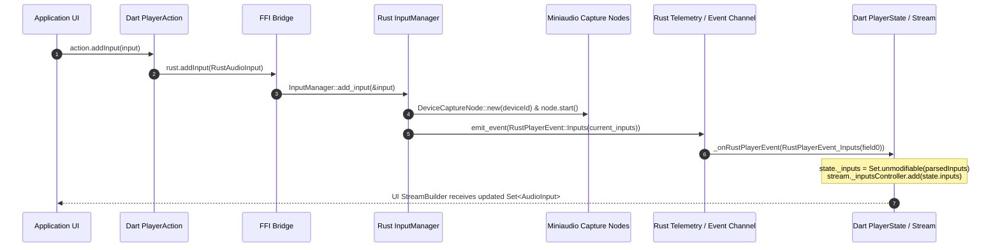

# Specification: Multi-Input Capture Matrix, AudioInputConfig & SSOT Reactivity

> **Status:** Specification Approved / Pending Implementation  
> **Scope:**
> 1. Decoupling and scaling `AudioInput` into an $N$-channel multi-capture matrix (symmetric to `AudioOutput`).
> 2. Complete elimination of legacy single-microphone APIs and convenience aliases (`enableMicrophone`, `disableMicrophone`, `clearInputs`, `setMicrophoneVolume`, `setDucking`, `setDirectMonitoring`, `isMicrophoneEnabled`, `micVolume`, `isDirectMonitoringEnabled`).
> 3. New first-class `AudioInputConfig` encapsulating gain, auto-ducking, and direct monitoring parameters.
> 4. `AudioInput` embeds `AudioInputConfig` directly with private attributes and public read-only getters.
> 5. **Strict Field Deduplication**: `AudioInput` only holds `deviceId` and `config`. Duplicating fields or forwarders (`volume`, `ducking`, `monitorDirect`, `monitorVolume`) directly on `AudioInput` is strictly forbidden.
> 6. **Zero Convenience Methods & Zero Aliases**: All convenience constructors (e.g. `AudioInput.fromParameters`), convenience getters, and state/stream aliases are eliminated in favor of explicit canonical APIs.
> 7. Strict functional separation: `addInput` registers capture nodes without modifying existing configs; `configureInput` modulates runtime parameters without reopening hardware.
> 8. Pure Single Source of Truth (SSOT): Rust engine orchestrates all capture hardware and emits `RustPlayerEvent::Inputs`; Dart never mutates state/streams locally.
> 9. Rust `InputManager` multi-device capture engine with per-channel ducking dynamics and zero-latency direct monitoring summing.

---

## 1. Architectural Motivation & Paradigm Shift

### 1.1. Why Legacy Microphone APIs Failed in a Modern Audio Engine
Previous iterations treated microphone capture as a global, singular toggle:
- `enableMicrophone` / `disableMicrophone` assumed the machine only ever has one active microphone.
- `setMicrophoneVolume(volume)` and `setDucking(config)` were global calls. In multi-input setups (e.g. podcast with Host mic, Guest mic, and room ambience), a global volume cannot differentiate between channels, and global ducking would cause ambient microphones to unintentionally duck the background music.
- `setDirectMonitoring(enabled, volume)` was global, causing acoustic feedback if applied to speakers instead of isolated headphones.
- `clearInputs()` was redundant boilerplate (`setInputs({})` already handles clearing symmetrically with `setOutputs({})`).
- `addInput` was mutating configuration in place if called repeatedly, blurring the line between node registration and runtime parameter modulation.
- Convenience getters and aliases (`isMicrophoneEnabled`, `micVolume`, `AudioInput.fromParameters`) created multiple competing ways to query the same state and bloated class APIs with duplicated fields.

### 1.2. The Symmetrical Matrix Paradigm
Inputs and outputs are duals of each other:
- **Outputs Matrix (`AudioOutput`)**: Zero, one, or multiple playback sinks (Speakers, DJ Cue Headphones, Network Stream) receiving audio signals from selectable buses (`all`, `musicMix`, `activeTrack`, `standbyTrack`).
- **Inputs Matrix (`AudioInput`)**: Zero, one, or multiple capture sources (USB Mic, Built-in Mic, Line-in Interface, Bluetooth headset) feeding into the engine with independent gain, selective auto-ducking sidechain, and direct monitoring.

---

## 2. Data Models & Class Architecture



### 2.1. `AudioInputConfig` Definition
`AudioInputConfig` encapsulates all modulatable real-time acoustic parameters for a capture stream:

```dart
/// Real-time capture configuration parameters for an [AudioInput].
class AudioInputConfig {
  /// The linear capture input gain/volume multiplier (`>= 0.0`). Defaults to `1.0`.
  final double volume;

  /// Optional sidechain ducking configuration. When non-null and enabled, this input's
  /// voice signal attenuates the music deck bus during speech.
  final DuckingConfig? ducking;

  /// Whether low-latency direct pass-through monitoring to the master output is enabled.
  /// When `true`, this input's signal is routed directly to the master output.
  final bool monitorDirect;

  /// The linear volume multiplier for direct voice monitoring (`>= 0.0`). Defaults to `1.0`.
  final double monitorVolume;

  /// Creates an [AudioInputConfig] with the specified capture parameters.
  const AudioInputConfig({
    this.volume = 1.0,
    this.ducking,
    this.monitorDirect = false,
    this.monitorVolume = 1.0,
  });

  /// Creates a copy of this configuration with the given fields replaced.
  AudioInputConfig copyWith({
    double? volume,
    DuckingConfig? ducking,
    bool? monitorDirect,
    double? monitorVolume,
  }) {
    return AudioInputConfig(
      volume: volume ?? this.volume,
      ducking: ducking ?? this.ducking,
      monitorDirect: monitorDirect ?? this.monitorDirect,
      monitorVolume: monitorVolume ?? this.monitorVolume,
    );
  }

  @override
  bool operator ==(Object other) =>
      identical(this, other) ||
      other is AudioInputConfig &&
          volume == other.volume &&
          ducking == other.ducking &&
          monitorDirect == other.monitorDirect &&
          monitorVolume == other.monitorVolume;

  @override
  int get hashCode => Object.hash(
        volume,
        ducking,
        monitorDirect,
        monitorVolume,
      );

  @override
  String toString() =>
      'AudioInputConfig(volume: $volume, ducking: $ducking, monitorDirect: $monitorDirect, monitorVolume: $monitorVolume)';
}
```

### 2.2. `AudioInput` Definition
`AudioInput` represents a concrete capture node binding an OS hardware endpoint to an `AudioInputConfig`:
- **Strict Prohibition of Duplicate Fields**: Having `volume`, `ducking`, `monitorDirect`, or `monitorVolume` directly on `AudioInput` is forbidden. All acoustic parameters are isolated inside `config`.
- **Zero Convenience Methods & Constructors**: No `AudioInput.fromParameters(...)` constructor and no forwarding getters (`input.volume`, `input.ducking`, etc.). To inspect parameters, callers must use `input.config.volume`, `input.config.ducking`, etc.
- **Private Fields with Read-Only Getters**: Attributes `_deviceId` and `_config` are private, exposed only through read-only getters (`deviceId` and `config`).
- **Direct `AudioDevice` Support**: The canonical constructor accepts `AudioDevice? device`, resolving `deviceId = device?.id`.
- **Identity & Equality based on Device**: Two `AudioInput` objects with the same `deviceId` refer to the same physical hardware capture node.

```dart
/// Represents an active or requested hardware audio capture source.
class AudioInput {
  final String? _deviceId;

  /// The physical OS hardware audio capture device identifier (`null` or `'auto'` targets default).
  String? get deviceId => _deviceId;

  final AudioInputConfig _config;

  /// Real-time capture configuration (gain, ducking, direct monitoring).
  AudioInputConfig get config => _config;

  /// Creates an [AudioInput] bound to a hardware endpoint and an [AudioInputConfig].
  const AudioInput({
    String? deviceId,
    AudioDevice? device,
    AudioInputConfig config = const AudioInputConfig(),
  })  : _deviceId = deviceId ?? device?.id,
        _config = config;

  /// Creates a copy of this input with updated parameters.
  AudioInput copyWith({
    String? deviceId,
    AudioDevice? device,
    AudioInputConfig? config,
  }) {
    return AudioInput(
      deviceId: deviceId ?? (device != null ? device.id : _deviceId),
      config: config ?? _config,
    );
  }

  @override
  bool operator ==(Object other) =>
      identical(this, other) ||
      other is AudioInput && _deviceId == other._deviceId;

  @override
  int get hashCode => _deviceId.hashCode;

  @override
  String toString() =>
      'AudioInput(deviceId: $_deviceId, config: $_config)';
}
```

---

## 3. Strict Functional Separation of Actions

| Method | Role | Behavior on Existing Device | Behavior on New Device |
| :--- | :--- | :--- | :--- |
| **`setInputs(Set<AudioInput> inputs)`** | Declarative batch replacement of all active capture nodes. | Retains already active devices without glitch; applies new config. | Opens new physical capture devices. Closes devices omitted from the set. Passing `{}` closes all inputs. |
| **`addInput(AudioInput input)`** | Adds a new physical capture node. | **REJECTS / THROWS `StateError`**: Input is already active. Must use `configureInput`. | Opens the hardware capture node in Rust and registers it. |
| **`removeInput(AudioInput input)`** | Detaches and closes a physical capture node. | Stops miniaudio capture thread, frees buffer memory, removes from Rust matrix. | No-op / safe ignore if device was not active. |
| **`configureInput(AudioInputConfig config, {String? deviceId, AudioDevice? device})`** | Real-time modulation of an **already running** capture node. | Modulates volume, ducking parameters, and direct monitoring gain lock-free without closing/reopening hardware. | Throws `ArgumentError` / `StateError` if the target device is not currently active. |

---

## 4. End-to-End Pure SSOT Reactivity Flow

Dart never mutates `state.inputs` or dispatches to `stream._inputsController` directly. Rust is the Single Source of Truth:



---

## 5. Rust Engine Implementation: Multi-Capture Architecture

### 5.1. Rust Data Structures (`rust/src/api/types.rs`)
```rust
#[derive(Debug, Clone, PartialEq)]
pub struct RustAudioInputConfig {
    pub volume: f32,
    pub ducking: Option<RustDuckingConfig>,
    pub monitor_direct: bool,
    pub monitor_volume: f32,
}

#[derive(Debug, Clone, PartialEq)]
pub struct RustAudioInput {
    pub device_id: Option<String>,
    pub config: RustAudioInputConfig,
}
```

### 5.2. Multi-Input Node Pool in `InputManager` (`rust/src/core/input_manager.rs`)
```rust
pub struct ActiveInputNode {
    pub device_id: Option<String>,
    pub config: RustAudioInputConfig,
    pub capture_node: Box<DeviceCaptureNode>,
    pub consumer: rtrb::Consumer<f32>,
    pub ducker: Option<AutoDucker>,
    pub scratch_buffer: Vec<f32>,
}

pub struct InputManager {
    pub active_inputs: Vec<ActiveInputNode>,
    pub sample_rate: u32,
    pub channels: usize,
}
```

### 5.3. Real-Time Mix Process
In each audio render callback (`InputManager::process(music_buffer, scratch_voice_out)`):
1. `scratch_voice_out.fill(0.0)`.
2. For each node in `active_inputs`:
   - Drains its lock-free SPSC consumer into `scratch_buffer`.
   - Multiplies samples by `node.config.volume`.
   - If `node.ducker` is active: processes sidechain compression against `music_buffer`.
   - If `node.config.monitor_direct == true`: sums samples into `scratch_voice_out` scaled by `node.config.monitor_volume`.
3. The master mix callback sums `scratch_voice_out` into the master output buffer.

---

## 6. Deprecation & Cleanup Matrix (Zero Convenience / Zero Aliases)

| Old API / Symbol | Action | Rationale & Replacement |
| :--- | :--- | :--- |
| `enableMicrophone(...)` | **Delete** | Multi-input incompatible. Replaced by `player.action.addInput(AudioInput(...))` or `player.action.setInputs(...)`. |
| `disableMicrophone()` | **Delete** | Multi-input incompatible. Replaced by `player.action.removeInput(input)` or `player.action.setInputs({})`. |
| `clearInputs()` | **Delete** | Convenience redundant method. Replaced canonically by `player.action.setInputs({})`. |
| `setMicrophoneVolume(vol)` | **Delete** | Multi-input incompatible. Replaced by `player.action.configureInput(AudioInputConfig(volume: vol))`. |
| `setDucking(config)` | **Delete** | Multi-input incompatible. Replaced by `player.action.configureInput(AudioInputConfig(ducking: config))`. |
| `setDirectMonitoring(en, vol)`| **Delete** | Multi-input incompatible. Replaced by `player.action.configureInput(AudioInputConfig(monitorDirect: en, monitorVolume: vol))`. |
| `MicrophoneAudioInput` | **Deleted** (Completed) | Deprecated class eliminated in favor of `AudioInput`. |
| `AudioInput.microphone` | **Deleted** (Completed) | Convenience factory eliminated in favor of canonical `AudioInput(...)`. |
| `AudioInput.fromParameters(...)` | **Delete** | Convenience constructor eliminated. Use `AudioInput(config: AudioInputConfig(...))`. |
| `AudioInput.volume` | **Forbidden / Delete** | Duplicate field eliminated. Callers must inspect `input.config.volume`. |
| `AudioInput.ducking` | **Forbidden / Delete** | Duplicate field eliminated. Callers must inspect `input.config.ducking`. |
| `AudioInput.monitorDirect` | **Forbidden / Delete** | Duplicate field eliminated. Callers must inspect `input.config.monitorDirect`. |
| `AudioInput.monitorVolume` | **Forbidden / Delete** | Duplicate field eliminated. Callers must inspect `input.config.monitorVolume`. |
| `PlayerState.isMicrophoneEnabled` | **Delete** | Convenience alias eliminated. Callers inspect `state.inputs.isNotEmpty`. |
| `PlayerStream.isMicrophoneEnabled` | **Delete** | Convenience stream alias eliminated. Callers listen to `stream.inputs`. |
| `PlayerState.micVolume` | **Delete** | Multi-input incompatible alias. Callers inspect `input.config.volume` on each item in `state.inputs`. |
| `PlayerStream.micVolume` | **Delete** | Multi-input incompatible stream. Callers listen to `stream.inputs`. |
| `PlayerState.isDirectMonitoringEnabled` | **Delete** | Multi-input incompatible alias. Callers inspect `input.config.monitorDirect` on each item in `state.inputs`. |
| `PlayerStream.isDirectMonitoringEnabled` | **Delete** | Multi-input incompatible stream. Callers listen to `stream.inputs`. |
| `RustPlayerEvent::MicrophoneEnabled` | **Delete** | Telemetry alias eliminated. Replaced by unified `RustPlayerEvent::Inputs(Vec<RustAudioInput>)`. |
| `RustPlayerEvent::MicVolume` | **Delete** | Telemetry alias eliminated. Replaced by unified `RustPlayerEvent::Inputs(Vec<RustAudioInput>)`. |

---

## 7. Step-by-Step Implementation Strategy

1. **Step 1: Data Models & Types (`Dart & Rust`)**:
   - Create `AudioInputConfig` in `lib/src/api/player_models.dart`.
   - Refactor `AudioInput` in `lib/src/api/player_models.dart`: embed `_config` with getter `config`; delete all duplicate fields (`volume`, `ducking`, `monitorDirect`, `monitorVolume`) and delete convenience constructor `fromParameters`.
   - Define `RustAudioInputConfig` and update `RustAudioInput` in `rust/src/api/types.rs`.
   - Remove legacy events (`MicrophoneEnabled`, `MicVolume`) from `RustPlayerEvent` in `rust/src/api/types.rs`.
   - Run `flutter_rust_bridge_codegen generate`.

2. **Step 2: Rust Multi-Capture Engine (`InputManager`)**:
   - Replace single capture node in `rust/src/core/input_manager.rs` with `Vec<ActiveInputNode>`.
   - Implement `set_inputs`, `add_input`, `remove_input`, and `configure_input`.
   - Implement multi-input render callback with individual sidechain ducking and direct monitoring summation.
   - Wire event emitter `RustPlayerEvent::Inputs(Vec<RustAudioInput>)`.

3. **Step 3: Dart API & Telemetry Synchronization**:
   - Update `PlayerAction`: implement `setInputs`, `addInput` (with duplicate check throwing `StateError`), `removeInput`, `configureInput`.
   - Delete all legacy and convenience actions: `clearInputs`, `enableMicrophone`, `disableMicrophone`, `setMicrophoneVolume`, `setDucking`, `setDirectMonitoring`.
   - Clean up `PlayerState` and `PlayerStream`: remove `isMicrophoneEnabled`, `micVolume`, and `isDirectMonitoringEnabled` getters and stream controllers.
   - Wire `RustPlayerEvent_Inputs` in `_onRustPlayerEvent` in `miniaudio_player.dart` to mutate `state._inputs` and push to `stream._inputsController`.
   - Remove manual `_player.state._inputs = ...` from `PlayerAction` (strictly follow SSOT).

4. **Step 4: Verification & Test Suite**:
   - Update existing tests (e.g. `test/engine/phase4_sinks_recording_and_ducking_test.dart`) to use the new canonical APIs without convenience aliases or duplicate properties.
   - Run `cargo test --manifest-path rust/Cargo.toml` (48+ unit tests).
   - Run `dart analyze lib test` and `flutter test` (257+ unit tests).
