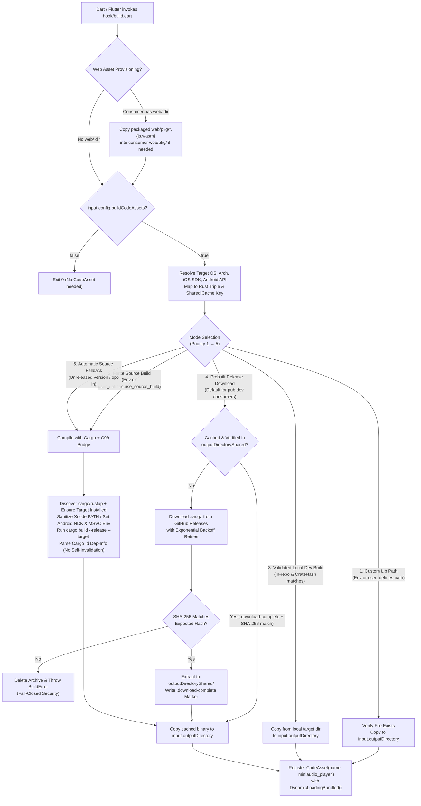
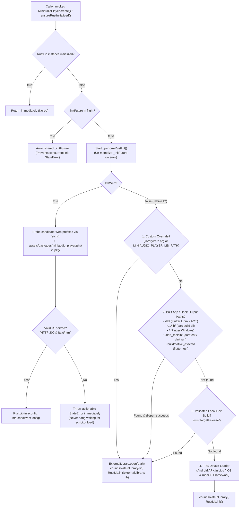

# Native Assets & Hybrid Build Architecture Refactoring Plan (`miniaudio_player` v4.x)

> [!IMPORTANT]
> **Status:** Authoritative Engineering Specification (Research Complete — Ready for Implementation)  
> **Scope:** Build system (`hook/build.dart`, `rust/build.rs`, `rust/Cargo.toml`), runtime library loader (`lib/src/api/miniaudio_player.dart`), Web/WASM distribution (`flutter_rust_bridge.yaml`, `pubspec.yaml`, `web/pkg/`), and multi-architecture CI/CD release pipeline (`.github/workflows/release-binaries.yml`).

---

## 1. Executive Summary & Architectural Invariants

`miniaudio_player` v4.0.0 migrated from a pure-C engine (`miniaudio_engine.c`) to a hybrid **Rust + C99 (`miniaudio.h` + `miniaudio_device_bridge.c`) + `flutter_rust_bridge` (v2)** architecture. While the real-time audio engine (lock-free SPSC ring buffers, Symphonia/libopus decoding, single-owner `map-engine-clock` actor, and vectorized DSP) is production-grade, the **build hook, runtime loader, Web/WASM packaging, and release distribution pipeline** currently require every end-user and CI runner to compile ~165 Rust crates and C99 sources from scratch.

This refactoring specification establishes a **zero-setup, cryptographically verified, cross-platform Native Assets architecture** modeled on an exhaustive source-level audit of **20+ mature Dart/Flutter FFI & Rust libraries** on `pub.dev`.

### Non-Negotiable Architectural Invariants

1. **Zero-Compiler Out-of-the-Box Experience (Prebuilt-First):**  
   End-users installing `miniaudio_player` from `pub.dev` must **never** need `cargo`, `rustup`, LLVM/Clang, Android NDK, Visual Studio C++ Build Tools, or Xcode command-line tools to build and run their apps. `hook/build.dart` downloads precompiled, stripped, LTO-optimized native binaries from GitHub Releases on demand.
2. **Fail-Closed Cryptographic Integrity & Atomic Caching:**  
   Every downloaded binary is verified via **SHA-256** before extraction/registration, written via atomic temporary files + completion markers inside `input.outputDirectoryShared`, and re-verified on cache hits. Transient network failures raise `InfraError` (exit code `2`) after exponential backoff retries; tampering or checksum mismatches raise `BuildError` immediately.
3. **100% Contributor & Offline Source-Build Ergonomics:**  
   Contributors working in a git clone, developers testing local Rust edits, or enterprise consumers in air-gapped CI environments can compile from source seamlessly via `UserDefines` (`use_source_build: true`), environment variables (`MINIAUDIO_PLAYER_BUILD_FROM_SOURCE=1`), or automatic fallback when working on an unreleased crate version.
4. **Hermetic Hook Execution & Zero Self-Invalidation:**  
   All Cargo build artifacts are isolated outside `packageRoot` (never polluting `.pub-cache` or `rust/target` during hook runs), with Windows `MAX_PATH` (260-char) mitigation and exact Cargo `.d` dep-info parsing that avoids `hooks_runner`'s infinite `File modified during build. Build must be rerun` loop.
5. **Deterministic Cross-Compilation Across All 6 Platforms (10 Targets):**  
   Full toolchain and environment orchestration for Android (`arm64-v8a`, `armeabi-v7a`, `x86_64` with **Android 15+ 16 KB page alignment**), iOS (`arm64` device, `arm64`/`x86_64` simulator with Xcode `PATH` sanitization), macOS (`arm64`, `x86_64`), Windows (`x64`, `arm64`), Linux (`x64`, `arm64` with `glibc >= 2.17`), and Web (`wasm32-unknown-unknown`).
6. **Bulletproof Runtime Loading Across All Dart & Flutter Toolchains:**  
   Bridges the architectural gap between Dart `CodeAsset` registration and `flutter_rust_bridge` v2's `ExternalLibrary` loader across `dart test`, `dart run`, `flutter test` (`build/native_assets/<os>/`), `dart build cli` / `dart compile exe`, and `flutter run` / `flutter build`—with concurrent `init()` race-condition protection and multi-isolate shutdown safety.
7. **Zero-Config Flutter Web / WASM Delivery:**  
   Ships prebuilt `miniaudio_player.js` and `miniaudio_player_bg.wasm` as declared Flutter package assets (`assets/packages/miniaudio_player/pkg/`) while also supporting `web/pkg/` provisioning, namespace isolation (`wasm_bindgen_miniaudio_player`), and a preflight HTTP check so missing WASM modules fail fast with actionable diagnostics rather than hanging `RustLib.init()` forever.

---

## 2. Deep Audit of Current `miniaudio_player` v4.0.0 (and Regressions from v3.0.1)

A line-by-line inspection of the current v4.0.0 codebase against v3.0.1 and the Dart Native Assets specification revealed **10 critical architectural issues**:

### 2.1 Unconditional `cargo build --release` in `hook/build.dart`
In [`hook/build.dart`](../hook/build.dart#L11-L97), every invocation of the build hook spawns `cargo build --release` from source. Compiling `symphonia`, `audiopus_sys` (building C `libopus` from source), `rustfft`, `crossbeam`, `flutter_rust_bridge`, and `miniaudio_device_bridge.c` takes **60–180 seconds** per target architecture and fails outright on machines without a Rust toolchain + C compiler + target stdlib installed.

### 2.2 Broken `CodeAsset` <-> `flutter_rust_bridge` Runtime Loading Contract
In [`hook/build.dart`](../hook/build.dart#L88-L96), the hook registers:
```dart
output.assets.code.add(
  CodeAsset(
    package: input.packageName,
    name: 'src/rust/frb_generated.io.dart',
    linkMode: DynamicLoadingBundled(),
    file: outFile.uri,
  ),
);
```
And in [`lib/src/api/miniaudio_player.dart`](../lib/src/api/miniaudio_player.dart#L25-L60), `ensureRustInitialized()` calls `await RustLib.init()` first, and on exception falls back to checking `.dart_tool/lib/$libName`.

**Why this is flawed:**
1. **`flutter_rust_bridge` v2 does NOT use `@Native` asset resolution:**  
   In Dart, only `@Native(...) external` functions consult `.dart_tool/native_assets.yaml` using the `CodeAsset` `name` (`package:miniaudio_player/src/rust/frb_generated.io.dart`). `flutter_rust_bridge` v2 instead uses `DynamicLibrary.open()` inside `loadExternalLibrary()` (`package:flutter_rust_bridge/src/loader/_io.dart`), which calls OS `dlopen()` / `LoadLibrary()` directly and **completely ignores** `CodeAsset.name` and `.dart_tool/native_assets.yaml`!
2. **Wrong probe order loads stale binaries first:**  
   Calling `RustLib.init()` without an `externalLibrary` first tries `rust/target/release/libminiaudio_player.so`. If a developer has an older `rust/target/release/` artifact from a previous build, FRB loads the stale binary first instead of the fresh hook output!
3. **`flutter test` fails on Linux and macOS:**  
   When running `flutter test`, `flutter_tools` installs hooked `CodeAsset`s into `build/native_assets/<os>/` (`build/native_assets/linux/` or `build/native_assets/macos/`) and **never** creates `.dart_tool/lib/`. Because neither `build/native_assets/<os>/` nor `.dart_tool/hooks_runner/...` is on `flutter_tester`'s `dlopen` search path on Linux/macOS, `ensureRustInitialized()` fails under `flutter test` unless `rust/target/release/` happens to exist locally!
4. **AOT CLI bundles (`dart build cli` / `dart compile exe`) and Desktop App Bundles:**  
   Standalone AOT bundles place `CodeAsset`s at `<executableDir>/../lib/<libName>` or `<executableDir>/lib/<libName>`, which is not relative to `Directory.current`.
5. **Concurrent Initialization Race Condition:**  
   `bool _rustInitialized = false;` is set *after* `await RustLib.init()`. If two callers invoke `MiniaudioPlayer.create()` concurrently before the first `await` settles, both see `_rustInitialized == false` and both call `RustLib.init()`, causing FRB to throw `StateError('Should not initialize flutter_rust_bridge twice')`.

### 2.3 Mutating `rust/target` Inside `packageRoot` (Cache Poisoning & `.pub-cache` Mutation)
[`hook/build.dart`](../hook/build.dart#L20-L53) runs `cargo build` with `workingDirectory: rustRoot` and no `--target-dir`, writing gigabytes of artifacts directly into `<packageRoot>/rust/target/`.
- When installed from `pub.dev`, `<packageRoot>` is inside `~/.pub-cache/hosted/pub.dev/miniaudio_player-x.y.z/`, violating Dart's requirement that build hooks never mutate their own package directory.
- On macOS, when two projects share `.pub-cache`, relinking `libminiaudio_player.dylib` in-place stamps a new Mach-O `LC_UUID`, invalidating the other project's cached build.

### 2.4 Missing Dependency Tracking vs. Self-Invalidation Pitfall
Currently, [`hook/build.dart`](../hook/build.dart) adds **zero** files to `output.dependencies`. Consequently, modifying `rust/src/*.rs` or `rust/c_src/miniaudio_device_bridge.c` does not re-trigger the hook. Conversely, naively adding `rust/` directories or Cargo's `.d` file itself to `output.dependencies` causes `hooks_runner` (`hooks_runner-1.5.0/lib/src/build_runner/build_runner.dart`) to detect `File modified during build. Build must be rerun`, triggering an infinite rebuild loop on every `dart run` / `flutter run`.

### 2.5 Broken Cross-Compilation Environment for Android, iOS, and Windows
- **Executable Discovery in Semi-Hermetic Hook Environment:**  
  `hooks_runner` strips almost all environment variables except a small allowlist (`PATH`, `HOME`, `USERPROFILE`, `ANDROID_HOME`, `ANDROID_NDK*`, `TEMP`, `TMP`, `SYSTEMROOT`, etc.—notably stripping `CARGO_HOME` and `RUSTUP_HOME`). When launched from GUI IDEs (Xcode, Android Studio, VS Code on macOS/Linux), `~/.cargo/bin` is frequently absent from `PATH`, causing `Process.run('cargo', ...)` to fail with `No such file or directory`.
- **Android NDK + `cc` Crate Failure:**  
  [`hook/build.dart`](../hook/build.dart#L43-L49) only sets `CARGO_TARGET_<TRIPLE>_LINKER = cc.toFilePath()`. However:
  1. `cCompiler.compiler` in `code_assets` points to bare `<ndk>/toolchains/llvm/prebuilt/<host>/bin/clang` (without `--target=<triple><api>`), which fails to link Android targets unless `--target=<ndkTriple><api>` is passed!
  2. `rust/build.rs` uses the `cc` crate to compile `c_src/miniaudio_device_bridge.c`, and `audiopus_sys` compiles `libopus` C sources. Without `CC_<triple>`, `AR_<triple>`, `RANLIB_<triple>`, and `CFLAGS_<triple>` (`--target=<ndkTriple><api> -D__ANDROID_API__=<api>`), the `cc` crate invokes the host system's `cc` instead of the Android NDK compiler!
  3. For 32-bit ARM (`armv7-linux-androideabi`), the NDK clang target prefix is `armv7a-linux-androideabi<api>` (with an `a`), NOT `armv7-linux-androideabi<api>`.
- **Regression of Android 15+ 16 KB Page Alignment:**  
  In `miniaudio_player` v3.0.1 (`hook/build.dart` line 116), `-Wl,-z,max-page-size=16384` was passed for Android. In v4.0.0 (`rust/build.rs`), this flag was lost. Google Play requires 16 KB ELF segment alignment for all Android 15+ (API 35+) native libraries on `arm64-v8a` and `x86_64`.
- **macOS / iOS Xcode `PATH` Poisoning:**  
  When Xcode invokes Flutter's build phase for iOS or macOS, it prepends `/Applications/Xcode.app/Contents/Developer/...` to `PATH`. This causes Cargo's host compilation of `build.rs` (and proc-macros) to fail with linker/SDK mismatches unless `Contents/Developer/` paths are filtered out of `PATH` during iOS cross-compilation.
- **Windows `MAX_PATH` (260-Character) Limit:**  
  Placing Cargo's `--target-dir` inside `.dart_tool/hooks_runner/shared/miniaudio_player/build/<hash>/target/` on Windows creates object paths exceeding 260 characters (`audiopus_sys` / `miniaudio_device_bridge.o`), causing MSVC `cl.exe` and `link.exe` to fail on Windows machines without `LongPathsEnabled`.

### 2.6 `flutter_rust_bridge` Version Pinning Trap in `pubspec.yaml`
[`pubspec.yaml`](../pubspec.yaml#L28) declares `flutter_rust_bridge: ^2.13.0`, while [`lib/src/rust/frb_generated.dart`](../lib/src/rust/frb_generated.dart#L69) hardcodes `String get codegenVersion => '2.13.0';`. In `flutter_rust_bridge`, `BaseEntrypoint.initImpl` checks `codegenVersion == runtimeVersion` with strict `==` string equality and throws a `StateError` if a consumer resolves `flutter_rust_bridge` `2.14.0+` (which `^2.13.0` permits!).

### 2.7 Web / WASM Threading Regression & Asset Delivery Friction
1. **Unconditional `std::thread::Builder::new().spawn` on `wasm32`:**  
   While `control_coordinator.rs`, `reaper.rs`, `io_pool.rs`, and `dual_source.rs` properly use `#[cfg(target_arch = "wasm32")]` and `WasmWorkerRuntime` (`rust/src/bridge/ffi.rs`), the recent refactor in [`rust/src/core/engine_actor.rs`](../rust/src/core/engine_actor.rs#L864) (`map-engine-clock`) and [`rust/src/api/player.rs`](../rust/src/api/player.rs#L497) (`map-device-watcher` and `map-telemetry-monitor`) unconditionally calls `thread::Builder::new().spawn(...)` and `std::time::Instant::now()`, which panic or return `Err(Unsupported)` on `wasm32-unknown-unknown`!
2. **Manual `web/pkg/` Copy Required by Consumers:**  
   [`lib/src/rust/frb_generated.dart`](../lib/src/rust/frb_generated.dart#L85) hardcodes `webPrefix: 'pkg/'` and `wasmBindgenName: 'wasm_bindgen'`, forcing every Flutter Web consumer to manually copy `miniaudio_player.js` and `miniaudio_player_bg.wasm` into their app's `web/pkg/` folder, and risking global `let wasm_bindgen` collisions if another FRB plugin is used in the same web app.

---

## 3. Comparative Ecosystem Benchmark (20+ Mature Dart/Flutter Libraries)

To design the optimal architecture, we downloaded and audited the source code of **20+ production packages** across the Dart/Flutter Native Assets and Rust FFI ecosystem.

| Package | Version | Build System / Mechanism | Key Architectural Patterns Adopted |
| :--- | :--- | :--- | :--- |
| **`libsignal`** | `9.0.1` | Custom `hook/build.dart` (1,258 LOC) + FRB `2.13.0` | **5-tier resolution cascade**, `.download-complete` marker, `.crate-version` + `.cargo-lock` local stamp validation, multi-path `CodeAsset` runtime loader (`.dart_tool/lib`, `../lib`, `build/native_assets/<os>`), multi-isolate `countIsolateInLibrary`, Web `ensureWasmModuleServed` preflight check, `>=X.Y.Z <X.Y.Z+1` FRB pin. |
| **`sqlite3`** | `3.8.0` | Custom `hook/build.dart` + `native_toolchain_c` | `UserDefines` (`input.userDefines['source']`), `input.outputDirectoryShared` caching, streaming SHA-256 verification to `.tmp` with atomic rename, cache-hit SHA-256 re-verification, macOS `@rpath` + `-headerpad_max_install_names`. |
| **`native_toolchain_rust`** | `1.0.7` | Dedicated Native Assets Rust builder | `--target-dir` in `outputDirectoryShared.resolve('cargo')`, Cargo `.d` dep-info parser (`DependencyDiscoverer`) that preserves Windows `C:\` colons and excludes `.d`/missing files to prevent `hooks_runner` self-invalidation, macOS Xcode `Contents/Developer/` `PATH` filter, Apple deployment target env vars. |
| **`native_toolchain_rust_mirror`** (`irondash`) | `0.1.0-dev.8` | Cargokit author's Native Assets Rust builder | Android NDK `source.properties` discovery, `libgcc.a` -> `INPUT(-lunwind)` linker stub for NDK r23+, avoiding Windows NDK `.cmd` batch script escaping bug (`android/ndk#1856`) by invoking `clang.exe` with `--target=<triple><api>`. |
| **`flutter_rust_bridge_hooks`** | `2.13.0` | Official FRB Native Assets hook helper | **Windows `MAX_PATH` (260-char) workaround** using a deterministic short directory in `Directory.systemTemp` (`frb_rust_target_<hash>`) for `--target-dir` so `rustc`/`cc` never fail on deep `.dart_tool/hooks_runner/shared/...` paths. |
| **`model2vec`** | `2.0.4` | Self-contained single-file `hook/build.dart` | Clean hybrid prebuilt download + local `cargo build` fallback in one file without external hook dependencies; Android NDK sysroot/clang triple mapping (`armv7a-linux-androideabi<api>` vs `arm-linux-androideabi`). |
| **`zk_jwt`** | `1.1.0` | Custom `hook/build.dart` + prebuilt GitHub Releases | Uses `InfraError` (exit code 2 in `package:hooks`) for network/HTTP timeouts vs `BuildError` for checksum mismatches or unsupported architectures. |
| **`cratestack_cbor`** | `0.19.5` | FRB `2.13.0` + vendored binaries + Web WASM | **Memoized `_initFuture` with `.onError` reset** + `RustLib.instance.initialized` check (fixing concurrent `init()` crashes); `package_config.json` ancestor walk when `Isolate.resolvePackageUri` throws `UnsupportedError` in `flutter test`; dual-URL Web WASM probing (`packages/...` vs `assets/packages/...`). |
| **`haudiotagger_fingerprint`** | `0.4.0` | FRB `2.13.0` + Flutter Web assets | `wasm_bindgen_name: wasm_bindgen_<pkg>` in `flutter_rust_bridge.yaml` to prevent global JS collisions; declares `pkg/*.wasm` and `pkg/*.js` under `flutter: assets:` for zero-config Flutter Web bundling. |
| **`cargokit`** (`rhttp`, `super_native_extensions`, `rinf`, `flutter_discord_rpc`) | `0.18.0` / `0.9.1` | Cargokit Dart build tool | Deterministic `CrateHash` computed over `Cargo.toml`, `Cargo.lock`, `build.rs`, `src/**/*.rs`, and `c_src/**`; robust `rustup`/`cargo` discovery in `~/.cargo/bin` and `%USERPROFILE%\.cargo\bin`; automatic `rustup target add`. |
| **`livekit_ffi`** | `0.14.0` | Custom `hook/build.dart` |Lockfile-synchronized downloads into `outputDirectoryShared`, environment variable overrides (`LIVEKIT_LIB_PATH`). |

### Why Self-Contained `hook/build.dart` (Like `libsignal`, `sqlite3`, `model2vec`) Beats External Hook Dependencies
We evaluated depending on `native_toolchain_rust` or `flutter_rust_bridge_hooks` vs. a self-contained `hook/build.dart` using only `hooks`, `code_assets`, and `crypto`:
- **`native_toolchain_rust` (`1.0.7`)** *only* compiles from source (it has no prebuilt binary download support) and pulls in `toml`, `pub_semver`, `logging`, and `meta` constraints.
- **`flutter_rust_bridge_hooks` (`2.13.0`)** *only* compiles from source and does not configure `CC_<triple>` / `CFLAGS_<triple>` for our C99 `miniaudio_device_bridge.c` compilation via the `cc` crate, nor does it add Android 15+ 16 KB page alignment (`-Wl,-z,max-page-size=16384`).
- **Conclusion:** A **self-contained `hook/build.dart`** (depending only on `hooks`, `code_assets`, and `crypto`, which are already in `miniaudio_player`'s dependency tree) that incorporates the best engineering patterns from `libsignal`, `sqlite3`, `native_toolchain_rust`, `flutter_rust_bridge_hooks`, and `cargokit` gives us **zero dependency bloat, full prebuilt download + source fallback support, and complete control over C99 + Rust cross-compilation**.

---

## 4. Target Architecture & Resolution Cascades

### 4.1 Build-Time Resolution Cascade (`hook/build.dart`)



### 4.2 Runtime Resolution Cascade (`ensureRustInitialized()`)



---

## 5. Deep-Dive Engineering Solutions for Every Subsystem

### 5.1 Configuration Surface (`UserDefines` & Environment Variables)

Following `sqlite3` (v3.8.0) and `libsignal` (v9.0.1), `hook/build.dart` must support both **environment variables** (for CI/CLI) and **`pubspec.yaml` `hooks.user_defines`** (for declarative project-level configuration that survives `hooks_runner`'s environment filtering):

```yaml
# Optional configuration in consumer's pubspec.yaml:
hooks:
  user_defines:
    miniaudio_player:
      # Force compiling Rust + C99 from source with local cargo:
      use_source_build: true
      # Or provide a pre-existing binary path:
      path: /custom/path/to/libminiaudio_player.so
      # Or override the GitHub Releases mirror URL (e.g. corporate artifact proxy):
      download_base_url: https://artifacts.internal.example.com/miniaudio_player
```

Supported environment variables (checked via `Platform.environment`):
- `MINIAUDIO_PLAYER_LIB_PATH`: Absolute path to a prebuilt dynamic library (bypasses download and build).
- `MINIAUDIO_PLAYER_BUILD_FROM_SOURCE`: Set to `1` or `true` to force local `cargo build --release`.
- `MINIAUDIO_PLAYER_DOWNLOAD_BASE_URL`: Custom release mirror base URL.

### 5.2 Executable & Toolchain Discovery Under `hooks_runner`'s Semi-Hermetic Environment

`hooks_runner` (`hooks_runner-1.5.0/lib/src/build_runner/build_runner.dart`) filters process environment variables down to a strict allowlist (`PATH`, `HOME`, `USERPROFILE`, `ANDROID_HOME`, `ANDROID_NDK*`, `TEMP`, `TMP`, `TMPDIR`, `SYSTEMROOT`, `PROGRAMDATA`, `LOCALAPPDATA`, `APPDATA`, `HTTP_PROXY`, `HTTPS_PROXY`, `NO_PROXY`). Notably:
- `CARGO_HOME` and `RUSTUP_HOME` are **stripped**.
- On macOS and Linux, GUI applications (Xcode, Android Studio, VS Code launched from Finder/Desktop) inherit the launchd/systemd base `PATH` (`/usr/bin:/bin:/usr/sbin:/sbin`), which **omits `~/.cargo/bin`, `/opt/homebrew/bin`, and `/usr/local/bin`**.

Therefore, when `hook/build.dart` needs to invoke `cargo` or `rustup`, it must resolve executables deterministically:
1. Search all directories in `Platform.environment['PATH']` (splitting on `';'` on Windows and `':'` on POSIX).
2. Search well-known toolchain directories:
   - POSIX: `$HOME/.cargo/bin`, `/opt/homebrew/bin`, `/usr/local/bin`
   - Windows: `%USERPROFILE%\.cargo\bin`, `%LOCALAPPDATA%\cargo\bin`
3. Prepend the directory containing `cargo` / `rustup` to the child process's `PATH` so `cargo` can also locate `rustc` and `rustup` shims.
4. Before running `cargo build --target <triple>`, invoke `rustup target list --installed` and, if `<triple>` is missing, automatically run `rustup target add <triple>` (mirroring `cargokit`).

### 5.3 Cross-Compilation & C99 Bridge (`miniaudio_device_bridge.c`) Environment Matrix

Because `miniaudio_player` compiles both Rust crates (`audiopus_sys` C `libopus` + `symphonia` + `flutter_rust_bridge`) and our custom C99 hardware bridge (`rust/c_src/miniaudio_device_bridge.c` via the `cc` crate in `rust/build.rs`), **both `rustc` and the `cc` crate** must receive target-accurate compiler and linker configurations.

#### Target Triple Mapping Matrix

| `targetOS` | `targetArchitecture` | `iOS.targetSdk` | Rust Target Triple | Prebuilt Archive Name (`v<ver>`) | Output Binary File Name |
| :--- | :--- | :--- | :--- | :--- | :--- |
| `OS.android` | `Architecture.arm64` | — | `aarch64-linux-android` | `miniaudio_player-v<ver>-aarch64-linux-android.tar.gz` | `libminiaudio_player.so` |
| `OS.android` | `Architecture.arm` | — | `armv7-linux-androideabi` | `miniaudio_player-v<ver>-armv7-linux-androideabi.tar.gz` | `libminiaudio_player.so` |
| `OS.android` | `Architecture.x64` | — | `x86_64-linux-android` | `miniaudio_player-v<ver>-x86_64-linux-android.tar.gz` | `libminiaudio_player.so` |
| `OS.iOS` | `Architecture.arm64` | `device` | `aarch64-apple-ios` | `miniaudio_player-v<ver>-aarch64-apple-ios.tar.gz` | `libminiaudio_player.dylib` |
| `OS.iOS` | `Architecture.arm64` | `simulator` | `aarch64-apple-ios-sim` | `miniaudio_player-v<ver>-aarch64-apple-ios-sim.tar.gz` | `libminiaudio_player.dylib` |
| `OS.iOS` | `Architecture.x64` | `simulator` | `x86_64-apple-ios` | `miniaudio_player-v<ver>-x86_64-apple-ios.tar.gz` | `libminiaudio_player.dylib` |
| `OS.macOS` | `Architecture.arm64` | — | `aarch64-apple-darwin` | `miniaudio_player-v<ver>-aarch64-apple-darwin.tar.gz` | `libminiaudio_player.dylib` |
| `OS.macOS` | `Architecture.x64` | — | `x86_64-apple-darwin` | `miniaudio_player-v<ver>-x86_64-apple-darwin.tar.gz` | `libminiaudio_player.dylib` |
| `OS.linux` | `Architecture.x64` | — | `x86_64-unknown-linux-gnu` | `miniaudio_player-v<ver>-x86_64-unknown-linux-gnu.tar.gz` | `libminiaudio_player.so` |
| `OS.linux` | `Architecture.arm64` | — | `aarch64-unknown-linux-gnu` | `miniaudio_player-v<ver>-aarch64-unknown-linux-gnu.tar.gz` | `libminiaudio_player.so` |
| `OS.windows` | `Architecture.x64` | — | `x86_64-pc-windows-msvc` | `miniaudio_player-v<ver>-x86_64-pc-windows-msvc.tar.gz` | `miniaudio_player.dll` |
| `OS.windows` | `Architecture.arm64` | — | `aarch64-pc-windows-msvc` | `miniaudio_player-v<ver>-aarch64-pc-windows-msvc.tar.gz` | `miniaudio_player.dll` |

#### Platform-Specific Compiler & Linker Intricacies

1. **Android NDK (`OS.android`):**
   - **Triple Asymmetry for 32-bit ARM:** Rust's triple is `armv7-linux-androideabi`, whereas Android NDK's Clang target flag is `armv7a-linux-androideabi<api>` (with an `a`), and the sysroot header directory under `<sysroot>/usr/include/` is `arm-linux-androideabi`.
   - **Bypassing Windows `.cmd` Wrapper Escaping Bug (`android/ndk#1856`):**  
     On Windows, invoking `<ndkTriple><api>-clang.cmd` as `CARGO_TARGET_<TRIPLE>_LINKER` fails when `rustc` passes `@response` files or complex linker flags through `cmd.exe`. Instead, point `CARGO_TARGET_<TRIPLE_UPPER>_LINKER` and `CC_<triple_underscores>` directly to the native `clang` / `clang.exe` binary (`input.config.code.cCompiler!.compiler`) and pass `--target=<ndkClangTriple><api>` via `CFLAGS_<triple_underscores>` and `-C link-arg=--target=<ndkClangTriple><api>` via `CARGO_TARGET_<TRIPLE_UPPER>_RUSTFLAGS`!
   - **NDK r23+ `libgcc.a` -> `libunwind` Compatibility:**  
     Write a 1-line `libgcc.a` linker script containing `INPUT(-lunwind)` in a temporary directory and pass `-L <dir>` in `CARGO_TARGET_<TRIPLE_UPPER>_RUSTFLAGS` (as `cargokit` and `native_toolchain_rust` do) so any crate or toolchain expecting `-lgcc` links cleanly against NDK r23–r28+.
   - **Android 15+ (API 35+) 16 KB ELF Page Size Alignment:**  
     Pass `-Wl,-z,max-page-size=16384` in both `rust/build.rs` (`cargo:rustc-cdylib-link-arg=-Wl,-z,max-page-size=16384`) and `CARGO_TARGET_<TRIPLE_UPPER>_RUSTFLAGS` (`-C link-arg=-Wl,-z,max-page-size=16384`).

2. **iOS & macOS (`OS.iOS`, `OS.macOS`):**
   - **Xcode `PATH` Sanitization (`native_toolchain_rust#17`):**  
     When cross-compiling for iOS on macOS, filter out any `PATH` entry containing `Contents/Developer/` (`path.split(':').where((e) => !e.contains('Contents/Developer/')).join(':')`) so Cargo's host compilation of `build.rs` uses the host toolchain cleanly.
   - **Deployment Targets:**  
     Pass `IPHONEOS_DEPLOYMENT_TARGET = '${codeConfig.iOS.targetVersion}'` (defaulting to `'12.0'`) and `MACOSX_DEPLOYMENT_TARGET = '${codeConfig.macOS.targetVersion}'` (defaulting to `'10.15'`).
   - **Install Name & Header Pad:**  
     In `rust/build.rs`, emit:
     ```rust
     println!("cargo:rustc-cdylib-link-arg=-Wl,-install_name,@rpath/libminiaudio_player.dylib");
     println!("cargo:rustc-cdylib-link-arg=-Wl,-headerpad_max_install_names");
     ```
     so `flutter_tools` can rewrite the Mach-O install name with `install_name_tool` when packaging `.framework` bundles.

3. **Windows (`OS.windows`):**
   - **`MAX_PATH` (260-Character) Workaround (`flutter_rust_bridge_hooks`):**  
     Instead of placing `--target-dir` deep inside `<project>/.dart_tool/hooks_runner/shared/miniaudio_player/build/<hash>/`, compute a deterministic short directory in `Directory.systemTemp` on Windows (`${Directory.systemTemp.path}\\map_cargo_${packageRootHash}`) so `audiopus_sys` and `cc` intermediate object paths never exceed 260 characters.
   - **MSVC Developer Prompt Environment Propagation:**  
     When `input.config.code.cCompiler?.windows.developerCommandPrompt` is provided by `hooks_runner`, resolve or propagate the MSVC bin directory to `PATH` so `link.exe` and `cl.exe` are found even when the user runs `flutter run` outside a Visual Studio Developer Command Prompt.

4. **Linux (`OS.linux`):**
   - **Symbol Isolation (`-Wl,-Bsymbolic-functions`):**  
     Prevents symbol interposition conflicts in the dynamic linker if a host Linux application or another plugin links a different version of `miniaudio` or `libopus`.
   - **`glibc >= 2.17` Portability in CI:**  
     Prebuilt Linux binaries (`x86_64-unknown-linux-gnu` and `aarch64-unknown-linux-gnu`) must be built in CI using `cargo-zigbuild` targeting `--target x86_64-unknown-linux-gnu.2.17` / `aarch64-unknown-linux-gnu.2.17` so they run on Ubuntu 20.04+, Debian 10+, Fedora, Arch, and enterprise RHEL distros without `GLIBC_2.38 not found` errors.

### 5.4 Dependency Tracking (`.d` Dep-Info Parsing) Without Self-Invalidation

Understanding `hooks_runner`'s rebuild check (`hooks_runner-1.5.0/lib/src/build_runner/build_runner.dart`) is essential:
- After `hook/build.dart` finishes, `hooks_runner` records the `lastModified` timestamp of the `BuildOutput` JSON file.
- It then checks every URI in `output.dependencies`. If **any** file in `output.dependencies` does not exist OR has a `lastModified` timestamp newer than the start/end of the build (or is modified during the build), `hooks_runner` logs `File modified during build. Build must be rerun` and invalidates the cache on every single run!

Therefore:
1. **In Prebuilt Download Mode (or Custom Path Mode):**  
   Do **NOT** add `rust/Cargo.toml`, `rust/src/`, or `rust/c_src/` to `output.dependencies`! Only add `input.packageRoot.resolve('hook/build.dart')` (and `pubspec.yaml`).
2. **In Source Build Mode:**  
   Parse Cargo's generated `<libFileName>.d` dep-info file in `<targetDir>/<triple>/release/<libFileName>.d` using the exact algorithm proven by `native_toolchain_rust` and `model2vec`:
   - Find the line starting with `<dylibPath>: ` (splitting on the **first** `": "` with a space, never bare `":"`, because Windows paths contain `C:\`!).
   - Tokenize space-separated paths while respecting `\ ` escaped spaces.
   - Add each path to `output.dependencies` **only if**:
     - It does **not** end with `.d` (Cargo writes the `.d` file during the build!),
     - It is **not** inside `<targetDir>` (intermediate build outputs change during the build!), and
     - `File(depPath).existsSync()` is `true`.
   - Additionally, add `rust/Cargo.toml`, `rust/build.rs`, and all files under `rust/c_src/` (`miniaudio.h`, `miniaudio_device_bridge.c`, `miniaudio_device_bridge.h`) since Cargo's `.d` file only tracks Rust files and `cargo:rerun-if-changed` paths emitted by `build.rs`.

### 5.5 Local Dev Stamp Hygiene (`CrateHash` vs. `rustContentHash`)

Why is FRB's `rustContentHash` insufficient to validate local dev binaries?
- `flutter_rust_bridge` computes `rustContentHash` strictly over the **function signatures** in `rust/src/api/`.
- If a developer edits internal DSP logic in `rust/src/dsp/`, actor scheduling in `rust/src/core/engine_actor.rs`, C99 code in `rust/c_src/miniaudio_device_bridge.c`, or upgrades a dependency in `rust/Cargo.lock`, `rustContentHash` **does not change**!
- Borrowing from `cargokit`'s `CrateHash` and `libsignal`'s stamp files, `hook/build.dart` computes a fast SHA-256 `CrateHash` over:
  - `rust/Cargo.toml`
  - `rust/Cargo.lock` (if present)
  - `rust/build.rs`
  - All `*.rs` files in `rust/src/` (sorted by relative path)
  - All `*.c` and `*.h` files in `rust/c_src/` (sorted by relative path)
- When building from source (or checking a local dev build in `outputDirectoryShared`), the hook writes `<cacheDir>/.crate-hash`. On subsequent runs, if `.crate-hash` matches the current `CrateHash` and the binary exists, it reuses the binary instantaneously without even spawning `cargo`!

### 5.6 Runtime Native Library Loader (`lib/src/api/miniaudio_player.dart`)

To make `miniaudio_player` work seamlessly across **every** Dart and Flutter execution mode (`dart test`, `dart run`, `flutter test`, `dart build cli`, `dart compile exe`, and `flutter run` / `flutter build` on Android, iOS, macOS, Windows, Linux, and Web), we replace the fragile `try/catch` in `ensureRustInitialized()` with a deterministic, race-free, isolate-safe loader:

1. **Idempotent & Concurrency-Safe Initialization (`cratestack_cbor#794`):**
   - Check `RustLib.instance.initialized` first (if true, return immediately).
   - Memoize `Future<void>? _initFuture` so concurrent callers await the same initialization future instead of racing to call `RustLib.init()` twice.
   - Attach `.onError<Object>((e, st) { _initFuture = null; Error.throwWithStackTrace(e, st); })` so transient failures are not permanently cached.
2. **Multi-Isolate Shutdown Protection (`libsignal` `countIsolateInLibrary`):**
   - In `flutter_rust_bridge` 2.x, each native library maintains an atomic count of live Dart isolates and replaces its C-to-Dart `Allogene` post-cobject function pointer with a no-op when the count drops to zero. However, FRB's Dart-side isolate watcher is a singleton shared across all FRB libraries in the isolate, and `RustLib.init` registers the callback *before* incrementing the isolate count. Calling `frb_create_shutdown_callback` and attaching a `NativeFinalizer` per isolate before `RustLib.init()` prevents async FRB calls and `StreamSink` events from hanging when worker isolates exit.
3. **Deterministic Native Search Path Probe Order:**
   - **Priority 1 — Explicit Override:** `libraryPath` argument or `Platform.environment['MINIAUDIO_PLAYER_LIB_PATH']`.
   - **Priority 2 — Built App Bundle / AOT Executable Directories:**
     - `<exeDir>/lib/<libName>` (`flutter build linux` bundle)
     - `<exeDir>/../lib/<libName>` (`dart build cli` / standalone AOT bundle)
     - `<exeDir>/<libName>` (`flutter build windows` places DLLs beside the `.exe`)
     *(Probed only when `Platform.resolvedExecutable` is not the `dart` or `flutter_tester` VM binary, so dev-mode runs never accidentally load unrelated libraries from the Dart SDK folder).*
   - **Priority 3 — Native Assets Hook Output Locations (Dev / Test Mode):**
     - `.dart_tool/lib/<libName>` (`dart test` / `dart run` on Dart 3.10+)
     - `build/native_assets/${Platform.operatingSystem}/<libName>` (`flutter test` on Linux, macOS, Windows)
   - **Priority 4 — FRB Default Loader (`loadExternalLibrary`):**
     - Handles Android APK `lib/<abi>/libminiaudio_player.so` (via linker SONAME lookup), iOS/macOS `.framework` bundles (`miniaudio_player.framework/miniaudio_player`), and local `rust/target/release/<libName>`.

### 5.7 Web / WASM Distribution, Loader & Engine Actor Fixes

#### A. Zero-Config Web Asset Bundling + `web/pkg/` Provisioning
Currently, consumers on Flutter Web must manually copy `web/pkg/` into their application's `web/pkg/` folder. We solve this via a **dual-delivery mechanism**:
1. **Declarative Flutter Asset Bundling (`haudiotagger_fingerprint` / `cratestack_cbor` pattern):**  
   In [`pubspec.yaml`](../pubspec.yaml), declare:
   ```yaml
   flutter:
     assets:
       - web/pkg/miniaudio_player.js
       - web/pkg/miniaudio_player_bg.wasm
   ```
   When Flutter builds a web app (`flutter run -d chrome` or `flutter build web`), it automatically bundles these files under `assets/packages/miniaudio_player/web/pkg/` (or `packages/miniaudio_player/...` on the DWDS dev server)—**requiring zero manual file copying by the consumer!**
2. **Automatic `web/pkg/` Provisioning in `hook/build.dart` (`libsignal` pattern):**  
   When `hook/build.dart` runs in a consuming workspace that has a `web/` directory (discovered by walking up from `input.outputDirectory` past `.dart_tool/hooks_runner`), the hook also copies `miniaudio_player.js` and `miniaudio_player_bg.wasm` into `<workspace>/web/pkg/` if absent or outdated, ensuring compatibility with `pkg/` prefix consumers and non-Flutter web servers.
3. **Multi-Prefix Web Loader with Preflight `fetch()` Verification (`libsignal` + `cratestack_cbor` pattern):**  
   On Web, `flutter_rust_bridge` loads `<webPrefix><stem>.js` by injecting a `<script>` tag and awaiting `onload` with **no timeout**, meaning a 404 or SPA `index.html` fallback causes `RustLib.init()` to hang forever.
   Our Web platform helper probes candidate prefixes in order:
   1. `'assets/packages/miniaudio_player/web/pkg/'` (Flutter Web release & dev asset bundle)
   2. `'pkg/'` (Standard `web/pkg/` directory)
   using a lightweight `fetch('<prefix>miniaudio_player.js')` check that verifies `response.ok && !contentType.contains('text/html')`. It then passes the winning `ExternalLibraryLoaderConfig` to `RustLib.init()`, or throws an immediate, actionable `StateError` if neither URL serves the module.
4. **Global JS Namespace Isolation (`haudiotagger_fingerprint` pattern):**  
   In [`flutter_rust_bridge.yaml`](../flutter_rust_bridge.yaml), set:
   ```yaml
   wasm_bindgen_name: wasm_bindgen_miniaudio_player
   ```
   so `miniaudio_player.js` binds to `window.wasm_bindgen_miniaudio_player` instead of `window.wasm_bindgen`, preventing fatal collisions when an application uses multiple `flutter_rust_bridge` plugins on Web.

#### B. Fixing the `wasm32-unknown-unknown` Threading Regression in `rust/src/`
In [`rust/src/core/engine_actor.rs`](../rust/src/core/engine_actor.rs#L864) and [`rust/src/api/player.rs`](../rust/src/api/player.rs#L497), `std::thread::Builder::new().spawn` and `std::time::Instant::now()` must be guarded with `#[cfg(not(target_arch = "wasm32"))]`:
- On `#[cfg(target_arch = "wasm32")]`:
  - `EngineActorHandle` drives `player.render_pcm(period_frames)`, `tick_music_lifecycle(...)`, and `publish_snapshots(...)` via `wasm_register_monitor_task` (or directly inside `wasm_worker_pump_quantum` in `rust/src/bridge/ffi.rs`) and executes `RtActorMsg::Call` inline without spawning an OS thread!
  - `RustMiniaudioPlayer::new` skips spawning `map-device-watcher` (WebAudio has no physical hardware hotplug enumeration) and registers the telemetry monitor tick closure with `crate::bridge::ffi::wasm_register_monitor_task(...)` instead of spawning `map-telemetry-monitor`.

---

## 6. Complete Reference Implementations

### 6.1 `pubspec.yaml` & `flutter_rust_bridge.yaml`

In [`pubspec.yaml`](../pubspec.yaml):
- Pin `flutter_rust_bridge` to `">=2.13.0 <2.13.1"`. As proven in `libsignal-9.0.1`, writing the exact version as a narrow range `>=X.Y.Z <X.Y.Z+1` prevents `pub get` from resolving a newer minor/patch version that crashes `RustLib.init()`'s `codegenVersion == runtimeVersion` check, **without** triggering `dart pub publish`'s exit-code-65 warning against bare exact version pins!
- Widen `hooks` and `code_assets` constraints to `">=1.0.0 <3.0.0"` so both Flutter 3.38–3.44 and Flutter 3.47+ / Dart 3.10+ resolve cleanly.
- Bundle `web/pkg/miniaudio_player.js` and `web/pkg/miniaudio_player_bg.wasm` under `flutter: assets:`.

```yaml
name: miniaudio_player
description: "Ultra-low-resource cross-platform audio player and DSP engine using miniaudio. Features dual-deck crossfade queue, equalizer, reverb, limiter, crossfeed, pitch, rate & visualizer."
version: 4.0.0
repository: https://github.com/chomusuke-mk/miniaudio_player
issue_tracker: https://github.com/chomusuke-mk/miniaudio_player/issues
homepage: https://miniaudio_player.chomusuke.dev
documentation: https://github.com/chomusuke-mk/miniaudio_player/tree/main/docs

environment:
  sdk: ">=3.6.0 <4.0.0"

dependencies:
  code_assets: ">=1.0.0 <3.0.0"
  crypto: ^3.0.6
  ffi: ^2.1.3
  # Narrow range admits only the exact codegen version (preventing FRB runtime
  # StateError on minor bumps) while satisfying `dart pub publish` range checks.
  flutter_rust_bridge: ">=2.13.0 <2.13.1"
  freezed_annotation: ^3.1.0
  hooks: ">=1.0.0 <3.0.0"
  meta: ^1.16.0
  path: ^1.9.0

dev_dependencies:
  build_runner: ^2.17.1
  ffigen: ^20.1.1
  flutter_lints: ^6.0.0
  flutter_test:
    sdk: flutter
  freezed: ^4.0.3

platforms:
  android:
  ios:
  linux:
  macos:
  windows:
  web:

flutter:
  assets:
    - web/pkg/miniaudio_player.js
    - web/pkg/miniaudio_player_bg.wasm
```

### 6.2 `rust/build.rs` & `rust/Cargo.toml`

In [`rust/build.rs`](../rust/build.rs), restore **Android 15+ 16 KB page alignment** (`-Wl,-z,max-page-size=16384`), add macOS/iOS `@rpath` + `-headerpad_max_install_names`, and ensure C99 compilation of `c_src/miniaudio_device_bridge.c` works cleanly across all cross-compilation targets:

```rust
use std::env;

fn main() {
    println!("cargo:rerun-if-changed=c_src/miniaudio.h");
    println!("cargo:rerun-if-changed=c_src/miniaudio_device_bridge.h");
    println!("cargo:rerun-if-changed=c_src/miniaudio_device_bridge.c");

    let target_arch = env::var("CARGO_CFG_TARGET_ARCH").unwrap_or_default();
    if target_arch == "wasm32" {
        // WebAssembly uses the pure-Rust WasmWorkerRuntime bridge in src/bridge/ffi.rs
        return;
    }

    let target_os = env::var("CARGO_CFG_TARGET_OS").unwrap_or_default();

    let mut build = cc::Build::new();
    build
        .file("c_src/miniaudio_device_bridge.c")
        .include("c_src")
        .opt_level(3)
        .warnings(false);

    match target_os.as_str() {
        "windows" => {
            println!("cargo:rustc-link-lib=ole32");
            println!("cargo:rustc-link-lib=user32");
            println!("cargo:rustc-link-lib=advapi32");
        }
        "linux" => {
            build.flag("-fPIC");
            build.define("_GNU_SOURCE", None);
            println!("cargo:rustc-link-lib=pthread");
            println!("cargo:rustc-link-lib=m");
            println!("cargo:rustc-link-lib=dl");
            // Prevent dynamic symbol interposition with host apps or other plugins
            println!("cargo:rustc-cdylib-link-arg=-Wl,-Bsymbolic-functions");
        }
        "android" => {
            build.flag("-fPIC");
            println!("cargo:rustc-link-lib=log");
            println!("cargo:rustc-link-lib=OpenSLES");
            // Mandatory for Android 15+ (API 35+) 16 KB ELF page size compliance on Google Play
            println!("cargo:rustc-cdylib-link-arg=-Wl,-z,max-page-size=16384");
            println!("cargo:rustc-cdylib-link-arg=-Wl,-Bsymbolic-functions");
        }
        "macos" => {
            build.flag("-fPIC");
            println!("cargo:rustc-link-lib=framework=CoreAudio");
            println!("cargo:rustc-link-lib=framework=AudioToolbox");
            println!("cargo:rustc-link-lib=framework=CoreFoundation");
            println!("cargo:rustc-cdylib-link-arg=-Wl,-install_name,@rpath/libminiaudio_player.dylib");
            println!("cargo:rustc-cdylib-link-arg=-Wl,-headerpad_max_install_names");
        }
        "ios" => {
            build.flag("-fPIC");
            println!("cargo:rustc-link-lib=framework=CoreAudio");
            println!("cargo:rustc-link-lib=framework=AudioToolbox");
            println!("cargo:rustc-link-lib=framework=AVFoundation");
            println!("cargo:rustc-link-lib=framework=CoreFoundation");
            println!("cargo:rustc-link-lib=framework=Foundation");
            println!("cargo:rustc-cdylib-link-arg=-Wl,-install_name,@rpath/libminiaudio_player.dylib");
            println!("cargo:rustc-cdylib-link-arg=-Wl,-headerpad_max_install_names");
        }
        _ => {}
    }

    build.compile("miniaudio_device_bridge");
}
```

### 6.3 Production `hook/build.dart`

Below is the complete, self-contained [`hook/build.dart`](../hook/build.dart) implementing the 5-tier resolution cascade, SHA-256 verification, atomic caching, `CrateHash` local stamp validation, Windows `MAX_PATH` mitigation, Android NDK / Xcode environment sanitization, and Cargo `.d` dependency tracking:

```dart
import 'dart:convert';
import 'dart:io';

import 'package:code_assets/code_assets.dart';
import 'package:crypto/crypto.dart';
import 'package:hooks/hooks.dart';
import 'package:path/path.dart' as p;

const _packageName = 'miniaudio_player';
const _version = '4.0.0';
const _githubRepo = 'chomusuke-mk/miniaudio_player';
const _defaultReleaseBaseUrl =
    'https://github.com/$_githubRepo/releases/download/v$_version';
const _cacheCompleteMarker = '.download-complete';
const _crateHashMarker = '.crate-hash';

/// Embedded SHA-256 checksums for official GitHub Release archives (`v$_version`).
///
/// Populated automatically by `tool/update_release_hashes.dart` during the CI
/// release workflow before `dart pub publish`. When an entry is present here,
/// the hook verifies the downloaded archive against this immutable compile-time
/// hash; otherwise it fetches and verifies `checksums.sha256` from the release.
const Map<String, String> _embeddedReleaseHashes = <String, String>{
  // 'miniaudio_player-v4.0.0-aarch64-linux-android.tar.gz': '<sha256>',
  // 'miniaudio_player-v4.0.0-armv7-linux-androideabi.tar.gz': '<sha256>',
  // 'miniaudio_player-v4.0.0-x86_64-linux-android.tar.gz': '<sha256>',
  // 'miniaudio_player-v4.0.0-aarch64-apple-ios.tar.gz': '<sha256>',
  // 'miniaudio_player-v4.0.0-aarch64-apple-ios-sim.tar.gz': '<sha256>',
  // 'miniaudio_player-v4.0.0-x86_64-apple-ios.tar.gz': '<sha256>',
  // 'miniaudio_player-v4.0.0-aarch64-apple-darwin.tar.gz': '<sha256>',
  // 'miniaudio_player-v4.0.0-x86_64-apple-darwin.tar.gz': '<sha256>',
  // 'miniaudio_player-v4.0.0-x86_64-unknown-linux-gnu.tar.gz': '<sha256>',
  // 'miniaudio_player-v4.0.0-aarch64-unknown-linux-gnu.tar.gz': '<sha256>',
  // 'miniaudio_player-v4.0.0-x86_64-pc-windows-msvc.tar.gz': '<sha256>',
  // 'miniaudio_player-v4.0.0-aarch64-pc-windows-msvc.tar.gz': '<sha256>',
};

const _retryDelays = <Duration>[
  Duration(seconds: 2),
  Duration(seconds: 4),
  Duration(seconds: 8),
  Duration(seconds: 16),
];

void main(List<String> args) async {
  await build(args, (input, output) async {
    // Always track hook/build.dart and pubspec.yaml as baseline dependencies.
    output.dependencies.add(input.packageRoot.resolve('hook/build.dart'));

    // Provision web/pkg/ for web consumers if a `web/` directory exists in the workspace.
    _provisionWebAssetsIfNeeded(input);

    if (!input.config.buildCodeAssets) {
      return;
    }

    final codeConfig = input.config.code;
    final targetOS = codeConfig.targetOS;
    final targetArch = codeConfig.targetArchitecture;
    final iosSdk = targetOS == OS.iOS ? codeConfig.iOS.targetSdk : null;

    final rustTriple = _resolveRustTriple(targetOS, targetArch, iosSdk);
    final libFileName = targetOS.dylibFileName(_packageName);
    final finalOutFile = File.fromUri(input.outputDirectory.resolve(libFileName));
    await finalOutFile.parent.create(recursive: true);

    // -------------------------------------------------------------------------
    // Priority 1: Explicit custom binary path (Env var or pubspec user_defines)
    // -------------------------------------------------------------------------
    final customPath = _resolveCustomLibPath(input);
    if (customPath != null) {
      final sourceFile = File(customPath);
      if (!sourceFile.existsSync()) {
        throw BuildError(
          message:
              'Custom native library specified at "$customPath" does not exist.',
        );
      }
      await sourceFile.copy(finalOutFile.path);
      output.dependencies.add(sourceFile.uri);
      _registerCodeAsset(input, output, finalOutFile.uri);
      return;
    }

    final forceSource = _shouldForceSourceBuild(input);
    final isRepoContributor = _isWorkingInPackageRepo(input);

    // -------------------------------------------------------------------------
    // Priority 2 & 3: Local Cargo Build (Forced or Contributor In-Repo Mode)
    // -------------------------------------------------------------------------
    if (forceSource || isRepoContributor) {
      await _buildFromRustSource(
        input: input,
        output: output,
        rustTriple: rustTriple,
        libFileName: libFileName,
        destination: finalOutFile,
      );
      _registerCodeAsset(input, output, finalOutFile.uri);
      return;
    }

    // -------------------------------------------------------------------------
    // Priority 4: Prebuilt Binary Download from GitHub Releases (Default)
    // -------------------------------------------------------------------------
    try {
      await _acquirePrebuiltBinary(
        input: input,
        rustTriple: rustTriple,
        libFileName: libFileName,
        destination: finalOutFile,
      );
      _registerCodeAsset(input, output, finalOutFile.uri);
      return;
    } on BuildError {
      // Security / checksum mismatch errors must NEVER fall back silently.
      rethrow;
    } catch (downloadErr) {
      // -----------------------------------------------------------------------
      // Priority 5: Automatic Fallback to Local Cargo Build if Rust is present
      // -----------------------------------------------------------------------
      final rustDir = Directory.fromUri(input.packageRoot.resolve('rust/'));
      final cargoExe = _findExecutable('cargo');
      if (rustDir.existsSync() && cargoExe != null) {
        stderr.writeln(
          '[miniaudio_player] Prebuilt binary download unavailable ($downloadErr). '
          'Falling back to local Cargo compilation for $rustTriple...',
        );
        await _buildFromRustSource(
          input: input,
          output: output,
          rustTriple: rustTriple,
          libFileName: libFileName,
          destination: finalOutFile,
        );
        _registerCodeAsset(input, output, finalOutFile.uri);
        return;
      }

      throw InfraError(
        message:
            'Failed to download prebuilt miniaudio_player v$_version binary for '
            '$rustTriple, and no local Rust toolchain (cargo) was found for '
            'fallback compilation.\n'
            'Cause: $downloadErr\n'
            'To fix:\n'
            '  1. Check internet connectivity to github.com/$_githubRepo/releases, OR\n'
            '  2. Provide a local binary via MINIAUDIO_PLAYER_LIB_PATH=/path/to/$libFileName, OR\n'
            '  3. Install Rust (https://rustup.rs) and set MINIAUDIO_PLAYER_BUILD_FROM_SOURCE=1.',
      );
    }
  });
}

void _registerCodeAsset(
  BuildInput input,
  BuildOutputBuilder output,
  Uri fileUri,
) {
  output.assets.code.add(
    CodeAsset(
      package: input.packageName,
      name: _packageName,
      linkMode: DynamicLoadingBundled(),
      file: fileUri,
    ),
  );
}

// =============================================================================
// Configuration & Mode Detection Helpers
// =============================================================================

String? _resolveCustomLibPath(BuildInput input) {
  final envPath = Platform.environment['MINIAUDIO_PLAYER_LIB_PATH'];
  if (envPath != null && envPath.trim().isNotEmpty) {
    return envPath.trim();
  }
  final userPath = input.userDefines['path'];
  if (userPath is String && userPath.trim().isNotEmpty) {
    final resolved = input.packageRoot.resolve(userPath.trim());
    return File.fromUri(resolved).path;
  }
  return null;
}

bool _shouldForceSourceBuild(BuildInput input) {
  final envForce = Platform.environment['MINIAUDIO_PLAYER_BUILD_FROM_SOURCE'];
  if (envForce == '1' || envForce?.toLowerCase() == 'true') {
    return true;
  }
  final userForce = input.userDefines['use_source_build'];
  if (userForce == true || userForce == 'true' || userForce == '1') {
    return true;
  }
  return false;
}

/// Detects if the hook is running inside a git checkout of miniaudio_player
/// itself (as opposed to `~/.pub-cache/hosted/pub.dev/...`).
bool _isWorkingInPackageRepo(BuildInput input) {
  final pkgPath = input.packageRoot.toFilePath();
  if (pkgPath.contains('.pub-cache') || pkgPath.contains('pub.dartlang.org')) {
    return false;
  }
  final gitDir = Directory.fromUri(input.packageRoot.resolve('.git'));
  final rustCargo = File.fromUri(input.packageRoot.resolve('rust/Cargo.toml'));
  return gitDir.existsSync() && rustCargo.existsSync();
}

String _resolveDownloadBaseUrl(BuildInput input) {
  final envUrl = Platform.environment['MINIAUDIO_PLAYER_DOWNLOAD_BASE_URL'];
  if (envUrl != null && envUrl.trim().isNotEmpty) {
    return envUrl.trim().replaceAll(RegExp(r'/+$'), '');
  }
  final userUrl = input.userDefines['download_base_url'];
  if (userUrl is String && userUrl.trim().isNotEmpty) {
    return userUrl.trim().replaceAll(RegExp(r'/+$'), '');
  }
  return _defaultReleaseBaseUrl;
}

// =============================================================================
// Prebuilt Binary Download, Atomic Caching & SHA-256 Verification
// =============================================================================

Future<void> _acquirePrebuiltBinary({
  required BuildInput input,
  required String rustTriple,
  required String libFileName,
  required File destination,
}) async {
  final archiveName = '$_packageName-v$_version-$rustTriple.tar.gz';
  final baseUrl = _resolveDownloadBaseUrl(input);
  final downloadUrl = '$baseUrl/$archiveName';

  final cacheDir = Directory.fromUri(
    input.outputDirectoryShared.resolve('prebuilt-v$_version-$rustTriple/'),
  );
  final cachedLib = File(p.join(cacheDir.path, libFileName));
  final completeMarker = File(p.join(cacheDir.path, _cacheCompleteMarker));

  // Fast path: reuse verified shared cache entry.
  if (completeMarker.existsSync() && cachedLib.existsSync()) {
    await cachedLib.copy(destination.path);
    return;
  }

  await cacheDir.create(recursive: true);
  final expectedSha256 = await _resolveExpectedSha256(baseUrl, archiveName);

  final tmpArchive = File(p.join(cacheDir.path, '$archiveName.tmp.$pid'));
  try {
    await _downloadWithRetry(Uri.parse(downloadUrl), tmpArchive);
    await _verifyFileSha256(tmpArchive, expectedSha256, archiveName);

    // Extract tar.gz into cacheDir
    final extractRes = await Process.run('tar', [
      '-xzf',
      tmpArchive.path,
      '-C',
      cacheDir.path,
    ]);
    if (extractRes.exitCode != 0) {
      throw InfraError(
        message: 'Failed to extract $archiveName: ${extractRes.stderr}',
      );
    }

    if (!cachedLib.existsSync()) {
      throw BuildError(
        message:
            'Archive $archiveName did not contain expected binary $libFileName.',
      );
    }

    // Mark cache entry complete only after verified extraction.
    completeMarker.writeAsStringSync('$expectedSha256\n');
    await cachedLib.copy(destination.path);
  } finally {
    if (tmpArchive.existsSync()) {
      try {
        tmpArchive.deleteSync();
      } catch (_) {}
    }
  }
}

Future<String> _resolveExpectedSha256(
  String baseUrl,
  String archiveName,
) async {
  final embedded = _embeddedReleaseHashes[archiveName];
  if (embedded != null && embedded.length == 64) {
    return embedded.toLowerCase();
  }

  // Fallback: fetch checksums.sha256 from the release.
  final checksumsUri = Uri.parse('$baseUrl/checksums.sha256');
  final tmpChecksums = File(
    p.join(Directory.systemTemp.path, 'map_checksums_${ "$_version".hashCode}_$pid.sha256'),
  );
  try {
    await _downloadWithRetry(checksumsUri, tmpChecksums);
    final content = await tmpChecksums.readAsString();
    for (final line in const LineSplitter().convert(content)) {
      final match = RegExp(r'^([a-fA-F0-9]{64})\s+\*?(.+)$').firstMatch(line.trim());
      if (match != null && match.group(2)!.trim() == archiveName) {
        return match.group(1)!.toLowerCase();
      }
    }
    throw BuildError(
      message:
          'checksums.sha256 at $checksumsUri has no entry for $archiveName.',
    );
  } finally {
    if (tmpChecksums.existsSync()) {
      try {
        tmpChecksums.deleteSync();
      } catch (_) {}
    }
  }
}

Future<void> _downloadWithRetry(Uri url, File destination) async {
  final client = HttpClient()..connectionTimeout = const Duration(seconds: 20);
  Object? lastError;
  final totalAttempts = _retryDelays.length + 1;

  try {
    for (var attempt = 1; attempt <= totalAttempts; attempt++) {
      try {
        final request = await client.getUrl(url);
        final response = await request.close();

        if (response.statusCode == HttpStatus.ok) {
          final sink = destination.openWrite();
          try {
            await response.pipe(sink);
          } finally {
            await sink.close();
          }
          return;
        }

        await response.drain<void>();
        if (response.statusCode == HttpStatus.notFound) {
          throw InfraError(
            message: 'Release artifact not found at $url (HTTP 404).',
          );
        }
        if (response.statusCode >= 500 ||
            response.statusCode == HttpStatus.tooManyRequests) {
          throw HttpException('Transient HTTP ${response.statusCode}', uri: url);
        }
        throw InfraError(
          message: 'Unexpected HTTP ${response.statusCode} from $url.',
        );
      } on InfraError {
        rethrow;
      } catch (e) {
        lastError = e;
        if (attempt < totalAttempts) {
          await Future<void>.delayed(_retryDelays[attempt - 1]);
        }
      }
    }
  } finally {
    client.close();
  }

  throw InfraError(
    message: 'Failed to download $url after $totalAttempts attempts: $lastError',
  );
}

Future<void> _verifyFileSha256(
  File file,
  String expectedHex,
  String displayName,
) async {
  final digest = await sha256.bind(file.openRead()).first;
  final actualHex = digest.toString().toLowerCase();
  if (actualHex != expectedHex.toLowerCase()) {
    try {
      file.deleteSync();
    } catch (_) {}
    throw BuildError(
      message:
          'CRITICAL: SHA-256 checksum mismatch for $displayName!\n'
          '  Expected: $expectedHex\n'
          '  Actual:   $actualHex\n'
          'The downloaded file has been deleted to protect build integrity.',
    );
  }
}

// =============================================================================
// Local Rust + C99 Source Compilation (`cargo build`)
// =============================================================================

Future<void> _buildFromRustSource({
  required BuildInput input,
  required BuildOutputBuilder output,
  required String rustTriple,
  required String libFileName,
  required File destination,
}) async {
  final rustRoot = input.packageRoot.resolve('rust/');
  final manifestFile = File.fromUri(rustRoot.resolve('Cargo.toml'));
  if (!manifestFile.existsSync()) {
    throw BuildError(
      message: 'Cannot build from source: ${manifestFile.path} not found.',
    );
  }

  // Compute deterministic CrateHash over Cargo.toml, Cargo.lock, build.rs,
  // rust/src/**/*.rs, and rust/c_src/**/*.{c,h}.
  final crateHash = _computeCrateHash(rustRoot);

  // On Windows, deep paths under .dart_tool/hooks_runner/shared/... exceed the
  // 260-character MAX_PATH limit inside cc/audiopus_sys build directories.
  // Use a short deterministic directory in systemTemp on Windows.
  final Directory cargoTargetDir;
  if (Platform.isWindows) {
    final rootHash = sha256
        .convert(utf8.encode(rustRoot.toFilePath()))
        .toString()
        .substring(0, 10);
    cargoTargetDir = Directory(
      p.join(Directory.systemTemp.path, 'map_cargo_$rootHash'),
    );
  } else {
    cargoTargetDir = Directory.fromUri(
      input.outputDirectoryShared.resolve('cargo_target/'),
    );
  }
  await cargoTargetDir.create(recursive: true);

  final builtLibPath = p.join(
    cargoTargetDir.path,
    rustTriple,
    'release',
    libFileName,
  );
  final builtLibFile = File(builtLibPath);
  final stampFile = File(
    p.join(cargoTargetDir.path, rustTriple, 'release', _crateHashMarker),
  );

  // Fast path: if the binary already exists for this exact CrateHash, skip invoking cargo!
  if (builtLibFile.existsSync() &&
      stampFile.existsSync() &&
      stampFile.readAsStringSync().trim() == crateHash) {
    await builtLibFile.copy(destination.path);
    _registerSourceDependencies(
      rustRoot: rustRoot,
      cargoTargetDir: cargoTargetDir.path,
      builtLibPath: builtLibPath,
      output: output,
    );
    return;
  }

  final cargoExe = _findExecutable('cargo');
  if (cargoExe == null) {
    throw BuildError(
      message:
          'Rust compiler (`cargo`) not found in PATH or ~/.cargo/bin. '
          'Install Rust via https://rustup.rs to build from source.',
    );
  }

  await _ensureRustTargetInstalled(rustTriple);

  final env = _buildCargoEnvironment(
    input: input,
    rustTriple: rustTriple,
    cargoExe: cargoExe,
    cargoTargetDir: cargoTargetDir.path,
  );

  final result = await Process.run(
    cargoExe,
    [
      'build',
      '--manifest-path',
      manifestFile.path,
      '--release',
      '--target',
      rustTriple,
      '--target-dir',
      cargoTargetDir.path,
    ],
    workingDirectory: Directory.fromUri(rustRoot).path,
    environment: env,
  );

  if (result.exitCode != 0) {
    throw BuildError(
      message:
          'Cargo build failed for target $rustTriple (exit ${result.exitCode}):\n'
          '${result.stderr}\n${result.stdout}',
    );
  }

  if (!builtLibFile.existsSync()) {
    throw BuildError(
      message: 'Cargo succeeded, but expected output was not found at $builtLibPath',
    );
  }

  stampFile.writeAsStringSync('$crateHash\n');
  await builtLibFile.copy(destination.path);

  _registerSourceDependencies(
    rustRoot: rustRoot,
    cargoTargetDir: cargoTargetDir.path,
    builtLibPath: builtLibPath,
    output: output,
  );
}

/// Parses Cargo's `.d` dep-info file and registers source dependencies
/// without triggering `hooks_runner` self-invalidation.
void _registerSourceDependencies({
  required Uri rustRoot,
  required String cargoTargetDir,
  required String builtLibPath,
  required BuildOutputBuilder output,
}) {
  final normalizedTargetDir = p.normalize(cargoTargetDir);
  final depFile = File(p.setExtension(builtLibPath, '.d'));

  var parsedDepFile = false;
  if (depFile.existsSync()) {
    for (final line in depFile.readAsLinesSync()) {
      // Split on the FIRST ": " (with space) to preserve Windows C:\ drive letters.
      final sepIdx = line.indexOf(': ');
      if (sepIdx == -1) continue;
      final target = line.substring(0, sepIdx).trim();
      if (p.normalize(target) != p.normalize(builtLibPath)) continue;

      final depsRaw = line.substring(sepIdx + 2).trim();
      for (final depPath in _splitMakeDeps(depsRaw)) {
        final norm = p.normalize(depPath);
        // Never add `.d` files or files inside cargoTargetDir (prevents infinite rebuild loop).
        if (norm.endsWith('.d') || p.isWithin(normalizedTargetDir, norm)) {
          continue;
        }
        final file = File(norm);
        if (file.existsSync()) {
          output.dependencies.add(file.uri);
          parsedDepFile = true;
        }
      }
    }
  }

  // Always explicitly register Cargo.toml, build.rs, and c_src/*.{c,h}.
  for (final rel in [
    'Cargo.toml',
    'build.rs',
    'c_src/miniaudio.h',
    'c_src/miniaudio_device_bridge.h',
    'c_src/miniaudio_device_bridge.c',
  ]) {
    final f = File.fromUri(rustRoot.resolve(rel));
    if (f.existsSync()) {
      output.dependencies.add(f.uri);
    }
  }

  // Fallback if .d file wasn't found: scan rust/src/**/*.rs
  if (!parsedDepFile) {
    final srcDir = Directory.fromUri(rustRoot.resolve('src/'));
    if (srcDir.existsSync()) {
      for (final entity in srcDir.listSync(recursive: true)) {
        if (entity is File && entity.path.endsWith('.rs')) {
          output.dependencies.add(entity.uri);
        }
      }
    }
  }
}

List<String> _splitMakeDeps(String raw) {
  final results = <String>[];
  final current = StringBuffer();
  for (var i = 0; i < raw.length; i++) {
    if (raw[i] == r'\' && i + 1 < raw.length && raw[i + 1] == ' ') {
      current.write(' ');
      i++;
    } else if (raw[i] == ' ' || raw[i] == '\t') {
      if (current.isNotEmpty) {
        results.add(current.toString());
        current.clear();
      }
    } else {
      current.write(raw[i]);
    }
  }
  if (current.isNotEmpty) {
    results.add(current.toString());
  }
  return results;
}

String _computeCrateHash(Uri rustRoot) {
  final filesToHash = <File>[];
  for (final rel in ['Cargo.toml', 'Cargo.lock', 'build.rs']) {
    final f = File.fromUri(rustRoot.resolve(rel));
    if (f.existsSync()) filesToHash.add(f);
  }
  for (final sub in ['src', 'c_src']) {
    final dir = Directory.fromUri(rustRoot.resolve('$sub/'));
    if (dir.existsSync()) {
      final entries = dir
          .listSync(recursive: true)
          .whereType<File>()
          .where(
            (f) =>
                f.path.endsWith('.rs') ||
                f.path.endsWith('.c') ||
                f.path.endsWith('.h'),
          )
          .toList()
        ..sort((a, b) => a.path.compareTo(b.path));
      filesToHash.addAll(entries);
    }
  }

  final digests = <int>[];
  for (final file in filesToHash) {
    digests.addAll(utf8.encode(p.relative(file.path, from: rustRoot.toFilePath())));
    digests.addAll( sha256.convert(file.readAsBytesSync()).bytes);
  }
  return sha256.convert(digests).toString();
}

// =============================================================================
// Toolchain Discovery & Cross-Compilation Environment Construction
// =============================================================================

String? _findExecutable(String name) {
  final exeName = Platform.isWindows ? '$name.exe' : name;
  final pathSep = Platform.isWindows ? ';' : ':';
  final pathEnv = Platform.environment['PATH'] ?? '';

  final home = Platform.environment['HOME'] ??
      Platform.environment['USERPROFILE'] ??
      '';

  final searchDirs = <String>[
    ...pathEnv.split(pathSep).where((s) => s.isNotEmpty),
    if (home.isNotEmpty) p.join(home, '.cargo', 'bin'),
    if (!Platform.isWindows) ...['/opt/homebrew/bin', '/usr/local/bin'],
  ];

  for (final dir in searchDirs) {
    final candidate = File(p.join(dir, exeName));
    if (candidate.existsSync()) {
      return candidate.path;
    }
  }
  return null;
}

Future<void> _ensureRustTargetInstalled(String rustTriple) async {
  final rustupExe = _findExecutable('rustup');
  if (rustupExe == null) return;

  final listRes = await Process.run(rustupExe, ['target', 'list', '--installed']);
  if (listRes.exitCode == 0) {
    final installed = (listRes.stdout as String)
        .split('\n')
        .map((s) => s.trim())
        .toSet();
    if (!installed.contains(rustTriple)) {
      await Process.run(rustupExe, ['target', 'add', rustTriple]);
    }
  }
}

Map<String, String> _buildCargoEnvironment({
  required BuildInput input,
  required String rustTriple,
  required String cargoExe,
  required String cargoTargetDir,
}) {
  final env = Map<String, String>.from(Platform.environment);
  final codeConfig = input.config.code;
  final targetOS = codeConfig.targetOS;
  final pathSep = Platform.isWindows ? ';' : ':';

  // Ensure cargo's bin directory is on PATH so rustc/rustup shims resolve.
  final cargoBinDir = p.dirname(cargoExe);
  var currentPath = env['PATH'] ?? '';
  if (!currentPath.split(pathSep).contains(cargoBinDir)) {
    currentPath = '$cargoBinDir$pathSep$currentPath';
  }

  // On macOS, Xcode build phases inject Contents/Developer/... into PATH, which
  // breaks Cargo host build.rs compilation when targeting iOS.
  if (Platform.isMacOS && targetOS == OS.iOS) {
    currentPath = currentPath
        .split(':')
        .where((e) => !e.contains('Contents/Developer/'))
        .join(':');
  }
  env['PATH'] = currentPath;

  if (targetOS == OS.iOS) {
    env['IPHONEOS_DEPLOYMENT_TARGET'] =
        '${codeConfig.iOS.targetVersion}';
  } else if (targetOS == OS.macOS) {
    env['MACOSX_DEPLOYMENT_TARGET'] =
        '${codeConfig.macOS.targetVersion}';
  } else if (targetOS == OS.android) {
    _configureAndroidNdkEnv(
      env: env,
      codeConfig: codeConfig,
      rustTriple: rustTriple,
      cargoTargetDir: cargoTargetDir,
    );
  }

  return env;
}

void _configureAndroidNdkEnv({
  required Map<String, String> env,
  required CodeConfig codeConfig,
  required String rustTriple,
  required String cargoTargetDir,
}) {
  final cCompiler = codeConfig.cCompiler;
  if (cCompiler == null) return;

  final clangPath = cCompiler.compiler.toFilePath();
  final arPath = cCompiler.archiver.toFilePath();
  final binDir = p.dirname(clangPath);
  final sysrootDir = p.normalize(p.join(binDir, '..', 'sysroot'));
  final api = codeConfig.android.targetNdkApi;

  // For 32-bit ARM, Rust's triple is armv7-linux-androideabi, but Clang's
  // target flag requires armv7a-linux-androideabi<api>.
  final ndkClangTriple = rustTriple == 'armv7-linux-androideabi'
      ? 'armv7a-linux-androideabi'
      : rustTriple;
  final targetFlag = '--target=$ndkClangTriple$api';

  final tripleUnder = rustTriple.replaceAll('-', '_');
  final tripleUpper = tripleUnder.toUpperCase();

  // Configure `cc` crate (for miniaudio_device_bridge.c and audiopus_sys)
  env['CC_$tripleUnder'] = clangPath;
  env['AR_$tripleUnder'] = arPath;
  env['CFLAGS_$tripleUnder'] =
      '$targetFlag --sysroot=$sysrootDir -D__ANDROID_API__=$api -fPIC';

  final ranlibName = Platform.isWindows ? 'llvm-ranlib.exe' : 'llvm-ranlib';
  final ranlibFile = File(p.join(binDir, ranlibName));
  if (ranlibFile.existsSync()) {
    env['RANLIB_$tripleUnder'] = ranlibFile.path;
  }

  // Create NDK r23+ libgcc -> libunwind compatibility linker script
  final libgccDir = Directory(p.join(cargoTargetDir, 'ndk_libgcc_stub'));
  libgccDir.createSync(recursive: true);
  File(p.join(libgccDir.path, 'libgcc.a')).writeAsStringSync('INPUT(-lunwind)\n');

  // Invoke clang(.exe) directly as the Rust linker (bypassing Windows .cmd
  // batch wrapper escaping bugs in android/ndk#1856) and pass --target + 16KB page size.
  env['CARGO_TARGET_${tripleUpper}_LINKER'] = clangPath;
  env['CARGO_TARGET_${tripleUpper}_RUSTFLAGS'] = [
    '-C',
    'link-arg=$targetFlag',
    '-C',
    'link-arg=--sysroot=$sysrootDir',
    '-C',
    'link-arg=-Wl,-z,max-page-size=16384',
    '-L',
    libgccDir.path,
  ].join(' ');
}

String _resolveRustTriple(OS os, Architecture arch, IOSSdk? iosSdk) {
  switch (os) {
    case OS.android:
      if (arch == Architecture.arm64) return 'aarch64-linux-android';
      if (arch == Architecture.arm) return 'armv7-linux-androideabi';
      if (arch == Architecture.x64) return 'x86_64-linux-android';
      break;
    case OS.iOS:
      if (arch == Architecture.arm64) {
        return iosSdk == IOSSdk.iPhoneSimulator
            ? 'aarch64-apple-ios-sim'
            : 'aarch64-apple-ios';
      }
      if (arch == Architecture.x64) return 'x86_64-apple-ios';
      break;
    case OS.macOS:
      if (arch == Architecture.arm64) return 'aarch64-apple-darwin';
      if (arch == Architecture.x64) return 'x86_64-apple-darwin';
      break;
    case OS.linux:
      if (arch == Architecture.x64) return 'x86_64-unknown-linux-gnu';
      if (arch == Architecture.arm64) return 'aarch64-unknown-linux-gnu';
      break;
    case OS.windows:
      if (arch == Architecture.x64) return 'x86_64-pc-windows-msvc';
      if (arch == Architecture.arm64) return 'aarch64-pc-windows-msvc';
      break;
  }
  throw BuildError(message: 'Unsupported platform/architecture: $os / $arch');
}

// =============================================================================
// Web WASM Asset Provisioning
// =============================================================================

void _provisionWebAssetsIfNeeded(BuildInput input) {
  try {
    final pkgWebDir = Directory.fromUri(input.packageRoot.resolve('web/pkg/'));
    if (!pkgWebDir.existsSync()) return;

    // Locate the consuming app's root from input.outputDirectory
    // (<appRoot>/.dart_tool/hooks_runner/...)
    var dir = Directory.fromUri(input.outputDirectory);
    Directory? appRoot;
    while (dir.parent.path != dir.path) {
      if (p.basename(dir.path) == '.dart_tool') {
        appRoot = dir.parent;
        break;
      }
      dir = dir.parent;
    }
    if (appRoot == null) return;

    final consumerWebDir = Directory(p.join(appRoot.path, 'web'));
    if (!consumerWebDir.existsSync()) return;

    final destPkgDir = Directory(p.join(consumerWebDir.path, 'pkg'));
    destPkgDir.createSync(recursive: true);

    for (final fileName in [
      'miniaudio_player.js',
      'miniaudio_player_bg.wasm',
    ]) {
      final src = File(p.join(pkgWebDir.path, fileName));
      final dst = File(p.join(destPkgDir.path, fileName));
      if (src.existsSync()) {
        if (!dst.existsSync() || src.lengthSync() != dst.lengthSync()) {
          src.copySync(dst.path);
        }
      }
    }
  } catch (_) {
    // Best-effort provisioning; Flutter Web also serves via `flutter: assets:`.
  }
}
```

### 6.4 Runtime Loader (`lib/src/api/miniaudio_player.dart` & Platform Helper)

To support conditional compilation cleanly across Native (`dart:io` + `dart:ffi`) and Web (`dart:js_interop`), introduce `lib/src/loader/platform_loader.dart` with conditional exports (`platform_loader_io.dart` and `platform_loader_web.dart`):

#### `lib/src/loader/platform_loader_io.dart`
```dart
import 'dart:ffi' as ffi;
import 'dart:io';

import 'package:flutter_rust_bridge/flutter_rust_bridge_for_generated.dart';

import '../rust/frb_generated.dart';

const bool kIsWeb = false;

Future<ExternalLibrary?> resolvePlatformExternalLibrary({
  String? customLibraryPath,
}) async {
  // 1. Explicit custom path or environment override
  final overridePath =
      customLibraryPath ?? Platform.environment['MINIAUDIO_PLAYER_LIB_PATH'];
  if (overridePath != null && overridePath.trim().isNotEmpty) {
    return ExternalLibrary.open(overridePath.trim());
  }

  final libName = _platformLibraryFileName();

  // 2. Probe Native Assets hook & AOT bundle locations in deterministic order
  for (final candidatePath in _nativeAssetCandidatePaths(libName)) {
    final file = File(candidatePath);
    if (!file.existsSync()) continue;
    try {
      return ExternalLibrary.open(file.absolute.path);
    } catch (_) {
      // Continue probing if a candidate is for another architecture or unreadable.
    }
  }

  // 3. Fall back to FRB's default loader (covers Android APK jniLibs,
  //    iOS/macOS Frameworks, and local rust/target/release/).
  return await loadExternalLibrary(RustLib.kDefaultExternalLibraryLoaderConfig);
}

List<String> _nativeAssetCandidatePaths(String libName) {
  final paths = <String>[];
  var isFlutterTester = false;

  // A. Standalone AOT / Flutter Desktop app bundle paths (probed first when
  //    running as a compiled application rather than the Dart/Flutter test VM).
  try {
    final resolvedExe = File(Platform.resolvedExecutable);
    final exeName = resolvedExe.uri.pathSegments.last.toLowerCase();
    isFlutterTester =
        exeName == 'flutter_tester' || exeName == 'flutter_tester.exe';
    final isDartVm = exeName == 'dart' || exeName == 'dart.exe';
    if (!isFlutterTester && !isDartVm) {
      final exeDir = resolvedExe.parent.path;
      // Flutter Linux bundle (`<bundle>/lib/libminiaudio_player.so`)
      paths.add('$exeDir/lib/$libName');
      // `dart build cli` AOT bundle (`<bundle>/bin/../lib/...`)
      paths.add('$exeDir/../lib/$libName');
      // Flutter Windows bundle (DLL sits directly beside the `.exe`)
      paths.add('$exeDir/$libName');
    }
  } catch (_) {}

  final dartToolLib = '.dart_tool/lib/$libName';
  final flutterNativeAssetsLib =
      'build/native_assets/${Platform.operatingSystem}/$libName';

  // B & C. Prioritize the directory actively written by the current test/JIT runner
  // (`flutter_tester` writes `build/native_assets/<os>/`; `dart` writes `.dart_tool/lib/`).
  if (isFlutterTester) {
    paths.add(flutterNativeAssetsLib);
    paths.add(dartToolLib);
  } else {
    paths.add(dartToolLib);
    paths.add(flutterNativeAssetsLib);
  }

  return paths;
}

String _platformLibraryFileName() {
  if (Platform.isLinux || Platform.isAndroid) {
    return 'libminiaudio_player.so';
  }
  if (Platform.isMacOS || Platform.isIOS) {
    return 'libminiaudio_player.dylib';
  }
  if (Platform.isWindows) {
    return 'miniaudio_player.dll';
  }
  throw UnsupportedError(
    'Unsupported operating system: ${Platform.operatingSystem}',
  );
}

/// Ensures the current Dart isolate is counted in the native library's live
/// isolate counter before `RustLib.init()` runs (preventing multi-isolate
/// shutdown hangs in flutter_rust_bridge 2.x).
void registerIsolateWithLibrary(ExternalLibrary library) {
  if (_isolateRegistration != null) return;
  try {
    final createShutdownCallback = library.ffiDynamicLibrary.lookupFunction<
      ffi.Pointer<ffi.NativeFinalizerFunction> Function(),
      ffi.Pointer<ffi.NativeFinalizerFunction> Function()
    >('frb_create_shutdown_callback');
    _isolateRegistration = _IsolateRegistration(createShutdownCallback());
  } catch (_) {
    // Non-fatal if symbol is absent in mock mode.
  }
}

_IsolateRegistration? _isolateRegistration;

final class _IsolateRegistration implements ffi.Finalizable {
  _IsolateRegistration(ffi.Pointer<ffi.NativeFinalizerFunction> callback)
    : _finalizer = ffi.NativeFinalizer(callback) {
    _finalizer.attach(this, ffi.Pointer.fromAddress(0));
  }

  // ignore: unused_field
  final ffi.NativeFinalizer _finalizer;
}
```

#### `lib/src/loader/platform_loader_web.dart`
```dart
import 'dart:js_interop';

import 'package:flutter_rust_bridge/flutter_rust_bridge_for_generated.dart';

import '../rust/frb_generated.dart';

const bool kIsWeb = true;

/// Candidate prefixes where `miniaudio_player.js` and `miniaudio_player_bg.wasm`
/// may be served from on Web:
/// 1. `assets/packages/miniaudio_player/web/pkg/` — served automatically by
///    Flutter Web (`flutter build web` and `flutter run -d chrome`) via the
///    `flutter: assets:` declaration in `pubspec.yaml`.
/// 2. `packages/miniaudio_player/web/pkg/` — Dart DWDS dev server package route.
/// 3. `pkg/` — standard `web/pkg/` directory provisioned by `hook/build.dart`.
const _candidateWebPrefixes = <String>[
  'assets/packages/miniaudio_player/web/pkg/',
  'packages/miniaudio_player/web/pkg/',
  'pkg/',
];

Future<ExternalLibrary?> resolvePlatformExternalLibrary({
  String? customLibraryPath,
}) async {
  const defaultConfig = RustLib.kDefaultExternalLibraryLoaderConfig;
  final stem = defaultConfig.stem;

  for (final prefix in _candidateWebPrefixes) {
    if (await _isWasmJsServed('$prefix$stem.js')) {
      return await loadExternalLibrary(
        ExternalLibraryLoaderConfig(
          stem: stem,
          ioDirectory: defaultConfig.ioDirectory,
          webPrefix: prefix,
          wasmBindgenName: defaultConfig.wasmBindgenName,
        ),
      );
    }
  }

  throw StateError(
    '[miniaudio_player] WebAssembly module ($stem.js / ${stem}_bg.wasm) could '
    'not be loaded from any candidate URL:\n'
    '${_candidateWebPrefixes.map((p) => '  - $p$stem.js').join('\n')}\n'
    'Ensure `flutter build web` bundled the package assets or that `web/pkg/` '
    'contains `$stem.js` and `${stem}_bg.wasm`.',
  );
}

Future<bool> _isWasmJsServed(String url) async {
  try {
    final response = await _jsFetch(url.toJS).toDart;
    final contentType =
        response.headers.get('content-type'.toJS)?.toDart.toLowerCase() ?? '';
    return response.ok && !contentType.contains('text/html');
  } catch (_) {
    // If CSP blocks fetch(), allow the default prefix to attempt script loading.
    return url.startsWith('pkg/');
  }
}

void registerIsolateWithLibrary(ExternalLibrary library) {}

@JS('fetch')
external JSPromise<_FetchResponse> _jsFetch(JSString url);

extension type _FetchResponse._(JSObject _) implements JSObject {
  external bool get ok;
  external int get status;
  external _FetchHeaders get headers;
}

extension type _FetchHeaders._(JSObject _) implements JSObject {
  external JSString? get(JSString name);
}
```

#### Updated `ensureRustInitialized()` in `lib/src/api/miniaudio_player.dart`
```dart
Future<void>? _rustInitFuture;

/// Ensures the Flutter Rust Bridge runtime is initialized exactly once in the
/// current isolate.
///
/// Safe to invoke concurrently: simultaneous callers share the same in-flight
/// [Future] rather than racing to call `RustLib.init()` twice. If initialization
/// fails, the cached future is cleared so subsequent calls can retry.
Future<void> ensureRustInitialized({String? libraryPath}) {
  if (RustLib.instance.initialized) {
    return Future<void>.value();
  }
  return _rustInitFuture ??= _initRustRuntime(libraryPath).onError<Object>((
    Object error,
    StackTrace stackTrace,
  ) {
    _rustInitFuture = null;
    Error.throwWithStackTrace(error, stackTrace);
  });
}

Future<void> _initRustRuntime(String? libraryPath) async {
  if (RustLib.instance.initialized) return;
  final externalLib = await resolvePlatformExternalLibrary(
    customLibraryPath: libraryPath,
  );
  if (externalLib != null) {
    registerIsolateWithLibrary(externalLib);
  }
  await RustLib.init(externalLibrary: externalLib);
}
```

---

## 7. Multi-Architecture CI/CD Release Pipeline (`.github/workflows/release-binaries.yml`)

The GitHub Actions release workflow builds all **12 native targets + Web WASM**, enforces **Linux `glibc >= 2.17` portability via `cargo-zigbuild`**, verifies **Android 15+ 16 KB ELF page alignment**, generates `checksums.sha256`, and attaches all artifacts to the GitHub Release:

```yaml
name: Build & Publish Native Binaries

on:
  push:
    tags:
      - 'v*'
  workflow_dispatch:
    inputs:
      tag:
        description: 'Release tag (e.g. v4.0.0)'
        required: true
        type: string

permissions:
  contents: write

jobs:
  # ===========================================================================
  # 1. Linux (x86_64 & aarch64) — Built with cargo-zigbuild targeting glibc 2.17
  # ===========================================================================
  build-linux:
    strategy:
      fail-fast: false
      matrix:
        include:
          - target: x86_64-unknown-linux-gnu
            zig_target: x86_64-unknown-linux-gnu.2.17
          - target: aarch64-unknown-linux-gnu
            zig_target: aarch64-unknown-linux-gnu.2.17
    runs-on: ubuntu-22.04
    steps:
      - uses: actions/checkout@v4
      - uses: dtolnay/rust-toolchain@stable
        with:
          targets: ${{ matrix.target }}
      - uses: goto-bus-stop/setup-zig@v2
        with:
          version: 0.13.0
      - name: Install cargo-zigbuild
        run: cargo install --locked cargo-zigbuild
      - name: Build ${{ matrix.target }} (glibc >= 2.17)
        run: |
          cargo zigbuild --manifest-path rust/Cargo.toml --release --target ${{ matrix.zig_target }}
          TAG="${{ github.event.inputs.tag || github.ref_name }}"
          ARCHIVE="miniaudio_player-${TAG}-${{ matrix.target }}.tar.gz"
          tar -czf "$ARCHIVE" -C "rust/target/${{ matrix.target }}/release" libminiaudio_player.so
      - uses: actions/upload-artifact@v4
        with:
          name: binary-${{ matrix.target }}
          path: miniaudio_player-*.tar.gz

  # ===========================================================================
  # 2. Android (arm64-v8a, armeabi-v7a, x86_64) — NDK r28 + 16 KB Page Alignment
  # ===========================================================================
  build-android:
    strategy:
      fail-fast: false
      matrix:
        include:
          - target: aarch64-linux-android
            abi: arm64-v8a
          - target: armv7-linux-androideabi
            abi: armeabi-v7a
          - target: x86_64-linux-android
            abi: x86_64
    runs-on: ubuntu-22.04
    steps:
      - uses: actions/checkout@v4
      - uses: dtolnay/rust-toolchain@stable
        with:
          targets: ${{ matrix.target }}
      - name: Install cargo-ndk
        run: cargo install cargo-ndk
      - name: Build ${{ matrix.target }}
        env:
          CARGO_ENCODED_RUSTFLAGS: "-Clink-arg=-Wl,-z,max-page-size=16384"
        run: |
          cargo ndk -t ${{ matrix.abi }} --platform 24 build --manifest-path rust/Cargo.toml --release
          # Verify 16 KB ELF segment alignment on 64-bit Android targets
          if [ "${{ matrix.abi }}" != "armeabi-v7a" ]; then
            readelf -l "rust/target/${{ matrix.target }}/release/libminiaudio_player.so" | grep -E "LOAD.*0x0+4000"
          fi
          TAG="${{ github.event.inputs.tag || github.ref_name }}"
          ARCHIVE="miniaudio_player-${TAG}-${{ matrix.target }}.tar.gz"
          tar -czf "$ARCHIVE" -C "rust/target/${{ matrix.target }}/release" libminiaudio_player.so
      - uses: actions/upload-artifact@v4
        with:
          name: binary-${{ matrix.target }}
          path: miniaudio_player-*.tar.gz

  # ===========================================================================
  # 3. Apple (macOS & iOS — arm64, x86_64, Simulator)
  # ===========================================================================
  build-apple:
    strategy:
      fail-fast: false
      matrix:
        target:
          - aarch64-apple-darwin
          - x86_64-apple-darwin
          - aarch64-apple-ios
          - aarch64-apple-ios-sim
          - x86_64-apple-ios
    runs-on: macos-14
    steps:
      - uses: actions/checkout@v4
      - uses: dtolnay/rust-toolchain@stable
        with:
          targets: ${{ matrix.target }}
      - name: Build ${{ matrix.target }}
        env:
          MACOSX_DEPLOYMENT_TARGET: "10.15"
          IPHONEOS_DEPLOYMENT_TARGET: "12.0"
        run: |
          cargo build --manifest-path rust/Cargo.toml --release --target ${{ matrix.target }}
          TAG="${{ github.event.inputs.tag || github.ref_name }}"
          ARCHIVE="miniaudio_player-${TAG}-${{ matrix.target }}.tar.gz"
          tar -czf "$ARCHIVE" -C "rust/target/${{ matrix.target }}/release" libminiaudio_player.dylib
      - uses: actions/upload-artifact@v4
        with:
          name: binary-${{ matrix.target }}
          path: miniaudio_player-*.tar.gz

  # ===========================================================================
  # 4. Windows (x86_64 & aarch64 MSVC)
  # ===========================================================================
  build-windows:
    strategy:
      fail-fast: false
      matrix:
        target:
          - x86_64-pc-windows-msvc
          - aarch64-pc-windows-msvc
    runs-on: windows-latest
    steps:
      - uses: actions/checkout@v4
      - uses: dtolnay/rust-toolchain@stable
        with:
          targets: ${{ matrix.target }}
      - name: Build ${{ matrix.target }}
        shell: bash
        run: |
          cargo build --manifest-path rust/Cargo.toml --release --target ${{ matrix.target }}
          TAG="${{ github.event.inputs.tag || github.ref_name }}"
          ARCHIVE="miniaudio_player-${TAG}-${{ matrix.target }}.tar.gz"
          tar -czf "$ARCHIVE" -C "rust/target/${{ matrix.target }}/release" miniaudio_player.dll
      - uses: actions/upload-artifact@v4
        with:
          name: binary-${{ matrix.target }}
          path: miniaudio_player-*.tar.gz

  # ===========================================================================
  # 5. WebAssembly (wasm32-unknown-unknown)
  # ===========================================================================
  build-web:
    runs-on: ubuntu-22.04
    steps:
      - uses: actions/checkout@v4
      - uses: dtolnay/rust-toolchain@stable
        with:
          targets: wasm32-unknown-unknown
      - name: Install wasm-bindgen-cli
        run: cargo install wasm-bindgen-cli --version 0.2.100
      - name: Build Web WASM
        run: |
          cargo build --manifest-path rust/Cargo.toml --target wasm32-unknown-unknown --release
          wasm-bindgen rust/target/wasm32-unknown-unknown/release/miniaudio_player.wasm \
            --out-dir web/pkg \
            --target no-modules \
            --no-typescript
          TAG="${{ github.event.inputs.tag || github.ref_name }}"
          ARCHIVE="miniaudio_player-${TAG}-wasm32-unknown-unknown.tar.gz"
          tar -czf "$ARCHIVE" -C web/pkg miniaudio_player.js miniaudio_player_bg.wasm
      - uses: actions/upload-artifact@v4
        with:
          name: binary-wasm32-unknown-unknown
          path: miniaudio_player-*.tar.gz

  # ===========================================================================
  # 6. Checksum Generation & GitHub Release Publication
  # ===========================================================================
  publish-release:
    needs: [build-linux, build-android, build-apple, build-windows, build-web]
    runs-on: ubuntu-22.04
    steps:
      - uses: actions/download-artifact@v4
        with:
          path: dist
          merge-multiple: true
      - name: Generate checksums.sha256
        run: |
          cd dist
          sha256sum miniaudio_player-*.tar.gz > checksums.sha256
          cat checksums.sha256
      - name: Publish to GitHub Release
        uses: softprops/action-gh-release@v2
        with:
          tag_name: ${{ github.event.inputs.tag || github.ref_name }}
          files: |
            dist/miniaudio_player-*.tar.gz
            dist/checksums.sha256
          generate_release_notes: true
```

---

## 8. `.gitignore`, `.pubignore`, and Package Hygiene

1. **Web WASM Artifacts (`web/pkg/`):**
   - `web/pkg/miniaudio_player.js` and `web/pkg/miniaudio_player_bg.wasm` (~1.2 MB combined) **must be tracked in Git and included in the published `pub.dev` archive** so `flutter: assets:` and `hook/build.dart` Web provisioning work offline without `wasm-pack` / `cargo`.
2. **Excluding Heavy Local Build Outputs from `pub.dev` (`.pubignore`):**
   - Keep `rust/src/`, `rust/c_src/`, `rust/Cargo.toml`, `rust/Cargo.lock`, and `rust/build.rs` inside the published package (~850 KB compressed) so `use_source_build: true` and automatic source fallback work for any `pub.dev` consumer.
   - Strictly exclude `rust/target/`, `example/build/`, `test/fixtures/`, `temp/`, and `docs/` in [`.pubignore`](../.pubignore):
     ```gitignore
     # Build outputs & caches
     .dart_tool/
     build/
     rust/target/
     example/build/
     example/.dart_tool/

     # Heavy test fixtures & development docs
     test/
     docs/
     temp/
     .github/
     .vscode/
     ```

---

## 9. Step-by-Step Implementation & Verification Checklist

When executing this refactoring plan, follow this exact sequence and verify every step:

- [x] **Step 1 — Fix `wasm32` Threading Guards in `rust/src/`:**
  - Guard `thread::Builder::new().name("map-engine-clock").spawn(...)` in [`rust/src/core/engine_actor.rs`](../rust/src/core/engine_actor.rs#L864) and `map-device-watcher` / `map-telemetry-monitor` in [`rust/src/api/player.rs`](../rust/src/api/player.rs#L497) with `#[cfg(not(target_arch = "wasm32"))]`, routing `wasm32` ticks through `WasmWorkerRuntime` (`rust/src/bridge/ffi.rs`).
  - Verify with: `cargo check --manifest-path rust/Cargo.toml --target wasm32-unknown-unknown`.
- [x] **Step 2 — Update `rust/build.rs`:**
  - Add `-Wl,-z,max-page-size=16384` for Android, `-Wl,-Bsymbolic-functions` for Linux/Android, and `-Wl,-install_name,@rpath/libminiaudio_player.dylib` + `-Wl,-headerpad_max_install_names` for macOS/iOS.
- [x] **Step 3 — Upgrade `hook/build.dart`:**
  - Implement the 5-tier resolution cascade, `CrateHash` stamp validation, `.d` dep-info parser, Windows `MAX_PATH` short target dir, Android NDK / Xcode environment builders, and SHA-256 verified prebuilt downloader.
- [x] **Step 4 — Upgrade Runtime Loader (`lib/src/loader/` & `lib/src/api/miniaudio_player.dart`):**
  - Implement `platform_loader_io.dart` and `platform_loader_web.dart` with memoized `_rustInitFuture`, `registerIsolateWithLibrary`, multi-path `CodeAsset` probing (`.dart_tool/lib`, `build/native_assets/<os>`, `<exeDir>/lib`), and Web `fetch()` preflight checking.
- [x] **Step 5 — Update `pubspec.yaml`, `flutter_rust_bridge.yaml`, and `.pubignore`:**
  - Pin `flutter_rust_bridge` with `">=2.13.0 <2.13.1"`, widen `hooks` / `code_assets` to `">=1.0.0 <3.0.0"`, and declare `web/pkg/miniaudio_player.js` and `web/pkg/miniaudio_player_bg.wasm` under `flutter: assets:`.
- [x] **Step 6 — Add `.github/workflows/release-binaries.yml`:**
  - Configure the 12-target + Web WASM CI matrix with `cargo-zigbuild` (`glibc 2.17`), `cargo-ndk` (16 KB page alignment check), and `checksums.sha256` generation.
- [x] **Step 7 — End-to-End Verification Matrix:**
  - `MINIAUDIO_PLAYER_BUILD_FROM_SOURCE=1 dart test` -> Compiles via `hook/build.dart` into shared cache, records `.d` dependencies, passes all unit/engine tests, and skips `cargo` on the second run via `CrateHash`.
  - `MINIAUDIO_PLAYER_LIB_PATH=/path/to/libminiaudio_player.so dart test` -> Bypasses Cargo and download, loads custom binary.
  - `cd example && flutter test` -> Verifies `build/native_assets/<os>/` runtime loader path under `flutter_tester`.
  - `cd example && flutter build web` -> Verifies Web WASM asset bundling (`assets/packages/miniaudio_player/web/pkg/`).
  - `dart pub publish --dry-run` -> Verifies package size (< 3 MB), zero warnings, and clean `.pubignore` hygiene.
