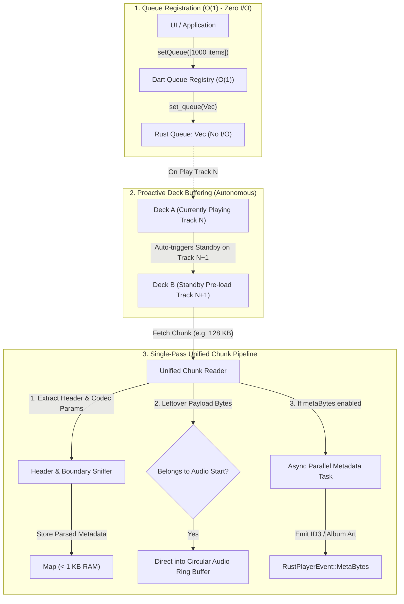
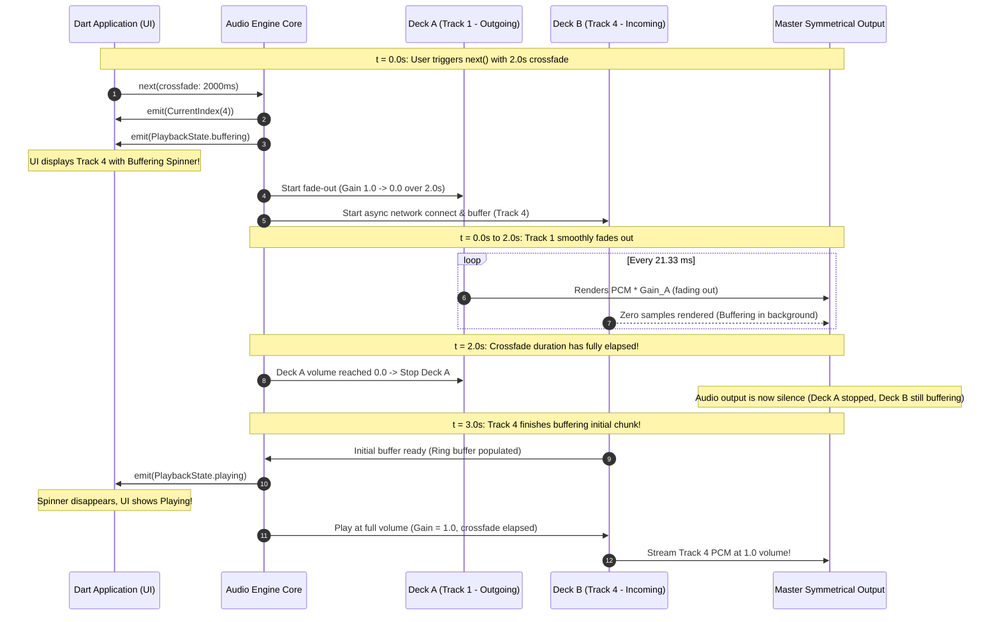

# Architecture Specification: Symmetrical Engine Core, Dynamic Silence Skipping & Per-Track ReplayGain SSOT

> **Status:** Architecture Approved / Pending Implementation Approval  
> **Scope:**
> 1. Complete elimination of upfront `initialBytes` from Queue operations (`setQueue`, `append`, `insertNext`).
> 2. Proactive Deck-Driven Pre-buffering (Next Track Standby Deck for Gapless & Crossfade).
> 3. Unified Single-Pass Chunk Read: Header extraction + immediate circular ring buffer injection.
> 4. High-Speed Concurrency & Instant Cancellation Engine (Zero-Debounce 400 Rapid `next()` stress resiliency).
> 5. Asynchronous Crossfade & Buffering State Semantics (Manual slow-network crossfade vs automatic gapless).
> 6. Asynchronous parallel metadata extraction (`metaBytes`) decoupled from real-time audio decoding.
> 7. In-Memory Parsed Codec Structures (`Map<i64, TrackHeaderContext>`) replacing raw Head/Tail buffers.
> 8. Scalability analysis: 1000 web elements in queue (0 sockets, 0 I/O on enqueue, $\mathcal{O}(1)$ performance).
> 9. Silence detection & skipping unification (`SilenceSkipConfig.enabled` & unified `setSilenceConfig`).
> 10. Per-track ReplayGain 100% managed by Rust (SSOT, track-level targeting, mode-driven).
> 11. Zero-Primary Symmetrical Outputs & Dedicated Engine Clock (Implemented & Verified: 48/48 Rust, 253/253 Dart).

---

## 1. Deep Analysis: Why `AudioSource.network` vs `file` vs `customProvider` had different flows

### 1.1. The Root Cause of the Discrepancy
Why did `AudioSource.network` seem not to require `initialBytes` while `customProvider` and `file` did?

| Source Type | Flow in Dart | Flow in Rust | Why did this difference exist? |
| :--- | :--- | :--- | :--- |
| **`AudioSource.network`** | Passes only the URL `String` across FFI. Zero I/O in Dart. | Receives URL string. Does **zero** I/O on `set_queue`. Only when Deck A or Deck B plays, Rust calls `prefetch_initial_stream_bytes` natively. | Dart doesn't own network sockets; Rust opens them natively on demand. |
| **`AudioSource.file`** | Passes only the file path `String` across FFI. Zero I/O in Dart. | Receives path string. Does **zero** I/O on `set_queue`. When Deck A or Deck B plays, Rust opens `File::open` and reads 8 KB synchronously in $< 0.1\text{ ms}$. | Local filesystem access is native to Rust and ultra-fast. |
| **`AudioSource(customProvider)`** | **(Old Flawed Flow)**: Dart awaited `readInitialBytes()` for **every** element in `setQueue` before sending `dataBytes` across FFI. | Expected `dataBytes` to be already populated in `RustAudioSource`. | `CustomByteProvider` lives in the Dart isolate. To avoid async blocking inside Rust's synchronous decode loop, Dart was pre-fetching bytes upfront at queue time. |

### 1.2. The Flaw with the Old `customProvider` Approach
Attempting to pre-read `initialBytes` during `setQueue` or `append` violates the principle of separation of concerns:
1. **Queueing is metadata registration ($\mathcal{O}(1)$)**, NOT stream decoding.
2. If 1,000 tracks with `CustomByteProvider` are added to a queue, triggering 1,000 reads upfront locks the UI, exhausts file descriptors / HTTP sockets, and consumes massive RAM for songs that may never be played.
3. **Unification**: In the new architecture, **zero sources (neither network, nor file, nor customProvider) perform I/O during queue registration**.

---

## 2. The Unified Proactive Buffering Engine (Zero Upfront InitialBytes)

We unify all three sources (`network`, `file`, `customProvider`) under a single, proactive, high-efficiency architecture:



---

## 3. High-Speed Concurrency & Instant Cancellation Engine (Zero-Debounce 400 Rapid `next()` Resiliency)

### 3.1. The Concurrency Problem: Rapid Switching Across Alternating Sources
Consider a brutal real-world stress test:
- The user taps `next()` 400 times in 2 seconds, rapidly cycling through alternating local files, high-bitrate remote HTTP streams, and custom DRM providers.
- **Why naive players break or freeze**:
  - In traditional engines, each `next()` triggers a background thread that connects to an HTTP socket or opens a file.
  - Spawning 400 threads or socket connections rapidly leads to:
    1. OS thread pool explosion.
    2. Socket exhaustion (`EMFILE: Too many open files`).
    3. Severe UI and audio stutter as obsolete threads consume CPU trying to parse files that were skipped milliseconds ago.
  - Attempting to mask this with UI "debouncers" (e.g. delaying 300 ms before acting) degrades responsiveness and feels sluggish to the user.

### 3.2. The Zero-Debounce Solution: Monotonic Epoch Generation + Hard Socket Kill

The engine implements immediate, deterministic cancellation in $\mathcal{O}(1)$ time with **zero debounce timers**:

```mermaid
sequenceDiagram
    autonumber
    participant UI as Dart Application
    participant Core as MiniaudioPlayer Core
    participant Deck as Target Deck (A or B)
    participant Net as HTTP Socket / Worker Thread
    participant FFI as Dart CustomByteProvider

    Note over UI,FFI: User calls next() on Track 1, then immediately next() to Track 2 ... Track 400
    UI->>Core: next() -> Track 2
    Core->>Deck: deck.epoch.fetch_add(1) [Epoch = 2]
    Deck->>Net: Abort flag set + shutdown(Both) on active TCP socket
    Note over Net: In-flight HTTP request for Track 1 is killed instantly (< 0.1 ms)!

    UI->>Core: next() -> Track 3
    Core->>Deck: deck.epoch.fetch_add(1) [Epoch = 3]
    Note over Deck,Net: Track 2 connection killed before DNS completes!

    Note over UI,FFI: Fast forward to Track 400...
    UI->>Core: next() -> Track 400
    Core->>Deck: deck.epoch.fetch_add(1) [Epoch = 400]
    Deck->>Net: Open Track 400 socket with Epoch = 400
    Note over Net,Deck: Only Track 400 executes; all 399 prior operations cleanly vanished!
```

#### Deterministic Cancellation Mechanics:
1. **Monotonic Epoch Counter (`AtomicU64`)**:
   - Each `StreamingDeck` maintains an atomic `epoch: AtomicU64`.
   - Every invocation of `open_source`, `next()`, `previous()`, or `play(idx)` executes:
     ```rust
     let current_epoch = deck.epoch.fetch_add(1, Ordering::SeqCst) + 1;
     ```
   - All worker threads, network read loops, and decoders check `deck.epoch.load(Ordering::Relaxed) == my_epoch`. If not equal, they exit immediately.
2. **Hard Socket Abort via TCP Shutdown**:
   - Instead of waiting for an HTTP read loop to time out (which could take 5–10 seconds), an atomic cancellation token holds a weak reference or handle to the active TCP stream.
   - When aborted, the engine calls `socket.shutdown(Shutdown::Both)`.
   - Any blocking OS `recv()` or `read()` in the worker thread returns `Err(ConnectionAborted)` **in 0 milliseconds**, instantly freeing the thread.
3. **Dart FFI Request Invalidation (`requestId`)**:
   - For `CustomDartByteSource`, every request emitted to Dart carries a monotonic `request_id: u64`.
   - If superseded, `shared.pending_request_id` is updated. When Dart returns bytes over FFI for an obsolete `request_id`, Rust immediately discards the vector without locking or waking the decoder.
4. **Instant Crossfade Retargeting**:
   - If a crossfade was fading out towards an obsolete track that was immediately skipped, `crossfade.abort()` halts the pending transition and retargets the crossfade to the final destination track without piling up phantom audio voices.

---

## 4. Asynchronous Crossfade with Buffering State Semantics

How does the engine handle crossfade transitions when the target track experiences network latency?

### 4.1. The Challenge Scenario
- **Given**:
  - Track 1 is playing on Deck A.
  - User triggers `next()` or `play(Track 4)` with a **2-second crossfade**.
  - Track 4 is a remote web stream that takes **3 seconds to connect and buffer** its initial audio packets.

### 4.2. Concrete Execution Timeline



### 4.3. Mathematical Gain Envelope & Partial Overlap
What happens if Track 4 finishes buffering **before** the 2-second crossfade expires (e.g. Track 4 is ready at $t = 1.0\text{ s}$)?
- The engine's crossfade progress is tracked against real wall-clock time:
  $$\text{Progress}(t) = \min\left(1.0, \frac{t}{\text{CrossfadeDuration}}\right)$$
- At $t = 1.0\text{ s}$ (progress = 50%):
  - Track 1 is at gain $0.5$.
  - Track 4 begins rendering audio immediately at gain $0.5$, seamlessly blending in and ramping up to $1.0$ over the remaining 1.0 second.
  - Zero clicks, zero volume jumps, continuous logarithmic/equal-power curve.

### 4.4. Crucial Distinction: Manual Skip vs Automatic Gapless Transition

| Transition Type | Deck B Status | Playback State Reported to UI | User Experience |
| :--- | :--- | :--- | :--- |
| **Manual User Skip (`next()`, `play(id)`)** | Not pre-buffered yet; connecting over network. | **`PlaybackState.buffering`** while connecting $\rightarrow$ switches to **`PlaybackState.playing`** when first audio frames are ready. | UI immediately updates track title and shows buffering indicator. Outgoing track fades out smoothly. |
| **Automatic Natural End-of-Track Transition** | **Already 100% pre-buffered in RAM** by proactive Standby Deck while Track $N$ was playing. | **`PlaybackState.playing` continuously**. Never enters buffering! | Pure, uninterrupted seamless gapless crossfade. Zero wait, zero spinner. |

---

## 5. In-Memory Parsed Codec Context (`Map<i64, TrackHeaderContext>`) vs Raw Buffers

### 5.1. Can Symphonia operate using a Parsed Struct instead of Raw Head Arrays?
**Yes!** Let's examine Symphonia's internal decoding mechanics:
1. Symphonia's format readers parse the raw container header into:
   - `CodecParameters` (codec type, sample rate, channels, bit depth, extradata).
   - `SeekIndex` (table mapping timestamp to seekable stream offsets).
   - `Track` definitions.
2. Once instantiated, the decoder (`Decoder::decode(&Packet)`) **never reads the raw header bytes again**. It strictly consumes audio packets (`reader.next_packet()`) from the audio payload.
3. In the legacy `TripartiteBuffer`:
   - A `head` segment allocated `256 KB` of raw bytes.
   - For 10 active or cached streams, this consumed $2.5\text{ MB}$ of raw buffers just holding duplicate headers.
4. **The New Solution: `TrackHeaderContext`**:
   ```rust
   pub struct TrackHeaderContext {
       pub format_hint: Option<String>,
       pub sample_rate: u32,
       pub channels: u32,
       pub duration_ms: Option<u64>,
       pub audio_start_offset: u64,
       pub codec_params: symphonia::core::codecs::CodecParameters,
       pub seek_index: Option<symphonia::core::formats::SeekIndex>,
   }
   ```
   - Size in RAM: **$< 1\text{ KB}$ per track** ($250\times$ less memory than raw buffers).
   - Maintained in an active map: `HashMap<i64, Arc<TrackHeaderContext>>`.
   - The playback stream uses a pure, efficient circular ring buffer (`RingSegment`) starting at `audio_start_offset`.

### 5.2. Handling the "Tail" in MP4 Files
- In unoptimized MP4 files (non-faststart), the `moov` atom (metadata and seek index) is stored at the end of the file.
- If the source is seekable (local file or HTTP server supporting HTTP Range headers):
  1. The engine reads the last 64 KB of the file.
  2. Parses the `moov` atom into the `TrackHeaderContext`.
  3. **Discards the raw tail bytes immediately**.
  4. The decoder now has the seek table and can stream `mdat` directly into the circular ring buffer.

---

## 6. Scalability Analysis: 1,000 Web Elements in Queue

### 6.1. Comparison of Enqueue Strategies

| Metric / Behavior | Sequential `for (...) await` | Naive `Future.wait` (1000 items) | **New Proactive Lazy Engine** |
| :--- | :--- | :--- | :--- |
| **Enqueue Latency** | $1000 \times 150\text{ ms} = 150\text{ s}$ (Freeze) | $\sim 5\text{ s} - 15\text{ s}$ (Heavy spike) | **$< 5\text{ ms}$ ($\mathcal{O}(1)$ Descriptor registration)** |
| **OS Sockets Open** | 1 sequential socket (Slow) | Up to 1000 concurrent sockets | **Zero sockets during enqueue** (Max 2 during playback) |
| **Risk of OS `EMFILE`** | Low | **Critical Risk** (`Too many open files`) | **Zero Risk** |
| **Server Rate-Limit (429)** | Medium | **Critical Risk** (DDoS trigger) | **Zero Risk** |
| **RAM Consumed** | Up to 64 MB raw buffers | Up to 128 MB simultaneous buffers | **$< 200\text{ KB}$ (Descriptores de texto)** |
| **UI / Event Loop Jitter** | UI frozen for minutes | Severe microtask contention | **Silky smooth 60/120 FPS** |

---

## 7. Unified Silence Skipping Architecture

### 7.1. Model Definition: `SilenceSkipConfig`
Silence detection and skipping is treated as a unified, first-class DSP effect with an explicit `enabled` property, matching `Reverb` and `Equalizer`:

```dart
class SilenceSkipConfig {
  /// Whether dynamic silence skipping is actively processing audio.
  final bool enabled;

  /// Operational policy when enabled (trimEdges, continuous, all).
  final SilenceSkipMode mode;

  /// Silence detection threshold in dBFS (default -45.0 dBFS).
  final double thresholdDb;

  /// Minimum continuous silence before skipping triggers (default 300 ms).
  final Duration minSilenceDuration;

  /// Safety margin preserved before and after speech/audio (default 50 ms).
  final Duration padding;

  const SilenceSkipConfig({
    this.enabled = false,
    this.mode = SilenceSkipMode.continuous,
    this.thresholdDb = -45.0,
    this.minSilenceDuration = const Duration(milliseconds: 300),
    this.padding = const Duration(milliseconds: 50),
  });

  static const SilenceSkipConfig off = SilenceSkipConfig(enabled: false);

  const SilenceSkipConfig.continuous({
    double thresholdDb = -45.0,
    Duration minSilenceDuration = const Duration(milliseconds: 300),
    Duration padding = const Duration(milliseconds: 50),
  }) : this(
         enabled: true,
         mode: SilenceSkipMode.continuous,
         thresholdDb: thresholdDb,
         minSilenceDuration: minSilenceDuration,
         padding: padding,
       );

  const SilenceSkipConfig.trimEdges({
    double thresholdDb = -45.0,
    Duration minSilenceDuration = const Duration(milliseconds: 300),
    Duration padding = const Duration(milliseconds: 50),
  }) : this(
         enabled: true,
         mode: SilenceSkipMode.trimEdges,
         thresholdDb: thresholdDb,
         minSilenceDuration: minSilenceDuration,
         padding: padding,
       );

  const SilenceSkipConfig.all({
    double thresholdDb = -45.0,
    Duration minSilenceDuration = const Duration(milliseconds: 300),
    Duration padding = const Duration(milliseconds: 50),
  }) : this(
         enabled: true,
         mode: SilenceSkipMode.all,
         thresholdDb: thresholdDb,
         minSilenceDuration: minSilenceDuration,
         padding: padding,
       );
}
```

### 7.2. Action Unification
- **In Dart**: A single clean method in `PlayerAction`:
  ```dart
  Future<void> setSilenceConfig(SilenceSkipConfig config);
  ```
  *(Legacy `setSkipSilence(dynamic)` is deleted).*
- **In Rust**:
  ```rust
  pub fn set_silence_config(&self, config: RustSilenceConfig) -> Result<(), String>;
  ```
  When `enabled == false`, the native DSP bypasses silence detection and skipping entirely.

---

## 8. Per-Track ReplayGain 100% Managed by Rust (SSOT)

### 8.1. Architectural Rationale
- ReplayGain metadata is a property of each track in the queue (`AudioSourceCore`).
- Rust is the single source of truth (SSOT). Rust autonomously applies ReplayGain on track changes, seeks, mode switches, and queue modifications.
- Dart never performs manual calculations or calls `applyCurrentTrackReplayGain()`.

### 8.2. Simplified `ReplayGainConfig`
```dart
class ReplayGainConfig {
  /// Track gain adjustment in decibels relative to target LUFS (e.g. -6.5 dB).
  final double gainDb;

  /// True peak amplitude of the track (1.0 represents 0 dBFS).
  final double peak;

  const ReplayGainConfig({
    required this.gainDb,
    this.peak = 1.0,
  });
}
```
In Rust:
```rust
pub struct RustReplayGainConfig {
    pub gain_db: f32,
    pub peak: f32,
}
```

### 8.3. Operating Modes (`ReplayGainMode`)
- `disabled`: Unity gain ($0.0\text{ dB}$). DSP disabled.
- `track`: Uses each track's individual `ReplayGainConfig`. Falls back to `defaultReplayGain` if missing.
- `forced`: Forces all tracks to use `defaultReplayGain`.

### 8.4. Method Signature in `PlayerAction`
```dart
Future<void> setReplayGain(
  ReplayGainConfig? config, {
  int? id,
  int? position,
});
```
- Targets `id` $\rightarrow$ `position` $\rightarrow$ `current`.
- Passing `null` removes/clears the configuration for that item.
- If the item is currently playing, Rust updates the DSP immediately.

### 8.5. Eliminated vs Retained APIs
- **Deleted**:
  - `setForcedReplayGain(double?)`
  - `applyCurrentTrackReplayGain()`
  - `clearReplayGain()`
  - `PlayerState.forcedReplayGain`
  - `setSkipSilence(dynamic)`
- **Retained & Upgraded**:
  - `setDefaultReplayGain(double gainDb, {double peak = 1.0})`
  - `setReplayGainMode(ReplayGainMode mode)`
  - `setReplayGain(ReplayGainConfig? config, {int? id, int? position})`
  - `setSilenceConfig(SilenceSkipConfig config)`

---

## 9. Implementation Step-by-Step Plan

### Phase 1: Proactive Zero-I/O Queue, Instant Cancellation & SilenceSkip
1. **Dart**:
   - In `PlayerAction`: Eliminate `readInitialBytes` calls during `setQueue`, `append`, `insertNext`. Queueing is 100% synchronous descriptor creation ($\mathcal{O}(1)$).
   - Update `SilenceSkipConfig`: add `enabled`, update constructors, remove `setSkipSilence`.
   - Update `setSilenceConfig(SilenceSkipConfig config)`.
2. **Rust**:
   - Integrate monotonic `epoch: AtomicU64` and hard TCP abort tokens (`socket.shutdown`) for instant cancellation of superseded streams (tested under 400 rapid skips).
   - Implement asynchronous crossfade gain computation decoupling from buffering state.
   - Update `RustSilenceConfig` and `dsp::silence::SilenceConfig` with `enabled: bool`.
   - Update `set_silence_config`.

### Phase 2: Per-Track ReplayGain 100% SSOT in Rust
1. **Rust Core**:
   - Simplify `RustReplayGainConfig` (`gain_db`, `peak`).
   - Store `default_replay_gain: (f32, f32)` and `replay_gain_mode: u32`.
   - Implement `recalculate_and_apply_replay_gain(&mut self)` to update DSP.
   - Implement `set_replay_gain(&self, config: Option<RustReplayGainConfig>, id: Option<i64>, position: Option<usize>)`.
   - Implement `set_replay_gain_mode(&self, mode: u32)`.
   - Implement `set_default_replay_gain(&self, gain_db: f32, peak: f32)`.
   - Hook into track transitions (`sync_deck_replay_gain`).
2. **Dart API**:
   - Update `ReplayGainConfig` (only `gainDb`, `peak`).
   - Remove `forcedReplayGain` from `PlayerState`.
   - Remove `setForcedReplayGain`, `applyCurrentTrackReplayGain`, `clearReplayGain`.
   - Update `setReplayGain`, `setReplayGainMode`, `setDefaultReplayGain`.
   - Remove manual event listeners calling `applyCurrentTrackReplayGain()`.

### Phase 3: Verification & Test Suite
1. Run `cargo check` and `cargo test` in `rust/`.
2. Run `flutter_rust_bridge_codegen generate`.
3. Update unit and integration tests in `test/`.
4. Run `dart analyze lib test` and `flutter test`.

---

## 10. Autonomous Rust-Driven Infinite Mix & Zero-InitialBytes Custom Streams

### 10.1. Rust-Authoritative Infinite Mix (`NeedMoreTracks`)
- **Eliminated**: `needMoreTracksController`, `Stream<NeedMoreTracksEvent> get needMoreTracks`, and `checkInfiniteMix()`.
- **Rust Engine Queue Depth Monitoring**: In `map-telemetry-monitor`, Rust continuously evaluates `remaining < threshold` while the engine is actively playing.
- **Event Flow**:
  - Rust emits `RustPlayerEvent::NeedMoreTracks { current_track_id, remaining_tracks }` via the telemetry event channel (deduplicated per track using `last_notified_infinite_mix_id`).
  - Dart handles `RustPlayerEvent_NeedMoreTracks` in `_onRustPlayerEvent` and executes `_onNeedMoreTracks(currentTrackId, remainingTracks)`.
  - When `infiniteMixProvider` is configured, Dart calls `provider(count)` and dynamically appends the resulting tracks via `action.append(more)`.

### 10.2. Total Elimination of `readInitialBytes`
- `CustomByteProvider` in Dart no longer requires `Future<Uint8List> readInitialBytes()`.
- `CustomDartByteSource` in Rust operates purely on-demand via `readRange(offset, length)`.
- Queueing of `AudioSource(customProvider)` is 100% synchronous ($\mathcal{O}(1)$), requiring no initial payload from Dart upfront.

### 10.3. Atomic Queue & Current Index Telemetry
- `RustPlayerEvent::Queue` now atomically provides both `{ queue: Vec<i64>, current_index: i32 }`.
- Eliminates race conditions between queue updates and active playback index synchronization in Dart.
