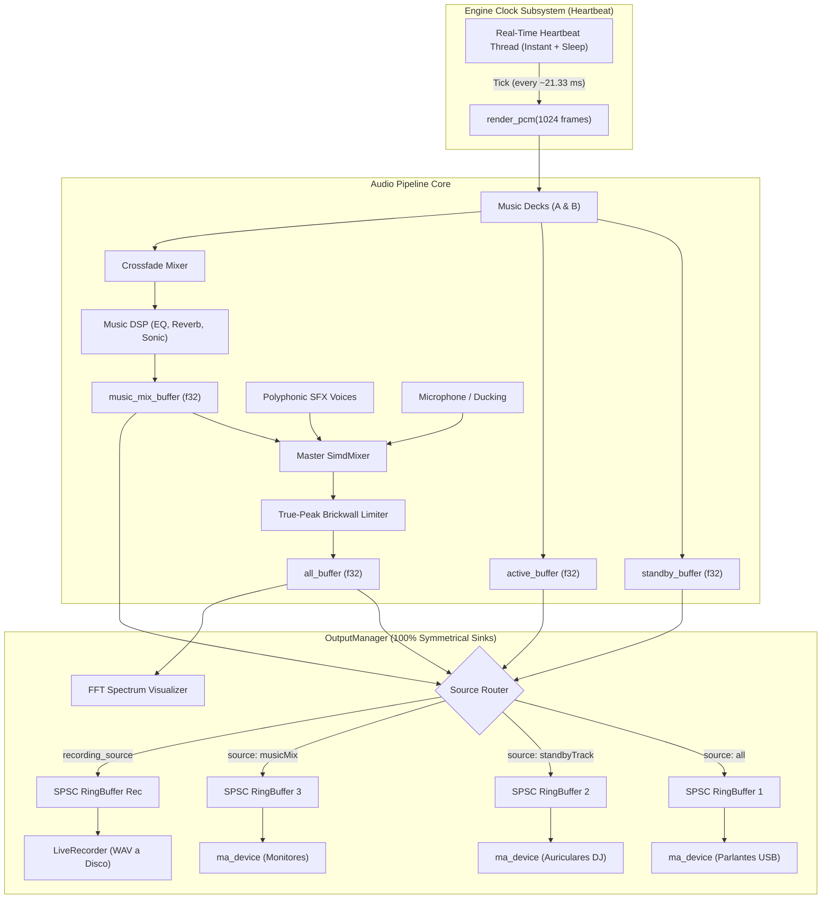
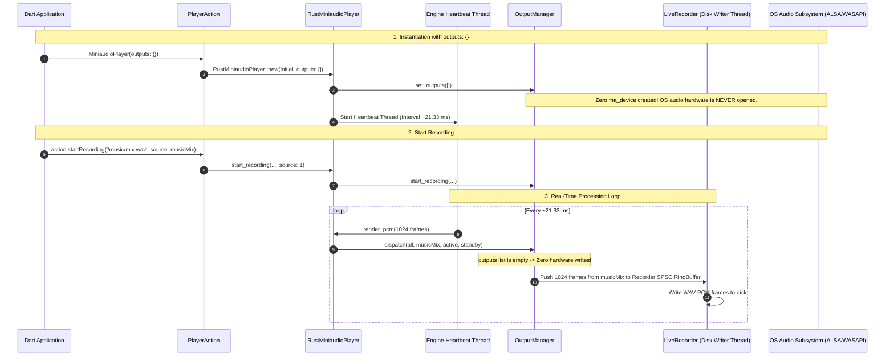
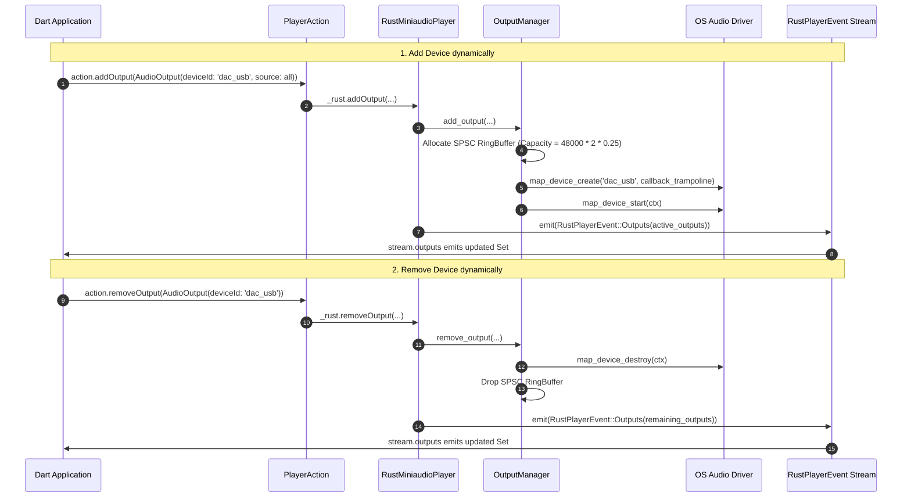

# Architecture Specification: Zero-Primary Symmetrical Output Architecture & Independent Engine Clock

> **Status:** Planned / Pending Implementation Approval  
> **Scope:** Full-stack elimination of the "Primary Output" asymmetry, transition to 100% symmetrical output sinks, dedicated internal high-resolution engine clock (Heartbeat), and multi-rate/drift handling.  
> **Backward Compatibility:** Zero legacy shims, zero aliases, full compliance with SSOT (`Set<AudioOutput>`).

---

## 1. Executive Summary & Problem Statement

### 1.1. The Legacy "Primary Device" Flaw
In the original architecture inherited from single-device playback:
1. `MiniaudioPlayer` maintained a dedicated hardware context `ply.device_ctx` (`map_device_create`) opened directly against the operating system.
2. In `OutputManager`:
   - `outputs[0]` was treated as the privileged "Primary Output", copied directly via raw memory pointers (`std::ptr::copy_nonoverlapping`) into DMA hardware memory.
   - `outputs[1..N]` were treated as "Secondary Outputs", decoupled via SPSC ring buffers (`rtrb`).
3. **Flaws introduced by this asymmetry**:
   - **Forced Silence on Hardware**: When `outputs: {}` (pure recording or headless mode), `ply.device_ctx` had to remain open against the physical soundcard, filling its buffer with `0.0f32` (IEEE-754 silence) solely to keep the driver's interrupt callback ticking to advance the player's clock.
   - **Fragile Clock Anchoring**: If the physical soundcard holding `outputs[0]` disconnected, the engine's clock stopped completely.
   - **Code Duplication**: Mutating `outputs` required two completely different code paths (re-pointing `outputs[0]` via `map_device_set_device` vs allocating/destroying `ActiveOutputDevice` for `outputs[1..N]`).

### 1.2. The New Architecture: Zero-Primary & Dedicated Engine Clock
1. **Zero Primary Output**: No device is primary. Every physical device in `outputs` is an identical `ActiveOutputDevice`.
2. **Zero Devices when `outputs: {}`**: When `outputs` is empty, **zero** `ma_device` instances are opened in the OS. The soundcard is not touched, no driver is initialized, and no silence is pumped to speakers.
3. **Independent Real-Time Clock (Heartbeat Thread)**: A dedicated high-resolution timer thread drives `render_pcm` at the exact mathematical sample rate.
4. **Independent SPSC Ring Buffers**: Each active output device has its own decoupled lock-free SPSC buffer, reading at its own native hardware cadence.

---

## 2. Multi-Rate & Velocity Handling: Different Speeds Across Outputs

How does the engine handle outputs demanding data at different speeds?

### 2.1. Scenario A: Different Hardware Sample Rates (e.g., 48 kHz vs 96 kHz)
When Output 1 runs at 48,000 samples/sec and Output 2 runs at 96,000 samples/sec (literally $2\times$ the data consumption rate per second):
- **Wall-Clock Musical Time**: Both outputs must play the song at normal speed ($1.0\times$ tempo). 1 second of music = 1 second of wall-clock time on both speakers.
- **Sample Generation vs Consumption**:
  - The engine's mixer and DSP pipeline renders at a master internal sample rate $F_{s,\text{engine}}$ (e.g. 48,000 Hz).
  - Every 1024 frames rendered equals $\Delta t = \frac{1024}{48000} \approx 21.33\text{ ms}$.
  - During that same 21.33 ms, Output 2 (96 kHz) requires $2048$ frames.
- **Solution: Per-Device Resampler**:
  - Each `ActiveOutputDevice` negotiates its own target rate with miniaudio.
  - Miniaudio's internal `ma_resampler` (or Rust `rubato`) converts the engine's native 48 kHz frames into 96 kHz frames in the device's playback thread.
  - SPSC ring buffer sizes are scaled proportionally to the device's sample rate:
    $$\text{Capacity}_{\text{device}} = F_{s,\text{device}} \times \text{channels} \times \text{TargetBufferSeconds}$$

### 2.2. Scenario B: Different Callback Period Sizes & Cadences (e.g., 256 vs 2048 frames)
Even at the same sample rate (48 kHz), different OS soundcards and drivers request samples in different chunk sizes:
- Device 1 (Low-latency USB interface): requests 256 frames every 5.33 ms.
- Device 2 (Bluetooth / HDMI / Network): requests 2048 frames every 42.66 ms.
- **Solution: Asynchronous SPSC Ring Buffers (`rtrb`)**:
  - The producer (Heartbeat thread) writes chunks of 1024 frames into each device's producer.
  - Device 1 reads in small frequent bursts of 256 frames.
  - Device 2 reads in larger, less frequent bursts of 2048 frames.
  - Because SPSC ring buffers are completely independent, Device 1 and Device 2 never block each other.

### 2.3. Scenario C: Hardware Physical Clock Drift
Two separate physical soundcards have independent quartz crystal oscillators. Even if both are set to 48,000 Hz, one might run at 48,001.2 Hz and the other at 47,998.7 Hz. Over 30 minutes, this would cause buffer overflow or underrun.
- **Solution: Elastic Ring Buffer with Watermark Drift Compensation**:
  - Each `ActiveOutputDevice` monitors its buffer fill level:
    $$\text{Watermark} = \frac{\text{Available Frames in Ring Buffer}}{\text{Capacity}}$$
  - **Nominal Target**: Watermark around 50%.
  - If a device runs too fast (watermark drops below 25%): the device's callback inserts a micro-interpolated duplicate sample every few seconds (completely sub-audible).
  - If a device runs too slow (watermark exceeds 75%): the device's callback drops 1 sample every few seconds.

### 2.4. Scenario D: Different Musical Speeds (Deck A at 1.0x, Deck B Cueing at 2.0x)
If a DJ wants to listen to the master mix on speakers at $1.0\times$ while cueing the standby track on headphones at $2.0\times$:
- Deck A renders into `active_buffer` at $1.0\times$.
- Deck B renders into `standby_buffer` with its own independent Sonic rate multiplier ($2.0\times$).
- Output 1 routes `source: AudioOutputSource.all` (master at $1.0\times$).
- Output 2 routes `source: AudioOutputSource.standbyTrack` (cueing at $2.0\times$).
- Each stream maintains its own independent playback position and speed.

---

## 3. High-Level Architecture



---

## 4. Sequence Diagrams

### 4.1. Headless / Pure Recording Lifecycle (`outputs: {}`)



### 4.2. Symmetrical Dynamic Device Add / Remove



---

## 5. Technical Specification & Implementation Plan

### 5.1. Rust Core Engine Updates

#### 5.1.1. Heartbeat Clock Thread (`rust/src/core/clock.rs`)
A new dedicated module `EngineClock`:
- Spawns a high-priority background thread: `map-engine-clock`.
- Maintains an atomic boolean `running`.
- Loop timing:
  ```rust
  let period_duration = Duration::from_secs_f64(frame_count as f64 / sample_rate as f64);
  let mut next_tick = Instant::now();
  while running.load(Ordering::Relaxed) {
      next_tick += period_duration;
      // 1. Render PCM frames
      renderer.render_pcm(frame_count);
      // 2. High-precision sleep to next_tick
      let now = Instant::now();
      if now < next_tick {
          std::thread::sleep(next_tick - now);
      } else {
          // Compensate for scheduler latency if overrun
          next_tick = now;
      }
  }
  ```

#### 5.1.2. `OutputManager` Refactoring (`rust/src/core/output_manager.rs`)
- Remove `primary_device_ctx: *mut MapDeviceContext` argument from `set_outputs`.
- Replace distinction between `outputs[0]` and `secondary_devices` with a single collection:
  ```rust
  pub struct OutputManager {
      pub outputs: Vec<RustAudioOutput>,
      pub active_devices: Vec<ActiveOutputDevice>,
      pub live_recorder: Option<LiveRecorder>,
      pub record_producer: Option<rtrb::Producer<f32>>,
      ...
  }
  ```
- In `dispatch`:
  - No `primary_hardware_out: *mut f32` parameter.
  - Symmetrical loop over all `active_devices`:
    ```rust
    for dev in &mut self.active_devices {
        let src_slice = select_source(dev.source);
        let _ = dev.producer.write_chunk_uncommitted(src_slice);
    }
    ```

#### 5.1.3. C Bridge (`rust/src/c/bridge.c`)
- Remove global single `MapDeviceContext` inside `MiniaudioPlayer`.
- All `MapDeviceContext` instances are created dynamically inside `ActiveOutputDevice` on demand.

---

## 6. Verification & Test Plan

1. **Unit Tests (Rust)**:
   - Verify `EngineClock` maintains exact frame count over 10 seconds ($\pm 0.01\%$).
   - Verify `outputs: {}` opens zero hardware handles.
   - Verify multiple devices with different buffer sizes run without blocking.
2. **Integration Tests (Dart)**:
   - Verify `MiniaudioPlayer(outputs: {})` records WAV to disk with exact RIFF headers and audible content.
   - Verify dynamic `setOutputs` with 0, 1, and 2 devices updates `stream.outputs` cleanly.
3. **Static Analysis**:
   - `cargo check --manifest-path rust/Cargo.toml`
   - `dart analyze lib test --fatal-infos`
   - `cargo test` and `flutter test`.
