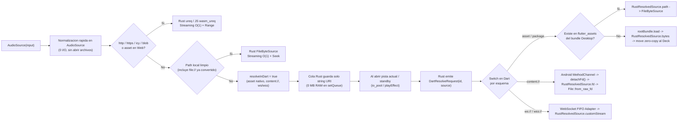

# Diseño del Sistema Unificado de Resolución de Fuentes (`docs/RESOLVER.md`)

Este documento analiza en detalle qué esquemas URI/rutas puede soportar `miniaudio_player`, qué parte del stack debe resolver cada uno (Dart, Rust nativo, JS/WASM Worker o puente OS Android), las correcciones y mejoras sobre las propuestas analizadas, y el **plan paso a paso definitivo** para implementarlo.

> **Alcance:** Solo diseño y especificación técnica (sin cambios de código todavía). Basado en la arquitectura actual de `miniaudio_player` `4.0.0` (`AudioSource`, `ControlCoordinator`, `io_pool`, `DualSource`, `EffectsManager`, `CustomSourceRegistry` y `wasm_ureq`).

---

## 1. Análisis de la Propuesta y Refinamientos Técnicos

Se evaluaron cuatro decisiones clave de diseño para unificar `file://`, `asset://`, `package:`, `content://`, `data:`, `ws://`/`wss://`, `http(s)://`, `ftp://` y `sftp://`:

### 1.1 `AudioSource`: mantener `uri` pública y separar `_normalizedSource` (no `_resolvedUri`)
* **Problema con llamarlo `_resolvedUri`:** Cuando Dart parsea `file:///Mi%20Musica/Track%231.mp3` con `Uri.toFilePath()`, el resultado (`C:\Mi Musica\Track#1.mp3` o `/Mi Musica/Track#1.mp3`) **deja de ser una URI** para convertirse en una ruta nativa del sistema operativo. Llamarlo `_engineSource` o **`_normalizedSource`** refleja con exactitud que ya está listo para ser consumido por Rust/OS.
* **Qué conserva cada campo en `AudioSource<T>`:**
  * `uri` (`String?`, público): conserva el valor original entregado por el caller para UI, logs, `toString()` y estabilidad de `sourceKey` / `==` / `hashCode`.
  * `_normalizedSource` (`String?`, interno):
    * En `!kIsWeb`:
      * Convierte `file://...` a ruta OS nativa usando `Uri.parse(u).toFilePath(windows: isWindows)` (RFC 8089: resuelve `%20`, `%23`, UTF-8, `file://localhost/...`, letras de unidad Windows `C:\...` y rutas UNC `\\server\share\...`).
      * Normaliza `data://...` mal escrito a `data:...` antes de `UriData.parse`.
      * Traduce `package:<pkg>/<path>` y `package://<pkg>/<path>` a la clave estándar de Flutter `asset://packages/<pkg>/<path>`.
    * En `kIsWeb`:
      * Resuelve `asset://`, `assets/...`, `package:` y `package://` **directamente en Dart** aplicando la misma regla oficial de Flutter (`once = Uri(pathSegments: key.split('/')).path`, `double = Uri.encodeFull('assets/$once')`, relativo a `Uri.base` / `<base href>`), entregando a Rust una URL `http://` / `https://` ya doble-codificada (`%2523`, `%2520`, etc.) lista para `wasm_ureq` (`_resolveInDart = false` en `debug`, `profile` y `release`)!
      * Así se elimina por completo el parche de codificación de assets y candidatos múltiples en Rust (`wasm_ureq.rs` y `wasm_ureq_protocol.rs`). Ver punto 1.3.4.
  * `_resolveInDart` (`bool`, interno): indica si Rust debe pedir a Dart la resolución real **en el momento de abrir la pista** (bajo demanda) en lugar de intentar abrir `_normalizedSource` directamente por filesystem o HTTP.
* **Portabilidad Web (`dart:io`):** Como [audio_source.dart](../lib/src/api/audio_source.dart) compila tanto en Nativo como en Web, toda lógica dependiente de `Platform` / `File` / `WebSocket` debe vivir tras **conditional imports** (`lib/src/resolver/source_resolver_io.dart` vs `source_resolver_web.dart`), igual que [platform_loader.dart](../lib/src/loader/platform_loader.dart).

---

### 1.2 ¿Resolver `content://` (Android SAF) en `AudioSource` (`fd` anticipado) o bajo demanda con `resolveInDart`?

Se analizó si `AudioSource` debería aceptar un `fd` o abrir `content://` en cuanto el usuario construye el `AudioSource` / llama a `setQueue()`:

| Criterio | `fd` anticipado en `AudioSource` / `setQueue()` | **`resolveInDart = true` bajo demanda (Recomendado)** |
|---|---|---|
| **Límite de descriptores (`RLIMIT_NOFILE`)** | ❌ Una cola de 500 pistas SAF abriría 500 `ParcelFileDescriptor` a la vez al hacer `setQueue()`. | ✅ Solo existen abiertos como máximo **2 `fd`** a la vez (`actual` + `siguiente` en standby). |
| **Propiedad (`Ownership`) y repetición de pista** | ❌ En Rust `File::from_raw_fd(fd)` **cierra el `fd` al destruirse el deck** en `map-reaper`. Si el usuario reproduce de nuevo la misma pista (`LoopMode.all`, `previous()`), ese `fd` ya estaría cerrado (`EBADF`) salvo que se duplique cada vez. | ✅ Cada apertura de pista solicita un **`fd` nuevo y exclusivo** (`openFileDescriptor(uri, "r")?.detachFd()`). Al terminar la pista `File` cierra ese `fd`; si vuelve a sonar, se obtiene otro `fd` fresco. |
| **Coste de `setQueue()`** | ❌ Bloquea/ralentiza por `MethodChannel` sobre cada ítem aunque no se vaya a reproducir. | ✅ `setQueue()` sigue costando **$O(1)$ de I/O y 0 FDs abiertos**. |
| **Permisos temporales SAF** | Retiene decenas de handles abiertos innecesariamente. | Solo abre el URI activo; si perdió permisos, falla limpio en la pista afectada. |

**¿Y `AudioSource.fd(int fd)` público?** No conviene exponerlo directamente porque transfiere un recurso no repetible en una cola reproducible/barajable (salvo que internamente se ejecute `dup()`/`DuplicateHandle`, y aun así expone detalles dependientes de POSIX no portables a Web/Windows handles). Resolver `content://` vía `resolveInDart` es mucho más seguro y coherente.

**¿Se puede obtener el `fd` de `content://` directamente desde Rust/C conectándose a la JVM?**
* **Técnicamente posible, pero no confiable sin clase Java/Kotlin propia en `miniaudio_player`:** `ndk-context` en Rust solo funciona si el host o un plugin Kotlin inicializó `ndk_context` antes; hoy este paquete es puro FFI + Build Hooks y **no tiene carpeta `android/` Kotlin/Java**.
* Intentar invocar `ActivityThread.currentApplication()` por reflexión JNI desde un worker thread de `io_pool` (sin `Looper` y sujeto a restricciones ocultas/R8 OEM) es frágil.
* **La vía robusta y estándar** es añadir un **micro-plugin Android (`android/` Kotlin, ~35 líneas)** usando `FlutterPlugin.onAttachedToEngine` que conserve `applicationContext` y exponga un único método en `MethodChannel` (`openContentFd(uri)` → `contentResolver.openFileDescriptor(Uri.parse(uri), "r")?.detachFd()`), manteniendo compatibilidad opcional limpia si en tests/CLI no hay canal Android.
* **Regla anti-fugas crítica en Rust:** Si Rust cancela la apertura por `CancelToken` (*rapid next/prev*, `setQueue()`, `dispose()`) mientras Dart está resolviendo `openContentFd`, cuando llegue el `fd` tardío a `respond_dart_resolve_request` para un `request_id` expirado, **Rust debe cerrar ese `fd` inmediatamente** (`drop(File::from_raw_fd(fd))`) en vez de ignorar el `int`.

---

### 1.3 Optimización híbrida para `asset://` y `package:`: Disco en Desktop + `rootBundle` + Streaming en Web

El usuario propuso resolver assets desktop en Windows/Linux con `p.join(executableDir, 'data', 'flutter_assets', relativePath)` y entregar a Rust una ruta de archivo. **La idea es excelente** (permite `FileByteSource` $O(1)$ RAM incluso para archivos WAV/DSF/MKV de 50 MB sin copiarlos a memoria), pero requiere corregir **4 detalles reales verificados en el SDK de Flutter (`3.47.6`)**:

1. **Los nombres en `flutter_assets/` están URI-encoded en disco:** Verificado en `example/build/linux/x64/debug/bundle/data/flutter_assets/assets/music/`: Flutter escribe `%23BrooklynBloodPop!-SyKo.opus` y `La%20Isla%20Bonita-Madonna.m4a` (usando `Uri(pathSegments: ...).path`). Unir `assetRelativePath` sin codificar fallaría en nombres con `#` o espacios. Hay que probar **primero** la ruta con `Uri(pathSegments: key.split('/')).path` y luego la ruta sin codificar.
2. **La ubicación cambia según plataforma (especialmente macOS y `flutter_tester`):**
   * **Linux / Windows (bundle compilado):** `<dir(Platform.resolvedExecutable)>/data/flutter_assets/<key>`
   * **macOS (`.app` bundle):** `<App>.app/Contents/Frameworks/App.framework/Resources/flutter_assets/<key>` (subiendo desde `Contents/MacOS/<bin>` por `../../Frameworks/App.framework/Resources/flutter_assets`)
   * **`flutter test` / dev host (`flutter_tester`):** `Platform.resolvedExecutable` apunta al ejecutable del SDK de Flutter, no al bundle; aquí se busca en `<CWD>/build/unit_test_assets/` o `<CWD>/` antes de ir a `rootBundle`.
3. **Fallback obligatorio a `rootBundle.load(key)`:** En **Android** (assets comprimidos dentro del `.apk`), **iOS** o si la app inyectó un `AssetBundle` custom en tests, ningún archivo existe en un path plano abierto directamente (o conviene usar el bundle). El `switch` de Dart intenta archivo directo en Desktop → si existe, devuelve **`Path(path)`** ($O(1)$ RAM); si no, llama `await rootBundle.load(key)` → devuelve **`Bytes(Uint8List)`**.
4. **Web normaliza `asset://` y `package:` a URL HTTP limpia directo en Dart (`_normalizedSource`):**
   * En **`debug`, `profile` y `release`**: tanto `WebAssetServer` (`flutter run -d chrome` + `DevFS`) como los bundles compilados (`flutter build web`) sirven los assets usando la clave URI ya codificada una vez (`entryUri.path`), por lo que el navegador siempre los obtiene bajo la URL **doble-codificada** (`Uri.base.resolve(Uri.encodeFull('assets/$once'))`, idéntico a `AssetManager.getAssetUrl`). Además, `WebAssetServer` rechaza todas las peticiones HTTP `HEAD` con `404` (`if (request.method != 'GET') return Response.notFound`), por lo que hacer sondas `HEAD` solo generaba `404` falsos y forzaba descargas completas vía `rootBundle.load`. Resolviendo directamente en `_normalizedSource` con `_resolveInDart = false` en todos los modos Web, Rust (`wasm_ureq`) ejecuta un único `GET` progresivo con `ReadableStream` (`O(1)` RAM) tanto en debug como en release.

---

### 1.4 Diseño FFI mínimo: 1 bandera (`resolveInDart`) + 1 evento + 1 método de respuesta

Para no multiplicar canales ni métodos FRB:
* En `RustAudioSource` se añade `pub resolve_in_dart: bool`.
* Cuando `resolve_in_dart == true`, `DualSource` / `io_pool` / `EffectsControl` emiten **un solo evento**:
  `RustPlayerEvent::DartResolveRequest { request_id: u64, source: String }`
* `MiniaudioPlayer` tiene **un solo dispatcher privado con un `switch` por esquema** sobre `source` y responde por **un único método FFI**:
  `respond_dart_resolve_request(request_id: u64, result: RustResolvedSource)`
* El enum `RustResolvedSource` cubre todos los modos nativos e híbridos:
  * `Path(String)` → `FileByteSource::open(path)` (streaming $O(1)$ + Seek; también sirve para HLS local).
  * `Bytes(Vec<u8>)` → `open_memory_owned_with_hint(bytes)` (move zero-copy al `StreamingDeck`, liberado al morir el deck sin mutar `queue`).
  * `Fd(i32)` → `unsafe { File::from_raw_fd(fd) }` envuelto en `FileByteSource` (Android `content://` / `android.resource://`, streaming $O(1)$ + Seek sin copias JNI).
  * `CustomStream { stream_id: u32, total_bytes: Option<u64>, is_seekable: bool }` → puente pull/FIFO secuencial (ej. `ws://` / `wss://`).
  * `Error { code: i32, message: String }` → fallo inmediato sin esperar timeouts de 10s.

---

### 1.5 Funcionamiento en Background Isolates y necesidad de `RootIsolateToken`

Analizando el runtime actual ([miniaudio_player.dart](../lib/src/api/miniaudio_player.dart) y [platform_loader_io.dart](../lib/src/loader/platform_loader_io.dart)) junto con el SDK de Flutter (`services/binding.dart`, `platform_channel.dart`, `asset_bundle.dart`):

1. **¿Funciona `miniaudio_player` en un Isolate secundario (`Isolate.spawn` / worker de background)?**
   * **Sí en Nativo (`Android`, `iOS`, `Desktop`):** cada Isolate que llama a `await MiniaudioPlayer.ensureInitialized()` abre la librería nativa, registra el callback de salida en FRB (`registerIsolateWithLibrary` → `frb_create_shutdown_callback`) para evitar deadlocks multi-isolate al cerrar el Isolate, inicializa `RustLib.init()`, y puede instanciar su propio `MiniaudioPlayer(...)` independiente en Rust (sin compartir objetos Dart entre Isolates). *(Nota: en Web no existen background Isolates con FFI nativo).*
   * **Qué funciona SIN `RootIsolateToken`:** `http://`, `https://`, `icy://`, `file://`, rutas locales, `Uint8List`, `data:`, `ws://`/`wss://`, `CustomByteProvider`, DSP, grabación, enumeración de dispositivos hardware y assets en Desktop resueltos por path de disco (`flutter_assets`).
2. **¿Cuándo sí es necesario `RootIsolateToken` (y qué conecta exactamente)?**
   * **Aclaración técnica:** `RootIsolateToken` **no** sirve para conectar con Rust ni con la Dart VM (FFI/Rust ya funcionan directo en cualquier Isolate). Su función específica en Flutter es registrar `BackgroundIsolateBinaryMessenger` contra el `PlatformDispatcher` del Isolate raíz para habilitar **Platform Channels** desde Isolates secundarios.
   * **Para `content://` y `android.resource://` (Android):** **sí es obligatorio** si `MiniaudioPlayer` corre en un Isolate secundario, porque `MethodChannel` verifica `ServicesBinding.rootIsolateToken == null` (`platform_channel.dart:175`) y delega en `BackgroundIsolateBinaryMessenger.instance`. Sin inicializarlo con un `RootIsolateToken`, cualquier llamada de canal lanza `StateError`.
   * **⚠️ Trampa verificada en Flutter SDK para `asset://` / `package:` (`asset_bundle.dart:328`):** aunque inicialices `BackgroundIsolateBinaryMessenger`, **`rootBundle.load(key)` llama directo a `ServicesBinding.instance.defaultBinaryMessenger`**, ¡y `ServicesBinding.instance` NO existe en un Isolate secundario! Por tanto `rootBundle.load()` fallaría en background isolates.
   * **Solución correcta en el resolver (`source_resolver_io.dart`):**
     * Si `ServicesBinding.rootIsolateToken != null` (Isolate raíz UI) → usar `rootBundle.load(key)` normal (permite mocks con `DefaultAssetBundle` / tests).
     * Si `ServicesBinding.rootIsolateToken == null` (Isolate secundario) → enviar la clave encoded por el canal **`'flutter/assets'`** usando directamente **`BackgroundIsolateBinaryMessenger.instance.send('flutter/assets', ...)`**!
3. **API pública (`RootIsolateToken? rootIsolateToken` opcional solo en `ensureInitialized`):**
   * En Flutter Web (`_background_isolate_binary_messenger_web.dart`), `RootIsolateToken` y `BackgroundIsolateBinaryMessenger.ensureInitialized(token)` existen como *no-ops* seguros en tiempo de compilación.
   * Por orden y limpieza de la API, `RootIsolateToken? rootIsolateToken` (por defecto `null`) se expone **únicamente** en **`MiniaudioPlayer.ensureInitialized({String? libraryPath, RootIsolateToken? rootIsolateToken})`**:
     * Permite inicializar el *binary messenger* del Isolate una sola vez (idempotente gracias a `if (_instance == null)` en Flutter) y queda disponible automáticamente tanto para cualquier instancia de `MiniaudioPlayer(...)` creada dentro del Isolate como para llamadas estáticas (`MiniaudioPlayer.analyzeAudio(...)` / `analyzeAudioSync(...)`).
     * Mantiene limpias las firmas de `MiniaudioPlayer(...)` y `MiniaudioPlayer.analyzeAudio(...)`.
   * **Manejo limpio de errores y mensajes descriptivos:**
     * Si en un Isolate secundario no se inicializó `rootIsolateToken` e intenta resolverse un `content://`, `android.resource://` o `asset://` sin archivo directo en disco, Dart captura el `StateError` / fallo del messenger y responde inmediatamente con un error claro (`MapResult.errorInvalidState` / `MiniaudioPlayerException` en métodos estáticos) indicando que debe llamarse a `MiniaudioPlayer.ensureInitialized(rootIsolateToken: token)` pasando el `RootIsolateToken.instance` obtenido en el Isolate raíz.
     * Todo error de esquema no soportado (`ftp://`, `sftp://`, `rtsp://`, `rtmp://`, `ipod-library://`, `phasset://`, o `content://`/`android.resource://` fuera de Android), permiso denegado (`SecurityException` -> `-11`), archivo/recurso no encontrado (`-5`) o URI mal formada (`-2`) preserva un mensaje contextual exacto y código `MapResult` consistente sin perder el detalle del motivo ni filtrar descriptores de archivo.

---

## 2. Tabla Completa de Formatos / Esquemas URI

| Esquema / Ruta | Estado Actual | Resolución Final Propuesta (`resolveInDart`) | Quién Resuelve y Qué Recibe Rust | Nativo | Web | Streaming $O(1)$ + Seek | Restricciones / Detalles Técnicos |
|---|---|---|---|---|---|---|---|
| **`http://`**, **`https://`** | ✅ Soportado | `false` (Directo) | Rust (`ureq` + `rustls`) / JS Worker (`wasm_ureq`) | ✅ | ✅ *(CORS)* | ✅ (`Range`) | Soporta headers, `CancelToken` y playlists `.m3u8` + AES-128. |
| **`icy://`** | ✅ Soportado | `false` (Directo) | Rust (`ureq` → `http://`) / JS Worker (`wasm_ureq`) | ✅ | ✅ *(CORS)* | ✅ (En vivo) | Demux inline de `icy-metaint` (`StreamTitle`). |
| **`file://`** | ⚠️ Parcial (`strip_file_prefix` sin `%20`/`UNC`) | `false` en `!kIsWeb` *(normalizado en `AudioSource`)* | **Dart** (`Uri.toFilePath`) en constructor → `Path` directo a Rust (`FileByteSource`) | ✅ | ❌ | ✅ | Convierte `%20`, `%23`, tildes, `C:\...` y UNC `\\host\share` sin parser en Rust. En Web retorna error `-10` (no soportado por navegador). |
| **Ruta local sin esquema** (`/path/...`, `C:\...`) | ✅ Soportado | `false` *(salvo `assets/...` ver abajo)* | Rust (`FileByteSource::open`) | ✅ | ❌ | ✅ | Pasa directo al filesystem nativo. |
| **`data:`**, (`data://`) | ✅ `data:` sí; ❌ `data://` no | `false` *(decodificado en `AudioSource`)* | **Dart** (`UriData.parse`) → `data_bytes` en `RustAudioSource` | ✅ | ✅ | En RAM | Normalizar `data://` → `data:` antes de `UriData.parse`. Compatible con Web, Nativo y `analyzeAudioSync`. |
| **`blob:`** | ✅ Soportado en Web | `false` (Directo en Web) | JS Network Worker (`fetch(blobUrl)`) | ❌ | ✅ | ✅ | Generado por selectores de archivo del navegador (`URL.createObjectURL`). Inválido en Nativo (`-10`). |
| **`asset://`**, **`assets/...`** | ⚠️ Nativo lee `CWD`; ✅ Web OK *(con parche candidatos en Rust)* | **Nativo:** `true` **Web `profile`/`release`:** `false` *(URL ya resuelta en `_normalizedSource`)* **Web `debug`:** `true` solo si hay chars codificados (`HEAD` probe) | **Nativo (`switch` Dart):** Desktop `flutter_assets` en disco → `Path`; si no existe / Android / iOS → `rootBundle.load` → `Bytes`. **Web:** Dart calcula URL doble-codificada (`%2523`, `%2520`, `Uri.base`) → URL `http(s)://` limpia a `wasm_ureq`. | ✅ | ✅ | Desktop ✅ / Web ✅ / Móvil RAM (`Bytes`) | En Desktop y Web evita cargar archivos grandes en RAM; en Android/iOS usa `rootBundle`. En Web `wasm_ureq` solo hace `fetch()` directo de la URL entregada por Dart. |
| **`package:`**, **`package://`** | ❌ No soportado | Igual que `asset://` *(reescrito a `packages/<pkg>/<rest>`)* | **Nativo:** `asset://packages/<pkg>/<rest>` → resolver. **Web:** `assets/packages/<pkg>/<rest>` doble-codificada desde Dart → `wasm_ureq`. | ✅ | ✅ | Igual que `asset://` | Solo funciona para assets declarados bajo `flutter: assets:` del paquete referenciado. |
| **`content://`** (Android SAF / MediaStore) | ❌ No soportado | **Android:** `true` | **Dart** → micro-plugin Kotlin (`openFileDescriptor(uri,"r")?.detachFd()`) → **`Fd(fd)`** a Rust (`File::from_raw_fd`) | ✅ *(Android)* | ❌ | ✅ | **Cero copias JNI y $O(1)$ RAM** incluso en archivos de GB. Si `request_id` expira/cancela antes de responder, Rust cierra el `fd`. Fuera de Android devuelve `-10`. |
| **`android.resource://`** | ❌ No soportado | **Android:** `true` | **Dart** → Kotlin `openAssetFileDescriptor` / `openRawResourceFd` (`startOffset`, `length`, `detachFd()`) o `Bytes` si está comprimido | ⚠️ *(Fase 3)* | ❌ | ⚠️ *(Si sin compresión y con slice `[offset..offset+len]`)* | En `res/raw/`, muchos recursos comparten el `.apk` con offset/length no cero: un `File::from_raw_fd` sin acotar `[startOffset..length]` leería el resto del APK! Requiere slice wrapper o devolver `Bytes`. |
| **`ws://`**, **`wss://`** | ❌ No soportado | `true` *(Fase opcional)* | **Dart** (`dart:io` `WebSocket` / `package:web` o JS `WebSocket`) → FIFO bounded stream + **`CustomStream`** en Rust | ✅ *(opcional)* | ✅ *(opcional)* | En vivo (no seekable) | Solo funciona directo si el servidor envía audio en **contenedor streaming continuo** (MP3, Ogg/Opus, AAC ADTS, WAV/FLAC), no PCM crudo sin header ni JSON de control. |
| **`custom:`** (`CustomByteProvider`) | ✅ Soportado | `false` *(usa flujo chunked propio)* | `CustomDartByteSource` ↔ `DartReadRequest` | ✅ | ✅ | ✅ (depende provider) | Permanece intacto para DRM, cifrado propio, `sftp`, proveedores cloud o protocolos propietarios. |
| **`ftp://`** | ❌ No soportado | `false` *(si se implementa en Rust)* | Posible en Rust con crate opcional (`suppaftp`, feature Cargo) | ⚠️ *(opcional)* | ❌ | ✅ (`REST` + `RETR`) | Bloqueado por navegadores en Web; baja demanda moderna. No conviene implementarlo manual en Dart `Socket`. |
| **`sftp://`** | ❌ No soportado | N/A *(fuera del core)* | Delegado al usuario vía `CustomByteProvider` | ⚠️ *(vía Custom)* | ❌ | Depende usuario | Exige SSH keys, `known_hosts`, contraseñas interactivas y libs pesadas (`russh`/`libssh2`). Fuera de alcance core. |
| **`rtsp://`**, **`rtmp://`**, **`ipod-library://`**, **`phasset://`** | ❌ No soportado | N/A *(fuera del core)* | No viable sin FFmpeg/GStreamer (RTSP) o plugin Swift/`AVAssetExportSession` (Apple Music DRM imposible) | ❌ | ❌ | N/A | Recomendación: el usuario exporta/abre vía app nativa hacia `file://` o `CustomByteProvider`. |

---

## 3. Arquitectura y Flujo de Resolución Unificado (Versión Final)

### Detalles críticos de ciclo de vida y sincronización

1. **Propiedad y descarte de memoria (`asset://` sin tratarse como `memory` en cola):**
   * En `AudioSource` y en `AudioSourceCore` (dentro de `self.queue`), el ítem conserva `source = "asset://..."`, `data_bytes = None` y `resolve_in_dart = true`.
   * Al recibir `RustResolvedSource::Bytes(vec)`, Rust usa **`StreamingDeck::open_memory_owned_with_hint(vec, hint)`** (sin `.to_vec()` extra, moviendo el buffer directo al `Cursor<Vec<u8>>` del `SymphoniaEngine` de ese deck).
   * Cuando la pista termina, hay `next()`, `setQueue()`, `clearQueue()` o `stop()`, el `StreamingDeck` desplazado pasa a `map-reaper`, que libera el `Vec<u8>` (o cierra el `File` del `fd`). La cola nunca queda contaminada con megabytes retenidos.
2. **Cancelación instantánea (`CancelToken`) y cero timeouts colgados:**
   * Cada petición se registra en un **`DartResolveRegistry`** (similar a `CustomSourceRegistry`, mapeando `request_id -> (oneshot/Condvar handle, CancelToken)`).
   * En `Dart` (`_onDartResolveRequest`), cualquier excepción (`FlutterError`, archivo no encontrado, falta de binding en CLI, permiso SAF denegado) responde inmediatamente con `RustResolvedSource.error(code, message)`.
   * Si Rust cancela vía `CancelToken` antes de que Dart responda (por ejemplo *rapid skipping* o `dispose()`), la espera en `Condvar` se desbloquea al instante y `resolve_request` descarta cualquier respuesta tardía (cerrando de inmediato cualquier `fd` tardío para evitar leaks).
3. **Caso estático `MiniaudioPlayer.analyzeAudio(...)` (sin instancia de player):**
   * Al ser `static`, no tiene stream `EventReporter`.
   * Por eso la función `Future<DartResolvedResult> resolveSourceInDart(String normalizedSource)` vive en un módulo compartido `lib/src/resolver/`:
     * `_onDartResolveRequest` (instancia) la invoca cuando Rust la pide.
     * `MiniaudioPlayer.analyzeAudio` (estático) la invoca en Dart **justo antes** de llamar a `rust.analyzeAudioSource` cuando `audioSource._resolveInDart == true` (convirtiendo `Bytes` en `dataBytes`, `Path` en path directo, y para `content://` en Android obteniendo el `Fd` con limpieza controlada al terminar `analyzeAudioSource`!).
   * `MiniaudioPlayer.analyzeAudioSync` permanece síncrono: acepta paths locales, `file://` (ya convertido a path en `AudioSource`), `data:`/`Uint8List`, y rechaza fuentes que exigen resolución asíncrona (`asset://` móvil, `content://`, `http(s)://`, `ws(s)://`) con excepción explícita. *(Opcionalmente en Desktop sí podría resolver síncronamente el path de `flutter_assets` si existe en disco).*
4. **Playlists HLS en `asset://` (`salida.m3u8` + segmentos `.ts`):**
   * Si en Desktop el `.m3u8` devolvió `Path`, el directorio base ya apunta a `flutter_assets/assets/music/` en disco (donde `resolve_hls_uri` necesita percent-encodear cada segmento igual que Flutter al buscarlo en `flutter_assets`, o pedir cada segmento al resolver).
   * En Android/iOS (`Bytes`), si `open_source_with_cancel` detecta que la fuente original tenía esquema `asset://` / `package:` y el payload inicial es `.m3u8` (`M3u8Parser::is_m3u8`), `HlsFetchBackend::DartResolver` pedirá cada segmento `asset://.../salida_N.ts` bajo demanda a través del mismo `DartResolveRegistry`, **pudiendo reproducir HLS comprimido desde assets en Android e iOS sin cargar todos los `.ts` a la vez**.

---

## 4. Plan Detallado de Implementación por Fases

### Fase 1: Normalización en `AudioSource` (`file://`, `data://`, `package:`, `asset://` Web) y Módulo Resolver Dart
- [x] **1.1. Crear módulo `lib/src/resolver/` con imports condicionales:**
  - `source_resolver.dart` (API interna unificada: `normalizePlatformAudioSourceUri(String uri)`, `tryResolveSourceSync(String normalized)`, `Future<DartResolvedSourceResult> resolveSourceAsync(String normalized)`).
  - `source_resolver_io.dart` (acceso a `dart:io`, RFC 8089 `resolveFileUriToPath` con `#` y Windows/UNC, detección de directorio `flutter_assets` por OS Linux/Windows/macOS, fallback a `rootBundle.load` / `BackgroundIsolateBinaryMessenger`).
  - `source_resolver_web.dart` (sin `dart:io`: convierte `asset://` / `assets/...` / `package:` / `package://` en `_normalizedSource` a URL HTTP/S absoluta respecto a `Uri.base` con `Uri(pathSegments: ...).path` + doble encoding `Uri.encodeFull` en `debug`, `profile` y `release` sin sondas `HEAD` 404, y rechaza `file://`/`content://`).
- [x] **1.2. Actualizar [audio_source.dart](../lib/src/api/audio_source.dart):**
  - Mantener `uri` original pública sin alterar identidad (`_sourceKey`, `==`).
  - Añadir `_normalizedSource`, `_resolveInDart`, `_directErrorCode` y `_directErrorMessage`.
  - Normalizar `file://` en `!kIsWeb`, `data://` → `data:`, `package:`/`package://`, `icy://` → `http://`, y `asset://` en Web directo en `_normalizedSource`.
  - Actualizar `toRustSource` y `_toRustSource` en [player_action.dart](../lib/src/api/player_action.dart) para pasar `_normalizedSource` y `resolveInDart`.
- [x] **1.3. Evaluar dependencia `flutter: sdk: flutter` y soporte Isolates en [pubspec.yaml](../pubspec.yaml):**
  - Añadir `flutter: sdk: flutter` en `dependencies:` para importar `package:flutter/services.dart` (`rootBundle`, `MethodChannel`, `RootIsolateToken`, `BackgroundIsolateBinaryMessenger`) de forma oficial.
  - Añadir helper en `source_resolver_io.dart` para leer `'flutter/assets'` vía `BackgroundIsolateBinaryMessenger.instance.send(...)` cuando no hay `ServicesBinding` activo (background isolate, evitando el fallo de `rootBundle.load()`).
  - Validar de forma segura si existe `ServicesBinding` / `BackgroundIsolateBinaryMessenger` antes de invocar canales, manteniendo compatibilidad con tests Dart VM CLI sin `WidgetsFlutterBinding` y devolviendo `Error` claro (`MapResult.errorInvalidState`) si falta `RootIsolateToken` en un Isolate secundario.
  - Exponer `RootIsolateToken? rootIsolateToken` opcional **únicamente** en `MiniaudioPlayer.ensureInitialized(...)`, manteniendo limpias las firmas de `MiniaudioPlayer(...)` y `MiniaudioPlayer.analyzeAudio(...)`, con mensajes de error claros y códigos `MapResult` apropiados si falta el token en un Isolate secundario o falla la resolución.

### Fase 2: Canal Unificado `DartResolveRequest` en Rust + FFI (`asset://` y `package:` nativo)
- [x] **2.1. Añadir tipos y RPC único en FRB ([types.rs](../rust/src/api/types.rs), [player.rs](../rust/src/api/player.rs)):**
  - Agregar `pub resolve_in_dart: bool` a `RustAudioSource` / `AudioSourceCore`.
  - Añadir `RustPlayerEvent::DartResolveRequest(RustDartResolveRequest)` y enum `RustResolvedSource { Path(String), Url(String), Fd { fd: i32, offset: u64, length: Option<u64>, hint_ext: Option<String> }, Bytes { data: Vec<u8>, hint_ext: Option<String> }, CustomStream { stream_id: u32, total_bytes: Option<u64>, is_seekable: bool, hint_ext: Option<String> }, Error { code: i32, message: String } }`.
  - Añadir método único `RustMiniaudioPlayer::respond_dart_resolve_request(&self, request_id: u64, resolved: RustResolvedSource)` (`#[frb(sync)]`) y regenerar bindings con `flutter_rust_bridge_codegen`.
- [x] **2.2. Crear `DartResolveRegistry` con soporte de cancelación y limpieza ([resolve.rs](../rust/src/buffer/resolve.rs)):**
  - Registrar peticiones en curso con `Condvar` + `CancelToken` (y aborto masivo en `set_queue`, `clear_queue(false)` y `dispose`).
  - **Guardia crítica en `resolve_request`:** si el `request_id` ya expiró o fue cancelado y `resolved` trae `Fd { fd, .. }`, cerrar `fd` inmediatamente vía RAII `File::from_raw_fd` para evitar fuga de descriptores.
- [x] **2.3. Implementar variante zero-copy `open_memory_owned_with_hint(Vec<u8>, ...)` en [dual_source.rs](../rust/src/core/dual_source.rs):**
  - Integrar la apertura vía resolver en `DualSource::open_deck_with_pre_resolved`, `io_pool` (`ActiveOpenJob` y `PrewarmJob`), `HlsFetchBackend::DartResolved` (para `.m3u8` + `.ts` en `asset://`) y `EffectsControl` / `decode_effect_source` ([voice_pool.rs](../rust/src/core/voice_pool.rs)).
  - Conservar `"asset://..."` intacto en `self.queue` para que la memoria del deck muera en `map-reaper` al cambiar/limpiar pista.
- [x] **2.4. Enlazar el handler privado en [miniaudio_player.dart](../lib/src/api/miniaudio_player.dart) y en `MiniaudioPlayer.analyzeAudio`:**
  - Atender `DartResolveRequest` con un `switch` único llamando a `resolveSourceAsync(...)` y responder siempre vía `respondDartResolveRequest` (incluyendo errores).
  - En `MiniaudioPlayer.analyzeAudio` (estático), resolver antes de llamar a `rust.analyzeAudioSource` usando exactamente la misma función `resolveSourceAsync(...)` (y `tryResolveSourceSync` en `analyzeAudioSync` para assets desktop en disco).

### Fase 3: Soporte Android `content://` (y `android.resource://`) mediante `fd` nativo
- [x] **3.1. Verificar convivencia `pluginClass` + Build Hooks en [pubspec.yaml](../pubspec.yaml):**
  - Añadir configuración `flutter: plugin: platforms: android:` con clase Java `MiniaudioPlayerPlugin` (mantiene los Build Hooks / `code_assets` para la compilación de Rust y evita conflictos Kotlin/AGP 8-9).
- [x] **3.2. Implementar micro-plugin Android ([MiniaudioPlayerPlugin.java](../android/src/main/java/dev/chomusuke/miniaudio_player/MiniaudioPlayerPlugin.java)):**
  - Expone `MethodChannel("dev.chomusuke.miniaudio_player/source_resolver")`.
  - Métodos `openContentFd` y `openAndroidResource`: abren descriptor en `ExecutorService` secundario (`detachFd()` + `startOffset`/`length` para `AssetFileDescriptor`, con fallback a bytes si la entrada del APK está comprimida), capturando `SecurityException` / `FileNotFoundException` con códigos claros (`ACCESS_DENIED`, `FILE_NOT_FOUND`, `INVALID_URI`, `UNSUPPORTED`).
- [x] **3.3. Consumo POSIX en Rust (`#[cfg(unix)]`):**
  - Ante `RustResolvedSource::Fd { fd, offset, length, hint_ext }` validar `fd >= 0`, envolver inmediatamente con `unsafe { std::fs::File::from_raw_fd(fd) }` y usar `FileByteSource::from_file_slice_with_len(...)`, permitiendo streaming $O(1)$ RAM + seeks aleatorios acotados al rango `[offset, offset + length)` sin pasar bytes por JNI.

### Fase 4: Soporte WebSocket (`ws://` / `wss://`) Opcional
- [x] **4.1. Adaptador interno `BaseWebSocketByteProvider implements CustomByteProvider` ([ws_stream_provider.dart](../lib/src/resolver/ws_stream_provider.dart)):**
  - Instanciado únicamente bajo demanda cuando Rust solicite `ws://` / `wss://` (nativo vía `dart:io` `WebSocket.connect`, Web vía browser `@JS('WebSocket')`).
  - Cola de chunks binarios acotada (`WebSocketFifoBuffer` con cota de 8 MiB de backpressure) + `isSeekable = false`, cerrando el socket al recibir `close()` en `dispose`/`setQueue`.
  - Documentar explícitamente que requiere audio encapsulado auto-descriptivo (MP3, Ogg/Opus, AAC ADTS, WAV/FLAC).

### Fase 5: Limpieza de Código Obsoleto y Parches Temporales

Al mover la normalización de `file://` y la codificación de assets Web/Desktop a Dart (`_normalizedSource` + `lib/src/resolver/`), quedan obsoletos los siguientes símbolos y bloques temporales, que deben eliminarse para dejar Rust limpio consumiendo rutas/URLs ya resueltas:

| Archivo | Símbolo / Código obsoleto a remover | Motivo / Quién lo reemplaza |
|---|---|---|
| [wasm_ureq_protocol.rs](../rust/src/net/wasm_ureq_protocol.rs) | `is_flutter_asset_pchar_or_slash`, `pct_encode_bytes`, `encode_flutter_asset_path_once`, `encode_uri_full`, `has_percent_hex_escape`, `normalize_base_url`, `resolve_wasm_fetch_candidates` | Dart calcula directamente en `_normalizedSource` la URL HTTP final (con doble encoding `%2523`/`%2520` y `<base href>` vía `Uri.base`). |
| [wasm_ureq.rs](../rust/src/net/wasm_ureq.rs) y [mod.rs](../rust/src/sync/mod.rs) | `BASE_URL`, `ORIGIN_STR`, `get_base_origin`, `capture_base_url`, `get_base_url`, llamada en `init_wasm_thread_spawner()`, array `urls` / `isLocalAsset` y bucle multi-candidato en `NETWORK_WORKER_JS` (`pumpStream` / `tryFetchCandidate`) | `RequestBuilder::call()` recibe de `_normalizedSource` una URL `http(s)://` o `blob:` única ya resuelta y limpia (`url` simple en `cmd`). |
| [dual_source.rs](../rust/src/core/dual_source.rs) y [voice_pool.rs](../rust/src/core/voice_pool.rs) | `strip_file_prefix`, `resolve_local_source_path` (incluyendo fallback `example/{}`) y sus llamadas en `dual_source.rs` (`open_source_with_cancel`, `HlsFetchBackend::LocalFile`) y `voice_pool.rs` (`decode_effect_source`) | Dart normaliza `file://` con `Uri.toFilePath` y resuelve `asset://` / `flutter_assets` vía `DartResolveRequest` (mismo canal para cola, HLS local y efectos). |
| [sync_concurrency_test.rs](../test/rust/sync_concurrency_test.rs) | Test `test_wasm_fetch_candidate_resolution_for_debug_and_release_assets` | La cobertura de `%23`, espacios, paréntesis, UTF-8, `packages/` y `<base href>` se traslada a unit tests Dart sobre `lib/src/resolver/`. |
| [audio_analyzer_controller.dart](../example/lib/controllers/audio_analyzer_controller.dart) | Parches manuales en `_decodeAndAnalyze` (`rootBundle.load` manual y `Uri.parse(uri).toFilePath()`) | El propio `MiniaudioPlayer.analyzeAudio(track.source)` del SDK ya resuelve internamente `asset://`, `package:` y `file://`. |

- [x] **5.1.** Eliminar helpers de URL/encoding de assets Web en [wasm_ureq_protocol.rs](../rust/src/net/wasm_ureq_protocol.rs), [wasm_ureq.rs](../rust/src/net/wasm_ureq.rs) y [mod.rs](../rust/src/sync/mod.rs), recompilando `assets/web/` con `dart run tool/build_web_wasm.dart`.
- [x] **5.2.** Eliminar `strip_file_prefix` y `resolve_local_source_path` de [dual_source.rs](../rust/src/core/dual_source.rs) y [voice_pool.rs](../rust/src/core/voice_pool.rs).
- [x] **5.3.** Remover el test de URL Web obsoleto en [sync_concurrency_test.rs](../test/rust/sync_concurrency_test.rs) y los workarounds de [audio_analyzer_controller.dart](../example/lib/controllers/audio_analyzer_controller.dart).

---

### Fase 6: Verificación Multiplataforma y Suite de Tests
- [x] **6.1. Unit Tests Dart (`test/source_resolver_test.dart` y suite completa):**
  - `file://` con espacios, `#`, UTF-8, `localhost`, letras Windows `C:\...` y UNC `\\server\share`.
  - `package:` / `package://` y `data:` / `data://`.
  - Normalización Web (`_normalizedSource`): doble encoding `%2523`/`%2520`, respeto de `<base href>`, `assets/packages/...`, `icy://` y `http(s)://`.
  - Coexistencia `uri` original intacta vs `_normalizedSource` y extracción de extensión con `#` en nombres locales (`#BrooklynBloodPop!-SyKo.opus`).
  - Simulación de `DartResolveRequest` (`Path`, `Bytes`, `Fd`, `MethodChannel` Android mockeado, `ws://` loopback, errores `-10`/`-2`/`-4`/`-5`/`-7`).
  - Test de `Isolate.run` con `MiniaudioPlayer` verificando fallo limpio `-7` ante ausencia de `RootIsolateToken` y propagación idempotente vía `MiniaudioPlayer.ensureInitialized(rootIsolateToken: token)`.
- [x] **6.2. Unit & Concurrency Tests Rust (`test/rust/`):**
  - `open_memory_owned_with_hint` decodificando y liberando bytes al destruir el deck (`test_open_memory_owned_with_hint_decodes_seeks_and_releases_cleanly`).
  - Cierre automático de `Fd(fd)` tardíos cuando `CancelToken` abortó antes el request (`test_dart_resolve_registry_success_cancellation_and_bounded_fd_slice`).
  - HLS desde resolver por URI (`asset://assets/music/salida.m3u8` + `salida_0.ts`) vía `test_hls_dart_resolved_m3u8_asset_segments`.
- [ ] **6.3. Pruebas reales por plataforma (estado actual):**
  - [x] **Web (`debug` y `release`) y paquete (`pubspec.yaml`/`android`):** `flutter build web --release`, `flutter build apk --debug`, `flutter build linux --debug` y `flutter pub publish --dry-run` validados; prueba real en Chromium (`example/build/web` release y `flutter run -d web-server` debug en vivo) confirmando 0 peticiones `HEAD`, 0 errores `404` y análisis 1-pass + reproducción + seek + cambio de pista en `#BrooklynBloodPop!-SyKo.opus`, `... Baby One More Time (from Kung Fu Panda 4)-Tenacious D.opus`, `Down Under-Men At Work.m4a` y `La Isla Bonita-Madonna.m4a`.
  - [ ] **Android (dispositivo físico / SAF en runtime):** pendiente validar en hardware/emulador real `content://` vía `file_picker`/SAF y APK release.
  - [ ] **Linux / Windows / macOS bundle empaquetado fuera del repo y Web `profile` / `salida.m3u8` post-cambios:** pendiente ejecutar manualmente los binarios desktop empaquetados en Windows/macOS/Linux fuera del árbol fuente y validar adicionalmente Web `profile` más `salida.m3u8` en navegador tras los cambios finales.
