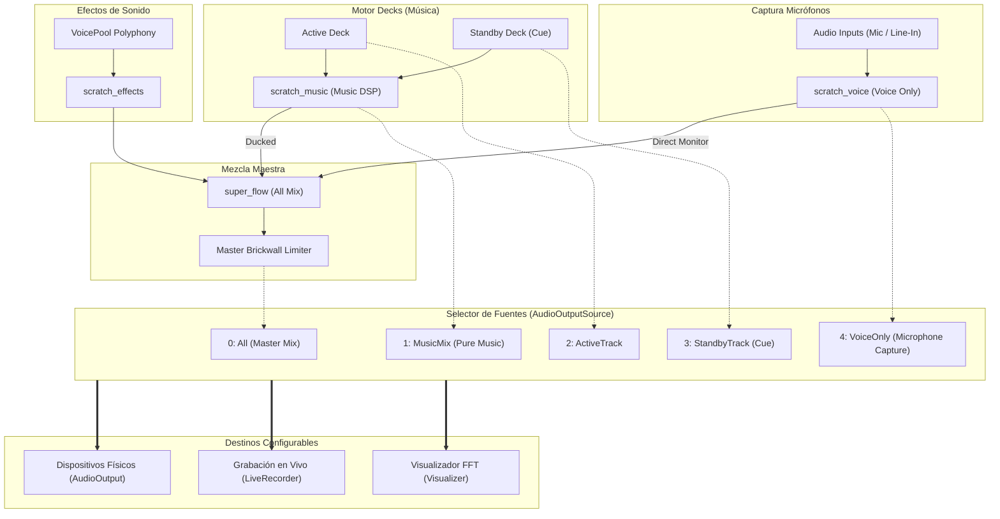

# Visualizer Audio Architecture & Multi-Source Routing Specification

Este documento explica en detalle cómo se alimenta actualmente el analizador espectral y visualizador FFT en `miniaudio_player`, las limitaciones de la arquitectura previa, y la propuesta de diseño exhaustiva para hacer que el visualizer sea configurable entre diferentes fuentes de audio, incorporando además la nueva fuente **`VoiceOnly`** (captura aislada de micrófonos) aplicable tanto para salidas físicas (`AudioOutput`), grabación en vivo (`startRecording`), como para el visualizador (`Visualizer`).

---

## 1. ¿De qué audio se alimenta actualmente el Visualizer?

### 1.1 Estado Actual en el Motor Nativo (Rust)
Actualmente, el visualizador se alimenta **exclusiva y fijamente** del búfer maestro **"All Mix"** (`all_buffer` / `super_flow`).

En [`rust/src/core/output_manager.rs`](file:///mnt/Proyectos/miniaudio_player/rust/src/core/output_manager.rs#L538-L546):
```rust
// 3. Compute FFT Spectrum for visualizer
if self.visualizer_enabled.load(Ordering::Relaxed) {
    let valid = all_buffer.len().min(sample_count);
    self.visualizer.set_enabled(true);
    self.visualizer.process_frames(&all_buffer[..valid]);
    let vis_data = self.visualizer.get_data();
    self.visualizer_seqlock.write(|d| *d = vis_data);
}
```

### 1.2 ¿Qué contiene exactamente `all_buffer` ("All Mix")?
En [`rust/src/core/miniaudio_player.rs:render_pcm`](file:///mnt/Proyectos/miniaudio_player/rust/src/core/miniaudio_player.rs#L170-L245), el flujo de mezcla sigue este orden secuencial estricto:

```
[Deck A / Deck B] -> scratch_music (Music DSP: EQ, Reverb, ReplayGain, SilenceSkip)
                             |
                             v
                    super_flow ("All Mix")
                             |
                             +-- <Auto-Ducking> (atenuación por voz del micrófono)
                             +-- <SFX Voices> (Bypass, Isolate DSP, Inherit DSP)
                             +-- <Microphone Voice> (Monitoreo directo si monitorDirect=true)
                             +-- <Master Limiter> (True-Peak Brickwall Limiter)
                             |
                             v
                        all_buffer (Alimentación actual del Visualizer)
```

Por lo tanto:
1. **No es configurable**: No permite aislar la música de los efectos de sonido ni de la voz del micrófono.
2. **Contaminación acústica**: Si se reproduce un efecto de sonido explosivo o entra el micrófono con monitoreo, el espectro visualiza todo combinado con la música.
3. **Dependencia de reproducción musical**: En [`rust/src/api/player.rs`](file:///mnt/Proyectos/miniaudio_player/rust/src/api/player.rs#L832-L843), el hilo de telemetría limpia el visualizador a cero (`VisualizerData::default()`) si el estado de transporte de la música no es `Playing`, impidiendo utilizar el visualizador como un vúmetro en vivo de micrófono cuando la música está pausada o detenida.

---

## 2. Propuesta Arquitectónica: Visualizer Multifuente y Fuente `VoiceOnly`

### 2.1 Catálogo Unificado de Fuentes de Audio (`AudioOutputSource`)
Actualmente existen 4 fuentes para salidas físicas y grabación:
- `all` (0): Mezcla maestra completa.
- `musicMix` (1): Música pura con su cadena DSP, sin efectos de sonido ni ducking.
- `activeTrack` (2): Deck activo individual antes del crossfader.
- `standbyTrack` (3): Deck en espera antes del crossfader (DJ Cue pre-escucha).

Se incorpora una 5ta fuente canónica:
- **`voiceOnly` (4)**: Señal limpia y aislada de los micrófonos / entradas de captura activas (`scratch_voice`), con sus ganancias aplicadas pero **sin música, sin ducking y sin efectos**.



---

## 3. Beneficios y Casos de Uso de la Arquitectura Propuesta

### 3.1 Para el Visualizador (`Visualizer`)
1. **Modo Espectro Musical Clásico (`visualizerSource = AudioOutputSource.musicMix`)**:
   - Muestra las frecuencias exactas de la canción que suena.
   - Si se lanzan 10 efectos de sonido o el locutor habla por el micrófono, el visualizador en pantalla sigue reflejando limpiamente la música sin saltos bruscos provocados por SFX o voz.
2. **Modo Medidor de Voz / Vúmetro de Micrófono (`visualizerSource = AudioOutputSource.voiceOnly`)**:
   - Transforma el visualizador en un analizador de voz en tiempo real o un indicador reactivo de habla.
   - Funciona incluso con la música pausada o detenida.
3. **Modo DJ Cue Pre-escucha (`visualizerSource = AudioOutputSource.standbyTrack`)**:
   - Permite al DJ ver la energía y espectro de la canción que está a punto de mezclar en auriculares antes de subir el fader al público.
4. **Modo Completo (`visualizerSource = AudioOutputSource.all`)**:
   - Comportamiento por defecto: visualiza exactamente lo que sale por los altavoces maestros.

### 3.2 Para Salidas Físicas (`AudioOutput`)
- Un dispositivo de salida puede configurarse con `AudioOutputSource.voiceOnly`:
  - **Ejemplo**: Enviar la voz de los micrófonos a un procesador externo de hardware o a una cabina de streaming sin retroalimentación de música.
  - Enviar solo música a los altavoces de la sala y la voz a una mesa de mezclas independiente.

### 3.3 Para Grabación en Disco (`startRecording`)
- Grabar en una pista WAV aislada únicamente la voz del locutor/invitados con `AudioOutputSource.voiceOnly`:
  - **Stems de Podcast**: Grabar la voz limpia en un archivo separado para posproducción, mientras la música suena en vivo por los altavoces.

---

## 4. Diseño Técnico de Implementación (Rust y Dart)

### 4.1 Capa Nativa en Rust

#### 4.1.1 Actualización del Enum `AudioOutputSource`
En `rust/src/api/types.rs`:
```rust
#[derive(Debug, Clone, Copy, PartialEq, Eq)]
pub enum AudioOutputSource {
    All = 0,
    MusicMix = 1,
    ActiveTrack = 2,
    StandbyTrack = 3,
    VoiceOnly = 4, // <-- NUEVO
}

impl From<i32> for AudioOutputSource {
    fn from(v: i32) -> Self {
        match v {
            1 => AudioOutputSource::MusicMix,
            2 => AudioOutputSource::ActiveTrack,
            3 => AudioOutputSource::StandbyTrack,
            4 => AudioOutputSource::VoiceOnly, // <-- NUEVO
            _ => AudioOutputSource::All,
        }
    }
}
```

#### 4.1.2 Enrutamiento en `OutputManager`
En `rust/src/core/output_manager.rs`:
1. Agregar campo atómico `pub visualizer_source: Arc<AtomicU8>` en `OutputManager`.
2. Actualizar el método `dispatch`:
```rust
pub fn dispatch(
    &mut self,
    all_buffer: &[f32],
    music_mix_buffer: &[f32],
    active_buffer: &[f32],
    standby_buffer: &[f32],
    voice_buffer: &[f32], // <-- NUEVO parámetro
    frame_count: usize,
) {
    let sample_count = frame_count * self.channels;

    let select_source = |src: AudioOutputSource| -> &[f32] {
        match src {
            AudioOutputSource::All => all_buffer,
            AudioOutputSource::MusicMix => music_mix_buffer,
            AudioOutputSource::ActiveTrack => active_buffer,
            AudioOutputSource::StandbyTrack => standby_buffer,
            AudioOutputSource::VoiceOnly => voice_buffer, // <-- NUEVO
        }
    };

    // 1. Enrutamiento a salidas físicas activas
    for dev in &mut self.active_devices {
        let src_slice = select_source(dev.source);
        // ... (escritura lock-free a la cola SPSC)
    }

    // 2. Grabación selectiva en vivo
    if self.is_recording.load(Ordering::Relaxed) {
        if let Some(ref mut prod) = self.record_producer {
            let rec_slice = select_source(self.recording_source);
            // ... (escritura lock-free a la cola SPSC)
        }
    }

    // 3. Alimentación del Visualizador según la fuente configurada
    if self.visualizer_enabled.load(Ordering::Relaxed) {
        let current_source = AudioOutputSource::from(
            self.visualizer_source.load(Ordering::Relaxed) as i32
        );
        let vis_slice = select_source(current_source);
        let valid = vis_slice.len().min(sample_count);
        self.visualizer.set_enabled(true);
        self.visualizer.process_frames(&vis_slice[..valid]);
        let vis_data = self.visualizer.get_data();
        self.visualizer_seqlock.write(|d| *d = vis_data);
    }
}
```

#### 4.1.3 Llamada desde `MiniaudioPlayer::render_pcm`
En `rust/src/core/miniaudio_player.rs`:
```rust
// 10. Symmetrical Output Dispatch to all active sinks:
self.output_manager.dispatch(
    &self.super_flow[..sample_count],
    &self.scratch_music[..sample_count],
    self.music_manager.active_deck_buffer(),
    self.music_manager.standby_buffer(),
    &self.scratch_voice[..sample_count], // <-- Se pasa scratch_voice como VoiceOnly
    frame_count,
);
```

#### 4.1.4 Soporte en el Worker de Telemetría
En `rust/src/api/player.rs`:
```rust
let vis_source = AudioOutputSource::from(
    ply.output_manager.visualizer_source.load(Ordering::Relaxed) as i32
);

// Si la fuente es VoiceOnly, consideramos audio activo si hay entradas de micrófono activas
let has_voice_input = ply.input_manager.active_inputs_count() > 0;
let is_active_audio = match vis_source {
    AudioOutputSource::VoiceOnly => has_voice_input,
    _ => (state == STATE_PLAYING && playback_state == PlaybackState::Playing)
        || is_rec
        || active_voices > 0,
};

let vis_data = if ply.output_manager.visualizer_enabled.load(Ordering::Relaxed) {
    if is_active_audio {
        Some(ply.output_manager.visualizer_seqlock.read())
    } else {
        Some(crate::dsp::visualizer::VisualizerData::default())
    }
} else {
    None
};
```

---

### 4.2 Capa Dart / Flutter

#### 4.2.1 Actualización de `AudioOutputSource` en `player_models.dart`
```dart
/// Audio signal source routed to an output device, live recording session, or visualizer.
enum AudioOutputSource {
  /// Complete master mix (music + SFX voices + microphone + ducking + master limiter).
  all(0),

  /// Pure music mix from decks with music DSP (EQ, Reverb), excluding SFX and microphone.
  musicMix(1),

  /// Isolated active deck track only.
  activeTrack(2),

  /// Isolated standby deck track only (ideal for DJ pre-listening).
  standbyTrack(3),

  /// Isolated microphone capture voice signal only, excluding music and sound effects.
  voiceOnly(4);

  final int value;
  const AudioOutputSource(this.value);

  static AudioOutputSource fromValue(int val) {
    switch (val) {
      case 1:
        return AudioOutputSource.musicMix;
      case 2:
        return AudioOutputSource.activeTrack;
      case 3:
        return AudioOutputSource.standbyTrack;
      case 4:
        return AudioOutputSource.voiceOnly;
      case 0:
      default:
        return AudioOutputSource.all;
    }
  }
}
```

#### 4.2.2 Configuración Inicial en `PlayerConfig`
```dart
class PlayerConfig {
  // ...
  /// The audio signal source that feeds the real-time FFT spectrum visualizer.
  ///
  /// Defaults to [AudioOutputSource.all].
  final AudioOutputSource visualizerSource;

  const PlayerConfig({
    // ...
    this.visualizerSource = AudioOutputSource.all,
  });
}
```

#### 4.2.3 Acción en Tiempo Real en `PlayerAction`
```dart
/// Configures which audio bus feeds the real-time FFT spectrum visualizer.
Future<void> setVisualizerSource(AudioOutputSource source) async {
  _player._ensureNotDisposed();
  _player.state._visualizerSource = source;
  await _rust.setVisualizerSource(source: source.value);
}
```

#### 4.2.4 Estado Reactivo en `PlayerState` y `PlayerStream`
- En `PlayerState`:
  ```dart
  AudioOutputSource _visualizerSource = AudioOutputSource.all;

  /// The audio bus stream currently feeding the real-time FFT spectrum visualizer.
  AudioOutputSource get visualizerSource => _visualizerSource;
  ```
- En `PlayerStream`:
  ```dart
  /// Reactive broadcast stream emitting updates whenever the visualizer audio source changes.
  Stream<AudioOutputSource> get visualizerSource => _visualizerSourceController.stream;
  ```

---

## 5. Garantías de Rendimiento y Arquitectura (Triple-Zero Guarantee)

1. **Zero Allocations (Cero Asignaciones de Memoria en el Hilo de Audio)**:
   - `scratch_voice` ya existe y está pre-dimensionado en `MiniaudioPlayer`.
   - `select_source` es un cierre inline que devuelve una rodaja prestada (`&[f32]`).
   - El cambio de fuente del visualizador se realiza mediante un `AtomicU8` con orden `Relaxed`/`Acquire`.
2. **Zero Mutexes / Zero Locks**:
   - `visualizer_seqlock` utiliza un Seqlock atómico alineado en caché (`CachePaddedSeqlock`).
   - El enrutamiento a dispositivos físicos y grabador en vivo se realiza mediante buffers circulares SPSC libres de bloqueos (`rtrb`).
3. **Zero Syscalls**:
   - La selección de fuente ocurre puramente en memoria compartida en espacio de usuario.

---

## 6. Plan de Pruebas y Validación

1. **Pruebas Unitarias en Rust (`test/rust/dsp_and_spatial_test.rs`)**:
   - Verificar que al configurar `visualizer_source = AudioOutputSource::MusicMix`, el visualizador recibe ceros cuando solo se reproducen efectos de sonido o voz.
   - Verificar que al configurar `visualizer_source = AudioOutputSource::VoiceOnly`, el visualizador solo reacciona ante datos en `scratch_voice` e ignora completamente la música.
   - Verificar que `AudioOutput` y `startRecording` con `AudioOutputSource::VoiceOnly` escriben exclusivamente muestras de voz sin audio de música.
2. **Pruebas de Integración en Dart (`test/`)**:
   - Verificar `player.action.setVisualizerSource(...)` actualiza `player.state.visualizerSource` y emite por `player.stream.visualizerSource`.
   - Verificar que `PlayerConfig(visualizerSource: AudioOutputSource.voiceOnly)` inicializa el reproductor en dicho modo.
   - Probar que `dart analyze` se mantiene en 0 advertencias y 100% de tests verdes (`flutter test`).

---

## 7. Arquitectura Universal Guiada por Señal (Signal-Driven Telemetry)

### 7.1 El Problema de las Banderas de Estado Booleanas (`is_active_audio`)
En versiones anteriores, el hilo de telemetría intentaba conjeturar si existía audio activo en el motor mediante una combinación heurística de banderas booleanas:
```rust
// ANTIGUO Y FRÁGIL:
let is_active_audio = match vis_source {
    AudioOutputSource::VoiceOnly => ply.input_manager.has_active_inputs(),
    AudioOutputSource::All => {
        (state == STATE_PLAYING && playback_state == PlaybackState::Playing)
            || is_rec
            || active_voices > 0
            || ply.input_manager.has_active_direct_monitoring()
    }
    _ => (state == STATE_PLAYING && playback_state == PlaybackState::Playing),
};
```

Esta estrategia de "adivinar por banderas" causaba fallos críticos en múltiples escenarios reales:
1. **Colas de Reverb en Efectos de Sonido**: Al reproducir un efecto con Reverb (`DspRouting::Inherit`), la voz en RAM dura por ejemplo 0.3 segundos. Al terminar la muestra, `active_voices` caía inmediatamente a 0, haciendo que `is_active_audio` evaluara a `false`. Esto **cortaba instantáneamente el visualizador a ceros**, a pesar de que los filtros de peine del Reverb seguían generando sonido activo por 2 a 3 segundos en los altavoces (`super_flow`). Solo se mantenía visible si una canción estaba sonando de fondo.
2. **Colas de Reverb al Pausar Música**: Al pausar una canción con Reverb activado, `playback_state` pasaba a `Paused`, cortando abruptamente la visualización de la cola acústica de la canción.
3. **Monitoreo Directo de Micrófonos**: Al hablar por el micrófono sin canción sonando, `playback_state` no era `Playing`, silenciando las barras en All Mix.
4. **Nuevos Efectos / Sintetizadores / Delays Futuros**: Cualquier nuevo procesador DSP con cola temporal o enrutamiento requería añadir parches y más condiciones `if/else`, violando la extensibilidad del sistema.

### 7.2 Solución Universal: La Señal de Audio es la Única Fuente de Verdad

En lugar de evaluar variables de estado del transporte o de las voces, la telemetría lee directamente los datos calculados por el visualizador desde su Seqlock en tiempo real (`output_manager.visualizer_seqlock`):

```rust
// ARQUITECTURA LIMPIA Y UNIVERSAL:
let vis_data = if ply.output_manager.visualizer_enabled.load(Ordering::Relaxed) {
    Some(ply.output_manager.visualizer_seqlock.read())
} else {
    None
};
```

#### 7.2.1 Clamping y Umbral de Ruido Acústico (`1e-4` / `-80 dBFS`)
Para garantizar que el visualizador caiga a `0.0` exacto en silencio y no quede oscilando por denormales o ruido de punto flotante de filtros IIR:
1. En `Visualizer::process_frames`:
   - Las bandas de frecuencia decaen suavemente con su envolvente de caída (`decay`). Si el valor decae por debajo de `1e-4`, se trunca exactamente a `0.0`.
   - Si `rms < 1e-4`, `peak < 1e-4`, `left < 1e-4` o `right < 1e-4`, se redondean a `0.0`.
   - Cuando todas las bandas y el RMS alcanzan `0.0`, el método `candidate.is_silent()` limpia los registros internos de los filtros Biquad (`self.reset()`), dejando el estado en `VisualizerData::default()`.

#### 7.2.2 Deduplicación Transparente y Cero Sobrecarga en Reposo
En el emisor de eventos (`EventReporter::emit`):
- Los eventos de `RustPlayerEvent::Visualizer` se comparan contra el valor anterior con un epsilon de `0.0005`.
- Al entrar en silencio, se emite **un único frame de ceros** para que la interfaz Flutter actualice las barras a cero.
- En todos los ticks subsecuentes de silencio, el deduplicador descarta el evento idéntico. Se consumen **0 eventos IPC**, **0 repintados en Flutter** y **0% de CPU/batería innecesaria**.
- En cuanto cualquier fuente genera sonido (música, efectos, colas de reverb, micrófono en monitoreo directo o voz pura), la energía supera `1e-4`, los datos varían frame a frame y el flujo de telemetría a 60 fps se reanuda de inmediato de forma 100% natural.
